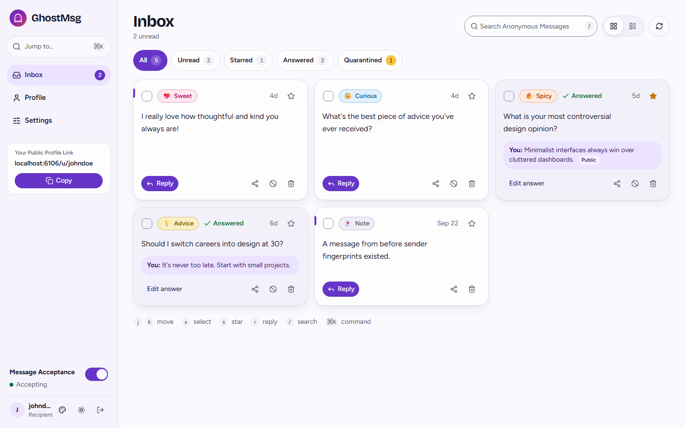
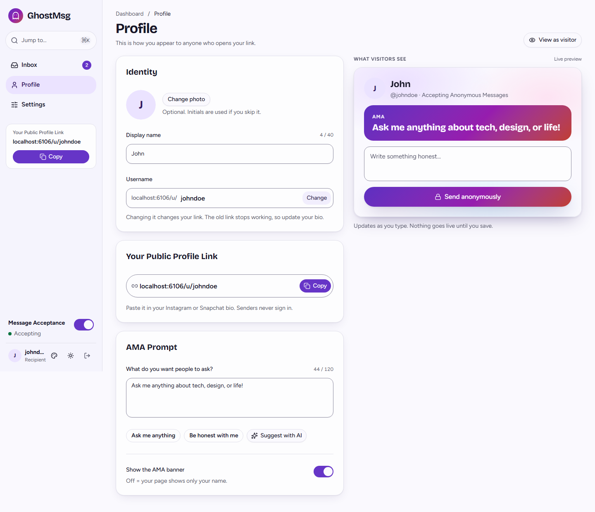
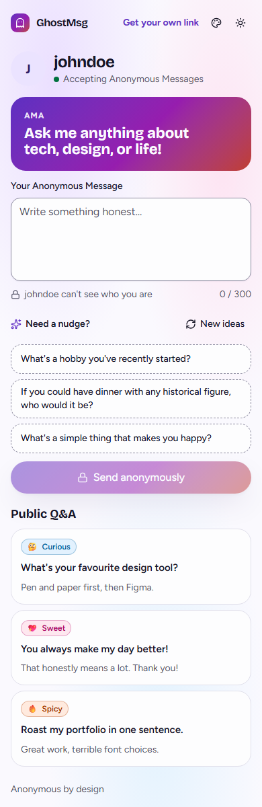
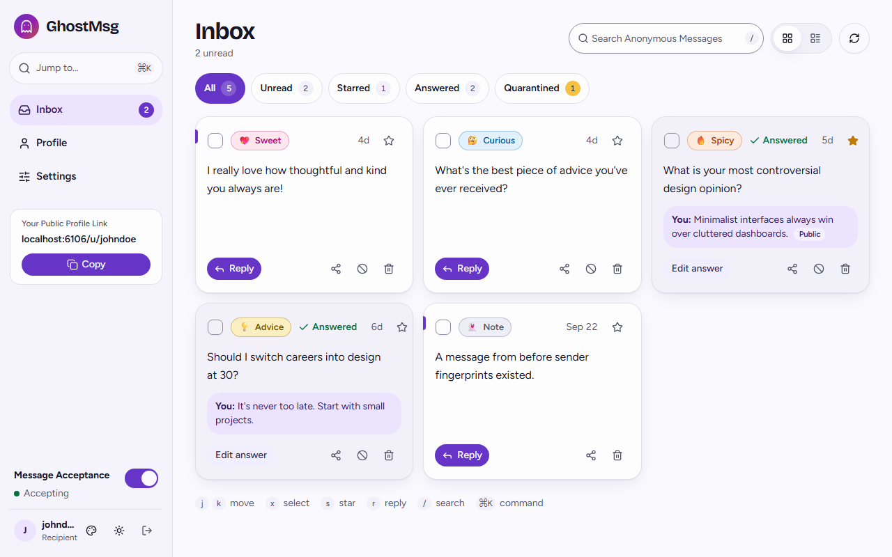
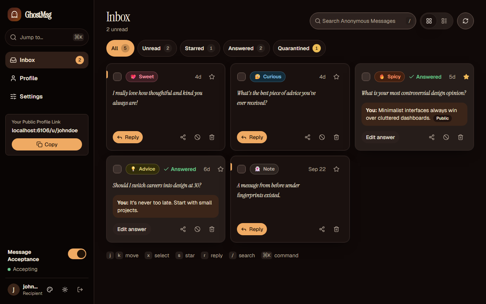
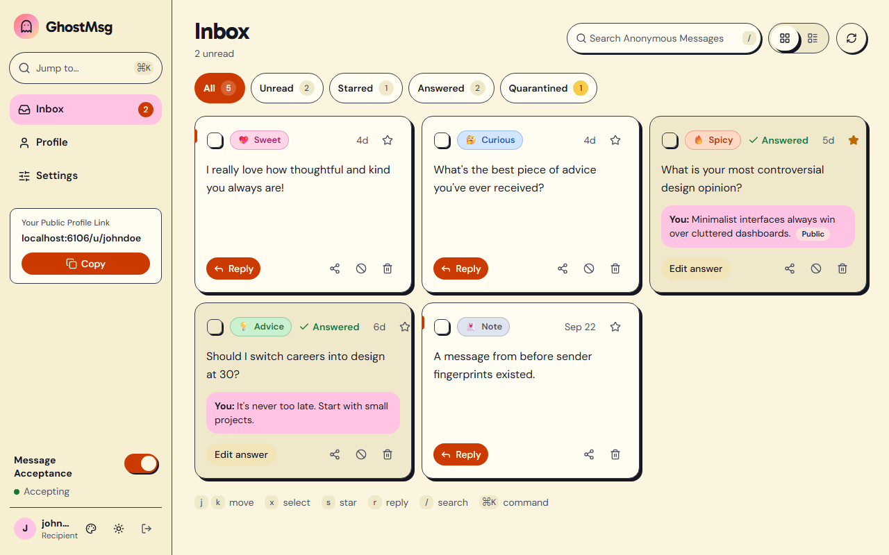

# GhostMsg 👻

[](https://nextjs.org/)
[](https://react.dev/)
[](https://www.typescriptlang.org/)
[](https://tailwindcss.com/)
[](https://www.mongodb.com/)
[](https://aistudio.google.com/)
[](https://biomejs.dev/)

GhostMsg is a modern, privacy-first anonymous messaging platform built with Next.js 15 App Router, React 19, and Tailwind CSS v4. Share your unique public profile link and receive honest thoughts, questions, and confessions from friends, followers, or colleagues without disclosing sender identities.

---

## ✨ Key Features

- 👤 **Unique Public Profile Links**: Custom shareable URLs (`/u/[username]`) for instant anonymous messaging.
- 🤖 **AI Prompt Suggestions**: Real-time message ideas powered by Google AI Studio (`gemini-2.5-flash-lite`) running on Next.js Edge Runtime.
- 🔐 **Dual Authentication**: Secure sign-in via Email/Password (bcrypt-hashed + 6-digit OTP verification) and one-click Google OAuth 2.0.
- 📬 **Recipient Dashboard**: Sidebar shell with Inbox, Profile and Settings routes, ⌘K command palette, live SSE updates, filter chips, search, grid/list layouts, keyboard triage (`j k x s r /`), bulk actions and CSV/JSON export.
- 💬 **Answers that travel**: AI Smart Reply drafts in three tones, opt-in Public Q&A, and Story Card images (9:16 or 1:1) with native share.
- 🪪 **Profile page**: Display name, photo, username change, share card, AMA Prompt with AI ideas and a banner switch, and a live "what visitors see" preview with an unsaved-changes bar.
- 🛡️ **Recipient-controlled safety**: Graded AI moderation with Relaxed/Balanced/Strict quarantine, Spicy blur, silent per-recipient Sender Hash blocking with dates, rate limiting.
- 🔔 **Private notifications**: Instant email or a once-a-day digest, Web Push, hidden message text by default, and quiet hours in your time zone.
- 🧨 **Safe destructive actions**: Delete all messages with a 10-second undo; delete account with typed confirmation.
- 🎛️ **Message Acceptance Toggle**: Instantly switch message reception on or off at any time.
- 📜 **Interactive Scalar Documentation**: OpenAPI 3.1 interactive API playground and reference hosted at `/docs` and `/api/docs`.
- ⚡ **End-to-End Type Safety**: `openapi-fetch` SDK and `@tanstack/react-query` replacing Axios with compile-time checked routes, auto-invalidation, and native `AbortSignal`.
- 📧 **Transactional Verification Emails**: Clean, responsive HTML emails delivered via Nodemailer & SMTP with React Email templates.
- 🧪 **Story-Driven Testing**: Storybook 10 stories double as component tests (Vitest browser mode, Chromium, `play()` interactions, axe a11y). A happy-dom unit project covers logic and controllers. Everything is network-isolated with MSW.
- 🧱 **Four-Tier Component Architecture**: `elements → patterns → blocks → pages`. Business logic lives only in page controllers, and Biome enforces the boundaries.
- 🎨 **Modern Animated UI**: Rich aesthetic built with Tailwind CSS v4, Motion, Lucide icons, and Sonner toast notifications.
- 🌓 **Three Palettes × Light/Dark**: Soft spectral, Midnight confessional and Playful paper, each with its own colours, fonts, radius and shadows, switchable from the header and AA-checked by `pnpm theme:contrast`.
- ⚡ **Strict Code Standards**: Zero-config formatting and type safety enforced by Ultracite (Biome).

---

## 🛠️ Tech Stack

| Layer | Technology |
| :--- | :--- |
| **Framework** | [Next.js 15](https://nextjs.org/) (App Router, Turbopack, Edge Runtime) |
| **Frontend Library** | [React 19](https://react.dev/) |
| **Styling & UI** | [Tailwind CSS v4](https://tailwindcss.com/), [shadcn/ui](https://ui.shadcn.com/) (Radix base) with GhostMsg CVA variants, [cmdk](https://cmdk.paco.me/), [Motion](https://motion.dev/), [Embla Carousel](https://www.embla-carousel.com/) |
| **API Client & State** | [openapi-fetch](https://openapi-ts.dev/openapi-fetch/) + [@tanstack/react-query](https://tanstack.com/query) |
| **API Documentation** | [Scalar](https://scalar.com/) ([@scalar/nextjs-api-reference](https://github.com/scalar/scalar)) + OpenAPI 3.1 |
| **State & Forms** | [React Hook Form](https://react-hook-form.com/) + [Zod v4](https://zod.dev/) + [@asteasolutions/zod-to-openapi](https://github.com/asteasolutions/zod-to-openapi) |
| **Database & ODM** | [MongoDB](https://www.mongodb.com/) with [Mongoose](https://mongoosejs.com/) |
| **Authentication** | [NextAuth.js v4](https://next-auth.js.org/) (Credentials & Google Providers) |
| **AI Integration** | [Vercel AI SDK](https://sdk.vercel.ai/) (`@ai-sdk/google`) + Google Gemini 2.5 Flash Lite |
| **Email Service** | [Nodemailer](https://nodemailer.com/) (SMTP) + [@react-email/components](https://react.email/) |
| **Testing Suite** | [Vitest 5](https://vitest.dev/) (unit: happy-dom + Testing Library; stories: browser mode via Playwright Chromium) + [MSW 2](https://mswjs.io/) |
| **Component Catalog** | [Storybook 10](https://storybook.js.org/) (`@storybook/nextjs-vite`, addon-docs, addon-a11y, addon-vitest) + `msw-storybook-addon` |
| **Package Manager** | [pnpm 10](https://pnpm.io/) (single lockfile, pinned via `packageManager`) |
| **Linter & Formatter** | [Ultracite](https://github.com/ultracite/ultracite) (Biome) |

---

## 📁 Project Structure

```
GhostMsg/
├── .agents/                    # Agent skills & workflows
├── .storybook/                 # Storybook 10 config (main.ts, preview.tsx, preview-head.html)
├── docs/                       # 19-chapter engineering documentation suite + ADRs + agent guides
│   ├── 01-overview.md          # Chapter 1: Vision, philosophy, & domain language
│   ├── 02-getting-started.md   # Chapter 2: Local setup, environment, & Turbopack
│   ├── 03-system-architecture.md# Chapter 3: Topology, NextAuth, & data modeling
│   ├── 04-api-and-type-safety.md# Chapter 4: OpenAPI 3.1, Scalar docs, & openapi-fetch
│   ├── 05-component-architecture.md# Chapter 5: Four-tier component architecture & design tokens
│   ├── 06-dev-workflow.md      # Chapter 6: Development lifecycle & Changesets
│   ├── 07-testing-strategy.md  # Chapter 7: Unit + story Vitest projects, MSW isolation
│   ├── 08-code-quality.md      # Chapter 8: Ultracite (Biome) & TypeScript standards
│   ├── 09-deployment-and-operations.md# Chapter 9: Vercel & MongoDB operations
│   ├── 10-storybook-and-ui-catalog.md# Chapter 10: Storybook, story standard, MSW, fixtures
│   ├── 11-component-registry.md# Chapter 11: Generated component/story/mock/scenario inventory
│   ├── 12-product-guide-and-features.md   # Chapter 12: Personas, routes, journeys, feature catalog
│   ├── 13-design-system-and-theming.md    # Chapter 13: Palettes, tokens, variants, contrast
│   ├── 14-ui-screens-and-user-flows.md    # Chapter 14: Every screen with screenshots + composition
│   ├── 15-data-model-and-database.md      # Chapter 15: ER diagram, fields, indexes, lifecycle
│   ├── 16-api-reference.md                # Chapter 16: Every endpoint, client data-layer map
│   ├── 17-trust-safety-and-privacy.md     # Chapter 17: Anonymity, moderation, blocking, issue log
│   ├── 18-notifications-and-realtime.md   # Chapter 18: SSE, email, Web Push, quiet hours
│   ├── 19-redesign-change-summary.md      # Chapter 19: What the October 2026 redesign changed
│   ├── agents/                 # Agent guides (start at agents/README.md)
│   ├── assets/screenshots/     # Generated by pnpm docs:screenshots
│   ├── adr/                    # Architecture Decision Records (ADRs)
│   ├── agents/                 # Agent integration & coding guardrails
│   └── README.md               # Master documentation table of contents
├── emails/                     # React Email verification templates
├── public/                     # Static media & assets (incl. MSW mockServiceWorker.js)
├── scripts/                    # Generators: OpenAPI types, component registry
├── src/
│   ├── app/                    # Next.js App Router
│   │   ├── (app)/              # Site-header layout group
│   │   │   └── (auth)/         # /sign-in, /sign-up, /verify
│   │   ├── (dashboard)/        # /dashboard, /dashboard/profile, /dashboard/settings (sidebar shell)
│   │   ├── api/                # REST API endpoints & OpenAPI JSON
│   │   ├── docs/               # Interactive Scalar documentation route
│   │   ├── u/[username]/       # Public profile anonymous messaging page
│   │   ├── layout.tsx          # Root layout & providers
│   │   └── page.tsx            # Hero landing page
│   ├── components/
│   │   ├── elements/           # Tier 1: primitives (incl. former shadcn ui + animate-ui)
│   │   ├── patterns/           # Tier 2: pure domain compositions (cards, forms, modals)
│   │   ├── blocks/             # Tier 3: pure page sections
│   │   └── pages/              # Tier 4: route components + controllers (all business logic)
│   ├── content/                # Static app content (landing example copy)
│   ├── data/                   # Client data layer: api-client, query-keys, <domain>/{queries, use-*-mutation, live/push hooks}
│   ├── generated/              # Auto-generated TypeScript API types
│   ├── hooks/                  # Generic React hooks only (get-strict-context, …)
│   ├── lib/                    # Pure, framework-free helpers by domain (utils, messages/export, browser/download)
│   ├── mock/                   # fixtures/ (domain builders), handlers/ (MSW scenarios), noop.ts
│   ├── providers/              # Context providers (Auth, Query, Theme)
│   ├── schemas/                # Universal Zod schemas + OpenAPI metadata (zod.ts)
│   ├── server/                 # server-only: db/, models/, email/, ai/, push/, security/, realtime/, openapi/
│   ├── test/                   # Unit setup (msw/node server, polyfills), render + renderHook utilities
│   └── types/                  # API DTOs (api.ts, from OpenAPI) & ambient declarations
├── AGENTS.md                   # Agent system guidelines
├── GLOSSARY.md                 # Domain model glossary
└── package.json
```

---

## 🚀 Getting Started

### Prerequisites

- **Node.js** 22.19+ and **pnpm** 10
- **MongoDB** cluster URL (e.g. MongoDB Atlas)
- **SMTP Account** credentials for transactional email dispatch via Nodemailer
- **Google AI Studio** API key for Gemini suggestions

### 1. Clone & Install Dependencies

```bash
git clone https://github.com/Abbas4tech/GhostMsg.git
cd GhostMsg
pnpm install
pnpm exec playwright install chromium   # one-time, for story tests
```

### 2. Configure Environment Variables

Create a `.env.local` file in the root directory:

```env
# Database
MONGODB_URI=your_mongodb_connection_string

# NextAuth
NEXT_AUTH_SECRET=your_nextauth_secret_key
NEXTAUTH_URL=http://localhost:3000

# Transactional Email (Nodemailer SMTP)
SMTP_HOST=smtp.mailtrap.io
SMTP_PORT=587
SMTP_USER=your_smtp_username
SMTP_PASS=your_smtp_password

# Google AI Studio (Gemini)
GOOGLE_AI_STUDIO_SECRET=your_google_ai_studio_api_key

# Google OAuth (Optional)
GOOGLE_OAUTH_CLIENT_ID=your_google_client_id
GOOGLE_OAUTH_CLIENT_SECRET=your_google_client_secret
GOOGLE_OAUTH_CALLBACK_URL=http://localhost:3000/api/auth/callback/google

# Web Push / VAPID (optional; npx web-push generate-vapid-keys)
NEXT_PUBLIC_VAPID_PUBLIC_KEY=your_vapid_public_key
VAPID_PRIVATE_KEY=your_vapid_private_key

# Sender Hash pepper (recommended; falls back to NEXT_AUTH_SECRET)
SENDER_PEPPER_SECRET=another_random_secret

# Daily digest cron (optional; unset = digests off)
CRON_SECRET=a_long_random_secret
```

### 3. Run Development Server

```bash
# 1. Generate TypeScript API types from OpenAPI spec
pnpm typegen

# 2. Start development server with Turbopack
pnpm dev
```

Open [http://localhost:3000](http://localhost:3000) to view the application in your browser.

---

## 📜 Available Scripts

| Script | Command | Description |
| :--- | :--- | :--- |
| `dev` | `pnpm dev` | Runs the Next.js dev server with Turbopack |
| `typegen` | `pnpm typegen` | Generates TypeScript definitions from OpenAPI 3.1 contracts |
| `build` | `pnpm build` | Automatically generates API types and builds production bundle |
| `start` | `pnpm start` | Runs the built production server |
| `test` | `pnpm test` | Vitest **unit** project (logic, controllers, page integration) |
| `test:watch` | `pnpm test:watch` | Unit project in watch mode |
| `test:coverage` | `pnpm test:coverage` | Unit project with V8 coverage |
| `test:stories` | `pnpm test:stories` | Vitest **storybook** project: every story in Chromium with `play()` + axe |
| `test:all` | `pnpm test:all` | Both projects (pre-push gate) |
| `storybook` | `pnpm storybook` | Storybook dev server at `http://localhost:6006` |
| `build-storybook` | `pnpm build-storybook` | Static Storybook in `storybook-static/` |
| `docs:registry` | `pnpm docs:registry` | Regenerates `docs/11-component-registry.md` (`:check` verifies it) |
| `docs:screenshots` | `pnpm docs:screenshots` | Captures documentation screenshots from `storybook-static/` (run `build-storybook` first) |
| `theme:contrast` | `pnpm theme:contrast` | WCAG AA check of every palette × mode token pair |
| `analyze` | `pnpm analyze` | Bundle analysis build |
| `check` | `pnpm check` | Runs Ultracite (Biome) lint + format checks, including tier import rules |
| `fix` | `pnpm fix` | Automatically fixes code style and lint issues |

---

## 📖 Documentation Suite

Explore the numbered engineering chapters in [`docs/`](docs/README.md):

- [**Chapter 1: Project Overview**](docs/01-overview.md) – Vision, ubiquitous language, and feature map.
- [**Chapter 2: Getting Started & Local Setup**](docs/02-getting-started.md) – Prerequisites, `.env.local` config, and setup.
- [**Chapter 3: System Architecture**](docs/03-system-architecture.md) – Topology, NextAuth flow, and data modeling.
- [**Chapter 4: API & Type-Safety Architecture**](docs/04-api-and-type-safety.md) – OpenAPI 3.1 registry, Scalar UI (`/docs`), and `openapi-fetch`.
- [**Chapter 5: Component Architecture & UI**](docs/05-component-architecture.md) – Four tiers (elements → patterns → blocks → pages), DAG rules, design tokens.
- [**Chapter 6: Developer Workflow**](docs/06-dev-workflow.md) – Daily commands, pre-commit hooks, and type generation.
- [**Chapter 7: Testing Strategy**](docs/07-testing-strategy.md) – Unit + story Vitest projects, MSW isolation, test inventory.
- [**Chapter 8: Code Quality & Standards**](docs/08-code-quality.md) – Ultracite (Biome) configuration and strict TypeScript rules.
- [**Chapter 9: Deployment & Operations**](docs/09-deployment-and-operations.md) – Vercel deployment, connection pooling, and SMTP configuration.
- [**Chapter 10: Storybook & UI Catalog**](docs/10-storybook-and-ui-catalog.md) – Story standard, providers, MSW page stories, reliability rules, recipes.
- [**Chapter 11: Component Registry**](docs/11-component-registry.md) – Generated inventory of modules, stories, mocks, fixtures and scenarios.
- [**Chapter 12: Product Guide & Feature Catalog**](docs/12-product-guide-and-features.md): personas, routes, journeys, every feature and known gaps.
- [**Chapter 13: Design System & Theming**](docs/13-design-system-and-theming.md): palettes, tokens, contrast gate, shadcn-first variants.
- [**Chapter 14: UI Screens & User Flows**](docs/14-ui-screens-and-user-flows.md): every screen with screenshots, composition and controllers.
- [**Chapter 15: Data Model & Database**](docs/15-data-model-and-database.md): ER diagram, fields, defaults, indexes, lifecycle.
- [**Chapter 16: API Reference**](docs/16-api-reference.md): every endpoint with examples, errors and client hooks.
- [**Chapter 17: Trust, Safety & Privacy**](docs/17-trust-safety-and-privacy.md): anonymity model, moderation, blocking, data rights.
- [**Chapter 18: Notifications & Real-Time Delivery**](docs/18-notifications-and-realtime.md): SSE, email, Web Push, quiet hours.
- [**Chapter 19: Redesign Change Summary**](docs/19-redesign-change-summary.md): what changed in features, UI, API and database.
- [**Agent Guides**](docs/agents/README.md): where AI agents start (product rules, recipes, documentation maintenance).

### Architectural Decision Records (ADRs)
- [`0001-embedded-messages-schema.md`](docs/adr/0001-embedded-messages-schema.md): Storing messages as subdocuments.
- [`0002-dual-authentication-and-email-verification.md`](docs/adr/0002-dual-authentication-and-email-verification.md): Credentials + Google OAuth strategy.
- [`0003-edge-runtime-for-ai-suggestions.md`](docs/adr/0003-edge-runtime-for-ai-suggestions.md): Edge Runtime with Gemini 2.5 Flash Lite.
- [`0004-ultracite-and-biome-tooling.md`](docs/adr/0004-ultracite-and-biome-tooling.md): Fast, strict code formatting via Biome.
- [`0005-type-safe-api-and-scalar-documentation.md`](docs/adr/0005-type-safe-api-and-scalar-documentation.md): OpenAPI 3.1 contracts, Scalar UI, and `openapi-fetch`.
- [`0006-standardized-api-calling-and-react-query-architecture.md`](docs/adr/0006-standardized-api-calling-and-react-query-architecture.md): `openapi-fetch` + `@tanstack/react-query` integration.
- [`0007-dependency-reclassification-and-bundle-optimization.md`](docs/adr/0007-dependency-reclassification-and-bundle-optimization.md): Moving dev tooling to `devDependencies`.
- [`0008-react-optimization-and-bundle-analysis.md`](docs/adr/0008-react-optimization-and-bundle-analysis.md): React 19 compiler & bundle size analysis.
- [`0009-biome-suppression-elimination-and-lint-remediation.md`](docs/adr/0009-biome-suppression-elimination-and-lint-remediation.md): Clean lint enforcement across codebase.
- [`0010-standalone-messages-schema-and-feature-architecture.md`](docs/adr/0010-standalone-messages-schema-and-feature-architecture.md): Standalone message collection and abuse prevention.
- [`0011-openapi-sdk-smtp-mailer-and-sender-unblocking.md`](docs/adr/0011-openapi-sdk-smtp-mailer-and-sender-unblocking.md): OpenAPI SDK enforcement, Nodemailer SMTP mailer, & sender unblocking.
- [`0012-vitest-unit-and-integration-testing-strategy.md`](docs/adr/0012-vitest-unit-and-integration-testing-strategy.md): Vitest unit & component test architecture.
- [`0013-elements-patterns-blocks-composable-architecture.md`](docs/adr/0013-elements-patterns-blocks-composable-architecture.md): Elements ➔ Patterns ➔ Blocks composable architecture & colocated tooling.
- [`0014-architectural-deepening-pure-patterns-hoisted-overlays-and-push-adapter.md`](docs/adr/0014-architectural-deepening-pure-patterns-hoisted-overlays-and-push-adapter.md): Pure patterns, hoisted modals, Web Push adapter, UI-parity restoration.
- [`0015-four-tier-components-pages-layer-and-vendor-consolidation.md`](docs/adr/0015-four-tier-components-pages-layer-and-vendor-consolidation.md): Pages tier, logic only in controllers, vendor UI moved into elements, lint-enforced DAG.
- [`0016-storybook-msw-and-story-driven-component-testing.md`](docs/adr/0016-storybook-msw-and-story-driven-component-testing.md): Storybook 10, MSW, stories as component tests, fixtures, a11y gate, pnpm only.
- [`0017-generated-component-registry-and-docs-freshness-gate.md`](docs/adr/0017-generated-component-registry-and-docs-freshness-gate.md): Generated Chapter 11 registry + `docs:registry:check` pre-push gate.
- [`0018-source-structure-server-data-lib-utils-controllers-tests.md`](docs/adr/0018-source-structure-server-data-lib-utils-controllers-tests.md): `src/server` (server-only), `src/data`, pure `src/lib`, colocated utils and tests.
- [`0019-controller-test-harness-renderhook-msw-and-edge-mocking.md`](docs/adr/0019-controller-test-harness-renderhook-msw-and-edge-mocking.md): `renderHookWithProviders`, `recordRequests`, edge-only mocking.
- [`0020-web-push-delivery-vapid-and-subscription-lifecycle.md`](docs/adr/0020-web-push-delivery-vapid-and-subscription-lifecycle.md): VAPID keys, `web-push` sender, per-device subscriptions, gone-pruning.
- [`0021-optimistic-inbox-mutations-close-first-and-shared-cache-helpers.md`](docs/adr/0021-optimistic-inbox-mutations-close-first-and-shared-cache-helpers.md): Close-first dialogs, optimistic delete + bulk with rollback.
- [`0022-palette-theming-and-claude-design-redesign.md`](docs/adr/0022-palette-theming-and-claude-design-redesign.md): Three palettes × light/dark, contrast gate, Claude Design layouts.
- [`0023-shadcn-first-elements-and-profile-settings-backend.md`](docs/adr/0023-shadcn-first-elements-and-profile-settings-backend.md): shadcn components app-wide with opt-in design variants; Profile & Settings APIs.
- [`0024-profile-preferences-data-model-and-settings-api.md`](docs/adr/0024-profile-preferences-data-model-and-settings-api.md): Embedded settings, one endpoint per section, dot-path writes, read-side defaults, avatar data URLs.
- [`0025-graded-toxicity-and-recipient-controlled-quarantine.md`](docs/adr/0025-graded-toxicity-and-recipient-controlled-quarantine.md): Graded toxicity, Relaxed/Balanced/Strict thresholds, fail-open moderation.
- [`0026-notification-delivery-policy-quiet-hours-and-hidden-previews.md`](docs/adr/0026-notification-delivery-policy-quiet-hours-and-hidden-previews.md): Quiet hours in IANA zones, hidden previews by default.
- [`0027-destructive-account-actions-undo-window-and-typed-confirmation.md`](docs/adr/0027-destructive-account-actions-undo-window-and-typed-confirmation.md): 10-second undo, typed confirmation, no username redirects.
- [`0028-agent-first-documentation-system-and-generated-screenshots.md`](docs/adr/0028-agent-first-documentation-system-and-generated-screenshots.md): Chapter structure for agents, generated screenshots, Mermaid diagrams.
- [`0029-daily-digest-scheduling-and-alert-privacy-fixes.md`](docs/adr/0029-daily-digest-scheduling-and-alert-privacy-fixes.md): Vercel Cron daily digest, allow-listed exports, safe live toast, hidden-text emails.

---

## 📸 Screenshots

Generated from Storybook with `pnpm docs:screenshots` ([how](docs/14-ui-screens-and-user-flows.md#10-how-screenshots-are-produced)).

**Inbox**



| Profile | Public profile (phone) |
| :--- | :--- |
|  |  |

**Three palettes × light/dark**

| Soft spectral | Midnight confessional | Playful paper |
| :--- | :--- | :--- |
|  |  |  |

More screens (landing, auth, settings, every dialog): [Chapter 14](docs/14-ui-screens-and-user-flows.md).

---

## 📄 License

This project is licensed under the MIT License.

