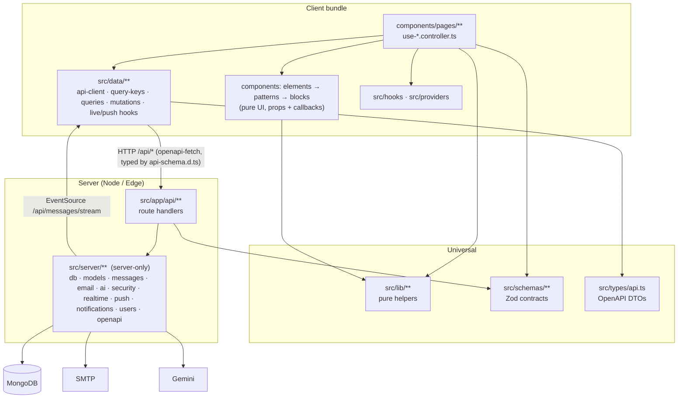
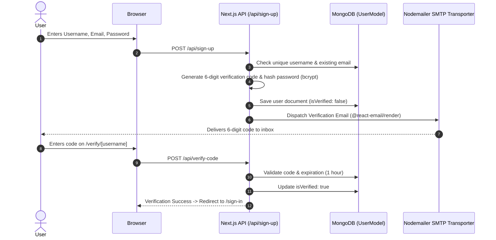
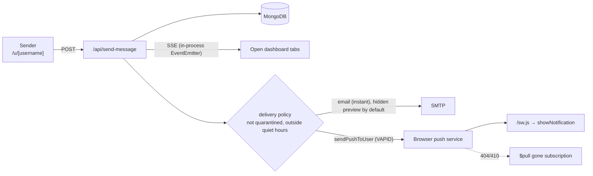

# Chapter 3: System Architecture & Technical Design

This chapter details the high-level system architecture, data models, authentication lifecycle, and runtime boundaries of GhostMsg.

---

## 1. High-Level Architecture Overview

GhostMsg is built on the **Next.js 15 App Router** using React 19, Tailwind CSS v4, MongoDB (Mongoose), NextAuth.js v4, and Google AI Studio.

```
┌─────────────────────────────────────────────────────────────────────────────┐
│                               Client Browser                                │
│          (Landing Page, Dashboard, Profile Link /u/[username], Auth)        │
└───────────────────────┬─────────────────────────────┬───────────────────────┘
                        │ HTTP Requests               │ Edge API Call
                        ▼                             ▼
        ┌──────────────────────────────┐ ┌────────────────────────────┐
        │      Next.js App Router      │ │    Next.js Edge Runtime    │
        │       Node.js Runtime        │ │   /api/suggest-messages    │
        │  - Middleware Authentication │ └─────────────┬──────────────┘
        │  - REST API Routes           │               │
        │  - NextAuth Handlers         │               ▼
        └──────┬───────────────┬───────┘ ┌────────────────────────────┐
               │               │         │ Google AI Studio (Gemini)  │
               ▼               ▼         └────────────────────────────┘
        ┌──────────────┐ ┌──────────────┐
        │   MongoDB    │ │  Nodemailer  │
        │   Database   │ │ (SMTP Mailer)│
        └──────────────┘ └──────────────┘
```

### Source layers & runtime boundaries ([ADR 0018](adr/0018-source-structure-server-data-lib-utils-controllers-tests.md))

Code is split by **where it runs**. Server-only code never reaches the client bundle (`import "server-only"` + Biome), the client reaches the server only over typed HTTP (`openapi-fetch`), and pure helpers have no runtime ties.



| Layer | Folder | Imported by | Must not import |
| :--- | :--- | :--- | :--- |
| Server | `src/server/<capability>/` | `src/app/**`, other server modules | anything client |
| Data | `src/data/<domain>/` | page controllers only | `@/server/**` |
| Controllers | `src/components/pages/<route>/` | page components | `@/server/**` |
| Pure UI | `elements` / `patterns` / `blocks` | higher tiers | `@/data/**`, `@/server/**`, router, session |
| Lib | `src/lib/<domain>/` | anyone | React, Next, `@/data`, `@/server`, components |

The full placement rules and recipes are in the [Source Structure Guide](agents/source-structure.md).

Where state lives at runtime (React Query cache, URL, device storage, form drafts, the server session) and how the inbox pages, counts and live updates fit together is in [Chapter 20: State Management](20-state-management.md).

---

## 2. Authentication & Authorization Lifecycle

GhostMsg supports a dual-authentication strategy configured in [`src/app/api/auth/[...nextauth]/options.ts`](../src/app/api/auth/[...nextauth]/options.ts).



### Session Management & JWT Payload
- Strategy: JWT (`session: { strategy: 'jwt' }`).
- Token Enrichment: The session token includes `_id`, `username` and `isVerified` (identity only; settings such as Message Acceptance are read from the API, [ADR 0031](adr/0031-state-management-consistency-and-structure.md)). `username` is refreshed through `useSession().update` after a rename.
- Dashboard session: the dashboard route layout reads `getServerSession` and passes it to `SessionProvider`, so it renders signed-in without a loading flash.
- Protected Routes: [`src/middleware.ts`](../src/middleware.ts) enforces authentication on `/dashboard` and redirects logged-in users away from guest-only auth pages.

---

## 3. Data Model & Storage Design

GhostMsg implements a decoupled relational document model using a dedicated `Message` collection and compound indexing as defined in [ADR 0010](adr/0010-standalone-messages-schema-and-feature-architecture.md) (superseding legacy embedded subdocuments).

### Standalone Message Schema (`src/server/models/message.model.ts`)
```typescript
interface IMessage {
  _id: Types.ObjectId;
  recipientId: Types.ObjectId; // Ref: User (indexed)
  content: string;             // 10-300 chars
  sentimentTag: 'sweet' | 'curious' | 'spicy' | 'advice' | 'neutral';
  isQuarantined: boolean;      // Moderation flag (indexed)
  isPinned: boolean;           // Starred message (indexed)
  isRead: boolean;             // Read tracking
  reply?: {
    text: string;
    isPublished: boolean;      // Public showcase flag (indexed)
    publishedAt?: Date;
  };
  senderHash: string;          // Cryptographic HMAC-SHA256 fingerprint (indexed)
  createdAt: Date;             // Reverse-chronological sort (indexed)
  updatedAt: Date;
}
```

### User Schema (`src/server/models/user.model.ts`)
```typescript
interface IUser {
  _id: Types.ObjectId;
  username: string;               // unique; the Public Profile Link /u/<username>
  email: string;                  // unique
  password?: string;              // bcrypt; absent for Google-only accounts
  verifyCode: string;
  verifyCodeExpiry: Date;
  isVerified: boolean;
  isAcceptingMessage: boolean;    // Message Acceptance
  amaPrompt?: string;             // ≤120, shown on /u/[username]
  displayName?: string;           // ≤40, "" = show username
  avatarUrl?: string | null;      // 256px WebP/JPEG/PNG data URL
  showAmaBanner: boolean;
  messagePreferences: { offerSuggestions: boolean; publishByDefault: boolean };
  safetySettings: {
    quarantineEnabled: boolean;
    sensitivity: "relaxed" | "balanced" | "strict";
    blurSpicy: boolean;
  };
  notificationSettings: {
    emailAlerts: "instant" | "daily" | "off";
    webPushEnabled: boolean;
    hideMessageText: boolean;     // default true
    quietHours?: { enabled: boolean; start: string; end: string; timeZone: string };
  };
  blockedSenderHashes: string[];  // lookup source for send-message
  blockedSenders: { hash: string; blockedAt: Date }[];
  pushSubscriptions: { endpoint: string; keys: { p256dh: string; auth: string }; createdAt: Date }[];
  createdAt: Date;
  updatedAt: Date;
}
```

Every field, default, write path and compatibility rule is documented in [Chapter 15: Data Model & Database](15-data-model-and-database.md) (ER diagram included).

### Key Database Compound Indexes
* `{ recipientId: 1, isQuarantined: 1, createdAt: -1 }` (Primary Inbox Feed)
* `{ recipientId: 1, isPinned: 1, createdAt: -1 }` (Starred/Favorites Feed)
* `{ recipientId: 1, "reply.isPublished": 1, createdAt: -1 }` (Public Showcase Q&A Feed)

---

## 4. AI & Content Moderation Pipeline

- **Suggested Prompts**: `/api/suggest-messages` (Edge runtime, Gemini 2.5 Flash Lite) generates 3 randomized conversation starters.
- **Synchronous Content Moderation & Sentiment Tagging**: Evaluated on `/api/send-message` ingestion:
  - **Graded Toxicity**: Returns `none` · `borderline` · `hurtful` · `severe`. `shouldQuarantine(toxicity, user.safetySettings)` sets `isQuarantined` using the Recipient's on/off switch and sensitivity (Relaxed → severe, Balanced → hurtful, Strict → borderline). AI errors fail open ([ADR 0025](adr/0025-graded-toxicity-and-recipient-controlled-quarantine.md)).
  - **Sentiment Classification**: Labels the emotional tone (`sweet`, `curious`, `spicy`, `advice`, `neutral`).
- **AI Smart Reply Assistant**: `/api/ai/smart-reply` generates multi-tone draft replies (`witty`, `wholesome`, `thoughtful`) directly into the recipient's reply modal.
- **AMA Prompt Ideas**: `/api/ai/ama-suggestions` returns three prompt ideas for the Profile page ("Suggest with AI"), with fixed fallbacks.

---

## 5. Privacy, Abuse Prevention & Real-Time Transport

- **In-Memory Rate Limiting**: a sliding window in a process-local `Map` (`checkRateLimit`, 5 messages per 10 minutes per IP). Raw IPs are never written to MongoDB. Per-instance only; see the scaling note in [Chapter 9 §4](09-deployment-and-operations.md#4-process-local-state-scaling-note).
- **Cryptographic Sender Hash**: Computed as $\text{HMAC-SHA256}(\text{IP} + \text{RecipientId},\; \text{SECRET\_SALT})$. Allows recipients to shadowban abusive senders without compromising visitor anonymity.
- **Server-Sent Events (SSE) Live Feed**: a process-wide Node `EventEmitter` (`src/server/realtime/event-bus.ts`, channel `recipient:{userId}:message`) streamed over `/api/messages/stream` with a 30 s ping. No Redis is used today ([Chapter 18](18-notifications-and-realtime.md)).
- **Web Push** ([ADR 0020](adr/0020-web-push-delivery-vapid-and-subscription-lifecycle.md)): each device's `PushSubscription` is stored in `User.pushSubscriptions`. `POST /api/send-message` calls `sendPushToUser` (`src/server/push/web-push.ts`, VAPID-signed via `web-push`) for messages that aren't quarantined and arrive outside quiet hours, without blocking the response. Preview text is hidden unless the Recipient turns `hideMessageText` off ([ADR 0026](adr/0026-notification-delivery-policy-quiet-hours-and-hidden-previews.md)). Endpoints that answer 404/410 are pruned.



- **Daily Digest** ([ADR 0029](adr/0029-daily-digest-scheduling-and-alert-privacy-fixes.md)): Vercel Cron (`vercel.json`, 17:00 UTC) calls `GET /api/cron/daily-digest` with `Bearer CRON_SECRET`. `runDailyDigest` (`src/server/notifications/daily-digest.ts`) emails each "daily" recipient a summary of new non-quarantined messages since `lastDigestSentAt`, skipping quiet hours.
- **Password Hashing & Auth Security**: Bcrypt (rounds = 10), 6-digit verification codes (1-hour expiration), and cached MongoDB connection pooling via [`src/server/db/db-connect.ts`](../src/server/db/db-connect.ts).

---

## 6. Master Blueprint & Next Chapter
For the exhaustive implementation specification, see the [Feature & Implementation Master Blueprint](feature-and-implementation-blueprint.md).
Proceed to [Chapter 4: API & Type Safety Architecture](04-api-and-type-safety.md).
