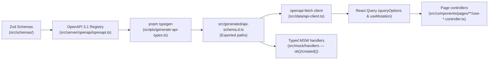

# Chapter 4: API & Type-Safety Architecture

This chapter details GhostMsg's type-safe API infrastructure, single-source-of-truth OpenAPI 3.1 contracts, automatic TypeScript typegen, and client-server communication using `openapi-fetch` and `@tanstack/react-query`.

---

## 1. End-to-End Type Safety Model



---

## 2. Single Source of Truth Contracts

Every parameter, query string, payload, and response is defined with Zod v4 and extended with `@asteasolutions/zod-to-openapi` metadata.

### Example Contract: Sign-Up Request ([`src/schemas/sign-up-schema.ts`](../src/schemas/sign-up-schema.ts))
```typescript
export const signUpSchema = z
  .object({
    username: usernameValidation,
    email: z
      .string()
      .trim()
      .email("Invalid email address")
      .openapi({
        description: "User's email address",
        example: "johndoe@example.com",
      }),
    password: z
      .string()
      .trim()
      .min(6, "password must be atleast 6 characters")
      .openapi({
        description: "Password (minimum 6 characters)",
        example: "SecurePass123!",
      }),
  })
  .openapi("SignUpRequest");
```

---

## 3. Registered Operations Matrix

> Behaviour, examples, side effects and the client hook for every endpoint are in [Chapter 16: API Reference](16-api-reference.md). This matrix is the quick index.

The OpenAPI registry in [`src/server/openapi/openapi.ts`](../src/server/openapi/openapi.ts) defines operations across auth, messaging, AI, moderation, and real-time streaming:

| Endpoint | Method | Auth Required | Request Payload / Params | Success Status | Error Statuses | Purpose |
| :--- | :--- | :--- | :--- | :--- | :--- | :--- |
| `/api/check-username-unique` | `GET` | No | Query: `username` | `200 OK` | `400`, `500` | Real-time username debounce availability check |
| `/api/sign-up` | `POST` | No | Body: `SignUpRequest` | `201 Created` | `400`, `500` | User account creation & OTP dispatch |
| `/api/verify-code` | `POST` | No | Body: `VerifyCodeRequest` | `200 OK` | `400`, `404`, `500` | 6-digit email OTP verification |
| `/api/send-message` | `POST` | No | Body: `SendMessageRequest` | `200 OK` | `429`, `404`, `500` | Rate limiting, sender hash, AI moderation, ingestion |
| `/api/suggest-messages` | `GET` | No (Edge) | None | `200 OK` | `500` | Gemini 2.5 Flash Lite prompt suggestions |
| `/api/get-messages` | `GET` | Yes (Session) | Query: `status` (incl. `any`), `q`, `cursor`, `limit` | `200 OK` | `400`, `401`, `404`, `500` | One page of one filter: server-side filter + escaped search, keyset paging (`nextCursor`) |
| `/api/messages/counts` | `GET` | Yes (Session) | None | `200 OK` | `401`, `500` | Count per inbox filter + total |
| `/api/delete-message/{messageId}` | `DELETE` | Yes (Session) | Path: `messageId` | `200 OK` | `401`, `404`, `500` | Single message deletion |
| `/api/messages/{messageId}` | `PATCH` | Yes (Session) | Path: `messageId`, Body: `{ isPinned, isRead }` | `200 OK` | `401`, `404`, `500` | Toggle star/read status |
| `/api/messages/{messageId}/reply` | `POST` | Yes (Session) | Path: `messageId`, Body: `{ text, isPublished }` | `200 OK` | `401`, `404`, `500` | Save or publish Q&A response (also marks the message read) |
| `/api/messages/bulk` | `POST` | Yes (Session) | Body: `{ action, ids }` | `200 OK` | `400`, `401`, `500` | Batch mark-read, star, or delete |
| `/api/block-sender` | `GET` | Yes (Session) | None | `200 OK` | `401`, `500` | Fetch recipient's blocked sender fingerprints |
| `/api/block-sender` | `POST` | Yes (Session) | Body: `{ senderHash }` | `200 OK` | `401`, `500` | Block sender fingerprint |
| `/api/block-sender` | `DELETE` | Yes (Session) | Body: `{ senderHash }` | `200 OK` | `401`, `500` | Unblock sender fingerprint or clear all |
| `/api/user/notifications` | `GET` | Yes (Session) | None | `200 OK` | `401`, `500` | Get notification & email alert preferences |
| `/api/user/notifications` | `PATCH` | Yes (Session) | Body: `{ emailAlerts?, webPushEnabled?, hideMessageText?, quietHours? }` | `200 OK` | `400`, `401`, `500` | Update notification preferences (quiet hours skip alerts) |
| `/api/user/push-subscription` | `POST` | Yes (Session) | Body: `PushSubscriptionRequest` (`endpoint`, `keys` required) | `200 OK` | `400`, `401`, `500` | Register (or replace) this device's Web Push subscription |
| `/api/user/push-subscription` | `DELETE` | Yes (Session) | Body: `PushUnsubscribeRequest` (`endpoint`) | `200 OK` | `400`, `401`, `500` | Remove this device's Web Push subscription; `webPushEnabled` turns false when no device is left |
| `/api/public/{username}/answers` | `GET` | No | Path: `username` | `200 OK` | `404`, `500` | Public Q&A feed + display name, photo, acceptance, banner and suggestion settings |
| `/api/ai/smart-reply` | `POST` | Yes (Session) | Body: `{ content, tone }` | `200 OK` | `401`, `500` | Multi-tone AI smart reply generator |
| `/api/user/ama-prompt` | `PATCH` | Yes (Session) | Body: `{ amaPrompt }` | `200 OK` | `401`, `500` | *Legacy.* Set the AMA Prompt; the app uses `PATCH /api/user/profile` |
| `/api/user/profile` | `GET` | Yes (Session) | None | `200 OK` | `401`, `404`, `500` | Profile: username, email, display name, photo, AMA prompt, banner |
| `/api/user/profile` | `PATCH` | Yes (Session) | Body: `{ displayName?, avatarUrl?, amaPrompt?, showAmaBanner? }` | `200 OK` | `400`, `401`, `500` | One atomic profile save, only changed fields (photo = resized data URL, ≤ 350 kB; prompt 1–120 chars) |
| `/api/user/username` | `PATCH` | Yes (Session) | Body: `{ username }` | `200 OK` | `400`, `401`, `409`, `500` | Change username (old link stops working) |
| `/api/user/preferences` | `GET` | Yes (Session) | None | `200 OK` | `401`, `500` | Messages + safety preferences |
| `/api/user/preferences` | `PATCH` | Yes (Session) | Body: `{ messages?, safety? }` (partial) | `200 OK` | `400`, `401`, `500` | Suggestions, publish default, quarantine + sensitivity, blur Spicy |
| `/api/user` | `DELETE` | Yes (Session) | Body: `{ confirmUsername }` | `200 OK` | `400`, `401`, `404`, `500` | Delete account, link, messages and answers |
| `/api/messages` | `DELETE` | Yes (Session) | None | `200 OK` | `401`, `500` | Delete every message (client offers a 10 s undo first) |
| `/api/ai/ama-suggestions` | `POST` | Yes (Session) | Body: `{ currentPrompt? }` | `200 OK` | `401`, `500` | AI ideas for the AMA Prompt |
| `/api/messages/stream` | `GET` | Yes (Session) | None (SSE Stream) | `200 OK` | `401`, `500` | Live real-time SSE stream (*not in the OpenAPI spec*; see [Chapter 18 §5](18-notifications-and-realtime.md#5-live-feed-server-sent-events)) |
| `/api/cron/daily-digest` | `GET` | `Authorization: Bearer CRON_SECRET` | None | `200 OK` | `401`, `503` | Daily digest run (Vercel Cron); `503` when `CRON_SECRET` is unset |
| `/api/accept-message` | `GET` | Yes (Session) | None | `200 OK` | `401`, `404`, `500` | Check acceptance status |
| `/api/accept-message` | `POST` | Yes (Session) | Body: `AcceptMessageRequest` | `200 OK` | `400`, `401`, `500` | Toggle acceptance preference |

---

## 4. Interactive Documentation with Scalar

- **Web UI Route**: [`/docs`](../src/app/docs/route.ts) mounted with `@scalar/nextjs-api-reference`.
- **Dynamic Spec Endpoint**: [`/api/openapi.json`](../src/app/api/openapi.json/route.ts) served dynamically from `getOpenApiSpec()`.
- **Capabilities**:
  - Direct "Test Request" console inside the browser.
  - Multi-language SDK code generation (cURL, TypeScript fetch, JavaScript, Python, Go).
  - Searchable schemas, tags, headers, and response formats.

---

## 5. Automated TypeScript Typegen

Running `pnpm typegen` converts the OpenAPI spec into compile-time TypeScript definitions:

```bash
pnpm typegen
```

This generates [`src/generated/api-schema.d.ts`](../src/generated/api-schema.d.ts) using `openapi-typescript`.

> [!TIP]
> `pnpm build` executes `pnpm typegen` automatically prior to Next.js compilation, guaranteeing zero schema-client drift in CI/CD and production builds.

---

## 6. Client Transport: `openapi-fetch` + React Query Architecture

Axios is deprecated and uninstalled. GhostMsg uses `createClient<paths>()` from `openapi-fetch` wrapped in a throwing `clientFetch` helper in [`src/data/api-client.ts`](../src/data/api-client.ts) alongside domain `queryOptions` and custom mutation hooks as established in [ADR 0006](adr/0006-standardized-api-calling-and-react-query-architecture.md).

For complete implementation blueprints, query key hierarchies, and optimistic update recipes, see [API & React Query Architecture Blueprint](api-and-react-query-architecture.md).

---

## 7. Next Chapter
Proceed to [Chapter 5: Component Architecture & UI](05-component-architecture.md).

