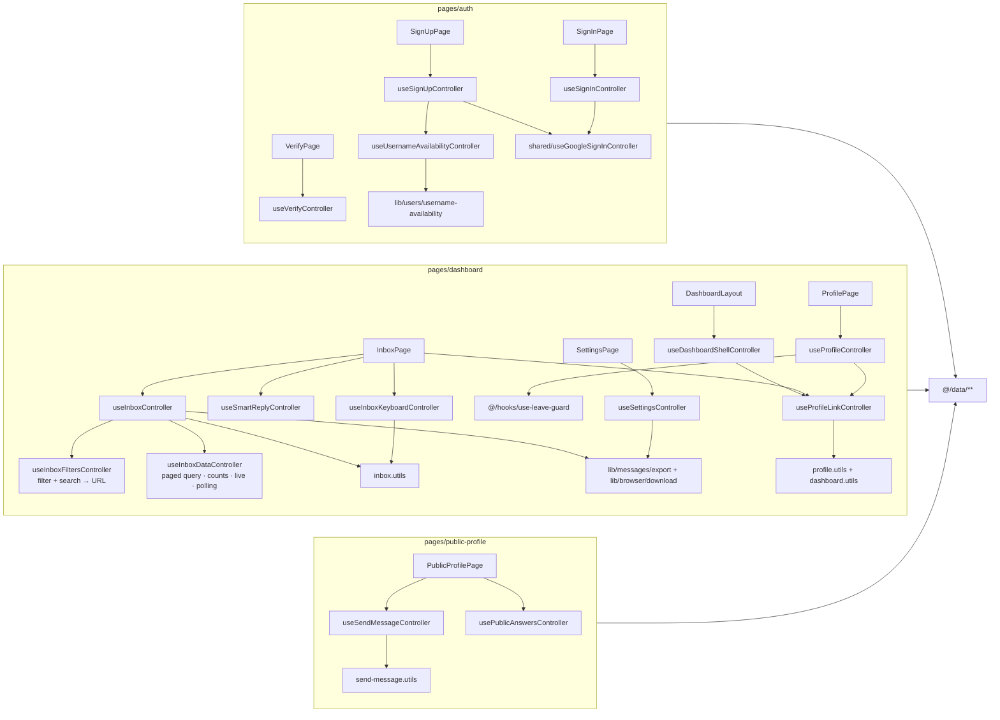

# Chapter 5: Component Architecture & UI Design System

This chapter details GhostMsg's React 19 component hierarchy, Tailwind CSS v4 design tokens, micro-animations with Motion, and component state management based on the **Elements ➔ Patterns ➔ Blocks ➔ Pages** architecture ([ADR 0013](adr/0013-elements-patterns-blocks-composable-architecture.md), [ADR 0015](adr/0015-four-tier-components-pages-layer-and-vendor-consolidation.md)).

---

## 1. 4-Tier Component Hierarchy (Elements ➔ Patterns ➔ Blocks ➔ Pages)

```
src/
├── app/                              # Routing + metadata only (thin)
│   ├── page.tsx                      # → pages/home
│   ├── not-found.tsx                 # → pages/not-found
│   ├── (app)/layout.tsx              # → pages/layouts/site-layout
│   ├── (app)/(auth)/sign-in|sign-up|verify/[username]
│   ├── (dashboard)/dashboard/        # layout → DashboardLayout; page|profile|settings → pages/dashboard
│   └── u/[username]/page.tsx         # → pages/public-profile
└── components/
    ├── elements/                     # Tier 1: shadcn (Radix) + Animate UI primitives with GhostMsg CVA variants
    │   ├── button/  button-group/  icon-button/  liquid-button/  copy-button/  theme-toggler/  palette-picker/
    │   ├── sidebar/  sheet/  drawer/  dialog/  alert-dialog/  command/  dropdown-menu/  popover/  hover-card/  tooltip/  tabs/  accordion/
    │   ├── field/  form/  input/  input-group/  input-otp/  textarea/  select/  checkbox/  radio-group/  switch/  label/
    │   ├── toggle/  toggle-group/  badge/  avatar/  kbd/  item/  table/  empty/  alert/  breadcrumb/  progress/
    │   ├── card/  separator/  scroll-area/  skeleton/  spinner/  sonner/ (Toaster + notify)  text/  carousel/
    │   └── effects/                  # slot, auto-height, highlight, particles, gravity-stars
    ├── patterns/                     # Tier 2: pure compositions (no data access)
    │   ├── auth-form/  username-field/  verify-code-form/
    │   ├── message-card/  filter-bar/  bulk-action-toolbar/  modals/  sentiment-badge/  command-palette/
    │   ├── ama-banner/  send-message-form/  suggested-messages/  public-qa-feed/
    │   ├── brand-mark/  claim-link-form/  how-it-works/  story-card-preview/
    │   ├── page-heading/  section-nav/  unsaved-changes-bar/  visitor-preview/  identity-card/
    │   ├── share-link-card/  ama-prompt-editor/  shortcut-sheet/  undo-toast/
    │   ├── responsive-dialog/  mobile-header-actions/  message-actions-menu/
    │       (modals/: block-sender, delete-message, delete-selected, reveal-message, smart-reply, story-card,
    │        change-username, delete-all-messages, delete-account, discard-changes)
    ├── blocks/                       # Tier 3: pure page sections
    │   ├── site-header/  hero/  trust-section/  qa-showcase/  cta-banner/  site-footer/
    │   ├── auth-panel/  verify-panel/  verify-success/  not-found-panel/
    │   ├── dashboard-shell/  inbox/  profile-panel/  settings-panel/
    │   └── public-profile/
    └── pages/                        # Tier 4: route components + ALL business logic
        ├── layouts/site-layout/      # session → SiteHeader
        ├── home/
        ├── auth/ (shared/use-google-sign-in, sign-in/use-sign-in, sign-up/use-sign-up + use-username-availability,
        │          verify/use-verify + use-resend-cooldown + verify.utils)
        ├── dashboard/ (dashboard-layout, inbox-page, profile-page, settings-page; controllers: dashboard-shell,
        │              global-shortcuts, inbox (= inbox-filters + inbox-data), inbox-keyboard, smart-reply, profile,
        │              profile-link, change-username, settings, appearance, danger-zone)
        ├── public-profile/ (public-profile-page, use-send-message / use-public-answers controllers)
        └── not-found/
```

### One example per tier

```tsx
// Tier 1, elements/: stock shadcn + opt-in variants. No GhostMsg data.
<Button size="xl" variant="brand">Get my link</Button>

// Tier 2, patterns/: a pure composition. Props in, callbacks out.
export function VerifyCodeForm({ form, codeError, resendSecondsLeft, onResend, onSubmit }: VerifyCodeFormProps) {
  /* InputOTP + Alert + the one main action; no fetch, no router */
}

// Tier 3, blocks/: a page section built from patterns. Still pure.
export function VerifyPanel({ username, children }: VerifyPanelProps) {
  return <AuthPanel backHref="/sign-up" step={{ current: 2, total: 2 }} title="Check your email" …>{children}</AuthPanel>;
}

// Tier 4, pages/: the only tier with logic. Controllers own queries, mutations, router, session.
export function VerifyPage({ username }: VerifyPageProps) {
  const verify = useVerifyController(username); // mutations, cooldown, error mapping
  const link = useProfileLinkController(username);
  if (verify.isVerified) return <VerifySuccess onCopy={link.handleCopy} profileUrl={link.profileUrl} />;
  return (
    <VerifyPanel username={username}>
      <VerifyCodeForm form={verify.form} onResend={verify.handleResend} onSubmit={verify.handleSubmit} … />
    </VerifyPanel>
  );
}
```

### Strict Unidirectional Dependency Rule (DAG), lint-enforced
- **Pages** may import blocks, patterns, elements, and every data/logic module (`@tanstack/react-query`, `@/data/**` (queries, mutations, live messages, push), `next-auth/react`, `next/navigation`).
- **Blocks** may import patterns and elements. They may not import pages or any data/logic module.
- **Patterns** may import elements and other patterns. They may not import blocks, pages or any data/logic module.
- **Elements** may import other elements only (plus external primitives like Radix and Motion).
- Vendor components live in `@/components/elements/` (there are no separate `ui/` or `animate-ui/` directories).
- No component, data, hook, provider, mock or Storybook file may import `@/server/**` or `server-only` ([ADR 0018](adr/0018-source-structure-server-data-lib-utils-controllers-tests.md)).

Biome's `noRestrictedImports` overrides in [`biome.jsonc`](../biome.jsonc) enforce the tier DAG and data/server boundaries, so `pnpm check` fails on a violation.

### Controller composition (pages tier)

Controllers are one hook per file. They compose shared controllers and pure `*.utils.ts`, and are the only components that reach `@/data` ([ADR 0018](adr/0018-source-structure-server-data-lib-utils-controllers-tests.md), Q5):



### Adding Registry Components (shadcn / Animate UI)
`components.json` maps the `ui` alias to `@/components/elements`. After `npx shadcn add @animate-ui/<name>`:
1. Move the styled file to `elements/<name>/<name>.tsx` and its primitive to `elements/<name>/<name>.primitive.tsx`. Shared effects go in `elements/effects/`.
2. Fix imports, then add `index.ts` and `<name>.stories.tsx`, plus a test if the element is interactive.
3. Delete the leftover `src/components/animate-ui/` folder so vendor primitives stay consolidated in `elements/`.

**shadcn first** ([ADR 0023](adr/0023-shadcn-first-elements-and-profile-settings-backend.md)): screens are composed from shadcn components (`Sidebar`, `ToggleGroup`, `Field`, `Empty`, `Item`, `Command`, `Table`, `Select`, …). Claude Design looks are opt-in CVA variants inside the element (`Badge variant="count"`, `ToggleGroup variant="segment"`, `InputGroup shape="pill"`), and `className` only handles layout.

### Visual Parity Rule for Elements
Every element's **default** variant and size reproduce the original shadcn primitive class-for-class (e.g. `Card` = `border bg-card py-4 shadow-sm`, `Switch` thumb dark-mode colors, `Input` selection/file styles). Extra variants (`glass`, `ghost`, `bordered`, `filled`, `brand`, …) are strictly opt-in, so swapping `ui/*` for `elements/*` never changes existing screens. **The only approved exception is WCAG AA contrast** ([ADR 0016](adr/0016-storybook-msw-and-story-driven-component-testing.md) Q17/Q18). Since [ADR 0022](adr/0022-palette-theming-and-claude-design-redesign.md) that exception is expressed through tokens: destructive surfaces use `text-destructive-foreground` (not `text-white`), and no component uses a raw Tailwind palette colour (`pink-500`, `red-700`, …).

### Colocated Module Directory Standard
Each module folder holds its implementation, public API, mock args and stories. Controllers exist **only** in `pages/`, one hook per file, each with a colocated `*.controller.test.ts`. Pure helpers sit next to their consumer as `<module>.utils.ts` + `<module>.utils.test.ts` ([ADR 0016](adr/0016-storybook-msw-and-story-driven-component-testing.md), [ADR 0018](adr/0018-source-structure-server-data-lib-utils-controllers-tests.md)):

```
src/components/patterns/message-card/        # pure pattern
├── index.ts                  # public API only (component + props type), never mocks
├── message-card.tsx          # pure presentational component (props + callbacks)
├── message-card.mock.ts      # args built from src/mock/fixtures (noop callbacks)
└── message-card.stories.tsx  # CSF3 stories = component tests (play() + axe)

src/components/pages/dashboard/              # page (impure by design)
├── index.ts
├── dashboard-layout.tsx      # session gate + DashboardShell (sidebar) + ⌘K CommandPalette
├── inbox-page.tsx  profile-page.tsx  settings-page.tsx   # one per route
├── use-dashboard-shell.controller.ts   # unread badge, Message Acceptance, ⌘K, sign-out
├── use-profile-link.controller.ts      # link + copy / native share (shared)
├── use-inbox-keyboard.controller.ts + .test.ts   # j/k/x/s/r and "/"
├── use-inbox-filters.controller.ts + .test.ts  # filter + debounced search, written to ?filter=&q=
├── use-inbox-data.controller.ts    + .test.ts  # paged server query, counts, live updates, polling fallback
├── use-inbox.controller.ts        + use-inbox.controller.test.ts       # composes the two: selection, dialogs, actions
├── use-smart-reply.controller.ts  + use-smart-reply.controller.test.ts
├── use-profile.controller.ts      + use-profile.controller.test.ts     # react-hook-form draft, one-PATCH save, leave guard
├── use-settings.controller.ts     + use-settings.controller.test.ts
├── use-change-username / use-appearance / use-danger-zone .controller.ts (+ tests)
├── inbox.utils.ts   + inbox.utils.test.ts      # shortcuts, j/k focus, URL, scoped selection, dialog state
├── dashboard.utils.ts + dashboard.utils.test.ts  # active nav, link label
├── profile.utils.ts + profile.utils.test.ts    # profile URL, buildProfilePatch (dirty fields → one PATCH)
├── dashboard.mock.ts         # MSW handler sets (withScenario…)
└── dashboard.stories.tsx     # layout + each page, real controllers against MSW
```

---

## 2. Design System Tokens & Tailwind CSS v4

GhostMsg uses Tailwind CSS v4 with custom CSS variable tokens defined in [`src/app/globals.css`](../src/app/globals.css):

> The full design system (brand direction, every token, the six theme screenshots, motion, the shadcn-first rule and the CVA variant catalog) is in [Chapter 13: Design System & Theming](13-design-system-and-theming.md). Screen-by-screen composition is in [Chapter 14](14-ui-screens-and-user-flows.md).

### Palettes × mode ([ADR 0022](adr/0022-palette-theming-and-claude-design-redesign.md))

Theming has two independent axes, both on `<html>`:

| Axis | Values | Owner | Attribute |
| :--- | :--- | :--- | :--- |
| **Palette** | `spectral` (Soft spectral, default) · `midnight` (Midnight confessional) · `paper` (Playful paper) | [`PaletteProvider`](../src/providers/palette-provider.tsx) + [`PalettePickerButton`](../src/components/elements/palette-picker/palette-picker.tsx) | `data-palette` |
| **Mode** | light · dark | `next-themes` + `ThemeTogglerButton` | `.dark` class |

`globals.css` defines six token sets: `:root` / `.dark` (Soft spectral), then `:root[data-palette="…"]` / `:root.dark[data-palette="…"]` for the other two. A palette sets colours **and** fonts (`--app-font-sans`, `--app-font-display`, `--app-font-message`), radius and shadows (Playful paper's hard offset shadows come from `--shadow-xs`/`--shadow-sm`). A blocking inline script ([`PALETTE_BOOT_SCRIPT`](../src/lib/theme/palette.ts)) applies the stored palette before first paint. Storybook has a **Palette** toolbar next to **Theme**.

Tokens beyond stock shadcn (all wired into `@theme inline`):

- Status: `success`, `warning`, `info` (each with `-foreground`).
- Sentiment Tags: `sentiment-{sweet,curious,spicy,advice,neutral}` with `-foreground` (on solid) and `-subtle` (tinted fill).
- `star`, `brand-foreground`, `brand-overlay` (text panels on the gradient).
- Utilities: `bg-brand-gradient`, `bg-brand-mist`, `font-display`, `font-message` (Midnight renders messages in serif italic), `shadow-soft`, `shadow-lift`, `animate-float` / `animate-rise` / `animate-pulse-ring` (always behind `motion-safe:`).

**Rules.** Never use a raw Tailwind palette colour in a component; pick the semantic token. Every text pair is WCAG AA in all six themes; `pnpm theme:contrast` ([`scripts/check-theme-contrast.ts`](../scripts/check-theme-contrast.ts)) recomputes the ratios from `globals.css` and fails on a regression.

---

## 3. UI Primitives & Animation Library

| Category | Component / Library | Purpose |
| :--- | :--- | :--- |
| **Primitives** | [Radix UI](https://www.radix-ui.com/) + [shadcn/ui](https://ui.shadcn.com/) (new-york, Radix base) | Every structural element: Sidebar, Dialog/AlertDialog/Sheet, Field, InputGroup, Select, RadioGroup, Checkbox, Toggle/ToggleGroup, Table, Empty, Item, Breadcrumb, Badge, Avatar, Kbd. Design via opt-in CVA variants ([ADR 0023](adr/0023-shadcn-first-elements-and-profile-settings-backend.md)). |
| **Command palette** | [cmdk](https://cmdk.paco.me/) via shadcn `Command`/`CommandDialog` | ⌘K palette with a substring filter and a labelled search input. |
| **Story Card Canvas** | Canvas 2D ([`story-card.canvas.ts`](../src/components/patterns/modals/story-card.canvas.ts)) | 9:16 or 1:1 PNG drawn from the active palette's tokens and fonts. |
| **Carousel** | [Embla Carousel React](https://www.embla-carousel.com/) | Generic `elements/carousel` primitive (no longer used on the landing page). |
| **OTP Input** | [Input OTP](https://input-otp.rodz.dev/) | 6-digit slotted verification code input with digit masking. |
| **Animations** | [Motion](https://motion.dev/) | Smooth entrance animations, layout transitions, and hover states. |
| **Notifications** | [Sonner](https://sonner.emilkowal.ski/) | Rich stacked toast notifications for mutation feedback and errors. |
| **Icons** | [Lucide React](https://lucide.dev/) | Crisp, consistent SVG icons across all views. |

---

## 4. State Management, Form Lifecycle & Render Boundaries

- **Component Segregation**: Pages are split into focused pure patterns (`SendMessageForm`, `SuggestedMessages`, `PublicQaFeed`, `MessageCard`, `StoryCardModal`). The dashboard is three routes (`/dashboard`, `/dashboard/profile`, `/dashboard/settings`) inside one `DashboardLayout`, each page with its own controller, so render and query boundaries stay isolated.
- **Hoisted Modal Overlays**: Each modal (`BlockSenderModal`, `DeleteSelectedModal`, `RevealMessageModal`, `SmartReplyModal`, `StoryCardModal`) is mounted **once**, as a sibling of the `Inbox` block, inside the page-level `inbox-page.tsx`. The same holds for `ChangeUsernameModal` and `DiscardChangesModal` (in `profile-page.tsx`) and `DeleteAllMessagesModal` / `DeleteAccountModal` (in `settings-page.tsx`). `useInboxController` holds one modal state `{ kind, messageId, snapshot }`; the dialog's message is resolved from the live cache by id (`resolveModalMessage`), falling back to the snapshot, and `closeModal` clears only `kind`, so dialogs animate out with their content and never show a stale copy ([ADR 0014](adr/0014-architectural-deepening-pure-patterns-hoisted-overlays-and-push-adapter.md), [ADR 0015](adr/0015-four-tier-components-pages-layer-and-vendor-consolidation.md)).
- **Ports & Adapters for Browser Infrastructure**: External browser APIs (`PushManager`, ServiceWorker, Web Push) are encapsulated in dedicated adapters (`src/data/user/use-push-notification.ts`) rather than leaking into React component trees.
- **Form Validation & Shadcn Compound Primitives**: Page controllers create the `react-hook-form` instance with `zodResolver(schema)` and `mode: "onChange"`. Form patterns receive it as `form: UseFormReturn<Values>`, render fields using shadcn `<Form>` compound primitives (`Form`, `FormField`, `FormItem`, `FormLabel`, `FormControl`, `FormMessage` from `src/components/elements/form/form.tsx`), suppress native browser validation popups via `<form noValidate ...>`, and call `form.handleSubmit(onSubmit)`. Pending state comes from the controller (`isSubmitting`) ([ADR 0033](adr/0033-standardized-form-architecture-with-react-hook-form-and-shadcn-primitives.md)).
- **Server-fed drafts**: the Profile page's form is `useForm({ values: serverValues, resetOptions: { keepDirtyValues: true } })`: it follows the server profile, keeps fields being edited when a refetch lands, and `isDirty` drives the `UnsavedChangesBar` and the leave guard (`useLeaveGuard` + `DiscardChangesModal`). Saving sends only the dirty fields in one `PATCH` (`buildProfilePatch`) ([ADR 0031](adr/0031-state-management-consistency-and-structure.md) D11).
- **Deterministic Optimistic Updates**: Standardized on TanStack Query `onMutate` cache updates with context rollback in `onError` as specified in [ADR 0006](adr/0006-standardized-api-calling-and-react-query-architecture.md). Inbox mutations share `src/data/messages/messages-cache.ts` (which walks every page of every cached inbox list), and confirm dialogs close **before** the request is awaited ([ADR 0021](adr/0021-optimistic-inbox-mutations-close-first-and-shared-cache-helpers.md)). Settings-like resources (acceptance, notifications, preferences, profile) use the `useOptimisticResourceMutation` factory: queued per resource, silent on success, one error toast ([ADR 0031](adr/0031-state-management-consistency-and-structure.md)). Server data is never copied into `useState`; see [Chapter 20](20-state-management.md).
- **Debounced Username Availability**: `useUsernameAvailabilityController` (in `pages/auth/sign-up/use-username-availability.controller.ts`, composed by `useSignUpController`) watches the username with `useWatch`, debounces it by 400 ms (`USERNAME_DEBOUNCE_MS`) with `useDebounceValue`, and queries `authQueries.checkUsername`. The result is **derived, never written into form state**: the status mapping is the pure `deriveUsernameAvailability` in `src/lib/users/username-availability.ts` (shared with Change username), `SignUpForm` disables submit while the name is taken, and `useSignUpController` re-checks it before sending. The pure `UsernameField` pattern only renders `availability: "idle" | "checking" | "available" | "taken"`.
- **Client-Side Story Card Engine**: `StoryCardModal` reads the palette tokens with `getComputedStyle` and draws the card on a canvas (format, look, answer and link toggles), then saves or shares the PNG without server roundtrips.

---

## 5. Architectural Deepening & Refactoring Standards (ADR 0014)

1. **Pure Design Patterns**: Patterns in `src/components/patterns/` (such as `MessageCard`, `SentimentBadge`, `FilterBar`, `BulkActionToolbar`, `SmartReplyModal`) are strictly pure presentational components accepting props and emitting event callbacks. They do not trigger React Query network mutations directly.
2. **Headless Controllers in Pages Only**: Mutation hooks, queries, session and routing are encapsulated inside controller hooks (`useInboxController`, `useSmartReplyController`, `useSettingsController`, `useProfileController`, `useSendMessageController`, `usePublicAnswersController`, `useSignInController`, `useSignUpController`, `useVerifyController`) colocated in their `pages/<route>/` folder ([ADR 0015](adr/0015-four-tier-components-pages-layer-and-vendor-consolidation.md)).
3. **Consolidated Atomic Primitives**: Base UI components reside in `src/components/elements/` with strict Class Variance Authority (CVA) type definitions and complete Storybook story specifications.

---

## 6. Component Registry

The full, always-current inventory is generated into [Chapter 11: Component Registry](11-component-registry.md). It lists every module, its public API, stories, `play()` tests, mock exports and controllers, plus fixtures and MSW scenarios. Regenerate it with `pnpm docs:registry`; `pnpm docs:registry:check` (part of the pre-push gate) fails if it's stale.

Folder contract per module:

| File | Elements | Patterns | Blocks | Pages |
| :--- | :---: | :---: | :---: | :---: |
| `<name>.tsx` | ✅ | ✅ | ✅ | ✅ (`<route>-page.tsx`, `*-layout.tsx`) |
| `index.ts` (public API only, never mocks) | ✅ | ✅ | ✅ | ✅ |
| `<name>.mock.ts` (args built from `src/mock/fixtures`) | ✅ | ✅ | ✅ | ✅ (MSW handler sets) |
| `<name>.stories.tsx` (five-point standard) | ✅ | ✅ | ✅ | ✅ (`pageProviders: true`) |
| `use-<concern>.controller.ts` + `.controller.test.ts` | — | — | — | ✅ (one hook per file) |
| `<module>.utils.ts` + `.utils.test.ts` | optional | optional | optional | optional (pure logic only) |

Shared callback stub: `src/mock/noop.ts`.

---

## 7. Next Chapter
Proceed to [Chapter 6: Developer Workflow](06-dev-workflow.md).


