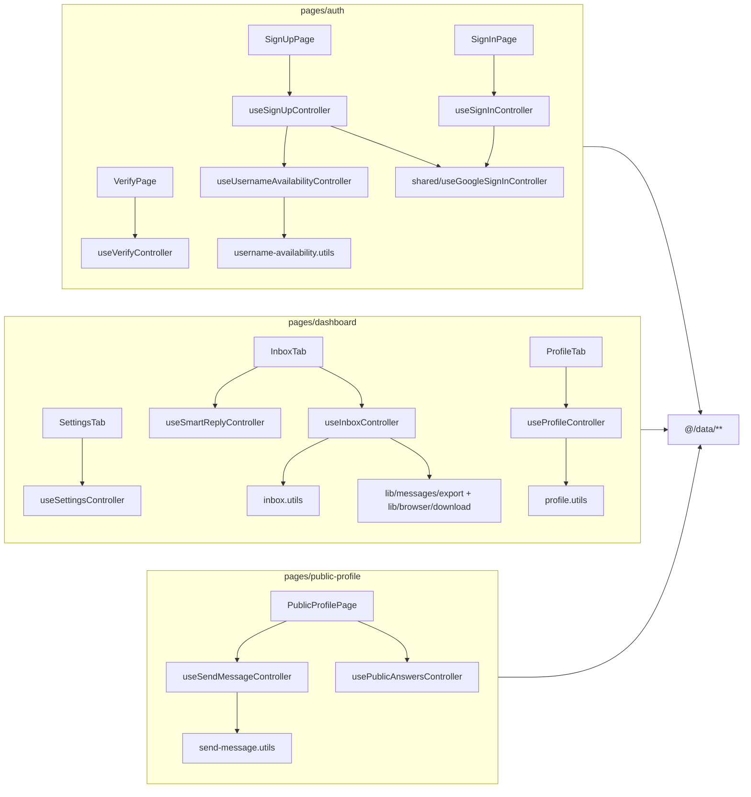

# Chapter 5: Component Architecture & UI Design System

This chapter details GhostMsg's React 19 component hierarchy, Tailwind CSS v4 design tokens, micro-animations with Motion, and component state management based on the **Elements ➔ Patterns ➔ Blocks ➔ Pages** architecture ([ADR 0013](file:///d:/Projects/GhostMsg/docs/adr/0013-elements-patterns-blocks-composable-architecture.md), [ADR 0015](file:///d:/Projects/GhostMsg/docs/adr/0015-four-tier-components-pages-layer-and-vendor-consolidation.md)).

---

## 1. 4-Tier Component Hierarchy (Elements ➔ Patterns ➔ Blocks ➔ Pages)

```
src/
├── app/                              # Routing + metadata only (thin)
│   ├── page.tsx                      # → pages/home
│   ├── not-found.tsx                 # → pages/not-found
│   ├── (app)/layout.tsx              # → pages/layouts/site-layout
│   ├── (app)/(auth)/sign-in|sign-up|verify/[username]
│   ├── (app)/(dashboard)/dashboard/  # → pages/dashboard
│   └── u/[username]/page.tsx         # → pages/public-profile
└── components/
    ├── elements/                     # Tier 1: primitives (former ui/ + animate-ui/ live here)
    │   ├── button/ (button.tsx + button.primitive.tsx)  liquid-button/  icon-button/  copy-button/
    │   ├── theme-toggler/  tabs/  alert-dialog/  dialog/  tooltip/  carousel/  form/
    │   ├── card/  input/  input-otp/  switch/  badge/  label/  text/  textarea/  skeleton/  sonner/
    │   └── effects/                  # slot, auto-height, highlight, particles, gravity-stars
    ├── patterns/                     # Tier 2: pure compositions (no data access)
    │   ├── auth-form/  username-field/  verify-code-form/
    │   ├── message-card/  filter-bar/  bulk-action-toolbar/  modals/  sentiment-badge/
    │   ├── ama-banner/  send-message-form/  suggested-messages/  public-qa-feed/
    │   └── messages-carousel/  share-link-card/  ama-prompt-editor/
    ├── blocks/                       # Tier 3: pure page sections
    │   ├── site-header/  hero/  auth-panel/  verify-panel/  not-found-panel/
    │   ├── dashboard-shell/  inbox/  profile-panel/  settings-panel/  settings-section/
    │   └── public-profile/
    └── pages/                        # Tier 4: route components + ALL business logic
        ├── layouts/site-layout/      # session → SiteHeader
        ├── home/
        ├── auth/ (shared/use-google-sign-in, sign-in/use-sign-in, sign-up/use-sign-up + use-username-availability, verify/use-verify)
        ├── dashboard/ (dashboard-page, inbox-tab, profile-tab, settings-tab, use-*.controller.ts)
        ├── public-profile/ (public-profile-page, use-send-message / use-public-answers controllers)
        └── not-found/
```

### Strict Unidirectional Dependency Rule (DAG), lint-enforced
- **Pages** may import blocks, patterns, elements, and every data/logic module (`@tanstack/react-query`, `@/data/**` (queries, mutations, live messages, push), `next-auth/react`, `next/navigation`).
- **Blocks** may import patterns and elements. They may not import pages or any data/logic module.
- **Patterns** may import elements and other patterns. They may not import blocks, pages or any data/logic module.
- **Elements** may import other elements only (plus external primitives like Radix and Motion).
- Nothing may import `@/components/ui` or `@/components/animate-ui`. Those folders no longer exist.
- No component, data, hook, provider, mock or Storybook file may import `@/server/**` or `server-only` ([ADR 0018](file:///d:/Projects/GhostMsg/docs/adr/0018-source-structure-server-data-lib-utils-controllers-tests.md)).

Biome's `noRestrictedImports` overrides in [`biome.jsonc`](file:///d:/Projects/GhostMsg/biome.jsonc) enforce these rules, so `pnpm check` fails on a violation.

### Controller composition (pages tier)

Controllers are one hook per file. They compose shared controllers and pure `*.utils.ts`, and are the only components that reach `@/data` ([ADR 0018](file:///d:/Projects/GhostMsg/docs/adr/0018-source-structure-server-data-lib-utils-controllers-tests.md), Q5):



### Adding Registry Components (shadcn / Animate UI)
`components.json` maps the `ui` alias to `@/components/elements`. After `npx shadcn add @animate-ui/<name>`:
1. Move the styled file to `elements/<name>/<name>.tsx` and its primitive to `elements/<name>/<name>.primitive.tsx`. Shared effects go in `elements/effects/`.
2. Fix imports, then add `index.ts` and `<name>.stories.tsx`, plus a test if the element is interactive.
3. Delete the leftover `src/components/animate-ui/` folder. Lint fails until you do.

### Visual Parity Rule for Elements
Every element's **default** variant and size reproduce the original shadcn primitive class-for-class (e.g. `Card` = `border bg-card py-4 shadow-sm`, `Switch` thumb dark-mode colors, `Input` selection/file styles). Extra variants (`glass`, `ghost`, `bordered`, `filled`, …) are strictly opt-in, so swapping `ui/*` for `elements/*` never changes existing screens. **The only approved exception is WCAG AA contrast** ([ADR 0016](file:///d:/Projects/GhostMsg/docs/adr/0016-storybook-msw-and-story-driven-component-testing.md) Q17/Q18): sentiment badge text `-600 → -700`, red status text `red-500 → red-700` (`dark:text-red-400`), destructive badge text `text-white`, and light-mode `--muted-foreground` `oklch(0.553 …) → oklch(0.5 …)`.

### Colocated Module Directory Standard
Each module folder holds its implementation, public API, mock args and stories. Controllers exist **only** in `pages/`, one hook per file, each with a colocated `*.controller.test.ts`. Pure helpers sit next to their consumer as `<module>.utils.ts` + `<module>.utils.test.ts` ([ADR 0016](file:///d:/Projects/GhostMsg/docs/adr/0016-storybook-msw-and-story-driven-component-testing.md), [ADR 0018](file:///d:/Projects/GhostMsg/docs/adr/0018-source-structure-server-data-lib-utils-controllers-tests.md)):

```
src/components/patterns/message-card/        # pure pattern
├── index.ts                  # public API only (component + props type), never mocks
├── message-card.tsx          # pure presentational component (props + callbacks)
├── message-card.mock.ts      # args built from src/mock/fixtures (noop callbacks)
└── message-card.stories.tsx  # CSF3 stories = component tests (play() + axe)

src/components/pages/dashboard/              # page (impure by design)
├── index.ts
├── dashboard-page.tsx        # session gate + DashboardShell + lazy tabs
├── inbox-tab.tsx  profile-tab.tsx  settings-tab.tsx
├── use-inbox.controller.ts        + use-inbox.controller.test.ts       # renderHook + MSW
├── use-smart-reply.controller.ts  + use-smart-reply.controller.test.ts
├── use-profile.controller.ts      + use-profile.controller.test.ts
├── use-settings.controller.ts     + use-settings.controller.test.ts
├── inbox.utils.ts   + inbox.utils.test.ts      # pure filter/count helpers
├── profile.utils.ts + profile.utils.test.ts
├── dashboard-page.mock.ts    # MSW handler sets (withScenario…)
└── dashboard-page.stories.tsx# real controllers against MSW
```

---

## 2. Design System Tokens & Tailwind CSS v4

GhostMsg uses Tailwind CSS v4 with custom CSS variable tokens defined in [`src/app/globals.css`](file:///d:/Projects/GhostMsg/src/app/globals.css):

### Color Palette & Theme Tokens
- **Background & Foreground**: Dynamic HSL tokens for light/dark mode adaptation.
- **Primary / Accent**: Purple & Ghost vibrant hues for branding.
- **Typography**: Google Font **Poppins** loaded via `next/font/google` in [`src/app/layout.tsx`](file:///d:/Projects/GhostMsg/src/app/layout.tsx#L9-L13).
- **Theme Provider**: [`next-themes`](file:///d:/Projects/GhostMsg/src/providers/theme-provider.tsx) supporting system, light, and dark modes with zero flash.

---

## 3. UI Primitives & Animation Library

| Category | Component / Library | Purpose |
| :--- | :--- | :--- |
| **Primitives** | [Radix UI](https://www.radix-ui.com/) + [Shadcn UI](https://ui.shadcn.com/) | Accessible dialogs, tooltips, cards, dropdowns, labels. |
| **Story Card Canvas** | [html-to-image](https://github.com/bubkoo/html-to-image) | High-resolution 9:16 PNG export with theme gradients for social stories. |
| **Carousel** | [Embla Carousel React](https://www.embla-carousel.com/) | Smooth animated carousel for message testimonials on the landing page. |
| **OTP Input** | [Input OTP](https://input-otp.rodz.dev/) | 6-digit slotted verification code input with digit masking. |
| **Animations** | [Motion](https://motion.dev/) | Smooth entrance animations, layout transitions, and hover states. |
| **Notifications** | [Sonner](https://sonner.emilkowal.ski/) | Rich stacked toast notifications for mutation feedback and errors. |
| **Icons** | [Lucide React](https://lucide.dev/) | Crisp, consistent SVG icons across all views. |

---

## 4. State Management, Form Lifecycle & Render Boundaries

- **Component Segregation**: Pages are split into focused pure patterns (`SendMessageForm`, `SuggestedMessages`, `PublicQaFeed`, `MessageCard`, `StoryCardModal`). Dashboard tabs are separate page-level components (`inbox-tab`, `profile-tab`, `settings-tab`), each with its own controller, so render and query boundaries stay isolated.
- **Hoisted Modal Overlays**: Each modal (`BlockSenderModal`, `DeleteMessageModal`, `SmartReplyModal`, `StoryCardModal`) is mounted **once**, as a sibling of the `Inbox` block, inside the page-level `inbox-tab.tsx`. `useInboxController` holds `activeModal` + `activeMessage`, and `closeModal` resets only `activeModal`, so dialogs animate out with their content ([ADR 0014](file:///d:/Projects/GhostMsg/docs/adr/0014-architectural-deepening-pure-patterns-hoisted-overlays-and-push-adapter.md), [ADR 0015](file:///d:/Projects/GhostMsg/docs/adr/0015-four-tier-components-pages-layer-and-vendor-consolidation.md)).
- **Ports & Adapters for Browser Infrastructure**: External browser APIs (`PushManager`, ServiceWorker, Web Push) are encapsulated in dedicated adapters (`src/data/user/use-push-notification.ts`) rather than leaking into React component trees.
- **Form Validation**: Page controllers create the `react-hook-form` instance with `zodResolver(schema)` and `mode: "onChange"`. Form patterns receive it as `form: UseFormReturn<Values>`, render the fields and call `form.handleSubmit(onSubmit)`. Pending state comes from the controller (`isSubmitting`).
- **Deterministic Optimistic Updates**: Standardized on TanStack Query `onMutate` cache updates with context rollback in `onError` as specified in [ADR 0006](file:///d:/Projects/GhostMsg/docs/adr/0006-standardized-api-calling-and-react-query-architecture.md). Inbox mutations share `src/data/messages/messages-cache.ts`, and confirm dialogs close **before** the request is awaited ([ADR 0021](file:///d:/Projects/GhostMsg/docs/adr/0021-optimistic-inbox-mutations-close-first-and-shared-cache-helpers.md)).
- **Debounced Username Availability**: `useUsernameAvailabilityController` (in `pages/auth/sign-up/use-username-availability.controller.ts`, composed by `useSignUpController`) watches the username with `useWatch`, debounces it by 400 ms with `useDebounceValue`, queries `authQueries.checkUsername`, and writes the result back with `form.setError` / `clearErrors`. The status mapping is the pure `deriveUsernameAvailability` in `username-availability.utils.ts`. The pure `UsernameField` pattern only renders `availability: "idle" | "checking" | "available" | "taken"`.
- **Client-Side Story Card Engine**: `StoryCardModal` mounts an isolated offscreen/preview canvas node with CSS theme variables to generate PNG blobs without server roundtrips.

---

## 5. Architectural Deepening & Refactoring Standards (ADR 0014)

1. **Pure Design Patterns**: Patterns in `src/components/patterns/` (such as `MessageCard`, `SentimentBadge`, `FilterBar`, `BulkActionToolbar`, `SmartReplyModal`) are strictly pure presentational components accepting props and emitting event callbacks. They do not trigger React Query network mutations directly.
2. **Headless Controllers in Pages Only**: Mutation hooks, queries, session and routing are encapsulated inside controller hooks (`useInboxController`, `useSmartReplyController`, `useSettingsController`, `useProfileController`, `useSendMessageController`, `usePublicAnswersController`, `useSignInController`, `useSignUpController`, `useVerifyController`) colocated in their `pages/<route>/` folder ([ADR 0015](file:///d:/Projects/GhostMsg/docs/adr/0015-four-tier-components-pages-layer-and-vendor-consolidation.md)).
3. **Consolidated Atomic Primitives**: Base UI components reside in `src/components/elements/` with strict Class Variance Authority (CVA) type definitions and complete Storybook story specifications.

---

## 6. Component Registry

The full, always-current inventory is generated into [Chapter 11: Component Registry](file:///d:/Projects/GhostMsg/docs/11-component-registry.md). It lists every module, its public API, stories, `play()` tests, mock exports and controllers, plus fixtures and MSW scenarios. Regenerate it with `pnpm docs:registry`; `pnpm docs:registry:check` (part of the pre-push gate) fails if it's stale.

Folder contract per module:

| File | Elements | Patterns | Blocks | Pages |
| :--- | :---: | :---: | :---: | :---: |
| `<name>.tsx` | ✅ | ✅ | ✅ | ✅ (`<route>-page.tsx`, `*-tab.tsx`) |
| `index.ts` (public API only, never mocks) | ✅ | ✅ | ✅ | ✅ |
| `<name>.mock.ts` (args built from `src/mock/fixtures`) | ✅ | ✅ | ✅ | ✅ (MSW handler sets) |
| `<name>.stories.tsx` (five-point standard) | ✅ | ✅ | ✅ | ✅ (`pageProviders: true`) |
| `use-<concern>.controller.ts` + `.controller.test.ts` | — | — | — | ✅ (one hook per file) |
| `<module>.utils.ts` + `.utils.test.ts` | optional | optional | optional | optional (pure logic only) |

Shared callback stub: `src/mock/noop.ts`.

---

## 7. Next Chapter
Proceed to [Chapter 6: Developer Workflow](file:///d:/Projects/GhostMsg/docs/06-dev-workflow.md).


