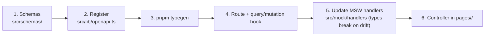

# Chapter 6: Developer Workflow & Tooling

Daily commands, the change workflows (API, component, story/mock, registry), git hooks, the pre-push gate and Changesets. **pnpm only** ([ADR 0016, Q1](file:///d:/Projects/GhostMsg/docs/adr/0016-storybook-msw-and-story-driven-component-testing.md)).

---

## 1. Commands

| Command | Description |
| :--- | :--- |
| `pnpm dev` | Next.js dev server (Turbopack) at `http://localhost:3000` |
| `pnpm typegen` | Regenerate `src/generated/api-schema.d.ts` from `src/lib/openapi.ts` |
| `pnpm build` | `pnpm typegen && next build` |
| `pnpm start` | Serve the production build |
| `pnpm analyze` | Bundle analysis build (`ANALYZE=true`) |
| `pnpm storybook` | Storybook 10 at `http://localhost:6006` |
| `pnpm build-storybook` | Static Storybook in `storybook-static/` (git-ignored) |
| `pnpm test` / `test:watch` / `test:coverage` | Vitest **unit** project |
| `pnpm test:stories` | Vitest **storybook** project (headless Chromium + axe) |
| `pnpm test:all` | Both projects |
| `pnpm docs:registry` | Regenerate [Chapter 11: Component Registry](file:///d:/Projects/GhostMsg/docs/11-component-registry.md) |
| `pnpm docs:registry:check` | Fail if the registry is stale |
| `pnpm check` / `pnpm fix` | Ultracite (Biome) lint + format, check or fix |
| `pnpm exec tsc --noEmit` | Type-check |

First-time setup: `pnpm install`, then `pnpm exec playwright install chromium`.

---

## 2. Change workflows

### 2.1 API change

Typed handlers (`ok()` for 200 and `created()` for 201) fail compilation when the contract changes. Fix the handler and the fixture together. Details: [agents/api-patterns.md](file:///d:/Projects/GhostMsg/docs/agents/api-patterns.md).

### 2.2 Component change
1. **Place the code** with the decision procedure in [agents/component-architecture.md §2](file:///d:/Projects/GhostMsg/docs/agents/component-architecture.md).
2. **Create the module folder:** `<name>.tsx`, `index.ts`, `<name>.mock.ts` (args from fixtures) and `<name>.stories.tsx` (five-point standard).
3. **Run** `pnpm test:stories` for the new stories, then `pnpm docs:registry`.

### 2.3 New mock data or API scenario
1. Add a builder or named dataset to `src/mock/fixtures/<domain>.fixtures.ts`.
2. Add a handler factory or scenario to `src/mock/handlers/<domain>.handlers.ts` and expose it in `scenarios` in `src/mock/handlers/index.ts`.
3. Use it in a story with `parameters: { msw: { handlers: withScenario(scenarios.x.y) } }`, most specific override first.
4. Run `pnpm docs:registry`, which lists fixtures and scenarios.

---

## 3. Git hooks (Husky)

`.husky/pre-commit` runs `npx ultracite fix` on staged `ts, tsx, js, jsx, json, jsonc, md, css` files (deleted files are skipped) and re-stages them.

---

## 4. Pre-push gate

[`.agents/rules/pre-push-quality-checks.md`](file:///d:/Projects/GhostMsg/.agents/rules/pre-push-quality-checks.md) requires, in order:

```bash
pnpm check
pnpm exec tsc --noEmit
pnpm build
pnpm test:all
pnpm docs:registry:check
```

---

## 5. Releases (Changesets)

```bash
pnpm changeset          # describe a change (writes .changeset/*.md)
pnpm changeset version  # bump version + CHANGELOG.md
pnpm changeset tag      # tag the release
```

---

## 6. Next Chapter
Proceed to [Chapter 7: Testing Strategy](file:///d:/Projects/GhostMsg/docs/07-testing-strategy.md).
