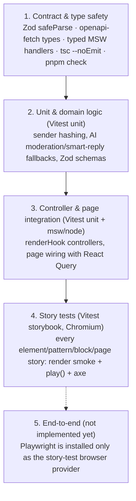

# Chapter 7: Testing Strategy & Test Architecture

GhostMsg runs **two Vitest projects** from one `vitest.config.ts`:
- **`unit`** (happy-dom, MSW-isolated) for logic, controllers and page integration.
- **`storybook`** (Vitest browser mode, headless Chromium, axe) for every component and page story.

Contracts are verified at compile time through Zod + OpenAPI typegen. Rationale: [ADR 0012](file:///d:/Projects/GhostMsg/docs/adr/0012-vitest-unit-and-integration-testing-strategy.md) (Vitest) and [ADR 0016](file:///d:/Projects/GhostMsg/docs/adr/0016-storybook-msw-and-story-driven-component-testing.md) (stories as tests, MSW).

---

## 1. Testing hierarchy



> **E2E status:** there is no E2E suite (`src/tests/` and `playwright.config.*` don't exist). `playwright` and `@vitest/browser-playwright` are dependencies only so story tests can drive Chromium. Adding E2E would need its own ADR.

---

## 2. Projects, ownership and commands

| Project | Environment | Includes | Owns |
| :--- | :--- | :--- | :--- |
| `unit` | happy-dom at `http://localhost:3000` + `msw/node` (`onUnhandledRequest: "error"`) | `src/**/*.{test,spec}.{ts,tsx}` | `src/lib`, schemas, page controllers, page integration |
| `storybook` | Chromium via `@vitest/browser-playwright`, `testTimeout: 30_000` | every `src/components/**/*.stories.tsx` (via `storybookTest({ configDir: ".storybook" })`) | All element, pattern, block and page UI behaviour + a11y |

**Ownership rule (ADR 0016, Q9).** Component behaviour lives in story `play()` functions. A `*.test.tsx` next to an element, pattern or block is a duplicate: move its assertions into the story and delete it.

**Network rule (Q11).** No test may reach the real network. Both projects answer HTTP from the same handlers in `src/mock/handlers/`.

```bash
pnpm test             # unit project (fast inner loop)
pnpm test:watch       # unit project, watch mode
pnpm test:coverage    # unit project + V8 coverage (excludes stories, mocks, src/mock, src/test, generated)
pnpm test:stories     # storybook project (first time: pnpm exec playwright install chromium)
pnpm test:all         # both projects — the pre-push gate
```

---

## 3. Current unit test inventory

| File | Covers |
| :--- | :--- |
| `src/lib/__tests__/security.test.ts` | HMAC-SHA256 `senderHash`, rate-limit helpers |
| `src/lib/__tests__/ai-moderation.test.ts` | Sentiment tagging, toxicity quarantine rules |
| `src/lib/__tests__/ai-smart-reply.test.ts` | Multi-tone smart reply + fallback on AI failure |
| `src/schemas/__tests__/message-schema.test.ts` | Message/send/reply/bulk schemas |
| `src/schemas/__tests__/notification-schema.test.ts` | Notification settings schemas |
| `src/components/pages/dashboard/settings-tab.test.tsx` | Settings tab wiring through `useSettingsController` |
| `src/components/pages/public-profile/public-profile-page.test.tsx` | Page wiring + `useSendMessageController` (`selectSuggestion` writes into form state) |

Story-test inventory (all components and pages) is generated in [Chapter 11: Component Registry](file:///d:/Projects/GhostMsg/docs/11-component-registry.md).

---

## 4. Unit project internals (`src/test/`)

| File | Role |
| :--- | :--- |
| `setup.ts` | jest-dom matchers. **`server.listen({ onUnhandledRequest: "error" })` runs at module load, not in `beforeAll`**, so `fetch` is patched before any app module (e.g. the openapi-fetch client) captures it. `afterEach` → `cleanup()` + `server.resetHandlers()`. `afterAll` → `server.close()`. Polyfills `atob`/`btoa`, `ResizeObserver`, `IntersectionObserver`, `Notification`, `serviceWorker` and `PushManager`. Wraps `Element.prototype.animate` so happy-dom's cancelled-animation rejections are handled. |
| `msw-server.ts` | `setupServer(...defaultHandlers)`. Override per test with `server.use(...scenarios.inbox.empty)`. |
| `test-utils.tsx` | `createTestQueryClient()` (retry off, infinite staleTime) and `renderWithProviders(ui, { queryClient? })`. |

Gotchas already solved (don't reintroduce them):
- **Don't import `motion/react` or `motion-utils` in `setup.ts`.** The first breaks Vitest's suite detection. The second resolves a different pnpm copy and doesn't affect Motion.
- **Keep `environmentOptions.happyDOM.url`.** Without an origin, relative `/api/*` URLs resolve against a blank base and slip past MSW.

---

## 5. Story tests (summary)

Full rules: [Chapter 10](file:///d:/Projects/GhostMsg/docs/10-storybook-and-ui-catalog.md).
- **Smoke tests:** every story renders as one, with axe checks at `a11y.test: "error"`.
- **Interaction tests:** `play()` functions drive the UI with `userEvent` and assert both callbacks (`fn()` spies) and the visible result.
- **No animation:** Motion and CSS animations are disabled in test mode, which keeps assertions deterministic.
- **Pages:** they run real controllers against MSW handlers inside `SessionProvider` and a fresh `QueryClient`.

---

## 6. Next Chapter
Proceed to [Chapter 8: Code Quality & Standards](file:///d:/Projects/GhostMsg/docs/08-code-quality.md).
