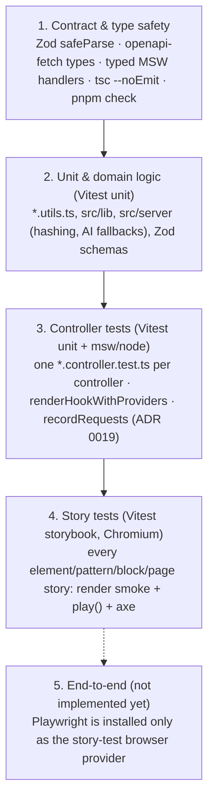
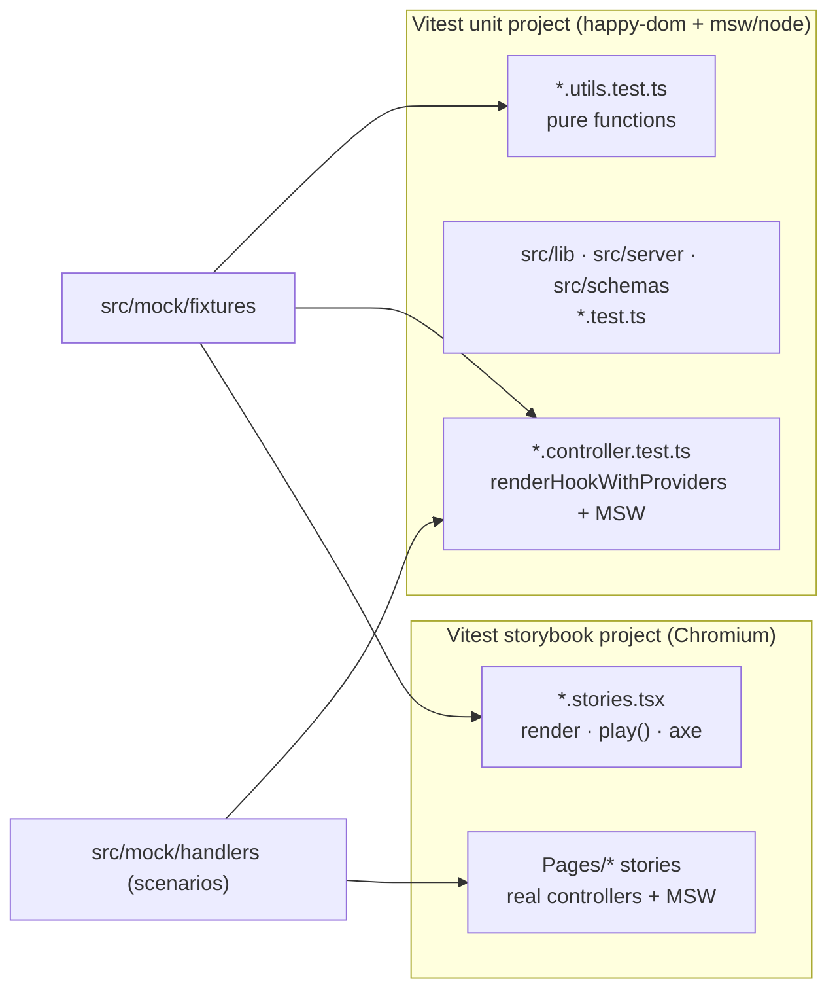

# Chapter 7: Testing Strategy & Test Architecture

GhostMsg runs **two Vitest projects** from one `vitest.config.ts`:
- **`unit`** (happy-dom, MSW-isolated) for logic, controllers and page integration.
- **`storybook`** (Vitest browser mode, headless Chromium, axe) for every component and page story.

Contracts are verified at compile time through Zod + OpenAPI typegen. Rationale: [ADR 0012](adr/0012-vitest-unit-and-integration-testing-strategy.md) (Vitest) and [ADR 0016](adr/0016-storybook-msw-and-story-driven-component-testing.md) (stories as tests, MSW).

---

## 1. Testing hierarchy



> **E2E status:** there is no E2E suite (`src/tests/` and `playwright.config.*` don't exist). `playwright` and `@vitest/browser-playwright` are dependencies only so story tests can drive Chromium. Adding E2E would need its own ADR.

---

## 2. Projects, ownership and commands

| Project | Environment | Includes | Owns |
| :--- | :--- | :--- | :--- |
| `unit` | happy-dom at `http://localhost:3000` + `msw/node` (`onUnhandledRequest: "error"`) | `src/**/*.{test,spec}.{ts,tsx}` | `src/lib`, `src/server`, schemas, `*.utils.ts`, page controllers |
| `storybook` | Chromium via `@vitest/browser-playwright`, `testTimeout: 30_000` | every `src/components/**/*.stories.tsx` (via `storybookTest({ configDir: ".storybook" })`) | All element, pattern, block and page UI behaviour + a11y |

**Ownership rule (ADR 0016, Q9).** Component behaviour lives in story `play()` functions. A `*.test.tsx` next to an element, pattern or block is a duplicate: move its assertions into the story and delete it.

**Network rule (Q11).** No test may reach the real network. Both projects answer HTTP from the same handlers in `src/mock/handlers/`.

```bash
pnpm test             # unit project (fast inner loop)
pnpm test:watch       # unit project, watch mode
pnpm test:coverage    # unit project + V8 coverage (excludes stories, mocks, src/mock, src/test, generated)
pnpm test:stories     # storybook project (first time: pnpm exec playwright install chromium)
pnpm test:all         # both projects — the pre-push gate
```

---

## 3. Current unit test inventory

Tests are **always colocated** (`x.ts` + `x.test.ts`); there are no `__tests__/` folders ([ADR 0018](adr/0018-source-structure-server-data-lib-utils-controllers-tests.md), Q6). Required coverage (Q7): every `*.utils.ts`, every `src/lib` / `src/server` module with logic, and every page controller.

| File | Covers |
| :--- | :--- |
| **Server** | |
| `src/server/security/security.test.ts` | HMAC-SHA256 `senderHash`, rate-limit helpers, constant-time cron bearer check |
| `src/server/ai/moderation.test.ts` | Graded toxicity levels and `isToxic`, code-fence stripping, legacy `{ isToxic }` mapping, unknown values, fail-open without a key / on invalid JSON / on AI errors (AI SDK mocked, no network) |
| `src/server/ai/quarantine-policy.test.ts` | Relaxed/Balanced/Strict thresholds, quarantine off, missing settings (ADR 0025) |
| `src/server/ai/smart-reply.test.ts` | Multi-tone smart reply + fallback on AI failure |
| `src/server/ai/ama-suggestions.test.ts` | `||` parsing, length filter, fixed fallbacks |
| `src/server/notifications/delivery-policy.test.ts` | Quiet hours (midnight crossing, zones, zero-length), hidden previews, truncation (ADR 0026) |
| `src/server/notifications/daily-digest.test.ts` | Digest window (first, since last, 7-day cap), hidden vs shown previews, quiet-hours skip, empty, failed send keeps the window, per-recipient error isolation (ADR 0029) |
| `src/server/email/send-message-alert-email.test.ts` | Preview + tone when shown; neutral email without text or tone when hidden; `APP_URL` link; failed send |
| `src/server/email/send-daily-digest-email.test.ts` | Previews + "more in your inbox", count-only when hidden, subject pluralisation |
| `src/server/users/user-dto.test.ts` | Profile/preferences/notification defaults for old documents, blocked-sender date join (ADR 0024) |
| `src/server/push/web-push.test.ts` | VAPID config, gone (404/410) detection, fan-out, pruning, unconfigured skip, push off only when no device remains (ADR 0020, 0030) |
| `src/server/messages/inbox-query.test.ts` | Status filters mirror the shared rules, escaped search on message + answer, cursor + search combination, page-size parsing, counts pipeline (ADR 0030) |
| **Schemas** | |
| `src/schemas/message-schema.test.ts` | Message/send/reply/bulk schemas |
| `src/schemas/notification-schema.test.ts` | Notification settings, `HH:MM` clock, quiet hours |
| `src/schemas/user-settings-schema.test.ts` | Display name trim/cap, avatar data URLs, `null` removal, username rules, preference partials + sensitivity enum, delete-account confirmation |
| **Lib & data** | |
| `src/hooks/use-leave-guard.test.ts` | Holds in-app links while dirty, ignores new-tab/external/same-page links, browser close prompt |
| `src/providers/palette-provider.test.tsx` | Stores/applies a palette, follows other tabs (`storage` event), ignores unknown values |
| `src/lib/messages/inbox-filter.test.ts` | Shared inbox rules: status matching (incl. `any`), search, counts, guards |
| `src/lib/messages/inbox-cursor.test.ts` | Cursor round-trip, malformed cursors, newest-first order, later-page check |
| `src/lib/messages/export.test.ts` | CSV/JSON export builders, allow-listed JSON records (never `senderHash`), quote escaping, filename + MIME |
| `src/lib/browser/download.test.ts` | Anchor + data-URL download side effect |
| `src/lib/browser/resize-image.test.ts` | `fitWithin` downscaling, never upscales |
| `src/lib/format/relative-time.test.ts` | now / minutes / hours / days, short date after a week, future dates |
| `src/lib/theme/palette.test.ts` | Palette guard, boot script (stored, invalid, blocked storage) |
| `src/lib/users/username-availability.test.ts` | Availability status mapping, min length (shared by sign-up and Change username) |
| `src/data/messages/use-live-messages.utils.test.ts` | Live toast (silent for quarantined, text-free when hidden), SSE payload mapping, cache insert per filter (no searches, no duplicates), counts bump |
| `src/data/user/use-push-notification.utils.test.ts` | VAPID key base64url → `Uint8Array`, same-key detection, DOMException → user message |
| **Component utils** | |
| `src/components/elements/theme-toggler/theme-toggler.utils.test.ts` | Theme cycling order |
| `src/components/pages/dashboard/inbox.utils.test.ts` | Filter guard, shortcut keys, focus movement, `buildInboxHref`, scoped selection, dialog message resolution |
| `src/components/pages/dashboard/dashboard.utils.test.ts` | Active nav from pathname, `stripProtocol`, `toLinkPrefix` |
| `src/components/pages/dashboard/profile.utils.test.ts` | Public profile URL, `buildProfilePatch` (changed fields only, trimmed, no blank prompt) |
| `src/components/pages/home/home.utils.test.ts` | Claim href (trim, encode, empty), link prefix fallback |
| `src/components/pages/public-profile/send-message.utils.test.ts` | AI suggestion parsing (`||`-separated) |
| **Controllers** | |
| `src/components/pages/dashboard/use-inbox.controller.test.ts` | Server filters (Quarantined), debounced server search, Load more paging, server counts, selection scoped to filter + loaded ids, mark-read on reply, optimistic star rollback, bulk, export, delete, refresh errors, blocklist (ADR 0021, 0030) |
| `src/components/pages/dashboard/use-dashboard-shell.controller.test.ts` | Session + active nav + unread count, acceptance toggle and paused label, ⌘K/Ctrl+K, command routing, sign-out, go to sign-in |
| `src/components/pages/dashboard/use-profile-link.controller.test.ts` | Link + label from the session, copy + toast, blocked clipboard, share sheet only when supported |
| `src/components/pages/dashboard/use-inbox-filters.controller.test.ts` | Route filter/search, URL write-through via `history.replaceState`, debounced search + scope, adopting a new `?filter=` |
| `src/components/pages/dashboard/use-inbox-data.controller.test.ts` | One filter from the server with counts, polling fallback flag, refresh toasts |
| `src/components/pages/dashboard/use-inbox-keyboard.controller.test.ts` | `j`/`k` cursor, select/star/reply on the focused card, `/` focuses search, ignored while a dialog is open |
| `src/components/pages/dashboard/use-smart-reply.controller.test.ts` | Draft seeding, AI generate, save / blank-draft guard |
| `src/components/pages/dashboard/use-profile.controller.test.ts` | Profile URL from session, form draft + discard, one-request save with the trimmed AMA prompt, blank-prompt guard, leave guard → discard and navigate, AI ideas |
| `src/components/pages/dashboard/use-change-username.controller.test.ts` | Opens idle with the current name, debounced available/taken, save → session `update` + `router.refresh` |
| `src/components/pages/dashboard/use-settings.controller.test.ts` | Defaults, closed-inbox scenario, acceptance (API + controlled), alerts, unblock, web push per device (switch follows this browser; off removes only this device) |
| `src/components/pages/dashboard/use-danger-zone.controller.test.ts` | Delete all behind the undo toast, Undo cancels, unmount commits, typed account deletion → `signOut`, wrong confirmation |
| `src/components/pages/dashboard/use-appearance.controller.test.ts` | Mode/palette exposure, system fallback, unknown palette ignored, `setTheme` |
| `src/components/pages/home/use-claim-link.controller.test.ts` | Submit opens `/sign-up?username=`, host as link prefix |
| `src/components/pages/public-profile/use-public-answers.controller.test.ts` | Answers + AMA prompt, Message Acceptance, error fallback |
| `src/components/pages/public-profile/use-send-message.controller.test.ts` | Auto-fetch suggestions, errors, `selectSuggestion`, send + reset, not-accepting |
| `src/components/pages/auth/shared/use-google-sign-in.controller.test.ts` | Stable Google OAuth callback |
| `src/components/pages/auth/sign-in/use-sign-in.controller.test.ts` | Credentials success/redirect, custom redirect, NextAuth error, thrown error |
| `src/components/pages/auth/sign-up/use-sign-up.controller.test.ts` | Register + redirect, server error, composed availability |
| `src/components/pages/auth/sign-up/use-username-availability.controller.test.ts` | Short-name skip, available clears error, taken writes form error |
| `src/components/pages/auth/verify/use-verify.controller.test.ts` | Verify + redirect, incorrect code |

**Totals (2026-10-14):** 46 unit test files + 102 story files = 148 files, 610 tests (`pnpm test:all`).

**Coverage:** every page controller now has a colocated `*.controller.test.ts`.

**Story-test conventions introduced by the shadcn migration:**
- `ToggleGroup type="single"` items have `role="radio"`: query filters, view switches, sensitivity and idea chips with `getByRole("radio", { name })`.
- A button that shows a `Spinner` is named "Loading <label>": match pending buttons with a regex (`/save changes/i`).
- cmdk keeps an empty `role="listbox"` in its empty state; only the `NoMatches` palette story disables `aria-required-children`.

**Where each kind of logic is tested** ([ADR 0018](adr/0018-source-structure-server-data-lib-utils-controllers-tests.md) Q6/Q7, [ADR 0019](adr/0019-controller-test-harness-renderhook-msw-and-edge-mocking.md)):



**Controller test recipe** ([ADR 0019](adr/0019-controller-test-harness-renderhook-msw-and-edge-mocking.md)). `renderHookWithProviders(() => useXController(), { session? })` from `src/test/test-utils.tsx` wraps the hook in `SessionProvider` (session passed directly, default `null`, so no session fetch and no SSE) and a fresh `QueryClient`. Network goes to the shared MSW handlers; override with `server.use(...scenarios.x.y)`. Assert endpoints with `recordRequests()`. Mock only the edges MSW can't see: `vi.mock("next/navigation")` for `useRouter`, `vi.mock("sonner")` for toasts, `vi.mock("next-auth/react")` for `signIn`, and browser side effects like `@/lib/browser/download`.

Story-test inventory (all components and pages) is generated in [Chapter 11: Component Registry](11-component-registry.md).

---

## 4. Unit project internals (`src/test/`)

| File | Role |
| :--- | :--- |
| `setup.ts` | jest-dom matchers. **`server.listen({ onUnhandledRequest: "error" })` runs at module load, not in `beforeAll`**, so `fetch` is patched before any app module (e.g. the openapi-fetch client) captures it. `afterEach` → `cleanup()` + `server.resetHandlers()`. `afterAll` → `server.close()`. Polyfills `atob`/`btoa`, `ResizeObserver`, `IntersectionObserver`, `Notification`, `serviceWorker` and `PushManager`. Wraps `Element.prototype.animate` so happy-dom's cancelled-animation rejections are handled. |
| `msw-server.ts` | `setupServer(...defaultHandlers)`. Override per test with `server.use(...scenarios.inbox.empty)`. |
| `test-utils.tsx` | `createTestQueryClient()` (retry off, infinite staleTime), `renderWithProviders(ui, { queryClient? })`, `renderHookWithProviders(hook, { queryClient?, session? })` and `recordRequests()` (MSW `request:start` log, auto-cleared per test). |
| `server-only-stub.ts` | Aliased to `server-only` in `vitest.config.ts`, so `src/server/**` modules import cleanly in happy-dom. Next.js still enforces the real package in builds. |

Gotchas already solved (don't reintroduce them):
- **Don't import `motion/react` or `motion-utils` in `setup.ts`.** The first breaks Vitest's suite detection. The second resolves a different pnpm copy and doesn't affect Motion.
- **Keep `environmentOptions.happyDOM.url`.** Without an origin, relative `/api/*` URLs resolve against a blank base and slip past MSW.

---

## 5. Story tests (summary)

Full rules: [Chapter 10](10-storybook-and-ui-catalog.md).
- **Smoke tests:** every story renders as one, with axe checks at `a11y.test: "error"`.
- **Interaction tests:** `play()` functions drive the UI with `userEvent` and assert both callbacks (`fn()` spies) and the visible result.
- **No animation:** Motion and CSS animations are disabled in test mode, which keeps assertions deterministic.
- **Pages:** they run real controllers against MSW handlers inside `SessionProvider` and a fresh `QueryClient`.

---

## 6. Next Chapter
Proceed to [Chapter 8: Code Quality & Standards](08-code-quality.md).
