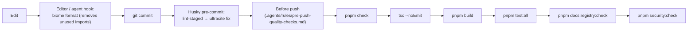

# Chapter 8: Code Quality & Standards

This chapter outlines GhostMsg's strict code standards, linting configuration via Ultracite (Biome), TypeScript compiler settings, and architectural anti-patterns.

---

## 1. Ultracite (Biome) Tooling ([ADR 0004](adr/0004-ultracite-and-biome-tooling.md))

GhostMsg has standardized on **Ultracite** (powered by Biome) to replace legacy ESLint and Prettier setups:
- **Sub-second execution**: Checks 100+ files in under 200ms.
- **Zero configuration drift**: Consistent rules across developer machines, pre-commit hooks, and CI pipelines.
- **Strict linting**: Enforces accessibility (`a11y`), hook dependencies, imports sorting, and anti-pattern bans.

### Commands
```bash
# Verify formatting and linting
pnpm check

# Automatically fix linting and formatting
pnpm fix
```

### Where the gates run



### Rules people trip on, with the fix

```tsx
// noJsxPropsBind: no new function per render in a list
{drafts.map((d) => <button onClick={() => onPick(d.text)}>{d.text}</button>)}   // ✗
{drafts.map((d) => <DraftIdeaButton draft={d} key={d.tone} onPick={onPick} />)} // ✓ (useCallback inside)

// noLeakedRender: a ternary whose branch is a variable
<p>{isQuarantineView ? `${n} held back` : inboxLine}</p>                         // ✗
let subtitle = describeUnread(unread);                                              // ✓ compute first
if (isQuarantineView) subtitle = `${n} held back · never in your main inbox`;
<p>{subtitle}</p>

// useTopLevelRegex: regexes are module constants
const DELETE_REGEX = /^delete$/i;                                                   // ✓
```

More, with causes: [Chapter 27 §4](27-developer-troubleshooting.md#4-lint-biome--ultracite).

---

## 2. TypeScript Strict Mode & Compiler Configuration

TypeScript is configured with strict compiler flags in [`tsconfig.json`](../tsconfig.json):
- `strict: true`
- `noImplicitAny: true`
- `strictNullChecks: true`
- Path aliases: `@/*` mapped to `./src/*`

### Type Checking
```bash
pnpm exec tsc --noEmit
```

---

## 3. Banned Anti-Patterns

| Banned Practice | Enforced Alternative |
| :--- | :--- |
| `axios` imports | `api` (`openapi-fetch`) from [`@/data/api-client`](../src/data/api-client.ts) |
| Untyped raw `fetch()` calls | `api.GET()`, `api.POST()`, `api.DELETE()` |
| Manual `useState` for API data | `@tanstack/react-query` (`useQuery`, `useMutation`) |
| Untyped `any` casting | Strongly typed Zod schemas (`z.infer<typeof schema>`) |
| Unverified string endpoints | Strongly typed OpenAPI `paths` |
| Array index as React `key` (`key={index}`) | Stable unique IDs (`key={item.id}` or deterministic item attributes) |
| `import { toast } from "sonner"` in app code | `notify` from `@/components/elements/sonner` (per-type durations, assertive errors; [Chapter 25 §5.2](25-accessibility-and-feedback.md#52-notify)) |
| Two DOM copies of a form for phone and desktop | One tree chosen with `useIsMobile()` ([Chapter 26 §2](26-responsive-design.md#2-two-techniques)) |
| Raw type sizes (`text-[22px] font-bold`) for headings and body | Semantic scale (`text-h3`, `text-body`, …) ([Chapter 13 §3.1](13-design-system-and-theming.md#31-type-scale)) |

---

## 4. Biome Suppression Elimination & Code Quality ([ADR 0009](adr/0009-biome-suppression-elimination-and-lint-remediation.md))

GhostMsg enforces a **zero-inline-suppression policy** and strict linter rules for core application and feature code:
- **No Array Index Keys (`suspicious.noArrayIndexKey: "error"`)**: React list rendering must always use stable, deterministic keys (e.g. database `_id`, semantic names, or deterministic angle/coordinate formulas) rather than array indices. Array index keys cause subtle reconciliation bugs, state leakage across reordered items, and animation glitching with Motion / `AnimatePresence`.
- **No Interactive `<div>`s**: Interactive elements must use semantic `<button type="button">` with `aria-label` or `<input>` to satisfy `a11y` rules.
- **No `any` Types**: Generic utility hooks and NextAuth callbacks must use `unknown`, strongly typed interfaces, or generic parameters.
- **No Nested Ternaries**: Branching logic must use early returns, guard clauses, or isolated resolver functions.
- **Scoped UI Overrides**: Framework conventions in vendored primitives (e.g. `src/components/elements/effects/`, `*.primitive.tsx`) are configured centrally via `overrides` in [`biome.jsonc`](../biome.jsonc) rather than through ad-hoc inline comments.

---

## 5. Biome configuration map (`biome.jsonc`)

| Setting | Scope | Purpose |
| :--- | :--- | :--- |
| `files.includes` | `src/**`, `.storybook/**`, `emails/**`, `scripts/**`, `docs/**`, root configs | Lint and format targets (`public/`, `.next/` excluded) |
| `performance.noBarrelFile: off` | global | Module `index.ts` public APIs are allowed. Tier-level barrels are intentionally absent. |
| `suspicious.noArrayIndexKey: error` | global | Stable React keys |
| `style.noRestrictedImports` | `elements/**`, `patterns/**`, `blocks/**` | Tier DAG + bans data/logic modules (`@tanstack/react-query`, `@/data/**`, `next-auth/react`, `next/navigation`) + bans `@/server/**` |
| `style.noRestrictedImports` | `pages/**`, `src/data/**`, `src/hooks/**`, `src/providers/**`, `src/content/**`, `src/mock/**`, `src/types/**`, `.storybook/**` | Bans `@/server/**` and `server-only` (ADR 0018) |
| `style.noRestrictedImports` | `src/lib/**` (not tests) | Bans `react`, `next/**`, `next-auth/**`, `@tanstack/**`, `@/data/**`, `@/components/**`, `@/server/**` (ADR 0018) |
| `a11y.useSemanticElements: off` | `elements/carousel/**`, `elements/input-otp/**`, `elements/breadcrumb/**`, `elements/field/**`, `elements/input-group/**`, `elements/item/**` | Upstream shadcn/Radix ARIA roles (carousel `region`, OTP `separator`, breadcrumb `link`, field and input-group `group`, item `list`) |
| `a11y.useFocusableInteractive`, `useKeyWithClickEvents`, `noNoninteractiveElementInteractions: off` | `elements/breadcrumb/**`, `elements/input-group/**` | Upstream patterns: the current-page crumb is a non-focusable `role="link"`; `InputGroupAddon` forwards clicks to its input ([ADR 0023](adr/0023-shadcn-first-elements-and-profile-settings-backend.md)) |
| `a11y.noNoninteractiveElementInteractions`, `noStaticElementInteractions: off` | `elements/effects/**`, `elements/**/*.primitive.tsx` | Vendored motion primitives |
| `style.noExportedImports: off` | `src/schemas/zod.ts` | Re-exported extended `z` |

## 6. Story, mock and test conventions enforced by lint

- **Regexes in stories and tests** are top-level constants (`performance/useTopLevelRegex`), e.g. `const SAVE_REGEX = /save/i;`.
- **Hooks in story `render`** must live in a named PascalCase component (`useHookAtTopLevel`). Use `StatefulX` wrappers or `XHarness` components, never `render: function Render() { useState… }`.
- **Empty callbacks** use `noop` from `@/mock/noop`, never `() => {}` (`noEmptyBlockStatements`).
- **No non-null assertions** in stories (`noNonNullAssertion`). Build the value from a fixture instead.
- **No inline suppressions**, consistent with ADR 0009. Fix the code or add a scoped override with a reason.

---

## 7. Tier Import Rules

`noRestrictedImports` overrides enforce the Elements ➔ Patterns ➔ Blocks ➔ Pages DAG and keep data/logic modules inside `src/components/pages/` ([ADR 0015](adr/0015-four-tier-components-pages-layer-and-vendor-consolidation.md)). Each diagnostic message names the violated rule.

---

## 8. Next Chapter
Proceed to [Chapter 9: Deployment & Operations](09-deployment-and-operations.md).

