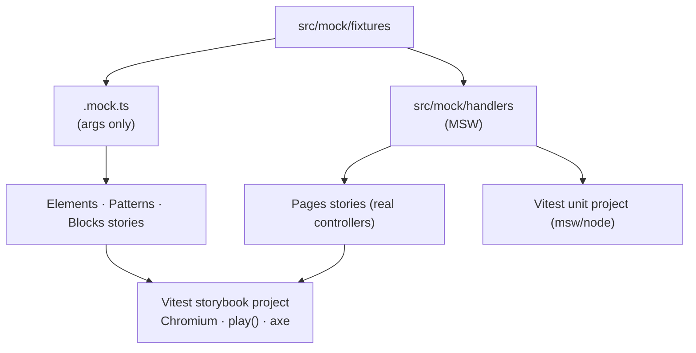

# Chapter 10: Storybook & UI Component Catalog

GhostMsg uses **Storybook 10** (`@storybook/nextjs-vite`) as the component catalog and the primary component test harness. Stories run as **Vitest browser tests** in headless Chromium through `@storybook/addon-vitest`, with axe accessibility checks. Page stories isolate their dependencies with **MSW** at the network layer. Rationale: [ADR 0016](file:///d:/Projects/GhostMsg/docs/adr/0016-storybook-msw-and-story-driven-component-testing.md).

---

## 1. Commands

| Command | What it does |
| :--- | :--- |
| `pnpm storybook` | Dev server at `http://localhost:6006` with autodocs, controls, actions, a11y panel and the theme toolbar |
| `pnpm build-storybook` | Static build into `storybook-static/` (manual/CI step) |
| `pnpm test:stories` | Runs every story as a Vitest browser test (smoke + `play()` + axe) |
| `pnpm test` | Unit project only (happy-dom): logic, controllers, page integration |
| `pnpm test:all` | Both projects; this is the pre-push gate |

First-time setup: `pnpm exec playwright install chromium`.

---

## 2. Configuration map

```
.storybook/
├── main.ts              # framework @storybook/nextjs-vite, stories glob, addons (docs, a11y, vitest), staticDirs
├── preview.tsx          # globals.css, theme toolbar, ThemeProvider(forcedTheme), <Toaster/>, MSW loader, a11y "error",
│                        # test-mode animation kill-switch (Motion + CSS)
└── preview-head.html    # Poppins <link> + --font-poppins (no build-time network)
# No vitest.setup.ts: Storybook 10's addon-vitest applies project annotations itself.

src/mock/
├── noop.ts              # stub callback
├── fixtures/            # typed domain builders + named scenarios (single source of mock data)
└── handlers/            # MSW handlers typed by OpenAPI paths: defaultHandlers + scenario sets
```



---

## 3. Providers and globals

| Concern | Where | Applies to |
| :--- | :--- | :--- |
| Tailwind + tokens | `import "../src/app/globals.css"` in `preview.tsx` | all stories |
| Light/dark | Toolbar global `theme` → `next-themes` `ThemeProvider forcedTheme` | all stories |
| Toasts | Global `<Toaster />` decorator | all stories |
| Network | `mswLoader` from `msw-storybook-addon/csf3` (the supported CSF3 integration in v3) with `parameters.msw.handlers` (defaults to `defaultHandlers`). Unmocked `/api/*` requests fail. | all stories (only pages make requests) |
| Session + React Query | `withPageProviders` decorator: `SessionProvider` + **new `QueryClient` per story** | `Pages/*` stories (`parameters.pageProviders: true`) |
| Next router/link | Built into `@storybook/nextjs-vite`; set `parameters.nextjs.navigation` for route params | as needed |

---

## 4. The story standard

Every `*.stories.tsx` must meet all five points ([ADR 0016, Q6](file:///d:/Projects/GhostMsg/docs/adr/0016-storybook-msw-and-story-driven-component-testing.md)):

1. **CSF3, typed.** `satisfies Meta<typeof X>`, `type Story = StoryObj<typeof meta>`, `tags: ["autodocs"]`, and a tier title (`Elements/…`, `Patterns/…`, `Blocks/…`, `Pages/…`).
2. **Controls and actions.** `argTypes` with a description for every prop, select/radio controls for variants and sizes, and `fn()` for every callback.
3. **One story per state.** Default · each Variant/Size · Disabled · Loading/Pending · Empty · Error · Edge (long text, overflow), as applicable.
4. **Interaction tests.** Interactive stories have a `play()` that asserts both the callback and the visible outcome.
5. **Themes and viewports.** Light/dark come from the toolbar. Responsive blocks add a mobile story (`globals: { viewport: { value: "mobile1" } }`).

### 4.1 Pure component story (elements / patterns / blocks)

```tsx
import type { Meta, StoryObj } from "@storybook/nextjs-vite";
import { expect, fn } from "storybook/test";
import { defaultShareLinkCardArgs } from "./share-link-card.mock";
import { ShareLinkCard } from "./share-link-card";

const meta = {
  title: "Patterns/ShareLinkCard",
  component: ShareLinkCard,
  tags: ["autodocs"],
  args: { ...defaultShareLinkCardArgs, onCopy: fn() },
  argTypes: {
    profileUrl: { control: "text", description: "Public profile URL shown read-only" },
    onCopy: { description: "Called after the URL is copied" },
  },
} satisfies Meta<typeof ShareLinkCard>;
export default meta;
type Story = StoryObj<typeof meta>;

export const Default: Story = {};

export const CopiesLink: Story = {
  play: async ({ args, canvas, userEvent }) => {
    await userEvent.click(canvas.getByRole("button", { name: /copy to clipboard/i }));
    await expect(args.onCopy).toHaveBeenCalledOnce();
  },
};

export const LongUrl: Story = { args: { profileUrl: "https://ghostmsg.app/u/a-very-long-username-that-overflows" } };
```

### 4.2 Page story (MSW-isolated)

```tsx
const meta = {
  title: "Pages/Dashboard",
  component: DashboardPage,
  tags: ["autodocs"],
  parameters: { layout: "fullscreen", pageProviders: true, msw: { handlers: defaultHandlers } },
} satisfies Meta<typeof DashboardPage>;

export const EmptyInbox: Story = { parameters: { msw: { handlers: [...scenarios.inbox.empty, ...defaultHandlers] } } };
export const SignedOut: Story = { parameters: { msw: { handlers: [...scenarios.session.unauthenticated, ...defaultHandlers] } } };
```

---

## 5. Mock data rules

Full catalog of fixtures and scenarios: [Chapter 11](file:///d:/Projects/GhostMsg/docs/11-component-registry.md).


- **Domain shapes come only from `src/mock/fixtures`** (`buildMessage`, `buildPublicAnswer`, `buildSession`, `messageScenarios.*`, …). Builders accept `Partial<T>` overrides and return fully typed objects.
- **`<component>.mock.ts` exports args objects** named `default<Name>Args`, `<state><Name>Args`. They're built from fixtures, and callbacks use `noop` (stories override with `fn()`).
- **A component mock never imports another component's mock.** Shared data goes in a fixture instead.
- **Mocks are never re-exported from `index.ts`.**
- **MSW handlers** live in `src/mock/handlers/<domain>.handlers.ts`, typed with `paths` from `src/generated/api-schema.d.ts`. Scenario sets are prepended to `defaultHandlers` (first match wins).

---

## 6. Dependency isolation: why stories don't break

| Dependency | Used by | Isolation in stories |
| :--- | :--- | :--- |
| `next/link`, `next/navigation` | blocks, patterns, pages | `@storybook/nextjs-vite` built-in mocks |
| `next-themes` | theme toggler, toaster | global `ThemeProvider` decorator |
| `next-auth/react` | pages | real `SessionProvider` + MSW `/api/auth/session` handler |
| `@tanstack/react-query` | pages | real client, fresh per story |
| `openapi-fetch` (`api`) | pages | real; MSW answers the HTTP |
| `motion`, `embla-carousel`, `input-otp`, Radix | elements | real browser, no mocking needed |

Nothing below `pages/` imports data modules (enforced by Biome, [ADR 0015](file:///d:/Projects/GhostMsg/docs/adr/0015-four-tier-components-pages-layer-and-vendor-consolidation.md)), so elements, patterns and blocks stories need args only.

---

## 7. Writing reliable story tests (lessons baked into the setup)

| Rule | Why |
| :--- | :--- |
| **Animations are off in story tests.** `preview.tsx` sets `MotionGlobalConfig.skipAnimations` and injects a zero-duration CSS rule when `import.meta.env.MODE === "test"`. Interactive Storybook keeps full motion. | axe and `toBeVisible()` would otherwise sample half-faded frames (dialogs, tabs, toasts). |
| **Controlled inputs use a local-state wrapper component**, e.g. `StatefulAmaPromptEditor`, never `useArgs`. | `useArgs` doesn't re-render inside Vitest, so typed text gets lost. A named component also satisfies Biome's hook rules. |
| **Form patterns use a harness component** that creates `useForm` with the real `zodResolver(schema)`. | Patterns receive `form` from a page controller, so the harness plays the controller's role. |
| **Page stories wait with `PAGE_LOAD` (`{ timeout: 15_000 }`)** as the third `findBy*` argument: `findByRole(role, { name }, PAGE_LOAD)`. The storybook project's `testTimeout` is 30s. | The first story of a file chains MSW worker start → session → lazy chunk → query. |
| **Preload `next/dynamic` chunks with a meta `loaders` entry** (see `dashboard-page.stories.tsx`). | Otherwise the first story races Vite's on-demand transform. |
| **Scenario order: most specific override first**, e.g. `withScenario(scenarios.credentials.invalid, scenarios.session.unauthenticated)`. | MSW uses the first matching handler, and session sets include NextAuth callbacks. |
| **Portals** (dialogs, tooltips, toasts) are queried with `screen`, not `canvas`. | They render outside the story root. |
| **Override args are partial objects** (`satisfies Partial<Props>`) that never spread `default*Args`. | Spreading would replace the meta's `fn()` spies with `noop`. |
| **A failing `color-contrast` check is fixed in the component**, one shade darker in the same hue (ADR 0016, Q17). | The a11y gate runs with `test: "error"`. |
| **First run after adding a dependency** may fail with "failed to find the current suite" or "Failed to import". Re-run once. | Vite re-optimizes dependencies on a cold cache. It's transient. |

---

## 8. Recipes

**Add a story file**
1. Create `<name>.mock.ts` with `default<Name>Args` (fixture-based, `noop` callbacks) plus partial override objects (`satisfies Partial<Props>`).
2. Create `<name>.stories.tsx` with the CSF3 meta (`title`, `tags: ["autodocs"]`, `args: { ...defaultArgs, onX: fn() }`, `argTypes` with descriptions) and one story per state. Interactive stories get a `play()`.
3. Run `pnpm test:stories` and `pnpm docs:registry`.

**Add an MSW scenario**
1. Add the dataset to `src/mock/fixtures/<domain>.fixtures.ts`.
2. Add the scenario to the domain handler group (`latency: "infinite"` for loading states, `apiError(status, message)` for errors).
3. Expose it via `scenarios` in `src/mock/handlers/index.ts` and use `withScenario(scenarios.group.name)` in the page story's `.mock.ts`.

**Add a page story**
- Set `parameters: { pageProviders: true, msw: { handlers } }`.
- Wait for data with `PAGE_LOAD`, and assert toasts with `screen`.
- Preload `next/dynamic` chunks in meta `loaders`.

---

## 9. Next Chapter
Return to the [Documentation Index](file:///d:/Projects/GhostMsg/docs/README.md).
