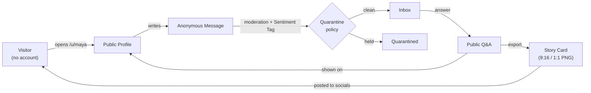
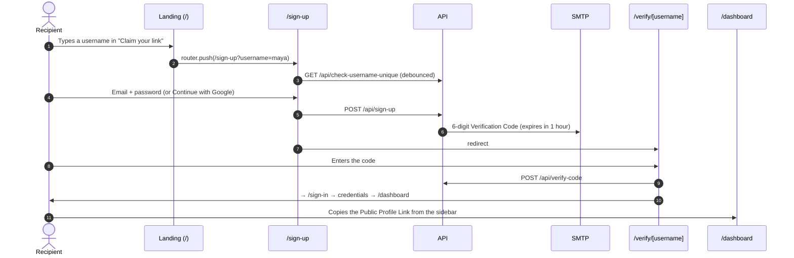
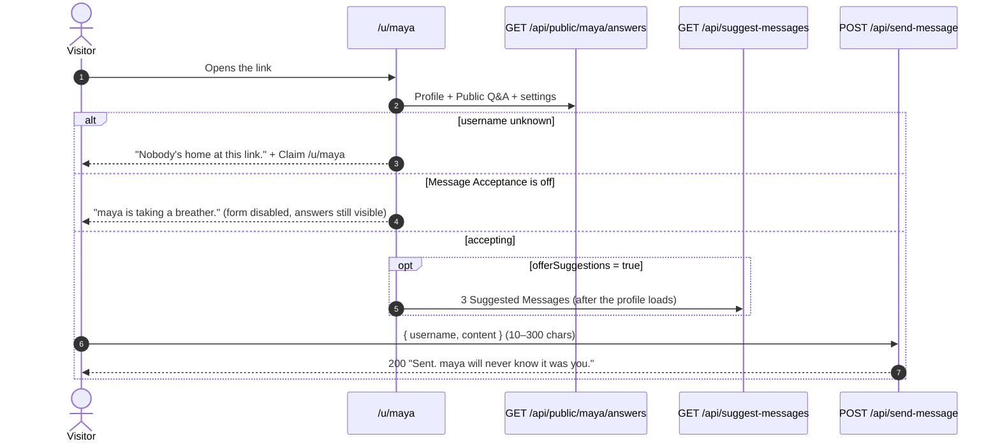
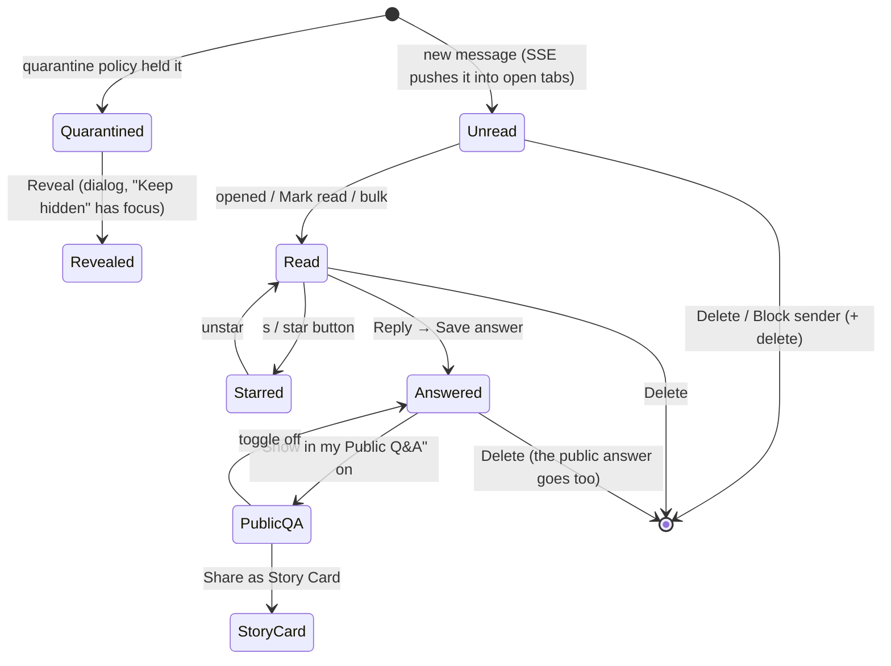
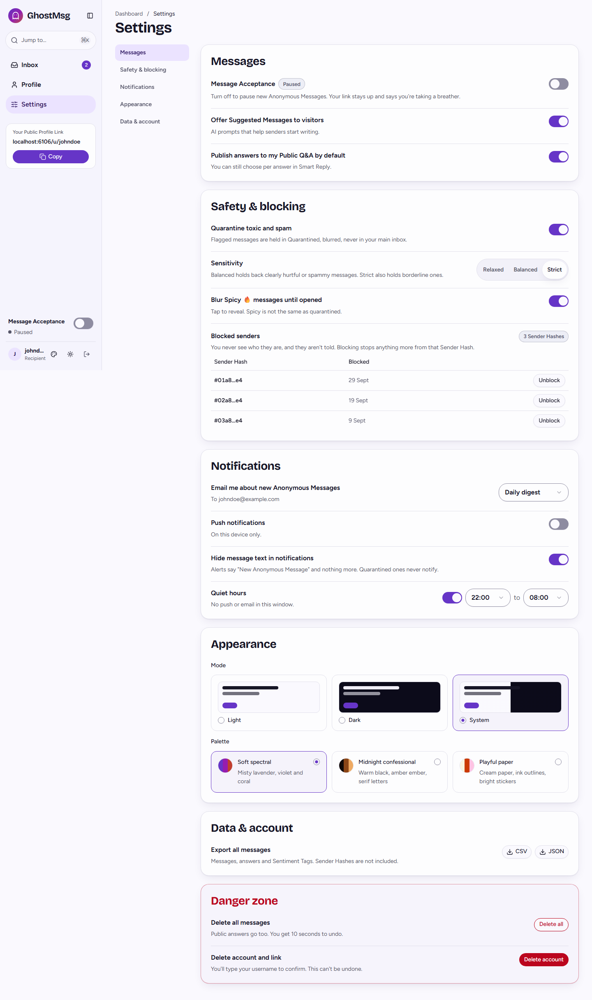

# Chapter 12: Product Guide & Feature Catalog

What GhostMsg does, for whom, on which screen, and which code owns each behaviour. Read this before changing a feature so the change keeps the product's promises. Terms in **bold** are defined in [`GLOSSARY.md`](../GLOSSARY.md); use them verbatim in code, tests, issues and docs.

> **Snapshot date:** 2026-10-14, after the Claude Design redesign ([ADR 0022](adr/0022-palette-theming-and-claude-design-redesign.md)), the shadcn-first rebuild ([ADR 0023](adr/0023-shadcn-first-elements-and-profile-settings-backend.md)) and the Profile & Settings backend ([ADR 0024](adr/0024-profile-preferences-data-model-and-settings-api.md)–[0027](adr/0027-destructive-account-actions-undo-window-and-typed-confirmation.md)). Screens below are captured from Storybook with `pnpm docs:screenshots` ([Chapter 14](14-ui-screens-and-user-flows.md#10-how-screenshots-are-produced)).

---

## 1. The product in one paragraph

A **Recipient** signs up, claims a **Public Profile Link** (`/u/<username>`) and shares it in a bio. Anyone who opens the link (a **visitor**, who never signs in) writes an **Anonymous Message**. Before it reaches the inbox the message is classified with a **Sentiment Tag** and a graded toxicity, and may become a **Quarantined Message**. The Recipient triages the inbox, answers messages (optionally with AI **Smart Reply** drafts), publishes answers as **Public Q&A** on their profile, and shares them as a **Story Card** image. The sender's identity is never stored; only a per-recipient **Sender Hash** exists, so the Recipient can block a sender without ever learning who they are.

The loop on the right is the growth engine: answered messages become shareable content that sends new visitors to the link.

## 2. Personas and promises

| Persona | Who | What we promise them | Where the promise is enforced |
| :--- | :--- | :--- | :--- |
| **Recipient** | Registered, verified user who owns a link. | Control: what arrives, when they're notified, what's public, what's hidden, and the ability to leave with their data. | Settings ([§5.7](#57-settings-dashboardsettings)), quarantine policy ([Chapter 17](17-trust-safety-and-privacy.md)), danger zone ([ADR 0027](adr/0027-destructive-account-actions-undo-window-and-typed-confirmation.md)). |
| **Visitor / sender** | Anyone with the link. No account, no sign-in. | Anonymity: the Recipient never sees who they are. Low friction: one text box, optional ideas. | Sender Hash instead of IP ([Chapter 17 §2](17-trust-safety-and-privacy.md#2-anonymity-model)), `/u/[username]` needs no session. |
| **Operator** (us) | Maintainers. | Abuse is contained without reading messages. | Rate limiting, AI moderation, silent blocking ([Chapter 17](17-trust-safety-and-privacy.md)). |

**Product principles**, which settle design arguments:

1. **Anonymous by design.** Never store or show anything that identifies a sender: no IP, no user agent, no account. The Sender Hash is per Recipient and one-way.
2. **The Recipient is in control and calm.** Harmful content is held back, blurred or silenced, never auto-deleted. Pausing is a "breather", not an error. Every destructive action is either undoable or typed-to-confirm.
3. **Senders never hit a wall they can learn from.** A blocked sender still sees "Sent." (silent shadowban). A paused profile says so up front, before they type.
4. **Answers are opt-in public.** Nothing becomes public without an explicit "Show in my Public Q&A" choice (default: `publishByDefault` preference, off).
5. **Accessible and themeable everywhere.** Every screen works in 3 palettes × light/dark, at 44px touch targets, with keyboard paths and AA contrast ([Chapter 13](13-design-system-and-theming.md)).

## 3. Surface map (routes)

| Route | Audience | Auth | Page component (`src/components/pages/…`) | Controllers | Screenshot |
| :--- | :--- | :--- | :--- | :--- | :--- |
| `/` | Everyone | Signed-in users are redirected to `/dashboard` by `src/middleware.ts` | `home/home-page.tsx` | `use-claim-link` | [landing](assets/screenshots/landing.png) |
| `/sign-up` | Guests | Guest-only (middleware) | `auth/sign-up/` | `use-sign-up`, `use-google-sign-in` | [sign-up](assets/screenshots/sign-up.png) |
| `/verify/[username]` | New users | Guest-only | `auth/verify/` | `use-verify` | [verify](assets/screenshots/verify.png) |
| `/sign-in` | Guests | Guest-only | `auth/sign-in/` | `use-sign-in`, `use-google-sign-in` | [sign-in](assets/screenshots/sign-in.png) |
| `/dashboard` | Recipient | Session (middleware + `DashboardLayout` gate) | `dashboard/inbox-page.tsx` | `use-inbox`, `use-inbox-keyboard`, `use-smart-reply` | [inbox](assets/screenshots/dashboard-inbox.png) |
| `/dashboard?filter=unread\|starred\|answered\|quarantined` | Recipient | Session | same | `initialStatus` from the query string | — |
| `/dashboard/profile` | Recipient | Session | `dashboard/profile-page.tsx` | `use-profile`, `use-change-username`, `use-profile-link` | [profile](assets/screenshots/dashboard-profile.png) |
| `/dashboard/settings` | Recipient | Session | `dashboard/settings-page.tsx` | `use-settings`, `use-appearance`, `use-danger-zone` | [settings](assets/screenshots/dashboard-settings.png) |
| `/u/[username]` | Visitors | None | `public-profile/public-profile-page.tsx` | `use-public-answers`, `use-send-message` | [public profile](assets/screenshots/public-profile.png) |
| `/docs` | Developers | None | Scalar API reference over `/api/openapi.json` | — | — |
| any unknown path | Everyone | None | `not-found/not-found-page.tsx` | — | — |

Every dashboard route renders inside `DashboardLayout` (`pages/dashboard/dashboard-layout.tsx`): session gate → `DashboardShell` (shadcn Sidebar) → routed page, plus the ⌘K `CommandPalette`. See [Chapter 14](14-ui-screens-and-user-flows.md) for the composition of every screen.

## 4. Core journeys

### 4.1 Recipient onboarding

Google sign-in skips the code: `controlGoogleSignInFlow` creates or links the account ([ADR 0002](adr/0002-dual-authentication-and-email-verification.md)).

### 4.2 A visitor sends a message

The server pipeline behind `POST /api/send-message` (rate limit → Sender Hash → blocklist → moderation → quarantine policy → store → live event → alerts) is in [Chapter 17 §3](17-trust-safety-and-privacy.md#3-the-send-pipeline).

### 4.3 Triage, answer, publish, share

`Revealed` is client state only (`revealedIds` in `use-inbox.controller.ts`); a reload hides the message again. Quarantined messages never alert ([Chapter 18](18-notifications-and-realtime.md)).

## 5. Feature catalog

Each entry lists **what**, **rules** (invariants to keep), and **where** (UI → controller → data hook → API). File paths are relative to `src/`.

### 5.1 Claim your link (landing)

- **What:** The hero's `ClaimLinkForm` shows `<host>/u/` and a username box; submitting opens `/sign-up?username=<name>`. The landing also has How it works, Trust, a Q&A showcase and a CTA banner ([screenshot](assets/screenshots/landing.png)).
- **Rules:** The landing is marketing only; it never calls the API. Copy for the illustrations lives in `content/landing.ts` and is example data, never real users.
- **Where:** `pages/home/home-page.tsx` → `use-claim-link.controller.ts` (`buildClaimHref`, `buildLinkPrefix` in `home.utils.ts`).

### 5.2 Sign up, verify, sign in

- **What:** Username (live availability), email, password; or Google. A 6-digit **Verification Code** is emailed (1-hour expiry). Sign in accepts email **or** username.
- **Rules:** Unverified credential accounts can't sign in. Google accounts have no password (sign-in says "Please sign in with Google").
- **Where:** `pages/auth/*` → `data/auth/*` → `/api/check-username-unique`, `/api/sign-up`, `/api/verify-code`, NextAuth `/api/auth/*`. Username availability logic: `lib/users/username-availability.ts` (shared with Change username).

### 5.3 Public profile (`/u/[username]`)

- **What:** Identity (photo or initial, **Display Name** or username, acceptance dot), the **AMA Prompt** banner, the send form with **Suggested Messages**, and the **Public Q&A** feed. States: sending, sent ("Sent. maya will never know it was you." + Send another), **paused**, **not found** ([screens](14-ui-screens-and-user-flows.md#5-public-profile-uusername)).
- **Rules:**
  - The AMA banner shows only when `showAmaBanner` is on. Suggested Messages show and load only when `offerSuggestions` is on, and only after the profile has loaded.
  - When paused, answers stay readable and the form is replaced, never silently broken.
  - A 404 renders the not-found state without retries.
- **Where:** `pages/public-profile/` → `use-public-answers.controller.ts` (`messagesQueries.publicAnswers`), `use-send-message.controller.ts` (`useSendMessageMutation`, `publicQueries.suggestions`) → `GET /api/public/{username}/answers`, `GET /api/suggest-messages` (Edge), `POST /api/send-message`.

### 5.4 Inbox (`/dashboard`)

| Capability | Behaviour | Code |
| :--- | :--- | :--- |
| **Filters** | All · Unread · Starred · Answered · Quarantined, with counts from the server (Quarantined shows an attention badge). A ToggleGroup of chips. Each filter is fetched from the server; `?filter=` deep-links one. | `patterns/filter-bar`, `messagesQueries.inbox` / `messagesQueries.counts`, rules in `lib/messages/inbox-filter.ts` ([ADR 0030](adr/0030-server-side-inbox-filtering-paging-and-counts.md)) |
| **Search** | Server-side, case-insensitive match on the message or its answer, 250 ms after typing stops; `/` focuses the box. The filter and search are kept in the URL (`?filter=&q=`), so refresh and shared links restore the view. | `searchFilter` in `server/messages/inbox-query.ts`, `use-inbox-filters.controller.ts` |
| **Paging** | 30 messages per page, newest first; **Load more** fetches the next page. Counts and "Delete all N" use server totals, not the loaded page. | `useInfiniteQuery`, keyset cursor (`lib/messages/inbox-cursor.ts`) |
| **Read state** | Opening Reply or the Story Card, revealing and starring mark a message read (optimistic); answering marks it read on the server too. Bulk **Mark read** still works. | `markRead` in `use-inbox.controller.ts` |
| **Layouts** | Grid or list (segmented ToggleGroup), remembered on this device. | `viewMode` (`localStorage`) in `use-inbox.controller.ts` |
| **Live updates** | New messages appear at once through Server-Sent Events (inserted into the list and counts, then re-synced). If the stream drops, the inbox polls every 30 s; it also refreshes when the tab regains focus. | `data/messages/use-live-messages.ts` → `/api/messages/stream`, `use-inbox-data.controller.ts` |
| **Keyboard triage** | `j`/`k` move, `x` select, `s` star, `r` reply, `/` search, `⌘K`/`Ctrl+K` command palette. Ignored while typing or when a dialog is open; never acts on a quarantined message. | `use-inbox-keyboard.controller.ts`, `inbox.utils.ts` (`resolveInboxShortcut`) |
| **Bulk actions** | Select cards → Mark read, Star, Export CSV/JSON, Delete. Optimistic with rollback. The selection belongs to the current filter + search: changing either clears it, so an action never reaches a hidden message. | `patterns/bulk-action-toolbar`, `use-bulk-action-mutation.ts` → `POST /api/messages/bulk` |
| **Message card** | Sentiment Tag, relative time, star, answer preview with Public badge, Reply/Edit answer, Story Card, Block, Delete. States: default, unread (accent bar), selected, answered, quarantined (dashed + hidden body). | `patterns/message-card` |
| **Empty / error / loading** | shadcn `Empty` states per filter; skeleton grid while loading. A failed load shows the empty state and the error toasts on **Refresh** (the initial load fails quietly). | `blocks/inbox`, `handleRefresh` in `use-inbox.controller.ts` |

**Sentiment Tags** (set by moderation, never by the Recipient): 💖 Sweet · 🤔 Curious · 🔥 Spicy · 💡 Advice · 👻 Note (`neutral`).

### 5.5 Message actions (dialogs)

| Dialog | Trigger | Rules | Code |
| :--- | :--- | :--- | :--- |
| **Smart Reply** | Reply / Edit answer / `r` | Three AI tones (🔥 Witty, 💖 Wholesome, 🤔 Thoughtful) fill the draft; the Recipient edits freely. "Show in my Public Q&A" starts at the `publishByDefault` preference. Save, or Save & share (opens the Story Card). | `patterns/modals/smart-reply-modal.tsx`, `use-smart-reply.controller.ts` → `POST /api/ai/smart-reply`, `POST /api/messages/{id}/reply` |
| **Story Card** | Share icon | Renders the exact PNG: Story 9:16 or Square 1:1, Gradient or Plain, include answer, show link. Uses the live palette tokens. Native share when the browser supports files, else Save image. Never shows the sender. | `patterns/modals/story-card-modal.tsx`, `story-card.canvas.ts` |
| **Reveal** | Reveal on a quarantined (or blurred Spicy) card | Quarantined: confirm dialog where **Keep hidden** has initial focus. Spicy blur reveals without a dialog. | `reveal-message-modal.tsx` |
| **Block sender** | Block icon | Blocks the Sender Hash (silent to the sender) and optionally deletes the message. Not offered for legacy messages without a hash. | `block-sender-modal.tsx` → `POST /api/block-sender` |
| **Delete message** | Trash icon | Close-first, optimistic, rollback on failure ([ADR 0021](adr/0021-optimistic-inbox-mutations-close-first-and-shared-cache-helpers.md)). | `delete-message-modal.tsx` → `DELETE /api/delete-message/{id}` |

### 5.6 Profile (`/dashboard/profile`)

| Card | Controls | Rules | API |
| :--- | :--- | :--- | :--- |
| **Identity** | Photo (Change / Remove), Display Name (0–40), Username with **Change** | The photo is center-cropped and resized in the browser to 256px WebP (JPEG fallback) and stored as a data URL ≤ 350,000 chars. An empty Display Name falls back to the username. | `PATCH /api/user/profile` |
| **Change username** dialog | New username with live availability (✓ / ✗ / spinner) | Saving updates the NextAuth session (`update({ username })`) and refreshes the router. **The old link stops working**: there is no redirect ([ADR 0027](adr/0027-destructive-account-actions-undo-window-and-typed-confirmation.md)). | `PATCH /api/user/username` (409 when taken) |
| **Your Public Profile Link** | Copy, Share… (native share sheet when available) | Shown without protocol. | — |
| **AMA Prompt** | Text (≤120, counter warns from 100), idea chips, **Suggest with AI**, **Show the AMA banner** | AI ideas riff on the current prompt; fixed fallbacks when AI is unavailable. | `PATCH /api/user/profile` (with the rest of the profile), `POST /api/ai/ama-suggestions` |
| **What visitors see** | Live preview | Mirrors the draft before saving; not interactive. | — |
| **Unsaved changes bar** | Discard / Save changes | Edits are a **draft** (react-hook-form) until saved; Save sends only the changed fields in one request. Leaving with unsaved edits asks first (**Discard unsaved changes?**, "Keep editing" focused); closing the tab shows the browser prompt. | `PATCH /api/user/profile` |

### 5.7 Settings (`/dashboard/settings`)

A scroll-spy **section nav** (desktop) follows the sections. Every control saves immediately and optimistically (no Save button); failures roll back and toast.

| Section | Setting | Stored as | Effect |
| :--- | :--- | :--- | :--- |
| Messages | **Message Acceptance** | `User.isAcceptingMessage` | Off → the public profile shows the paused state; `POST /api/send-message` answers 404 "not accepting". Also in the sidebar footer and ⌘K. |
| Messages | Offer Suggested Messages to visitors | `messagePreferences.offerSuggestions` | Hides and skips AI suggestions on `/u/[username]`. |
| Messages | Publish answers to my Public Q&A by default | `messagePreferences.publishByDefault` | Initial state of the publish switch in Smart Reply. |
| Safety | Quarantine toxic and spam | `safetySettings.quarantineEnabled` | Off → everything goes to the main inbox. |
| Safety | Sensitivity: Relaxed · Balanced · Strict | `safetySettings.sensitivity` | Threshold on the graded toxicity ([Chapter 17 §4](17-trust-safety-and-privacy.md#4-moderation-and-the-quarantine-policy)). Disabled while quarantine is off. |
| Safety | Blur Spicy 🔥 messages until opened | `safetySettings.blurSpicy` | Spicy cards render concealed ("Spicy 🔥 Reveal to read."). Client-side only. |
| Safety | Blocked senders table | `blockedSenderHashes` + `blockedSenders[{hash, blockedAt}]` | Shows `#01a8…e4` handles and dates; Unblock per row. |
| Notifications | Email me about new Anonymous Messages: Instant · Daily digest · Off | `notificationSettings.emailAlerts` | Instant sends one email per message. Daily digest sends one summary a day (17:00 UTC) of new non-quarantined messages since the last digest ([ADR 0029](adr/0029-daily-digest-scheduling-and-alert-privacy-fixes.md)). |
| Notifications | Push notifications (this device) | this browser's subscription + `pushSubscriptions[]` (`webPushEnabled` = any device) | On only when this browser is subscribed. Turning it off removes this device only; other devices keep receiving pushes ([ADR 0020](adr/0020-web-push-delivery-vapid-and-subscription-lifecycle.md), [ADR 0030](adr/0030-server-side-inbox-filtering-paging-and-counts.md) D9). |
| Notifications | Hide message text in notifications (default **on**) | `notificationSettings.hideMessageText` | Alerts say "New Anonymous Message" instead of the text. |
| Notifications | Quiet hours (switch + start/end, 30-min steps) | `notificationSettings.quietHours{enabled,start,end,timeZone}` | No email or push inside the window; the browser's IANA time zone is saved with it. |
| Appearance | Mode: Light · Dark · System | `next-themes` (browser storage) | Per device, not per account. |
| Appearance | Palette: Soft spectral · Midnight confessional · Playful paper | `localStorage["ghostmsg-palette"]` | Per device ([Chapter 13](13-design-system-and-theming.md)). |
| Data & account | Export all messages (CSV / JSON) | — | Pages through the server for **every** message (quarantined included) and builds the file in the browser. Both formats use an allow-list of fields; Sender Hashes are never included. |
| Danger zone | Delete all messages | — | Confirm dialog → **10-second Undo toast** → `DELETE /api/messages`. Leaving the page commits immediately. |
| Danger zone | Delete account and link | — | Type the username to enable → `DELETE /api/user` → sign out to `/`. |

### 5.8 Dashboard shell

- **Sidebar** (desktop): brand, **Jump to… ⌘K**, nav (Inbox with unread count, Profile, Settings), the link card with Copy, **Message Acceptance** switch with status, and a user row (avatar, palette picker, light/dark toggle, log out).
- **Phones:** top bar (brand, ⌘K button, avatar that opens the sidebar as a sheet) and a bottom tab bar ([screenshot](assets/screenshots/dashboard-inbox-mobile.png)).
- **Command palette (⌘K):** Copy my link, Pause/Resume Message Acceptance, View my public profile, Inbox, Inbox · Unread, Inbox · Starred, Profile, Settings. Typing filters by substring.
- **Where:** `blocks/dashboard-shell`, `patterns/command-palette`, `pages/dashboard/use-dashboard-shell.controller.ts`.

## 6. Known gaps and non-goals

Record of what is intentionally **not** built, so nobody "fixes" an expected absence or promises it to users.

| Gap | Status | Why / next step |
| :--- | :--- | :--- |
| Unblock all | `DELETE /api/block-sender { senderHash: "ALL" }` and `handleUnblockAll` exist; no button in the redesigned Settings. | Design omitted it. Add a row action if users ask. |
| Archive (`e`) | Not built. | Designed in the canvas, no data model. |
| Resend Verification Code | Not built. | Users sign up again after expiry. |
| Rate limiting / live events across instances | In-memory per server instance. | Fine on a single long-lived Node server; on multi-instance serverless each instance limits and broadcasts separately ([Chapter 18 §5](18-notifications-and-realtime.md#scaling-limits)). |
| Avatar storage | Base64 data URL inside the User document. | Small (≈15–40 KB) and simple; move to object storage before profile pictures get larger ([ADR 0024](adr/0024-profile-preferences-data-model-and-settings-api.md)). |
| Username redirects | Old links 404 after a rename. | Deliberate privacy choice ([ADR 0027](adr/0027-destructive-account-actions-undo-window-and-typed-confirmation.md)). |
| Server-side theme preference | Palette and mode are per device. | No account field; keep it client-only unless sync is requested. |

## 7. Where to go next

| You want to… | Read |
| :--- | :--- |
| See every screen and how it's composed | [Chapter 14: UI Screens & User Flows](14-ui-screens-and-user-flows.md) |
| Change colours, fonts, variants | [Chapter 13: Design System & Theming](13-design-system-and-theming.md) |
| Change stored data | [Chapter 15: Data Model & Database](15-data-model-and-database.md) |
| Call or add an endpoint | [Chapter 16: API Reference](16-api-reference.md) |
| Touch moderation, blocking, privacy | [Chapter 17: Trust, Safety & Privacy](17-trust-safety-and-privacy.md) |
| Touch alerts, push, live updates | [Chapter 18: Notifications & Real-Time Delivery](18-notifications-and-realtime.md) |
| See what changed in this release | [Chapter 19: Redesign Change Summary](19-redesign-change-summary.md) |
