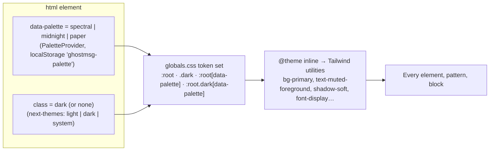
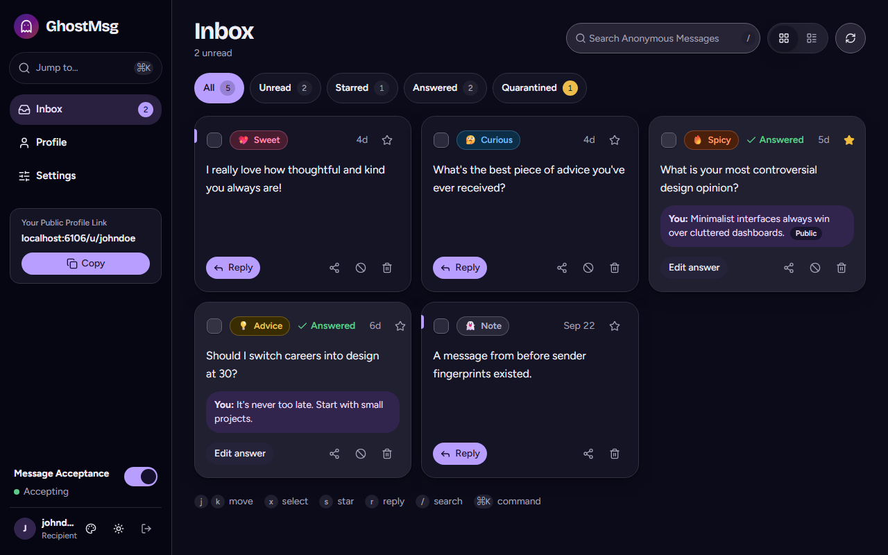
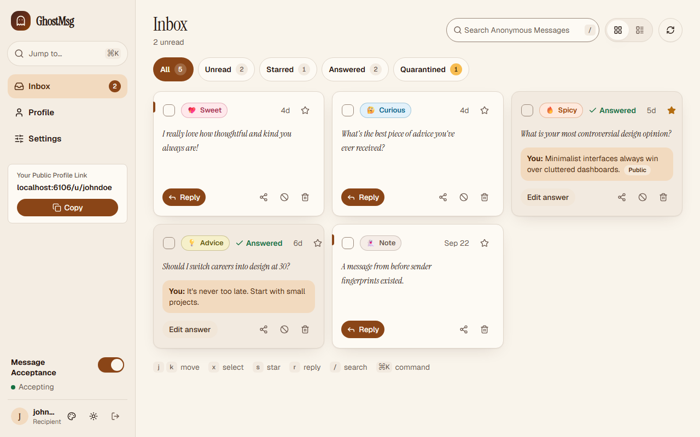
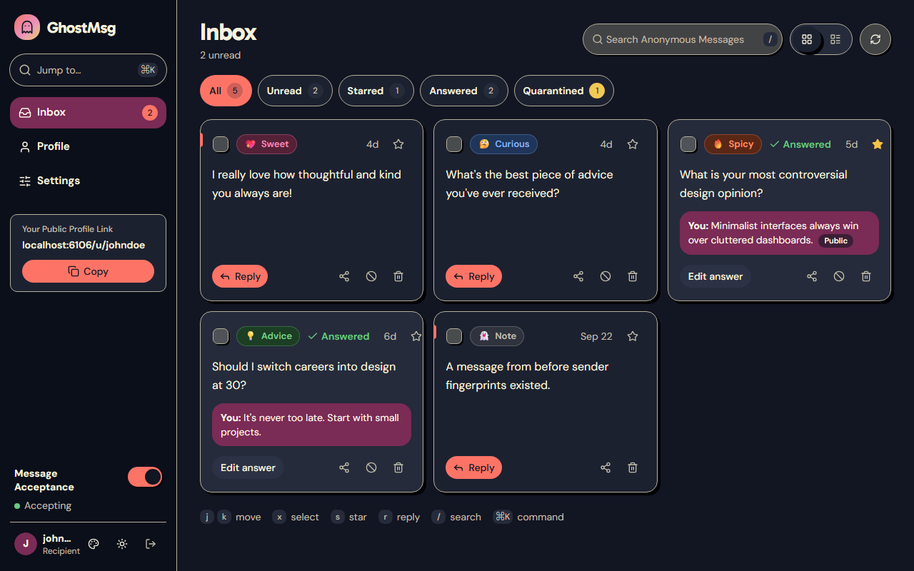
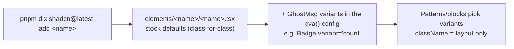

# Chapter 13: Design System & Theming

The GhostMsg look: brand direction, design tokens, the three palettes × light/dark, typography, motion, and the opt-in **CVA variants** that carry the design inside shadcn elements. Read this before you add a colour, a font, a variant or a new element.

Decisions behind it: [ADR 0022](adr/0022-palette-theming-and-claude-design-redesign.md) (palettes, tokens, contrast gate) and [ADR 0023](adr/0023-shadcn-first-elements-and-profile-settings-backend.md) (shadcn-first, variants inside elements). Source of truth for values: [`src/app/globals.css`](../src/app/globals.css). The design canvas is Claude Design's "GhostMsg: Soft spectral redesign" (design tokens, brand direction, CVA component specs, motion, trust & safety).

---

## 1. Brand direction

| Principle | In practice |
| :--- | :--- |
| **Calm, not edgy.** Anonymous messaging can feel unsafe; the UI must feel safe. | Soft tinted backgrounds (`bg-brand-mist`), generous radius, no harsh reds except for genuinely destructive actions. Quarantine is "held back", pausing is "taking a breather". |
| **Warm and expressive.** Messages are personal. | Sentiment colours, emoji Sentiment Tags, a display face for headings, Midnight renders messages as serif-italic "letters". |
| **One accent, used for intent.** | `primary` marks the next action; the `brand` gradient is reserved for the hero moment of a flow (Send anonymously, Share as Story Card, Claim). |
| **Trust is visible.** | Lock icons on send, "can't see who you are" microcopy, the "sender is never shown" note on Story Cards. |

## 2. Two independent axes: palette × mode

- **Palette** is owned by `src/providers/palette-provider.tsx` and `src/lib/theme/palette.ts`. `PALETTE_BOOT_SCRIPT` runs inline in `<head>` before first paint, so there is no flash of the default palette. The server renders `data-palette="spectral"`.
- **Mode** is owned by `next-themes` on the `.dark` class. `@custom-variant dark (&:is(.dark *))` makes `dark:` follow the class, not the OS.
- **Selector specificity** resolves the 6 combinations: `:root.dark[data-palette=x]` > `:root[data-palette=x]` > `.dark` > `:root`.
- **Both are per device.** Nothing is stored on the account ([Chapter 12 §6](12-product-guide-and-features.md#6-known-gaps-and-non-goals)).
- **Where users switch:** the sidebar user row (palette picker + light/dark toggle), the public profile header, and Settings → Appearance (Light · Dark · System + palette cards). Storybook has **Palette** and **Theme** toolbar globals.

### 2.1 The six themes

| | Light | Dark |
| :--- | :--- | :--- |
| **Soft spectral** (default) |  |  |
| **Midnight confessional** |  |  |
| **Playful paper** |  |  |

### 2.2 What a palette changes

A palette is more than colour. Each sets fonts, radius, shadows and the message style:

| Palette | Sans (UI) | Display (headings) | Message body | `--radius` | Shadows | Character |
| :--- | :--- | :--- | :--- | :--- | :--- | :--- |
| **Soft spectral** `spectral` | Figtree | Bricolage Grotesque | Sans, normal | `1rem` | Soft violet-tinted blur | Misty lavender, violet and coral |
| **Midnight confessional** `midnight` | Geist | Instrument Serif | **Instrument Serif italic** | `0.625rem` | Deep, low-contrast | Warm black, amber ember, serif letters |
| **Playful paper** `paper` | DM Sans | Gabarito | Sans, normal | `0.75rem` | **Hard offset** (`6px 6px 0 ink`) | Cream paper, ink outlines, bright stickers |

All six fonts load through `next/font` in `src/app/layout.tsx`. Only Spectral's preload; the others download when their palette is applied (`preload: false`). Instrument Serif has one weight, so headings set `font-synthesis-weight: none` instead of faux-bold.

## 3. Token reference

Tokens are CSS variables defined per theme and exposed to Tailwind in `@theme inline`. **Use the utility, never a raw colour** (`bg-success`, not `bg-emerald-600`).

| Group | Tokens (each has a `-foreground` where text sits on it) | Typical use |
| :--- | :--- | :--- |
| Surfaces | `background`, `card`, `popover`, `muted`, `secondary`, `accent`, `sidebar*` | Page, cards, menus, hover fills |
| Text | `foreground`, `muted-foreground`, `*-foreground` | Body copy, hints |
| Intent | `primary`, `destructive`, `success`, `warning`, `info` | Actions, errors, status badges |
| Lines & focus | `border`, `input` (3:1 against background), `ring` | Borders, form outlines, focus rings |
| Sentiment | `sentiment-{sweet,curious,spicy,advice,neutral}` + `-foreground` + `-subtle` | Sentiment badges and tinted cards |
| Misc | `star`, `chart-1…5`, `brand-foreground`, `brand-overlay` | Starred icon, Story Card, charts |
| Geometry | `--radius` → `rounded-sm/md/lg/xl` | Every rounded surface |
| Elevation | `shadow-xs`, `shadow-sm`, `shadow-soft`, `shadow-lift` | Cards (soft), floating bars and dialogs (lift) |
| Type | `font-sans`, `font-display`, `font-message` (utility) | UI, headings, message bodies |
| Utilities | `bg-brand-gradient`, `bg-brand-mist` | Hero buttons and banners; page backgrounds |

**Rule:** a new token must be defined in **all six** theme blocks and added to the contrast gate if text or a UI boundary sits on it.

## 4. Accessibility gate

`pnpm theme:contrast` (`scripts/check-theme-contrast.ts`) parses `globals.css`, resolves each palette × mode, and checks:

- text pairs at **4.5:1** (WCAG AA): foregrounds on their surfaces, sentiment text on its subtle fill, muted text on cards;
- UI pairs at **3:1**: ring, input border, star, chart series;
- gradients at their **worst stop**.

The latest run reports "All palette × mode pairs pass WCAG AA". The weakest pairs are inputs at about 3.1:1 and Paper's spicy text at 4.57:1. Story tests also run axe on every story ([Chapter 7](07-testing-strategy.md)); a `color-contrast` failure is fixed by adjusting the token, never by disabling the rule.

Other baseline rules, enforced in review and story tests:

- Touch targets ≥ 44px on interactive controls (`size="touch"`, `min-h-11`).
- Every icon-only button has an accessible name; decorative icons are `aria-hidden`.
- Animations use `motion-safe:` and respect `prefers-reduced-motion`.
- Landmarks: one `<main>` (`SidebarInset`), the desktop sidebar is an `<aside>`, dialogs always have a title.

## 5. Motion

| Token | Keyframes | Used for |
| :--- | :--- | :--- |
| `animate-float` | 6s gentle bob | Ghost illustrations, not-found mark |
| `animate-rise` | 0.24s fade-and-rise, `cubic-bezier(0.2,0.8,0.2,1)` | Bulk toolbar, unsaved-changes bar, sent card |
| `animate-pulse-ring` | 2s expanding ring | "Sent" success check |
| Motion library (`motion`) | Spring presses and morphs | Icon buttons, copy button, theme toggler (Animate UI elements) |

Always prefix CSS animations with `motion-safe:`. Durations stay under 300ms for UI feedback; only ambient illustration loops are longer.

## 6. Elements: shadcn first, design through variants

Every Tier-1 element in `src/components/elements/` is a **shadcn (Radix base)** component copied in by the CLI, or an Animate UI element. The design is applied by **opt-in CVA variants inside the element**, never by restyling at the call site.

**Two rules decide where a style goes:**

1. **Defaults stay stock.** The `default` variant and size render exactly like upstream shadcn, so swapping in a new shadcn version never restyles the app. The only approved deviation is WCAG contrast, expressed through tokens.
2. **`className` is for layout.** Margin, width, grid placement, `rounded-full` for pill-shaped buttons. Colour, typography and state styling belong in a variant. If two call sites need the same look, it becomes a variant.

### 6.1 Variant catalog (GhostMsg additions in **bold**)

| Element | Variants | Sizes / other axes | Notes |
| :--- | :--- | :--- | :--- |
| `Button` | default, destructive, outline, secondary, ghost, link, **primary, accent, glass, brand** | default, xs, sm, **md**, lg, **xl**, icon, icon-xs, icon-sm, icon-lg | Stock v4 (Slot `asChild`). `brand` = gradient hero action. Compose loading with `<Spinner data-icon="inline-start" />` + `disabled`; there is no `isLoading` prop. |
| `IconButton` | default, accent, destructive, outline, secondary, ghost, link | default, xs, sm, lg | Animate UI motion press; used by palette picker, theme toggler, copy. |
| `Badge` | default, secondary, destructive, outline, ghost, link, **glass, success, warning, neutral, count, attention** | — | `count`/`attention` invert inside an `on` toggle (`in-data-[state=on]:`). No `size` prop. |
| `Card` | default, glass, ghost, bordered, **elevated** | default, sm, lg | `elevated` = `shadow-soft`, used by every dashboard card. |
| `Toggle` | default, outline, **chip, segment** | default, sm, lg, **touch** | `chip` = filter pill, `segment` = segmented-control item. |
| `ToggleGroup` | inherits Toggle | `spacing` | `variant="segment"` draws the track; `chip` wraps. Items are `role="radio"` for `type="single"`. |
| `InputGroup` | — | **size** default/lg, **shape** default/pill, **tone** default/success | Use `InputGroupInput`/`InputGroupTextarea`/`InputGroupButton`/`InputGroupText` inside. `aria-invalid` on the input shows the error ring. |
| `Avatar` | — | default, sm, lg, **xl (52px), 2xl (72px)** | `AvatarFallback variant="brand"` = tinted initial. Always render a fallback. |
| `Checkbox` | — | sm, default, **lg (22px)** | `lg` on message cards. |
| `SelectTrigger` | — | sm, default, **lg** | `lg` in Settings. |
| `Switch` | default, success | sm, md, lg, xl | Settings use `xl`. |
| `SidebarMenuButton` | default, outline | default, sm, lg, **nav** | `nav` = 44px rounded nav row. `SidebarMenuBadge variant="count"`. |
| `Dialog` | — | `showCloseButton` | Title required (use `sr-only` if hidden). |
| `CommandDialog` | — | **`label`**, **`filter`** | `label` names the search input (cmdk labels it); the palette passes a substring filter. |

Installed shadcn elements: alert, alert-dialog, avatar, badge, breadcrumb, button, card, checkbox, command, dialog, dropdown-menu, empty, field, input, input-group, input-otp, item, kbd, label, radio-group, scroll-area, select, separator, sheet, sidebar, skeleton, sonner, spinner, switch, table, tabs, textarea, toggle, toggle-group, tooltip. GhostMsg/Animate UI elements: carousel, copy-button, effects, form, icon-button, liquid-button, palette-picker, text, theme-toggler. The live inventory is [Chapter 11](11-component-registry.md).

### 6.2 Composition cheatsheet (what to reach for)

| Need | Use | Not |
| :--- | :--- | :--- |
| Form layout | `FieldGroup` › `Field` › `FieldLabel` + control + `FieldDescription`/`FieldError` | `div` + `space-y-*` |
| Setting row | `SettingRow` / `SwitchSetting` (`blocks/settings-panel/settings-section.tsx`), built on `Field orientation="horizontal"` | Hand-rolled flex rows |
| 2–7 options | `ToggleGroup` (`chip` or `segment`) | Buttons with manual active state |
| Choice cards | `RadioGroup` + `FieldLabel` wrapping a `Field` (Appearance) | Custom radio divs |
| Empty state | `Empty` › `EmptyHeader` › `EmptyMedia`/`EmptyTitle`/`EmptyDescription` | Centered custom markup |
| Status chip | `Badge` variant | Styled `span` |
| Divider | `Separator` / `FieldSeparator` | `
`, `border-t` divs |
| Loading | `Skeleton`, `Spinner` | Custom `animate-pulse` |
| Callout | `Alert` | Coloured `div` |
| Listing row | `Item` (`variant="outline"`) | Card-in-card |
| Tabular data | `Table` | CSS grid "tables" |
| Breadcrumb | `Breadcrumb` (via `PageHeading`) | Slash-separated text |
| Navigation shell | `SidebarProvider` › `Sidebar` › `SidebarInset` | Custom aside |
| Command palette | `CommandDialog` | Custom listbox |
| Menus | `DropdownMenu` (items inside `DropdownMenuGroup`) | Popover + buttons |

## 7. Adding to the design system

| Change | Steps | Done when |
| :--- | :--- | :--- |
| New token | Add to all 6 theme blocks in `globals.css` and expose it in `@theme inline`. Add text/UI pairs to `scripts/check-theme-contrast.ts`. | `pnpm theme:contrast` passes. |
| New variant | Add it to the element's `cva()` config with a one-line comment. Keep the `default` variant untouched. Add the option to the element story's `argTypes` and an `AllVariants` render. | The story test passes; [Chapter 11](11-component-registry.md) is regenerated. |
| New shadcn element | Follow [agents/component-architecture.md §7.4](agents/component-architecture.md): install, move to `elements/<name>/`, fix imports, `pnpm remove cn`, add mock + story. | Lint, tsc, story test pass. |
| New palette | Add to `PALETTES`/`PALETTE_META` in `src/lib/theme/palette.ts`, add two blocks in `globals.css`, load its fonts in `layout.tsx` (`preload: false`), and add it to the contrast script and the screenshot matrix. | Contrast gate passes; `pnpm docs:screenshots` produces its two images. |
