# Chapter 14: UI Screens & User Flows

Every screen of GhostMsg with a real screenshot, how it is composed through the four tiers, which controller owns its behaviour, its states, and the Storybook story that renders it. Use this chapter to find **where** to change a screen. The tier rules are in [Chapter 5](05-component-architecture.md) and [agents/component-architecture.md](agents/component-architecture.md).

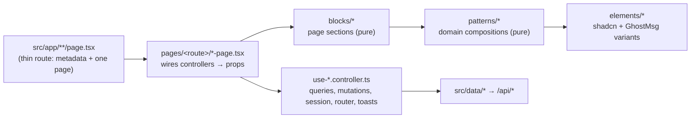

---

## 1. Landing (`/`)

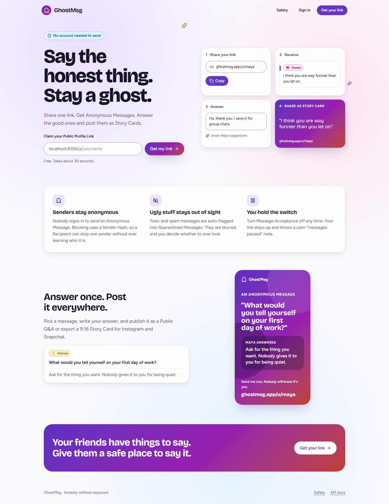

| | |
| :--- | :--- |
| **Composition** | `HomePage` → `SiteLayout` (`SiteHeader`) → `Hero` (with `ClaimLinkForm` + `HowItWorks` slots) → `TrustSection` → `QaShowcase` → `CtaBanner` → `SiteFooter` |
| **Controller** | `use-claim-link.controller.ts`: username state, `linkPrefix` from `window.location.host`, submit → `/sign-up?username=`, `liveProfileHref` from `NEXT_PUBLIC_LIVE_PROFILE_USERNAME` ("See a live profile" hides when unset) |
| **Phones (MobLanding)** | CSS-only, so the server render never shifts: hero 16px rhythm and a full-width "Get my link"; `HowItWorks` becomes a carousel with an h2, "1 / 4" counter, "Step 1 · …" overlines, 272px cards and pill dots; `TrustSection` shows "Safe by default" over icon rows (desktop keeps the 3-column card, heading sr-only); `QaShowcase` drops the Q&A sample and tilts a 220px Story Card left (`StoryCardPreview size="fluid" tilt="fluid"`); `CtaBanner` splits title / subtitle with a full-width button; `SiteFooter` stacks with 44px links (desktop: underlined, right-aligned). |
| **States** | Guest only. Signed-in visitors are redirected to `/dashboard` by middleware. The `SignedIn` story shows the header variant. |
| **Stories** | `Pages/Home` → Guest, ClaimLink, SignedIn, Mobile |

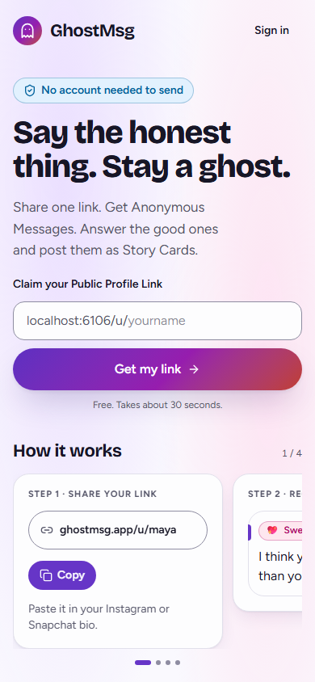

## 2. Authentication (`/sign-up`, `/verify/[username]`, `/sign-in`)

| Sign up | Verify | Sign in |
| :--- | :--- | :--- |
| 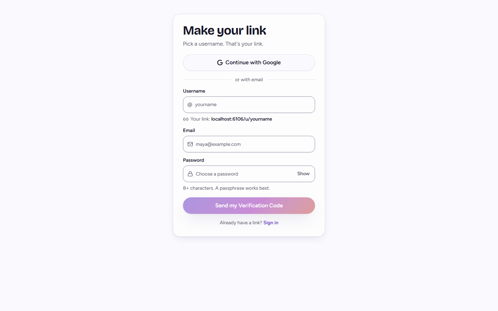 | 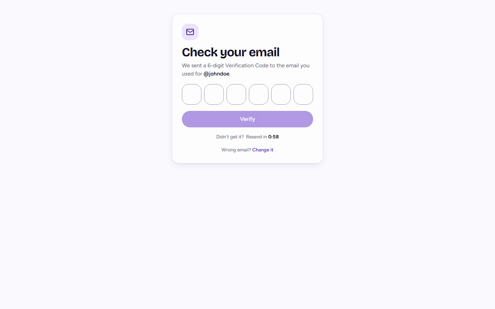 | 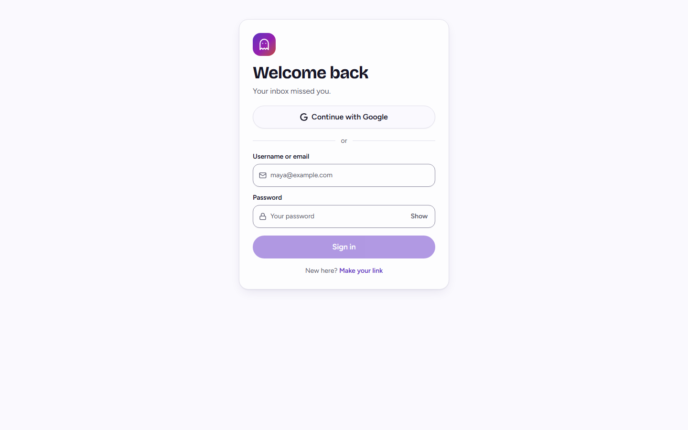 |

| | |
| :--- | :--- |
| **Composition** | `AuthPanel` block (desktop: one centred card; phones: no card, a top bar with Back and optional "n / total" progress, `align="center"` + `iconTone` for the verified screen) → `SignUpForm` / `SignInForm` / `AuthFormFooter` (`patterns/auth-form`; the footer pins to the bottom on phones) with `UsernameField` (InputGroup, success tone + ✓ when available, `aria-invalid` when taken) and `PasswordField` ("Show" / "Hide" text toggle); `VerifyPanel` → `VerifyCodeForm` (`InputOTP`, the tries-left `Alert`, the resend countdown, one main action: Verify or Resend code); `VerifySuccess` (pulse mark, `ShareLinkCard layout="compact"`, Sign in to open your inbox). `SiteLayout hideHeaderOnPhones` drops the site header on these routes below 640px. |
| **Controllers** | `use-sign-up`, `use-username-availability`, `use-verify` (+ `use-resend-cooldown`, `verify.utils.ts`), `use-sign-in`, `use-google-sign-in` (forms use `react-hook-form` + `zodResolver` in the controller). The verified screen reuses `useProfileLinkController(username)` for Copy / Share. |
| **States** | Username checking / available / taken; invalid credentials; code typing + "Resend in 0:42"; timer finished (Resend code); wrong code ("That code isn't right. 2 tries left. Check for the newest email.", red slots, one shake); locked ("Too many tries."); expired; resending; verified ("You're in. Your link is live."); submitting |
| **Stories** | `Pages/Auth/SignUp` (UsernameAvailable, UsernameTaken, SignsUp), `Pages/Auth/Verify` (Default, Verifies, InvalidCode, Locked, Expired, Mobile), `Pages/Auth/SignIn` (SignsIn, InvalidCredentials); `Patterns/VerifyCodeForm` (TimerFinished, WrongCode, Locked, Mobile), `Blocks/VerifySuccess`, `Blocks/AuthPanel` (Mobile, MobileSignUp) |

## 3. Dashboard shell (every `/dashboard/*` route)

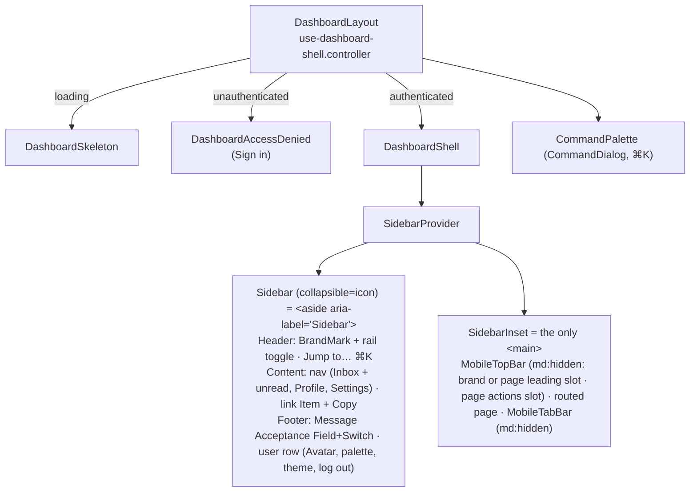

| Signed out | Phone |
| :--- | :--- |
| 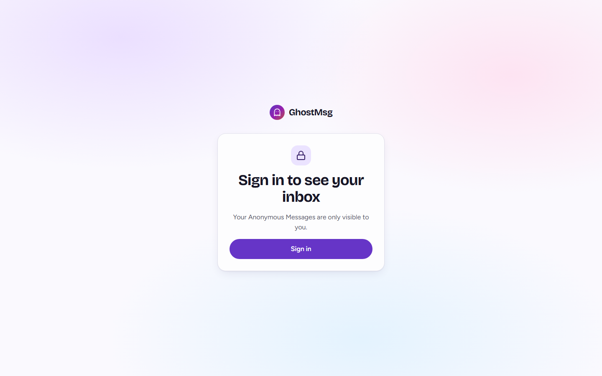 | 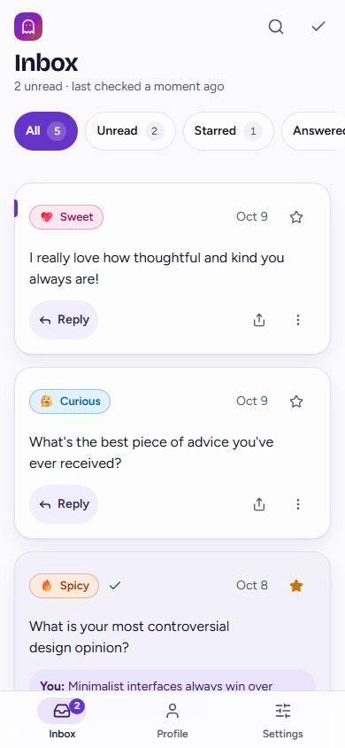 |

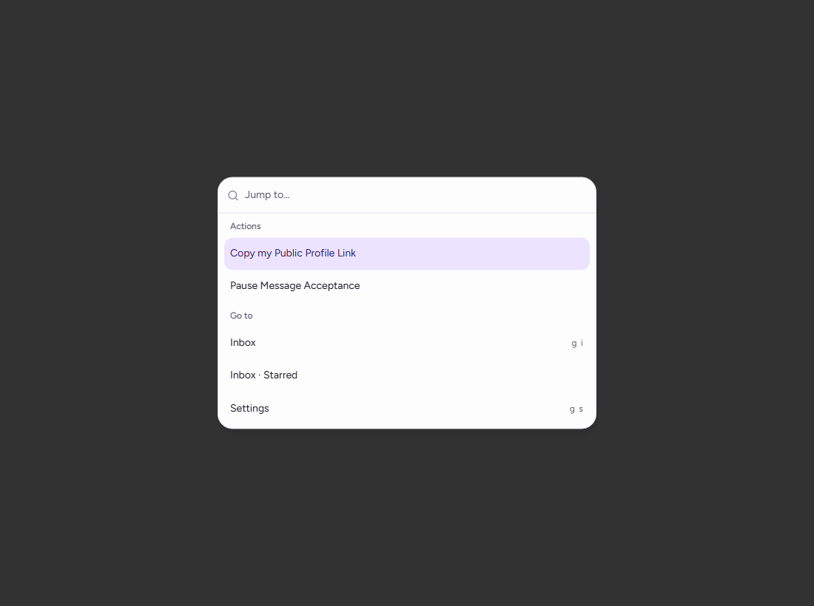

- **Controller:** `use-dashboard-shell.controller.ts`: session status, unread count (`messagesQueries.counts()`, from the server, so it is right before the inbox has loaded), acceptance query + mutation, profile avatar, ⌘K listener, command groups, sign-out.
- **Session:** `app/(dashboard)/dashboard/layout.tsx` reads `getServerSession` and passes it to `AuthProvider` → `SessionProvider`, so a signed-in visit renders the shell at once. The `SessionLoading` story covers the client-only case (no server session).
- **Phones:** the top bar shows the brand tile and whatever the page portals in through `MobileHeaderActions` (Inbox: Search + Select; Profile: View as visitor) or `MobileHeaderLeading` (Quarantined: back arrow, which hides the brand). The tab bar puts a pill behind the active icon. Message Acceptance and Sign out live in Settings ([ADR 0034](adr/0034-confirmed-message-deletes-undo-for-delete-all-and-phone-dashboard-chrome.md)).
- **Tablet (768–1023 px):** the sidebar starts on its icon rail (link card, acceptance and account details hide); `lg+` opens it fully. The rail toggle sits by the brand.
- **Accessibility:** the Inbox nav link's name includes "Unread: N" (visually a badge, `aria-hidden`).
- **Stories:** `Blocks/DashboardShell` (Desktop, SettingsActive, Paused, Mobile), `Pages/Dashboard` (SessionLoading, SignedOut, CommandPalette).

## 4. Inbox (`/dashboard`)


| | |
| :--- | :--- |
| **Composition** | `InboxPage` → `Inbox` block: header (title, unread count, search `InputGroup` pill with `/` `Kbd`, grid/list segmented `ToggleGroup`, Refresh) → `FilterBar` (chip `ToggleGroup` + `Badge count/attention`) → `BulkActionToolbar` (when selecting) → `MessageCard` grid/list → **Load more** (when the server has more pages) → shortcut legend (`Kbd`). Hoisted modals: `SmartReplyModal`, `StoryCardModal`, `RevealMessageModal`, `BlockSenderModal`, `DeleteMessageModal` (single delete), `DeleteSelectedModal` (bulk delete); both deletes confirm and have no Undo ([ADR 0034](adr/0034-confirmed-message-deletes-undo-for-delete-all-and-phone-dashboard-chrome.md)). `ShortcutSheet` (`?`) is mounted by the dashboard layout. A sticky "N new Anonymous Messages" pill appears above the list when messages arrive while scrolled. Phones: search and Select move to the top bar, chips scroll sideways, grid only, selection header + bottom `BulkActionToolbar layout="bar"`. **Quarantined filter** = the Quarantined view: title "Quarantined", "N held back · never in your main inbox", a reassurance notice, "Delete all quarantined"; on phones the chips hide and a back arrow returns to All. |
| **Controllers** | `use-inbox.controller.ts` composes `use-inbox-filters.controller.ts` (filter + debounced search, written to `?filter=&q=`) and `use-inbox-data.controller.ts` (server-filtered paged query, counts, live SSE inserts, 30 s polling fallback); it owns scoped selection, dialog state by message id, mark-read and actions. Plus `use-inbox-keyboard.controller.ts`, `use-smart-reply.controller.ts` (draft seeded once per opening). State rules: [Chapter 20](20-state-management.md). |
| **States** | Loading skeleton (after 150 ms) · first run (`Empty`, floating ghost, Copy link) · empty filter ("Nothing unread" + Clear filter) · nothing quarantined ("Nothing held back") · no search matches · populated · selecting (phones: selection mode) · focused card · concealed (quarantined with its reason / spicy) · revealed · archived (Archived chip once any) · new-messages pill · Quarantined view. Subtitle: "N unread · last checked a moment ago". |
| **Stories** | `Pages/Dashboard` → Inbox, DeletesAMessage, RepliesWithAi, RevealsQuarantined, KeyboardTriage, EmptyInbox, InboxError, InboxLoading, Mobile; `Blocks/Inbox` (… NoMatches, SearchNoMatches, NothingQuarantined); `Patterns/MessageCard`, `Patterns/FilterBar`, `Patterns/BulkActionToolbar`, `Patterns/ShortcutSheet`, `Patterns/MessageActionsMenu` |

| Dark mode | Empty inbox |
| :--- | :--- |
| 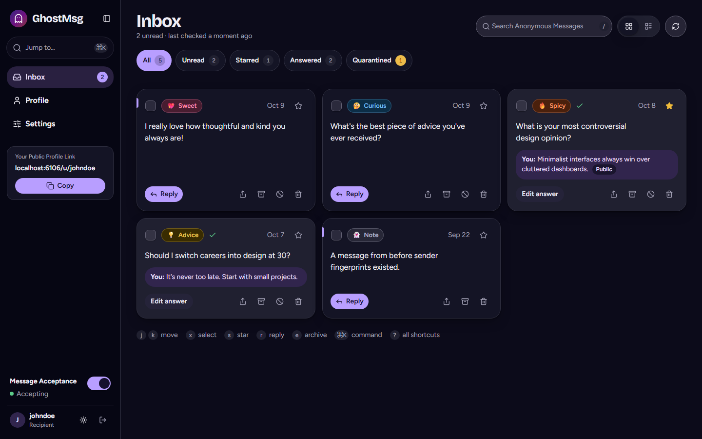 | 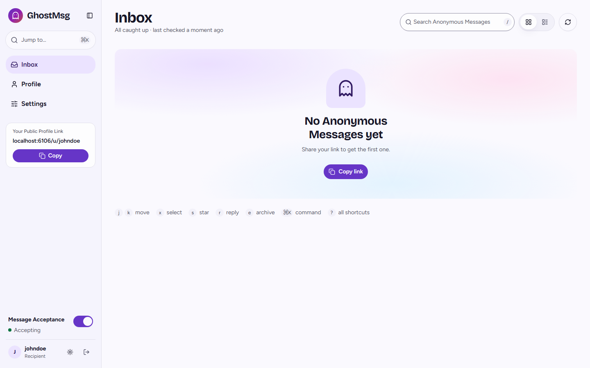 |

### Inbox dialogs

| Smart Reply | Story Card | Reveal quarantined |
| :--- | :--- | :--- |
| 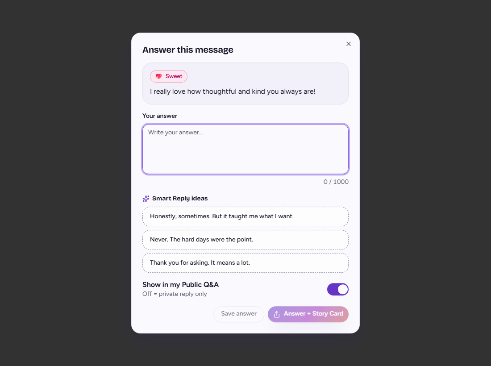 | 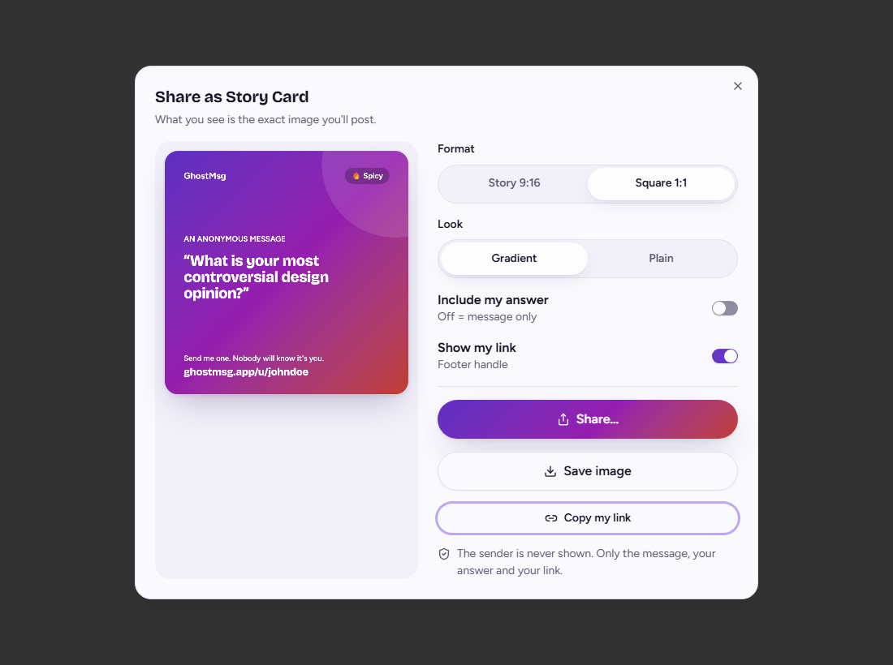 | 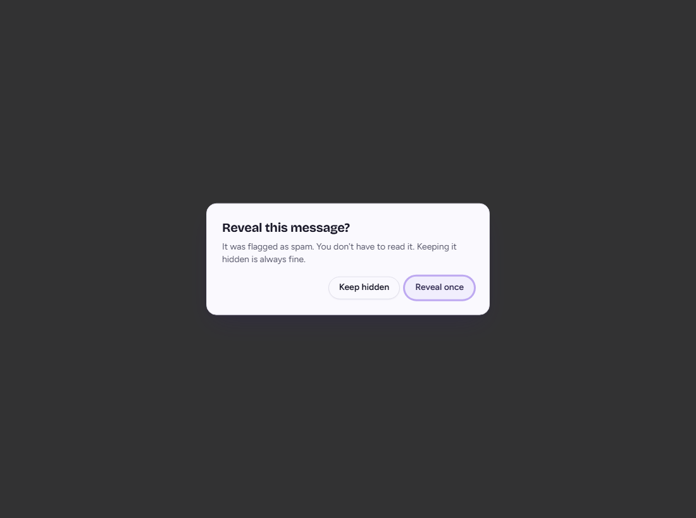 |

The modal rules (focus defaults, close-first deletes, publish default) are in [Chapter 12 §5.5](12-product-guide-and-features.md#55-message-actions-dialogs).

### Flow: answering and publishing

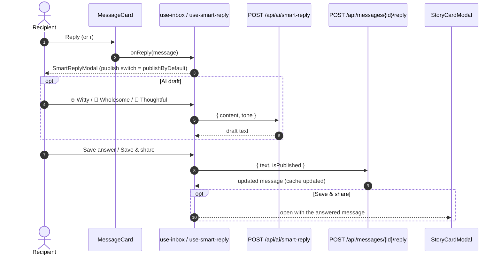

## 5. Public profile (`/u/[username]`)

| Accepting | Paused | Not found |
| :--- | :--- | :--- |
|  | 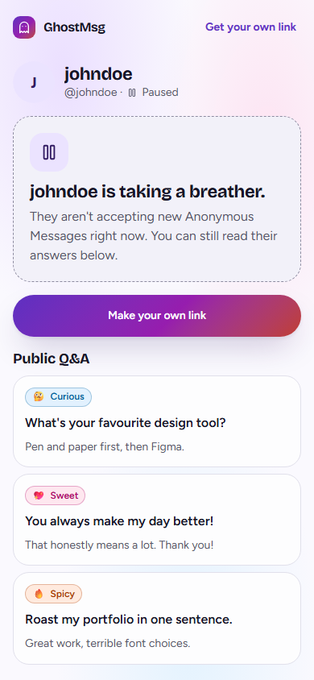 | 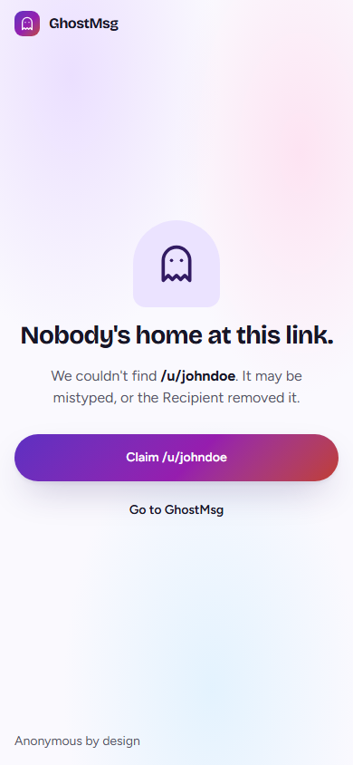 |

| | |
| :--- | :--- |
| **Composition** | `PublicProfilePage` → `PublicProfile` block (phone-first, max 480px): header (`BrandMark`, Get your own link; brand only when not found; "‹ Name" back on the sent screen) → identity (`Avatar` xl, display name as h1, "@handle · ● Accepting" / "@handle · ‖ Paused") → `AmaBanner` (if `showAmaBanner`) → `SendMessageForm` in a card with `SuggestedMessages` slot (if `offerSuggestions`) → `PublicQaFeed`. **Sent** replaces the whole body (MobPublicSent): success mark, "Sent. Name will never know it was you.", the message under "You sent", Send another + Get your own link at the bottom. **Paused** (MobPublicPaused): a dashed `AmaBanner tone="quiet"` card and one brand "Make your own link". |
| **Controllers** | `use-public-answers.controller.ts` (profile + answers + settings; `initialData` rendered on the server by `getPublicProfile`, 404 → not found, no retry on 404), `use-send-message.controller.ts` (form, send, `publicQueries.suggestions` query gated on `offerSuggestions`) |
| **Server rendering** | `app/u/[username]/page.tsx` loads the profile with `getPublicProfile` (React `cache`) for an instant first paint; `layout.tsx` builds the title and link preview from the display name and AMA Prompt. |
| **States** | Loading answers · accepting · sending · sent (full screen) · paused · not found · no answers yet · suggestions unavailable |
| **Stories** | `Pages/PublicProfile` → Default, SuggestionFillsForm, SendsMessage, NotAcceptingMessages, NoAnswersYet, AnswersLoading, SuggestionsUnavailable, Paused, UserNotFound, Mobile |

## 6. Profile (`/dashboard/profile`)


| | |
| :--- | :--- |
| **Composition** | `ProfilePage` → `ProfilePanel` block: `PageHeading` (Breadcrumb + "View as visitor") → left column `IdentityCard`, `ShareLinkCard`, `AmaPromptEditor` → right column sticky `VisitorPreview` → `UnsavedChangesBar`. Hoisted `ChangeUsernameModal`. |
| **Controllers** | `use-profile.controller.ts` (react-hook-form draft fed by the server profile, `isDirty`, one-request save via `buildProfilePatch`, discard, photo resize, AI ideas, leave guard), `use-change-username.controller.ts` (debounced availability, mutation, `useSession().update`, `router.refresh`), `use-profile-link.controller.ts` (copy/share). Hoisted `DiscardChangesModal` when leaving with unsaved edits. |
| **States** | Clean · dirty (bar visible) · saving · photo processing · suggesting · username checking/available/taken |
| **Stories** | `Pages/Dashboard` → Profile; `Blocks/ProfilePanel` (Default, UnsavedChanges, BannerHidden, Paused, Mobile); `Patterns/IdentityCard`, `Patterns/AmaPromptEditor`, `Patterns/ShareLinkCard`, `Patterns/VisitorPreview`, `Patterns/UnsavedChangesBar`, `Patterns/Modals/ChangeUsernameModal` |

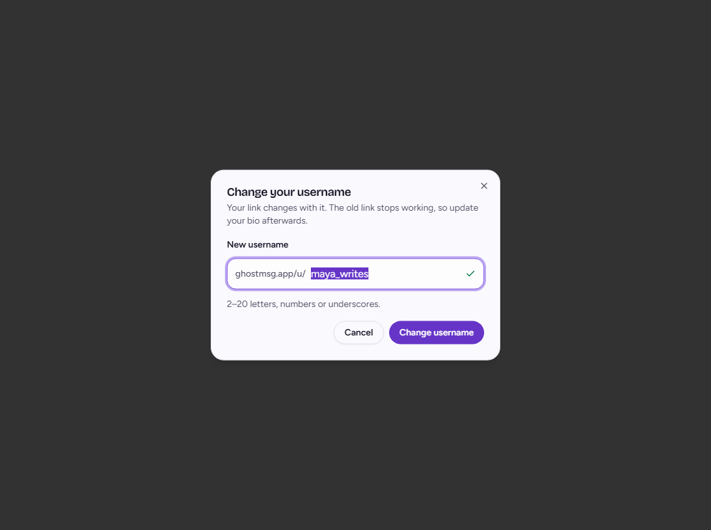

### Flow: draft → save

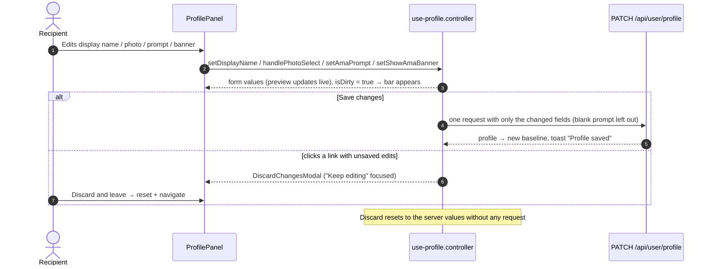

## 7. Settings (`/dashboard/settings`)


| | |
| :--- | :--- |
| **Composition** | `SettingsPage` → `SettingsPanel` block: `PageHeading` → `SectionNav` (scroll-spy via `useActiveSection`, `lg:` only) → `MessagesSettings`, `SafetySettings` (`ToggleGroup segment`, `Table`, `Empty`), `NotificationSettings` (`Select lg`, quiet-hours Switch + time Selects), `AppearanceSettings` (`RadioGroup` choice cards), `DataSettings`, `DangerZone`. Rows use `SettingsSection`/`SettingRow`/`SwitchSetting`. Hoisted `DeleteAllMessagesModal`, `DeleteAccountModal`. **Phones** (`SettingsLayoutProvider layout="list"`): account card (avatar, name, email + Message Acceptance switch) → PREFERENCES `Accordion` (Messages, Safety & blocking, Notifications, Appearance rows with icon tile + live summary such as "Balanced · 3 blocked") → DATA & ACCOUNT (Export accordion row, Sign out) → DANGER ZONE (two red rows). Blocked senders render as rows instead of a table. |
| **Controllers** | `use-settings.controller.ts` (acceptance, preferences, notifications, push adapter, blocklist, export), `use-appearance.controller.ts` (next-themes + palette), `use-danger-zone.controller.ts` (10s undo, typed confirmation, sign out) |
| **States** | Each control optimistic; pending disables its control; quarantine off disables sensitivity; quiet hours off disables the time selects; blocklist empty vs table |
| **Stories** | `Pages/Dashboard` → Settings; `Blocks/SettingsPanel` (Defaults, EmitsChanges, ClosedWithBlockedSenders, AllPending, QuarantineOff, Mobile); `Patterns/Modals/DeleteAllMessagesModal`, `DeleteAccountModal` |

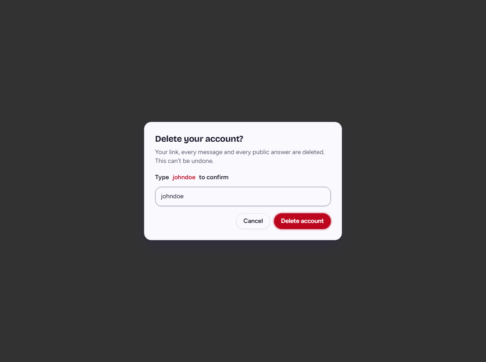

### Flow: Delete all messages with undo

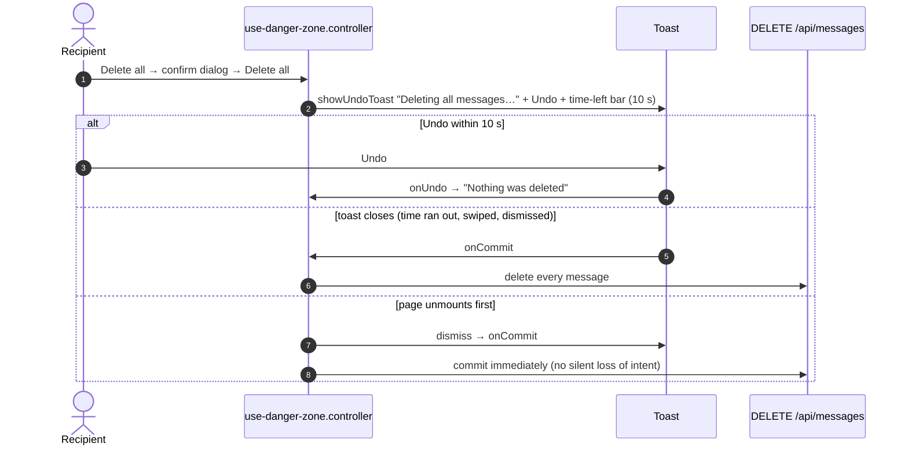

The bar pauses while the toaster is hovered, together with Sonner's timer, so the commit always matches what the toast shows. Only Delete all uses this hold. Single and bulk message deletes confirm in a dialog and then delete at once, with no Undo ([ADR 0034](adr/0034-confirmed-message-deletes-undo-for-delete-all-and-phone-dashboard-chrome.md)):

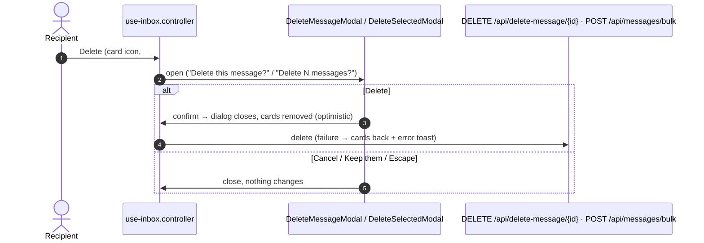

## 8. Not found

`NotFoundPage` → `NotFoundPanel` block (floating ghost, Go home). Story: `Pages/NotFound`.

## 9. Responsive behaviour

| Breakpoint | Dashboard | Public profile | Settings |
| :--- | :--- | :--- | :--- |
| `< md` (phones) | Top bar (brand + page actions) + bottom tab bar; Inbox selection mode; Profile identity summary | Single column (always) | Grouped list: account card, accordion rows, Data & account, Danger zone |
| `md`–`lg` | Sidebar starts on the icon rail | — | Section nav hidden |
| `≥ lg` | Sidebar + content; Profile shows the sticky preview column | — | Sticky section nav (180px) |

Story tests run at 1280×900 so `lg:` layouts are queryable; mobile stories set the `mobile1` viewport global.

## 10. How screenshots are produced

Screenshots in `docs/assets/screenshots/` are generated, never hand-edited:

```bash
pnpm build-storybook        # → storybook-static/
pnpm docs:screenshots       # → docs/assets/screenshots/*.png (all shots)
pnpm docs:screenshots dashboard-settings palette-paper-dark   # only these
```

`scripts/capture-doc-screenshots.ts` serves `storybook-static/`, opens each story's iframe in headless Chromium (Playwright) with a fixed viewport, the `palette`/`theme` globals and reduced motion, waits for Storybook's render phase to finish (loaders, MSW, `play()`), and saves a PNG. To add a shot, add an entry to `SHOTS` (story id = `title` lower-kebab + `--` + export name in kebab case). **Re-capture after any visible UI change** and commit the PNGs with the change ([agents/documentation-maintenance.md](agents/documentation-maintenance.md)).
