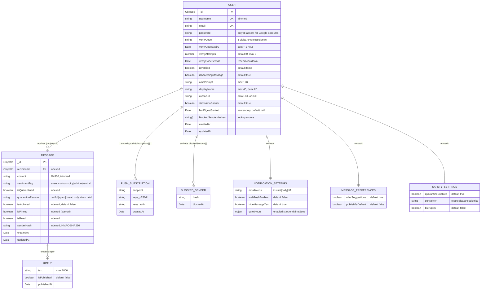
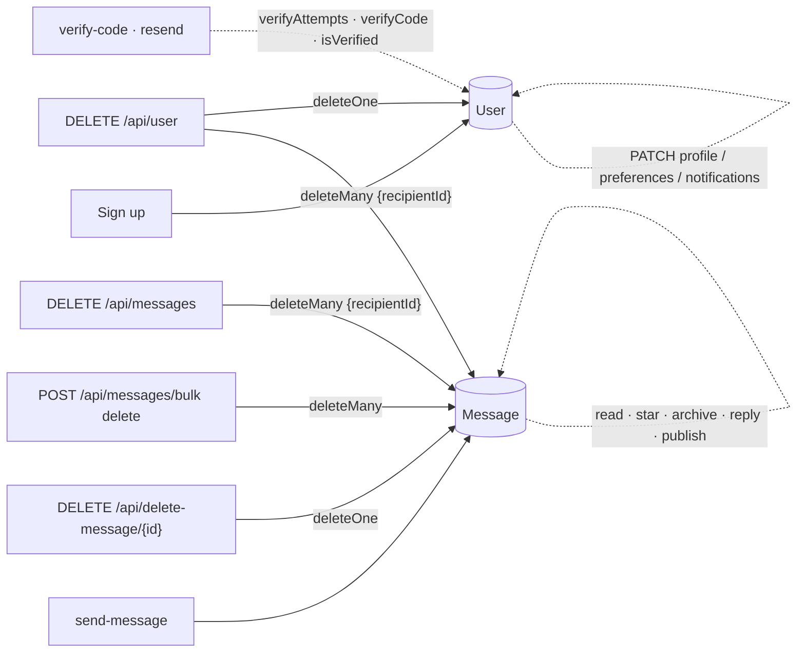

# Chapter 15: Data Model & Database

The MongoDB data model: collections, every field with its type, default and validation, indexes, how each field is written, how old documents are kept compatible, and what leaves the server. Models live in [`src/server/models/`](../src/server/models/) and are `server-only`. Decisions: [ADR 0010](adr/0010-standalone-messages-schema-and-feature-architecture.md) (standalone messages), [ADR 0020](adr/0020-web-push-delivery-vapid-and-subscription-lifecycle.md) (push subscriptions), [ADR 0024](adr/0024-profile-preferences-data-model-and-settings-api.md) (profile & preferences).

---

## 1. Overview

Two collections. A **User** is a Recipient with embedded settings; a **Message** is one Anonymous Message pointing at its Recipient. There is no Sender collection: senders exist only as a `senderHash` string.

In cloud environments, Terraform manages database users and network access on a MongoDB Atlas M0 cluster ([ADR 0032](adr/0032-terraform-managed-vercel-and-mongodb-atlas-infrastructure.md), [Chapter 21](21-infrastructure-and-terraform.md)), scoping production to the `honest_feedback` database and preview deployments to an isolated `honest_feedback_preview` database.



## 2. `users` collection ([`user.model.ts`](../src/server/models/user.model.ts))

### 2.1 Identity and account

| Field | Type | Default / validation | Written by | Exposed by |
| :--- | :--- | :--- | :--- | :--- |
| `username` | string | required, **unique**, trimmed; Zod `usernameValidation` on input | `POST /api/sign-up`, Google sign-in, `PATCH /api/user/username` | session, profile, public answers |
| `email` | string | required, **unique**, regex `.+@.+\..+` | sign-up, Google | `GET /api/user/profile` (owner only) |
| `password` | string? | bcrypt hash (10 rounds); Google sign-up stores a random unusable password | sign-up, Google sign-in | never |
| `verifyCode`, `verifyCodeExpiry` | string, Date | required; `crypto.randomInt` 6 digits, expires 1 hour after it was sent (`issueVerificationCode`) | sign-up, `POST /api/verify-code/resend` | never |
| `verifyAttempts` | number | `0`; +1 per wrong guess, locked at 3; reset by a new code or success | `POST /api/verify-code`, resend | never (the response says `attemptsLeft`) |
| `verifyCodeSentAt` | Date? | when the current code went out (60 s resend cooldown) | sign-up, resend | never (the 429 says `retryAfterSeconds`) |
| `isVerified` | boolean | `false` | `POST /api/verify-code`, Google | session |
| `isAcceptingMessage` | boolean | `true` | `POST /api/accept-message` | `GET /api/accept-message`, `GET /api/user/notifications`, public answers (`isAcceptingMessages`), `send-message` check. **Not in the session token** ([ADR 0031](adr/0031-state-management-consistency-and-structure.md) D13): the client reads it through `user.acceptance`. |
| `lastDigestSentAt` | Date \| null | `null` | `GET /api/cron/daily-digest` after a successful digest | never (server-only; [ADR 0029](adr/0029-daily-digest-scheduling-and-alert-privacy-fixes.md)) |
| `createdAt`, `updatedAt` | Date | Mongoose timestamps | automatic | — |

### 2.2 Public identity (Profile page)

| Field | Type | Default / validation | Written by | Notes |
| :--- | :--- | :--- | :--- | :--- |
| `displayName` | string | `""`, trimmed, max 40 | `PATCH /api/user/profile` | Empty means "show the username". |
| `avatarUrl` | string \| null | `null`; Zod: `data:image/(png\|jpeg\|webp);base64,…`, ≤ 350,000 chars | `PATCH /api/user/profile` (`null` removes) | Resized client-side to 256px WebP (≈15–40 KB). Stored inline ([ADR 0024](adr/0024-profile-preferences-data-model-and-settings-api.md)). |
| `amaPrompt` | string | `"Send me an anonymous message!"`, trimmed, 1–120 | `PATCH /api/user/profile` (the app's save; one request with the other Profile fields), `PATCH /api/user/ama-prompt` (legacy) | A blank prompt is never sent (`buildProfilePatch`). |
| `showAmaBanner` | boolean | `true` | `PATCH /api/user/profile` | Hides the AMA banner on `/u/[username]`. |

### 2.3 Embedded settings

| Path | Type | Default | Written by (always `$set` with **dot paths**) |
| :--- | :--- | :--- | :--- |
| `messagePreferences.offerSuggestions` | boolean | `true` | `PATCH /api/user/preferences` |
| `messagePreferences.publishByDefault` | boolean | `false` | `PATCH /api/user/preferences` |
| `safetySettings.quarantineEnabled` | boolean | `true` | `PATCH /api/user/preferences` |
| `safetySettings.sensitivity` | `"relaxed" \| "balanced" \| "strict"` | `"balanced"` | `PATCH /api/user/preferences` |
| `safetySettings.blurSpicy` | boolean | `false` | `PATCH /api/user/preferences` |
| `notificationSettings.emailAlerts` | `"instant" \| "daily" \| "off"` | `"instant"` | `PATCH /api/user/notifications` |
| `notificationSettings.webPushEnabled` | boolean | `false` | `PATCH /api/user/notifications`; set `true` by `POST /api/user/push-subscription` |
| `notificationSettings.hideMessageText` | boolean | `true` | `PATCH /api/user/notifications` |
| `notificationSettings.quietHours.enabled/start/end/timeZone` | boolean, `"HH:MM"`, `"HH:MM"`, IANA zone | `false`, `"22:00"`, `"08:00"`, `"UTC"` | `PATCH /api/user/notifications` (the client sends the browser's zone) |

**Why dot paths:** `$set: { safetySettings: { blurSpicy: true } }` would replace the whole subdocument and reset its siblings. Routes build `{ "safetySettings.blurSpicy": true }` from the validated partial body, so one switch never resets another.

### 2.4 Arrays

| Field | Shape | Written by | Rules |
| :--- | :--- | :--- | :--- |
| `blockedSenderHashes` | `string[]` | `POST /api/block-sender` (`$addToSet`), `DELETE` (`$pull`, or `[]` for `"ALL"`) | **The lookup source** for `send-message`. Keep it authoritative. |
| `blockedSenders` | `{ hash, blockedAt }[]` | `POST /api/block-sender` (`$push` only if the hash isn't there, so re-blocking keeps the first date), `DELETE` (`$pull`) | Display metadata for the Settings table. Legacy hashes without a record show no date. |
| `pushSubscriptions` | `{ endpoint, keys: { p256dh, auth }, createdAt }[]` | `POST /api/user/push-subscription` (`$pull` same endpoint, then `$push`), `DELETE` (`$pull`), `sendPushToUser` (prunes 404/410) | One per device ([ADR 0020](adr/0020-web-push-delivery-vapid-and-subscription-lifecycle.md)). |

## 3. `messages` collection ([`message.model.ts`](../src/server/models/message.model.ts))

| Field | Type | Default / validation | Written by |
| :--- | :--- | :--- | :--- |
| `recipientId` | ObjectId → User | required, indexed | `POST /api/send-message` |
| `content` | string | required, trimmed, 10–300 chars (also enforced in the route) | send-message |
| `sentimentTag` | enum | `"neutral"`; from moderation | send-message |
| `isQuarantined` | boolean | `false`; `shouldQuarantine(toxicity, safetySettings)` | send-message |
| `quarantineReason` | enum? `hurtful` \| `spam` \| `threat` | set with `isQuarantined` from moderation's `category` (`toQuarantineReason`; none → hurtful); absent on messages held before the field existed | send-message |
| `isArchived` | boolean | `false`, indexed; archived messages appear only under `status=archived` | `PATCH /api/messages/{id}` |
| `isPinned` (Starred) | boolean | `false` | `PATCH /api/messages/{id}`, bulk `star` |
| `isRead` | boolean | `false` | `PATCH /api/messages/{id}`, bulk `read` |
| `reply` | `{ text ≤1000, isPublished, publishedAt? }` \| null | `null` | `POST /api/messages/{id}/reply` (sets `publishedAt` only when published) |
| `senderHash` | string | required, indexed | send-message (`HMAC-SHA256(ip:recipientId, pepper)`) |
| `createdAt`, `updatedAt` | Date | timestamps | automatic |

The Mongoose shape for the two newest message fields (from `src/server/models/message.model.ts`):

```ts
isArchived: { default: false, index: true, type: Boolean },
quarantineReason: { enum: QUARANTINE_REASONS, type: String }, // "hurtful" | "spam" | "threat"
```

`quarantineReason` is written only together with `isQuarantined: true`, from moderation's category ([Chapter 24 §3](24-ai-features.md#3-moderation)). Messages held before the field existed have none and show "Quarantined".

Messages migrated from the old embedded model carry a placeholder hash (`sha256("legacy-<userId>")`) that no real sender can produce, so blocking it has no effect. The UI hides **Block** for any message without a `senderHash`.

### 3.1 Indexes and the queries they serve

| Index | Serves |
| :--- | :--- |
| `{ recipientId: 1, isQuarantined: 1, createdAt: -1 }` | Inbox "All" (non-quarantined) and "Quarantined", newest first |
| `{ recipientId: 1, isPinned: 1, createdAt: -1 }` | "Starred" |
| `{ recipientId: 1, "reply.isPublished": 1, createdAt: -1 }` | Public Q&A feed on `/u/[username]` |
| single-field: `recipientId`, `isQuarantined`, `isPinned`, `isRead`, `isArchived`, `senderHash` | Filters, bulk updates, blocklist joins |
| `users.username` unique, `users.email` unique | Lookups by link and sign-in |

`GET /api/get-messages` filters by status, searches `content` and `reply.text` with an escaped case-insensitive pattern, sorts by `{ createdAt: -1, _id: -1 }` and pages with a keyset cursor (default 12, max 100). `GET /api/messages/counts` computes every filter count in one `$group` over the recipient's messages (`recipientId` index). Both are built in `src/server/messages/inbox-query.ts` ([ADR 0030](adr/0030-server-side-inbox-filtering-paging-and-counts.md)). The public feed returns at most 50 published answers sorted by `reply.publishedAt`.

## 4. Compatibility: documents older than a field

Documents created before a field existed are not migrated. Defaults are applied **on read** by the DTO mappers in [`src/server/users/user-dto.ts`](../src/server/users/user-dto.ts) (unit-tested):

| Mapper | Used by | Fills |
| :--- | :--- | :--- |
| `toUserProfile` | `GET/PATCH /api/user/profile` | `displayName ""`, `avatarUrl null`, `amaPrompt` default text, `showAmaBanner true` |
| `toUserPreferences` | `GET/PATCH /api/user/preferences` | all Messages + Safety defaults |
| `toNotificationSettings` | `GET/PATCH /api/user/notifications` | email `instant`, push off, hidden text on, quiet hours off 22:00–08:00 UTC |
| `toBlockedSenders` | `GET /api/block-sender` | joins hashes with dates; missing dates omitted |

Server policies do the same: `shouldQuarantine` merges `DEFAULT_SAFETY`, and `send-message` treats a missing `hideMessageText` as `true`. **Rule:** a new field gets a schema default **and** a read-side default in the DTO mapper; the client must never see `undefined` sections.

One-off migrations live in `scripts/` (for example `migrate-embedded-messages.ts`, which moved embedded messages into the `messages` collection, ADR 0010).

## 5. Data lifecycle



- Deletes are **hard deletes**. There is no soft-delete flag, so the 10-second undo for Delete all is a client timer before the request ([ADR 0027](adr/0027-destructive-account-actions-undo-window-and-typed-confirmation.md)). Single and bulk deletes confirm first and have no undo ([ADR 0034](adr/0034-confirmed-message-deletes-undo-for-delete-all-and-phone-dashboard-chrome.md)).
- **Archive is not a delete.** `isArchived` only moves a message out of All / Unread / Starred into the Archived view; it is reversible and keeps the answer.
- Deleting a message deletes its public answer (the answer is embedded).
- Deleting the account removes the User and every Message. Rate-limit entries (in memory, keyed by IP) expire on their own.

## 6. What never leaves the server

| Data | Rule |
| :--- | :--- |
| Sender IP, user agent | Never stored. Only the HMAC Sender Hash. |
| `password`, `verifyCode`, `verifyCodeExpiry`, `verifyAttempts`, `verifyCodeSentAt` | Never returned by any API (the verify routes return only `attemptsLeft` and `retryAfterSeconds`). |
| `pushSubscriptions` keys | Never returned. |
| `email` | Only to its owner (`GET /api/user/profile`). |
| `senderHash` | Only to the Recipient (`GET /api/get-messages`, blocklist). Never on the public profile and never in exports (allow-listed fields). |
| Quarantined content | Only to the Recipient, concealed until revealed. Never alerts. |

## 7. Changing the model: checklist

1. **Schema:** add the field with a default in `src/server/models/*.model.ts` (and the TypeScript interface). Add `index: true` if a filter will use it.

   ```ts
   // message.model.ts: interface + schema stay side by side
   isArchived?: boolean;
   // …
   isArchived: { default: false, index: true, type: Boolean },
   ```
2. **Contract:** add or extend the Zod schema in `src/schemas/*` and register it in `src/server/openapi/openapi.ts`; run `pnpm typegen`.
3. **Read path:** add a default in the DTO mapper (`src/server/users/user-dto.ts`) and a unit test.
4. **Write path:** validate with `safeParse`, write with dot-path `$set` (or `$addToSet`/`$pull` for arrays).
5. **Client:** extend `src/types/api.ts` aliases if needed, the query/mutation in `src/data/`, fixtures in `src/mock/fixtures/` (`buildMessage` defaults), and the MSW handler. For a field the inbox filters on, also update `src/lib/messages/inbox-filter.ts`, `src/server/messages/inbox-query.ts` and the SSE payload mapping in `src/data/messages/use-live-messages.utils.ts`.
6. **Docs:** update this chapter, [Chapter 16](16-api-reference.md), and the ADR if the decision is non-obvious.
