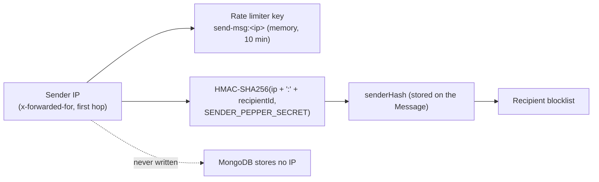
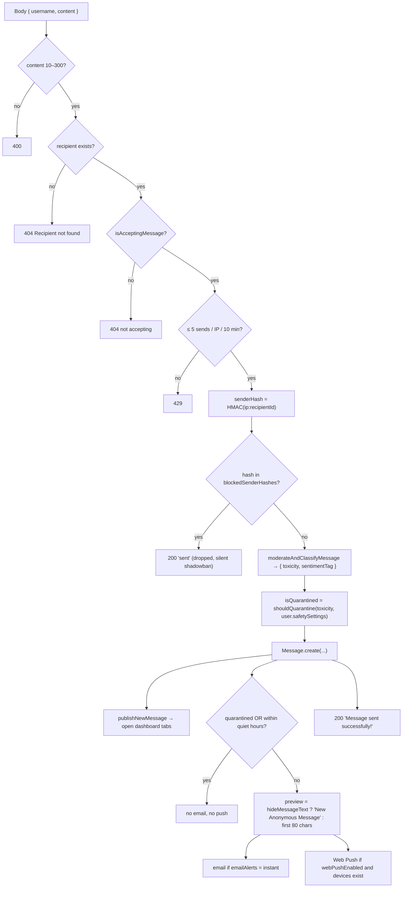

# Chapter 17: Trust, Safety & Privacy

How GhostMsg keeps senders anonymous and Recipients safe: the anonymity model, the send pipeline, graded moderation and the Recipient-controlled quarantine policy, Spicy blur, silent blocking, rate limiting, private notifications, and data rights. **Read this before touching `/api/send-message`, moderation, blocking, notifications or anything that stores or shows sender data.**

Decisions: [ADR 0010](adr/0010-standalone-messages-schema-and-feature-architecture.md), [ADR 0011](adr/0011-openapi-sdk-smtp-mailer-and-sender-unblocking.md) (reversible blocking), [ADR 0025](adr/0025-graded-toxicity-and-recipient-controlled-quarantine.md) (graded toxicity + quarantine policy), [ADR 0026](adr/0026-notification-delivery-policy-quiet-hours-and-hidden-previews.md) (quiet hours + hidden previews), [ADR 0027](adr/0027-destructive-account-actions-undo-window-and-typed-confirmation.md) (destructive actions).

---

## 1. Invariants (never break these)

1. **No sender identity is stored or shown.** Not the IP, user agent or any account. Only `senderHash`.
2. **A blocked sender is never told.** `send-message` answers the normal 200 and drops the message.
3. **Quarantined content never notifies** (no email, no push) and is concealed until the Recipient chooses to reveal it.
4. **Moderation never deletes.** It only routes: main inbox or Quarantined.
5. **Nothing becomes public without an explicit choice** (`isPublished` per answer; `publishByDefault` only pre-sets the switch).
6. **Notification text is private by default** (`hideMessageText: true`).
7. **Failures fail open for delivery, closed for exposure.** If AI moderation is down, the message is delivered as `none`/`neutral`. If anything about alerts is uncertain, no text is shown.

## 2. Anonymity model

- **Per-recipient:** the hash includes `recipientId`, so the same visitor has different hashes for different Recipients. Hashes can't be correlated across profiles.
- **One-way:** an HMAC with a server pepper (`SENDER_PEPPER_SECRET`, falling back to `NEXT_AUTH_SECRET`, then a constant; **set it in production**). The Recipient sees only a short handle (`#01a8…e4`, `formatSenderHash`).
- **Approximate by design:** a shared IP (office, carrier NAT) shares a hash; a new IP gets a new hash. Blocking is a strong nudge, not a guarantee.
- **Exports exclude hashes.** CSV and JSON exports are built from an allow-list (`toMessageExportRecord`): ID, content, Sentiment Tag, dates, read/star/quarantine flags and the reply. Sender Hashes never leave the app.

## 3. The send pipeline

`POST /api/send-message` ([`route.ts`](../src/app/api/send-message/route.ts)):

Email and push are fire-and-forget (`.catch(console.warn)`); they never delay or fail the response.

## 4. Moderation and the quarantine policy

### 4.1 Graded toxicity

`moderateAndClassifyMessage` ([`src/server/ai/moderation.ts`](../src/server/ai/moderation.ts)) asks Gemini 2.5 Flash Lite for one JSON object:

| `toxicity` | Meaning (from the prompt) |
| :--- | :--- |
| `severe` | Violent threats, doxxing, hate speech, sexual harassment, explicit abuse |
| `hurtful` | Insults, demeaning or bullying language, spam or scam links |
| `borderline` | Rude, mean-spirited or crude but not clearly abusive |
| `none` | Everything else, including playful teasing |

…plus a `sentimentTag` (sweet, curious, spicy, advice, neutral) and a `category` (`none`, `hurtful`, `spam`, `threat`). Without `GOOGLE_AI_STUDIO_SECRET`, or on any error or unparsable reply, the result is `{ toxicity: "none", category: "none", sentimentTag: "neutral" }` (fail open, invariant 7). An old-shape reply `{ isToxic: true }` maps to `severe`.

When a message is held, `toQuarantineReason(category)` stores `quarantineReason` (`none` → `hurtful`, the promise of the Quarantine setting). The reason only labels the message; the hold decision is still `shouldQuarantine` alone (S5).

### 4.2 The policy

`shouldQuarantine(toxicity, safetySettings)` ([`quarantine-policy.ts`](../src/server/ai/quarantine-policy.ts), unit-tested) compares the level with the Recipient's **sensitivity**:

| Sensitivity → / toxicity ↓ | Relaxed | **Balanced** (default) | Strict |
| :--- | :---: | :---: | :---: |
| `none` | inbox | inbox | inbox |
| `borderline` | inbox | inbox | **Quarantined** |
| `hurtful` | inbox | **Quarantined** | **Quarantined** |
| `severe` | **Quarantined** | **Quarantined** | **Quarantined** |
| *quarantine switched off* | inbox | inbox | inbox |

- The decision is made **once, at send time**, and stored as `isQuarantined`. Changing sensitivity later does not re-sort existing messages.
- Missing settings fall back to `{ quarantineEnabled: true, sensitivity: "balanced" }`.
- The UI copy mirrors the table: "Balanced holds back clearly hurtful or spammy messages. Strict also holds borderline ones."

### 4.3 How held content is shown

| Situation | Inbox treatment | Reveal | Alerts |
| :--- | :--- | :--- | :--- |
| `isQuarantined` | Only under **Quarantined** (attention badge count). Card is dashed, tagged with its reason (Hurtful language, Spam, Threat; older messages: Quarantined), body hidden: "Hidden. Flagged as hurtful." / "… as spam." / "… as a threat." Keyboard actions skip it. | Dialog ("It was flagged for hurtful language." etc.); **Keep hidden** has initial focus; reveal lasts until reload. | Never |
| Spicy + `blurSpicy` on | Normal inbox, body concealed: "Spicy 🔥 Reveal to read." | Click reveals (no dialog). | Normal |
| Spicy + `blurSpicy` off | Normal | — | Normal |

"Spicy is not the same as quarantined": Spicy is a **Sentiment Tag** (playful roasts, dares, confessions), not a safety verdict.

## 5. Blocking

- **Where:** the Block icon on a message card → `BlockSenderModal` (block, optionally also delete). Settings → Safety → Blocked senders table (Unblock per row).
- **Data:** `blockedSenderHashes` (authoritative lookup) + `blockedSenders[{hash, blockedAt}]` (display). Details in [Chapter 15 §2.4](15-data-model-and-database.md#24-arrays).
- **Effect:** future sends with that hash are dropped silently (200). Existing messages stay unless deleted.
- **Reversible:** Unblock restores delivery immediately ([ADR 0011](adr/0011-openapi-sdk-smtp-mailer-and-sender-unblocking.md)). `DELETE {senderHash:"ALL"}` clears the list (no UI button today).

## 6. Rate limiting and abuse limits

| Limit | Value | Where |
| :--- | :--- | :--- |
| Sends per IP | 5 per 10 minutes (sliding window) | `checkRateLimit("send-msg:<ip>", 5, 600_000)` in `src/server/security/security.ts` |
| Message length | 10–300 characters | route + Zod + Mongoose |
| Answer length | 1–1000 | reply schema |
| AMA Prompt | ≤ 120 | schema + model |
| Display name | ≤ 40 | schema + model |
| Avatar | PNG/JPEG/WebP data URL ≤ 350,000 chars | profile schema |
| Inbox page | 12 per page, ≤ 100 per request | get-messages |
| Inbox search | Literal text only (regex characters escaped) | `escapeRegExp` in `server/messages/inbox-query.ts` |

The limiter is an **in-memory Map per server instance** (cleaned every 5 minutes). It is not shared across serverless instances; see [Chapter 18 §5](18-notifications-and-realtime.md#scaling-limits) for the scaling note.

## 7. Private notifications

| Control | Default | Effect |
| :--- | :--- | :--- |
| Hide message text | **On** | Push and email show "New Anonymous Message", never the content. |
| Quiet hours | Off (22:00–08:00 when enabled) | No email or push inside the window, evaluated in the Recipient's IANA time zone; windows may cross midnight. |
| Quarantined | — | Never alerts. |

Details and the decision flow: [Chapter 18](18-notifications-and-realtime.md).

## 8. Recipient data rights

| Right | How | Notes |
| :--- | :--- | :--- |
| **Pause** | Message Acceptance off | Visitors see a calm paused state; answers remain public. |
| **Hide** | Unpublish an answer, hide the AMA banner, turn off suggestions | Immediate. |
| **Export** | Settings → Export all (CSV/JSON) | Pages through the server for **every** message (quarantined included, not just what is loaded), then builds the file in the browser from allow-listed fields only; no Sender Hashes. |
| **Erase messages** | Danger zone → Delete all (confirm + 10 s undo); per message (confirm, no undo); selected (confirm, no undo); Quarantined view → Delete all quarantined (confirm, no undo) ([ADR 0034](adr/0034-confirmed-message-deletes-undo-for-delete-all-and-phone-dashboard-chrome.md)) | Hard delete, answers included. |
| **Erase account** | Danger zone → Delete account (type username) | Hard delete of User + Messages, then sign-out. The username becomes available to others. |
| **Rename** | Change username | The old link stops working at once (no redirect, so an old link can't keep pointing at a renamed person). |

## 9. Configuration that affects safety

| Env var | Purpose | If missing |
| :--- | :--- | :--- |
| `SENDER_PEPPER_SECRET` | HMAC pepper for Sender Hashes | Falls back to `NEXT_AUTH_SECRET`, then a constant (**weak; always set in production**). Rotating it changes every future hash, so existing blocks stop matching. |
| `GOOGLE_AI_STUDIO_SECRET` | Moderation, suggestions, Smart Reply, AMA ideas | Moderation fails open (`none`), AI features use fallbacks. |
| `NEXT_AUTH_SECRET` | Session JWTs | Auth breaks. |
| `VAPID_*`, `NEXT_PUBLIC_VAPID_PUBLIC_KEY` | Web Push | Push is skipped silently. |
| `SMTP_*` | Verification and alert email | Email fails (logged). |

## 10. Known issues (code that does not yet meet these rules)

**None open.** Resolved on 2026-10-14 (K1–K4 in [ADR 0029](adr/0029-daily-digest-scheduling-and-alert-privacy-fixes.md), K5–K7 in [ADR 0030](adr/0030-server-side-inbox-filtering-paging-and-counts.md)):

| # | Was | Fix | Test |
| :--- | :--- | :--- | :--- |
| K1 | JSON export included `senderHash`. | Exports use the `toMessageExportRecord` allow-list. | `export.test.ts` |
| K2 | The live toast previewed every message, including quarantined ones, and ignored hidden text. | `buildLiveMessageToast`: silent for quarantined, text-free when hidden. | `use-live-messages.utils.test.ts` |
| K3 | "Daily digest" was never sent. | Scheduled `GET /api/cron/daily-digest` (Vercel Cron + `CRON_SECRET`). | `daily-digest.test.ts`, `send-daily-digest-email.test.ts` |
| K4 | Hidden-text alert emails quoted the placeholder "New Anonymous Message" and showed the tone; the button linked to a hard-coded domain. | `preview: null` renders a neutral sentence; links use `APP_URL`. | `send-message-alert-email.test.ts` |
| K5 | "Export all" contained only the messages loaded in the inbox. | `fetchAllMessages("any")` pages through the server ([ADR 0030](adr/0030-server-side-inbox-filtering-paging-and-counts.md)). | `fetch-all-messages.test.ts`, `use-settings.controller.test.ts` |
| K6 | A selection survived a filter or search change, so a bulk action (delete, mark read) could reach messages no longer on screen. | Selection is scoped to the filter + search and counts only loaded ids (ADR 0030 D6). | `use-inbox.controller.test.ts`, `inbox.utils.test.ts` |
| K7 | Turning push off on one device switched it off for every device. | Per-device switch; the server clears `webPushEnabled` only when no device is left (ADR 0030 D9). | `use-settings.controller.test.ts`, `web-push.test.ts` |

Add a row here (K5…) whenever code is found not to meet a rule above, with its fix and owner, and remove it when the fix lands.

## 11. Review checklist for safety-relevant changes

- [ ] No new field stores or returns anything that identifies a sender.
- [ ] Blocked-sender responses stay indistinguishable from success.
- [ ] Quarantined messages still skip every alert channel.
- [ ] New public data is opt-in, visible in the Profile preview, and added only in `getPublicProfile` (`src/server/users/public-profile.ts`), the single public read model (S8).
- [ ] AI failures degrade to the safe default listed above.
- [ ] New destructive actions have an undo window or typed confirmation.
- [ ] Tests: policy unit tests (`quarantine-policy.test.ts`, `delivery-policy.test.ts`) and a controller or story test for the UI path.
