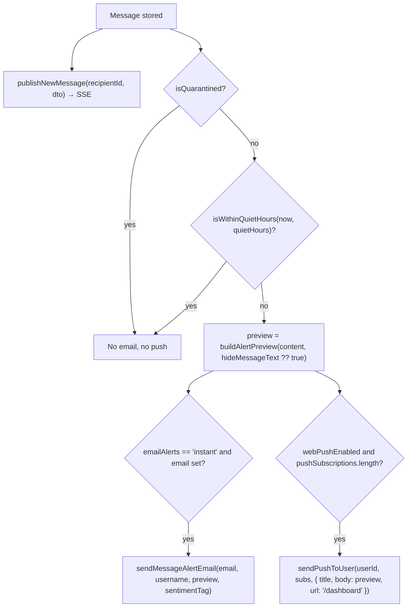
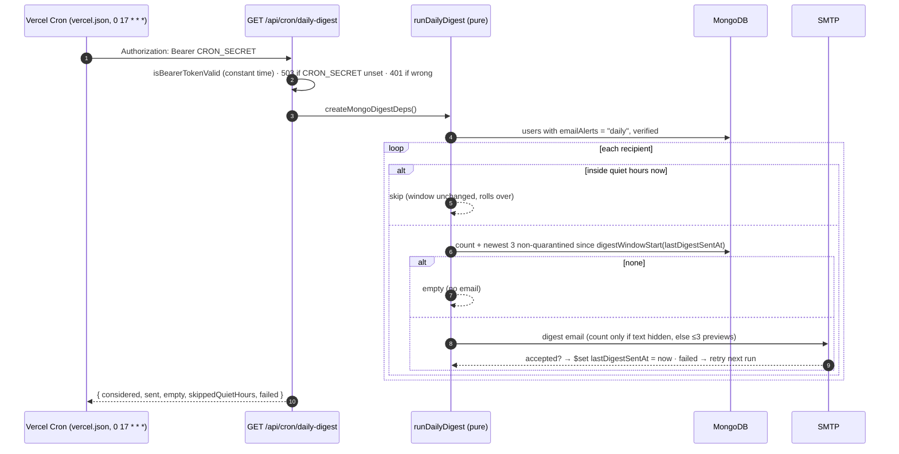
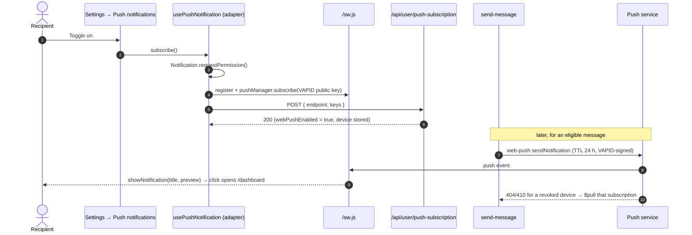
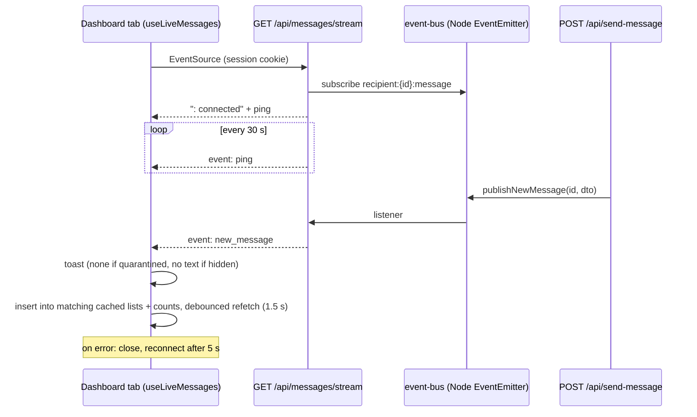

# Chapter 18: Notifications & Real-Time Delivery

How a Recipient learns about a new Anonymous Message: the live in-app feed (SSE), email alerts, and Web Push, plus the delivery policy that decides which channels fire (quarantine, quiet hours, hidden text). Decisions: [ADR 0020](adr/0020-web-push-delivery-vapid-and-subscription-lifecycle.md) (Web Push) and [ADR 0026](adr/0026-notification-delivery-policy-quiet-hours-and-hidden-previews.md) (quiet hours + hidden previews).

---

## 1. Channels at a glance

| Channel | Reaches | Trigger | Respects quarantine | Respects quiet hours | Respects hidden text |
| :--- | :--- | :--- | :---: | :---: | :---: |
| **Live feed (SSE)** | Open dashboard tabs | Every stored message | ✓ inbox lands it in Quarantined; no toast | ✗ (in-app only) | ✓ toast has no text when hidden |
| **Email** | Inbox of `user.email` | `emailAlerts = "instant"` | ✓ never | ✓ | ✓ |
| **Web Push** | Every subscribed device | `webPushEnabled` and ≥1 subscription | ✓ never | ✓ | ✓ |
| **Daily digest** | Inbox of `user.email` | `emailAlerts = "daily"`, once a day (17:00 UTC) | ✓ never counted | ✓ skipped, rolls to the next run | ✓ count only |

The in-app toast rules come from `buildLiveMessageToast` (`src/data/messages/use-live-messages.utils.ts`); the digest from `runDailyDigest` ([ADR 0029](adr/0029-daily-digest-scheduling-and-alert-privacy-fixes.md)).

## 2. The delivery decision

All alert logic lives in `POST /api/send-message` after the message is stored, using the pure helpers in [`src/server/notifications/delivery-policy.ts`](../src/server/notifications/delivery-policy.ts) (unit-tested in `delivery-policy.test.ts`):

### 2.1 Quiet hours

`isWithinQuietHours(date, quietHours)`:

- Off unless `enabled`. A zero-length window (`start == end`) counts as off.
- Times are `HH:MM` wall-clock in `timeZone` (IANA). The current time is converted with `Intl.DateTimeFormat`; an invalid zone falls back to UTC.
- Windows may cross midnight: `22:00 → 08:00` is quiet from 22:00 until 07:59.
- **The time zone is captured from the browser** when the Recipient edits quiet hours (`Intl.DateTimeFormat().resolvedOptions().timeZone` in `use-settings.controller.ts`). If they travel, the window stays in the zone where they last saved it.
- Messages that arrive during quiet hours are **not queued** for later; they simply don't alert. They are in the inbox (and the live feed) as usual.

### 2.2 Hidden previews

`buildAlertPreview(content, hideText)` returns `"New Anonymous Message"` when hidden (the default), else the first 80 characters plus `…`. Push uses it as the notification body. Email gets `preview: null` when hidden and then renders a neutral sentence ("Someone sent you a new anonymous message. Open your inbox to read it.") with no quote box and no Sentiment Tag; when text is shown it quotes the preview and shows the tag.

## 3. Email alerts

- **Transport:** Nodemailer over SMTP (`src/server/email/mailer.ts`, `SMTP_HOST/PORT/USER/PASS`). Templates are React Email components in `emails/` (`new-message-alert.tsx`, `daily-digest.tsx`, `verification-email.tsx`), rendered with `@react-email/render`. Links use `APP_URL` (from `NEXTAUTH_URL`).
- **Subjects:** instant "GhostMsg 👻 | You received a new anonymous message!"; digest "GhostMsg 👻 | 3 new anonymous messages today".
- **Frequency:** `instant` sends one email per eligible message. `off` sends none. `daily` sends one digest per day, described below.

### 3.1 Daily digest ([ADR 0029](adr/0029-daily-digest-scheduling-and-alert-privacy-fixes.md))

- **Window:** since `lastDigestSentAt`; a first digest covers 24 hours; never more than 7 days back.
- **Setup:** set `CRON_SECRET` in the Vercel project (Vercel Cron sends it as the bearer token). Without it the route answers 503 and no digests go out. Trigger manually with `curl -H "Authorization: Bearer $CRON_SECRET" https://<host>/api/cron/daily-digest`.
- **Code:** policy `src/server/notifications/daily-digest.ts` (unit-tested), store `daily-digest-store.ts`, email `src/server/email/send-daily-digest-email.ts` + `emails/daily-digest.tsx`.
- Failures are logged (`console.warn`) and never affect the send response.

## 4. Web Push

- **Per device.** "Push notifications: On this device only." Each browser registers its own subscription, and the Settings switch shows **this browser's** subscription. Turning push off removes this device only; `webPushEnabled` ("some device is subscribed") goes false only when the last subscription is removed or pruned ([ADR 0030](adr/0030-server-side-inbox-filtering-paging-and-counts.md) D9).
- **Server:** [`src/server/push/web-push.ts`](../src/server/push/web-push.ts): `getVapidConfig()` (null when keys are missing → push skipped), `sendPushToUser()` (never throws; prunes gone endpoints).
- **Client adapter:** `src/data/user/use-push-notification.ts` hides browser APIs from controllers (ADR 0014/0020). Missing VAPID config surfaces as `PUSH_NOT_CONFIGURED_MESSAGE`.
- **Env:** `NEXT_PUBLIC_VAPID_PUBLIC_KEY`, `VAPID_PRIVATE_KEY`, `VAPID_SUBJECT` (default `mailto:support@ghostmsg.app`).

## 5. Live feed (Server-Sent Events)

- `runtime = "nodejs"`, `dynamic = "force-dynamic"`. The listener and heartbeat are removed when the request aborts.
- **Client:** `useLiveMessages` inserts each new message into every cached inbox list it belongs to (not searches) and into the counts (`insertLiveMessage`, `addToInboxCounts`), then refetches once after 1.5 s to fill in the Sender Hash and reply. It reports `isConnected`; while disconnected the inbox polls every 30 s, and inbox + counts refetch on window focus ([ADR 0031](adr/0031-state-management-consistency-and-structure.md)).
- The bus is a process-wide `EventEmitter` (`src/server/realtime/event-bus.ts`, max 100 listeners, kept on `global` in development to survive hot reload).

### Scaling limits

The event bus and the rate limiter ([Chapter 17 §6](17-trust-safety-and-privacy.md#6-rate-limiting-and-abuse-limits)) are **in-memory per server process**:

| Deployment | Effect |
| :--- | :--- |
| One long-lived Node server | Works as designed. |
| Multiple instances / serverless (Vercel) | A message stored by instance A only reaches SSE clients connected to instance A; other tabs see it on the next refetch (Refresh, focus, invalidation). The rate limit is per instance. Email and push are unaffected. |

To scale out, replace `publishNewMessage`/`subscribeToMessages` with a shared pub/sub (for example Redis or Upstash) and `checkRateLimit` with a shared store. Both are single-file swaps behind the same function signatures. Earlier docs described Upstash Redis; **the current code does not use Redis.**

## 6. Settings that control notifications

| UI (Settings → Notifications) | Field | API |
| :--- | :--- | :--- |
| Email me about new Anonymous Messages: Instant · Daily digest · Off | `notificationSettings.emailAlerts` | `PATCH /api/user/notifications { emailAlerts }` |
| Push notifications (On this device only) | `webPushEnabled` + `pushSubscriptions[]` | `POST/DELETE /api/user/push-subscription`, `PATCH { webPushEnabled }` |
| Hide message text in notifications | `notificationSettings.hideMessageText` | `PATCH { hideMessageText }` |
| Quiet hours (switch, start, end; 30-minute steps) | `notificationSettings.quietHours` | `PATCH { quietHours: { enabled, start, end, timeZone } }` |

All four are optimistic in the UI (`useNotificationSettingsMutation`), with rollback and a toast on failure.

## 7. Testing

| Layer | Test |
| :--- | :--- |
| Policy | `delivery-policy.test.ts` (windows, midnight crossing, zones, hidden preview), `quarantine-policy.test.ts`, `daily-digest.test.ts` (window, previews, quiet-hours skip, retry on failure) |
| Email | `send-message-alert-email.test.ts` (hidden text renders no quote or tone), `send-daily-digest-email.test.ts` |
| Live toast | `use-live-messages.utils.test.ts` (silent for quarantined, text-free when hidden) |
| Cron auth | `security.test.ts` (`isBearerTokenValid`) |
| Push server | `web-push.test.ts` (VAPID config, gone pruning) |
| Push adapter | `use-push-notification.utils.test.ts` |
| Settings UI | `use-settings.controller.test.ts`, `Blocks/SettingsPanel` stories |
| Schemas | `notification-schema.test.ts` (clock format, quiet hours) |
