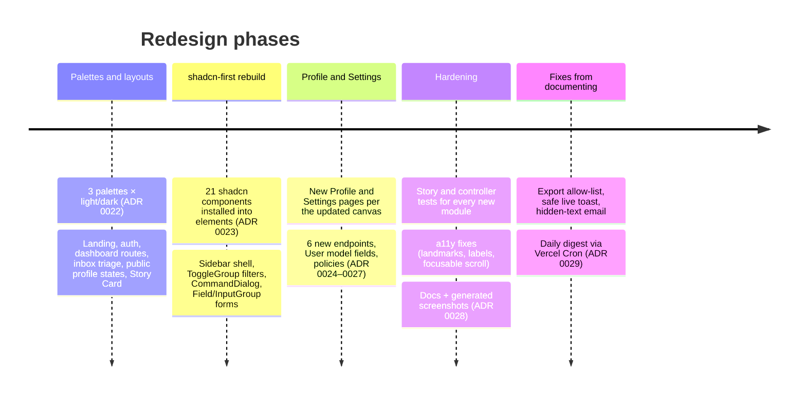

# Chapter 19: Redesign Change Summary (October 2026)

Everything the Claude Design redesign changed, in one place: features, UI, API, database, code structure, tests and docs. Use it to review the release, write release notes, or find out why something moved. Detailed reasoning is in [ADR 0022](adr/0022-palette-theming-and-claude-design-redesign.md)–[ADR 0028](adr/0028-agent-first-documentation-system-and-generated-screenshots.md).

**Baseline:** commit `74479d9` (optimistic inbox + Web Push, ADR 0020/0021). **Scope:** branch `feat/as/source-structure-and-utilities`.

---

## 1. Timeline

## 2. For users: what's new

| Area | Before | After |
| :--- | :--- | :--- |
| **Look** | Stock shadcn stone, Poppins, one theme | 3 palettes (Soft spectral, Midnight confessional, Playful paper) × Light/Dark/System, brand fonts and gradients ([Chapter 13](13-design-system-and-theming.md)) |
| **Landing** | Heading + carousel | Claim-your-link hero, How it works, Trust, Q&A showcase, CTA, footer |
| **Dashboard** | One page with 3 tabs | Routes `/dashboard`, `/dashboard/profile`, `/dashboard/settings` in a sidebar shell; phone top bar + tab bar; ⌘K command palette |
| **Inbox** | Tabular list | Card grid/list, filter chips with counts, search with `/`, keyboard triage (`j k x s r`), bulk toolbar, sentiment badges, concealed quarantined cards with a Reveal dialog, optional Spicy blur |
| **Public profile** | Basic form | Display name + photo, optional AMA banner, optional Suggested Messages, sent/paused/not-found states, palette + theme switchers |
| **Profile page** | AMA prompt field | Identity (photo, display name, change username), share card, AMA editor with ideas + **Suggest with AI** + banner switch, live visitor preview, unsaved-changes bar |
| **Settings** | Acceptance, email alerts, push, blocklist | + Suggested Messages toggle, publish-by-default, quarantine on/off + **Relaxed/Balanced/Strict**, blur Spicy, blocked-senders table with dates, **hide message text**, **quiet hours**, appearance, export, **delete all (10 s undo)**, **delete account** |
| **Answers** | Reply + publish | Smart Reply tones, publish default from Settings, Story Card 9:16/1:1 gradient/plain with native share |

## 3. API changes

### 3.1 New endpoints

| Endpoint | Purpose |
| :--- | :--- |
| `GET/PATCH /api/user/profile` | Display name, avatar (data URL), AMA banner switch |
| `PATCH /api/user/username` | Change username (409 if taken) |
| `GET/PATCH /api/user/preferences` | Messages + Safety preferences |
| `DELETE /api/messages` | Delete every message |
| `DELETE /api/user` | Delete account (typed confirmation) |
| `POST /api/ai/ama-suggestions` | AI AMA Prompt ideas |
| `GET /api/cron/daily-digest` | Daily digest emails (scheduler only, `CRON_SECRET`) |

### 3.2 Changed endpoints (backwards compatible: additive)

| Endpoint | Change |
| :--- | :--- |
| `GET/PATCH /api/user/notifications` | + `hideMessageText`, `quietHours`; PATCH now Zod-validated and writes dot paths (no sibling resets) |
| `GET /api/block-sender` | + `blockedSenders: { hash, blockedAt? }[]` |
| `POST/DELETE /api/block-sender` | Record / remove block dates |
| `GET /api/public/{username}/answers` | + `isAcceptingMessages`, `displayName`, `avatarUrl`, `showAmaBanner`, `offerSuggestions` |
| `POST /api/send-message` | Quarantine via the Recipient's sensitivity; alerts respect quiet hours and hidden text |
| NextAuth `jwt` callback | Handles `trigger === "update"` to refresh `username` |

OpenAPI paths are registered under the new **Profile & Settings** tag; `pnpm typegen` regenerated `src/generated/api-schema.d.ts`. Reference: [Chapter 16](16-api-reference.md).

### 3.3 State-management follow-up ([ADR 0030](adr/0030-server-side-inbox-filtering-paging-and-counts.md), [ADR 0031](adr/0031-state-management-consistency-and-structure.md))

| Endpoint | Change | Compatible? |
| :--- | :--- | :--- |
| `GET /api/get-messages` | Serves **one page of one filter**: `status` (`all` default, `unread`, `starred`, `answered`, `quarantined`, `any`), `q`, `cursor`, `limit` (30, max 100); returns `nextCursor`. `400` for an unknown status or a bad cursor. | **No**: callers that expected every message must page (`fetchAllMessages`). |
| `GET /api/messages/counts` | **New.** `{ all, unread, starred, answered, quarantined, total }` in one aggregation. | Additive |
| `POST /api/messages/{id}/reply` | Also marks the message read. | Additive |
| `DELETE /api/user/push-subscription` | Turns `webPushEnabled` off when no device is left (also after gone-pruning). | Behaviour |
| `PATCH /api/user/profile` | + `amaPrompt`; the whole Profile page saves in one request. | Additive |
| `PATCH /api/user/ama-prompt` | Legacy: still works, no longer called by the app. | — |
| `GET /api/public/{username}/answers` | Body built by `getPublicProfile`, shared with the server-rendered page and its metadata. Same shape. | Same |
| NextAuth session / JWT | `isAcceptingMessage` removed (identity only). | **No** for code reading `session.user.isAcceptingMessage` |

## 4. Database changes

All additive on `users`, with schema defaults and read-side defaults (`src/server/users/user-dto.ts`), so **no migration is required** ([Chapter 15 §4](15-data-model-and-database.md#4-compatibility-documents-older-than-a-field)).

| Field | Default |
| :--- | :--- |
| `displayName` | `""` |
| `avatarUrl` | `null` |
| `showAmaBanner` | `true` |
| `messagePreferences.{offerSuggestions, publishByDefault}` | `true`, `false` |
| `safetySettings.{quarantineEnabled, sensitivity, blurSpicy}` | `true`, `"balanced"`, `false` |
| `notificationSettings.hideMessageText` | `true` |
| `notificationSettings.quietHours.{enabled,start,end,timeZone}` | `false`, `"22:00"`, `"08:00"`, `"UTC"` |
| `blockedSenders[{hash, blockedAt}]` | `[]` (legacy hashes show no date) |
| `lastDigestSentAt` | `null` (server-only; set after each daily digest) |

`messages` is unchanged. Moderation now returns a graded `toxicity` (stored only as the resulting `isQuarantined`).

**Behaviour change to note:** existing users get `hideMessageText: true` by default, so their alerts stop showing message text until they turn it off. This is intended (privacy by default, [ADR 0026](adr/0026-notification-delivery-policy-quiet-hours-and-hidden-previews.md)).

## 5. Code changes

### 5.1 Structure

| Area | Added | Removed / renamed |
| :--- | :--- | :--- |
| Routes | `src/app/(dashboard)/dashboard/{page,profile/page,settings/page,layout}.tsx` | `src/app/(app)/(dashboard)/dashboard/*` (dashboard left the `(app)` group: no site header) |
| Elements | alert, avatar, breadcrumb, checkbox, command, dropdown-menu, empty, field, input-group, item, kbd, palette-picker, radio-group, scroll-area, select, separator, sheet, sidebar, spinner, table, toggle, toggle-group | custom `chip` (replaced by Toggle `chip`) |
| Patterns | brand-mark, claim-link-form, command-palette, how-it-works, identity-card, page-heading, section-nav, story-card-preview, unsaved-changes-bar, visitor-preview, modals: change-username, delete-account, delete-all-messages, reveal-message (+ `story-card.canvas.ts`) | messages-carousel |
| Blocks | cta-banner, qa-showcase, site-footer, trust-section; settings-panel split into section files | settings-section (folded into settings-panel) |
| Pages | dashboard-layout, inbox-page, profile-page, settings-page; controllers: dashboard-shell, inbox-keyboard, profile-link, change-username, danger-zone, appearance, claim-link | dashboard-page, inbox/profile/settings tabs |
| Server | `ai/quarantine-policy`, `ai/ama-suggestions`, `notifications/delivery-policy`, `notifications/daily-digest` (+ `-store`), `email/send-daily-digest-email`, `users/user-dto`; `isBearerTokenValid` in `security` | — |
| Data | `use-update-profile`, `use-change-username`, `use-update-preferences`, `use-delete-all-messages`, `use-delete-account`, `use-ama-suggestions` mutations; `user.profile`/`user.preferences` queries | — |
| Lib / hooks / providers | `lib/theme/palette`, `lib/browser/resize-image`, `lib/format/relative-time`, `lib/users/username-availability` (promoted from sign-up), `hooks/use-active-section`, `hooks/use-mobile`, `providers/palette-provider` | `content/landing-messages.json`, `mock/fixtures/carousel.fixtures.ts` |
| Scripts & config | `check-theme-contrast.ts` (`pnpm theme:contrast`), `capture-doc-screenshots.ts` (`pnpm docs:screenshots`), `vercel.json` (daily digest cron), `emails/daily-digest.tsx` | — |

### 5.2 Component API changes (breaking for internal callers)

| Component | Change |
| :--- | :--- |
| `Button` | Stock shadcn v4 (Slot `asChild`) + GhostMsg variants; the motion version lives on in `IconButton`/`CopyButton` |
| `Badge` | `size` removed; new variants `glass/success/warning/neutral/count/attention` |
| `Avatar`, `Kbd`, `Sheet`, `DropdownMenu`, `InputGroup` | Replaced by shadcn versions (`InputGroup` uses `size/shape/tone`; old `state` prop gone) |
| `CommandPalette` | Built on `CommandDialog`; types renamed `CommandGroupDefinition`/`CommandItemDefinition` |
| `FilterBar`, view toggle | ToggleGroup items are `role="radio"` (tests query radios) |
| `AmaPromptEditor` | Props: `value, aiIdeas, isSuggesting, onChange, onSuggest, showBanner, onShowBannerChange` (save moved to the page's unsaved bar) |
| `ShareLinkCard` | Props: `profileUrl, onCopy, onShare` |
| `ProfilePanel` | Props: `{ identity, link, ama, isAccepting, unsaved }` |
| `SettingsPanel` | Props: `{ messages, safety, notifications, appearance, data, danger }` |
| `MessageCard` / `Inbox` | + `concealSpicy`; checkbox is shadcn `Checkbox size="lg"` |
| `Dialog` | + `showCloseButton` |
| `Sidebar` (element) | Desktop container is `<aside>`; cookie persistence removed |
| `ScrollArea` | Viewport focusable (`tabIndex=0`) |

### 5.3 Tooling

- `biome.jsonc`: `useSemanticElements` off for upstream breadcrumb/field/input-group/item; focus/click rules off for breadcrumb/input-group (upstream ARIA patterns only).
- shadcn CLI quirk documented: `pnpm remove cn` after every `shadcn add`.

## 6. Quality gates at release

| Gate | Result (2026-10-14) |
| :--- | :--- |
| `pnpm check` (Ultracite/Biome) | ✓ 0 errors |
| `pnpm exec tsc --noEmit` | ✓ |
| `pnpm build` | ✓ |
| `pnpm test:all` | ✓ 676 tests in 157 files (54 unit + 103 story), after the state-management review |
| `pnpm theme:contrast` | ✓ all 6 palette × mode pairs AA |
| `pnpm docs:registry:check` | ✓ |

## 7. Follow-up: state-management review

After the redesign, a state-management review ([Chapter 20](20-state-management.md)) was carried out in three phases:

- **Correctness** ([ADR 0030](adr/0030-server-side-inbox-filtering-paging-and-counts.md)): server-side filters, search and keyset paging with **Load more**; `GET /api/messages/counts` for badges, the unread count and "Delete all N"; export of every message; mark-read on interaction; selection scoped to the current filter; optimistic star/read/reply; a per-device push switch. The MSW mock now runs the same filter rules as the server.
- **Consistency** ([ADR 0031](adr/0031-state-management-consistency-and-structure.md)): one optimistic-resource mutation factory (serialised per resource, silent switches); live messages inserted into the cache; focus refetch and polling when the stream drops; Suggested Messages as a cached query; AMA Prompt saved with the profile.
- **Structure** ([ADR 0031](adr/0031-state-management-consistency-and-structure.md)): inbox split into filter/data controllers with URL state and a remembered layout; dialogs by message id; no effects copying state; Profile on react-hook-form with a leave guard; dashboard session from the server; Message Acceptance out of the JWT; public profile rendered on the server with real metadata; palette synced across tabs.

## 8. Issues found while documenting, and fixed

Writing chapters 12–18 against the code surfaced four places where behaviour broke the product's own rules (K1–K4, [ADR 0029](adr/0029-daily-digest-scheduling-and-alert-privacy-fixes.md)); the state-management review found three more (K5–K7, [ADR 0030](adr/0030-server-side-inbox-filtering-paging-and-counts.md)). All are fixed in this release ([Chapter 17 §10](17-trust-safety-and-privacy.md#10-known-issues-code-that-does-not-yet-meet-these-rules)):

| # | Problem | Fix |
| :--- | :--- | :--- |
| K1 | JSON export contained Sender Hashes. | Allow-listed export records. |
| K2 | The live toast previewed quarantined messages and ignored hidden text. | `buildLiveMessageToast`. |
| K3 | "Daily digest" was never sent. | `GET /api/cron/daily-digest` + Vercel Cron + digest email. |
| K4 | Hidden-text alert emails quoted the placeholder as if it were the message and linked to a hard-coded domain. | Neutral hidden-text email; `APP_URL` links. |
| K5 | "Export all" contained only the loaded messages. | `fetchAllMessages("any")` pages through the server. |
| K6 | A selection survived a filter change, so bulk actions could reach hidden messages. | Selection scoped to filter + search, loaded ids only. |
| K7 | Turning push off on one device switched it off everywhere. | Per-device switch; server clears the flag when no device is left. |

Also added: controller tests for `use-dashboard-shell` and `use-profile-link`, and graded-moderation parsing tests with the AI SDK mocked. The final documentation audit added tests for code the docs already described but nothing exercised: the inbox URL/selection/dialog helpers (`inbox.utils.test.ts`) and **Export all** (`fetch-all-messages.test.ts`, `use-settings.controller.test.ts`), and corrected the OpenAPI descriptions of the reply, AMA Prompt, profile, push-unsubscribe and public-answers operations.

**Still deliberate (not bugs):** no "Unblock all" button (design), the in-memory rate limiter and live-event bus (need shared infrastructure and a privacy decision before moving off-process), avatars stored in MongoDB ([Chapter 12 §6](12-product-guide-and-features.md#6-known-gaps-and-non-goals)).

## 9. Post-redesign: infrastructure as code ([ADR 0032](adr/0032-terraform-managed-vercel-and-mongodb-atlas-infrastructure.md))

After the redesign the Vercel project, per-environment environment variables and the MongoDB Atlas cluster were adopted into Terraform (`terraform/`). This separates infrastructure concerns from the app codebase: no more manual dashboard edits that drift out of sync.

| What changed | Detail |
| :--- | :--- |
| Vercel project settings | `vercel_project.ghostmsg` (imported, not re-created) |
| All Production + Preview env vars | One `vercel_project_environment_variable.app` per `NAME::environment` key; `MONGODB_URI` built from Atlas resources |
| MongoDB Atlas project and cluster | "Project 0" and "Abbas-Shaikh" adopted via `terraform import`; MongoDB 8.0 on M0 free, `AP_SOUTH_1` |
| Two isolated databases | `honest_feedback` (production user) and `honest_feedback_preview` (preview user) — RBAC-enforced isolation |
| HCP Terraform state | Org `PersonalAbbasSpace`, workspace `ghostmsg`, CLI-driven (not VCS-driven) |

**Nothing in the app code changed.** All changes are under `terraform/`. The cron in `vercel.json` stays out of Terraform (no provider resource for it).

Full reference: [Chapter 21: Infrastructure & Terraform](21-infrastructure-and-terraform.md).

## 10. Design-handoff v2 alignment: phones, toasts and confirmed deletes ([ADR 0034](adr/0034-confirmed-message-deletes-undo-for-delete-all-and-phone-dashboard-chrome.md))

| Area | For users | For developers |
| :--- | :--- | :--- |
| Deletes | Deleting one message or a selection always asks first ("Delete this message?" / "Delete N messages?"), then deletes at once. Only **Delete all** in Danger zone keeps its 10 s **Undo**. | `DeleteMessageModal` (single) and `DeleteSelectedModal` (bulk) driven by `use-inbox.controller.ts`; `showUndoToast` is used by the danger zone only. An earlier undo-first version was reverted on 2026-10-31. |
| Toasts | One-line toasts with a coloured icon; success 3 s, info/warning 5 s, errors 6 s (or until dismissed with an action); errors are read out at once. Undo toasts show the time left and pause on hover. | `notify` (`elements/sonner/notify.ts`, `TOAST_DURATION_MS`) wraps Sonner and feeds an assertive live region; `Toaster` is `unstyled` + `classNames`. Bulk success copy is verb-first. |
| Archive | `e` (or the card / sheet action) archives a message: it leaves the inbox and appears under an **Archived** chip. "Moved back to Inbox" undoes it. | `isArchived` on the message (indexed), `status=archived` in the inbox query, `use-archive-message-mutation.ts`. |
| Quarantine reasons | Quarantined cards say why: **Hurtful language**, **Spam** or **Threat** (older ones say Quarantined). | Moderation returns a `category`; `toQuarantineReason` stores `quarantineReason`; copy in `lib/messages/quarantine-reason.ts`. |
| Keyboard | `e`, `⇧B`, `#`, `esc`, `⇧J`/`⇧K`, `g i` / `g p` / `g s`, `⇧C`, and a `?` shortcut sheet; tooltips show keys. | `use-global-shortcuts.controller.ts` (capture phase, chords stop propagation), `patterns/shortcut-sheet`, `lib/browser/shortcuts.ts`. |
| Inbox feel | Cards are marked read after 600 ms on screen; new messages show a pill instead of jumping; skeletons only after 150 ms; four empty states; "last checked a moment ago". | `useMarkSeen` in `MessageCard`, `useNewMessagesPill` / `useDelayedFlag` / `InboxEmptyState` in `blocks/inbox`, `formatLastChecked`. |
| Smart Reply | Three drafts (thoughtful, witty, wholesome) appear as soon as Reply opens, from one AI call. | `POST /api/ai/smart-reply` now takes `{ content }` and returns `{ drafts }`; `smartReplyQueries.drafts` replaces the mutation. |
| Verify | A resend countdown, tries left after a wrong code, a lock after three, and a "You're in. Your link is live." screen. | `POST /api/verify-code/resend`, `verifyAttempts` / `verifyCodeSentAt` on the user, `lib/users/verification.ts`, `blocks/verify-success`. |
| Auth, landing, public profile on phones | Auth screens have their own Back + progress, no site header; the landing and public profile states match the MobLanding / MobPublic* boards. | `SiteLayout hideHeaderOnPhones`, `AuthPanel backHref/step/align/iconTone`, CSS-only landing variants, `PublicProfile` sent screen. |
| Phones | New top bar (page actions instead of title/avatar), pill tab bar, Inbox search + selection mode, More actions sheet, Quarantined view, Settings as a grouped list with accordion rows, Profile identity summary. Sign out and Message Acceptance are in Settings. | `patterns/mobile-header-actions` portals; `SettingsLayoutProvider`; new props on `BulkActionToolbar`, `ShareLinkCard`, `MessageCard`, `FilterBar`, `IdentityCard`. |
| Tablet | Sidebar starts as an icon rail. | `useTabletRail` in the shell. |
| Styling | Danger zone title and other headings with colour variants keep their size again. | `cn()` knows the semantic type scale (`src/lib/utils.ts`). |

Not done, with reasons: [redesign-progress.md §5](agents/redesign-progress.md#5-not-done-and-why).
