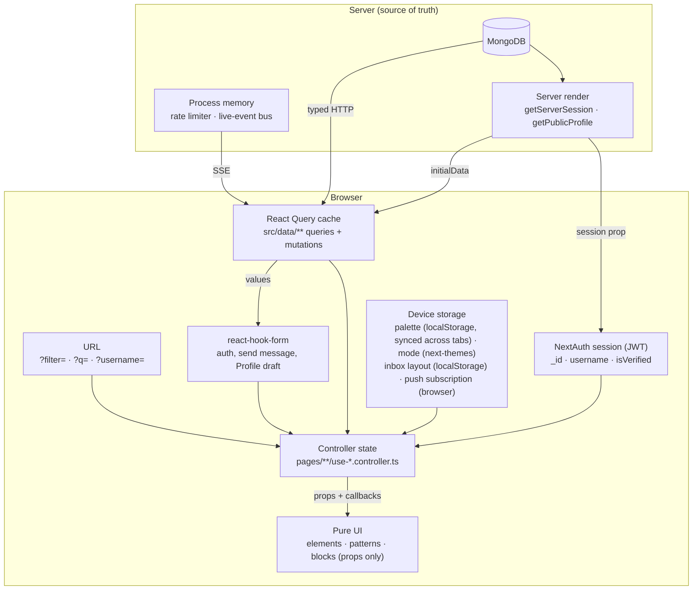
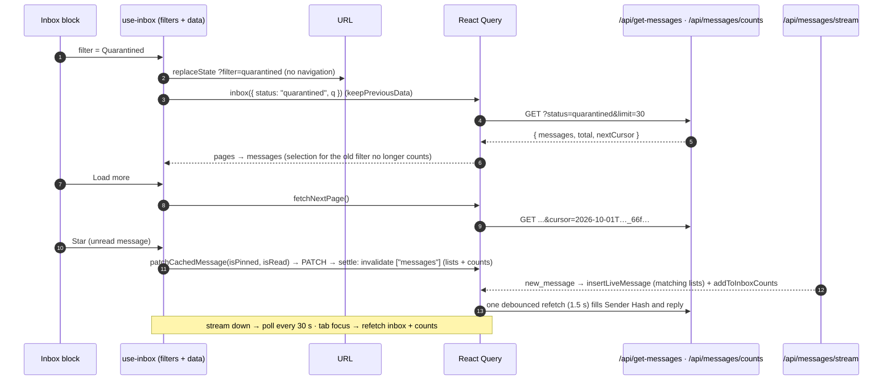

# Chapter 20: State Management

Where each kind of state lives in GhostMsg, the rules for adding new state, and the outcome of the state-management review (October 2026). Read this before adding a query, a mutation, a `useState` in a controller, or anything stored in the URL, the session or the browser.

Decisions: [ADR 0006](adr/0006-standardized-api-calling-and-react-query-architecture.md) (React Query), [ADR 0015](adr/0015-four-tier-components-pages-layer-and-vendor-consolidation.md) (logic only in controllers), [ADR 0021](adr/0021-optimistic-inbox-mutations-close-first-and-shared-cache-helpers.md) (optimistic mutations), [ADR 0030](adr/0030-server-side-inbox-filtering-paging-and-counts.md) (server-side inbox), [ADR 0031](adr/0031-state-management-consistency-and-structure.md) (consistency and structure).

---

## 1. State map

| Kind | Owner | Use it for | Never |
| :--- | :--- | :--- | :--- |
| **Server data** | React Query (`src/data/**`) via `queryOptions` / `infiniteQueryOptions` factories and one-hook-per-file mutations | Anything stored in MongoDB | Copying it into `useState` (derive instead) |
| **Server-rendered data** | Route files: `getServerSession` (dashboard layout → `SessionProvider`), `getPublicProfile` (`/u/[username]` → `initialData` + metadata) | A filled first paint where the server already has the data | A second source of truth: the client cache takes over after hydration |
| **Session** | NextAuth JWT | Identity (`_id`, `username`, `isVerified`) | App settings (they go stale in the token) |
| **URL** | Route `searchParams` in, `window.history.replaceState` out | Shareable view state (`?filter=`, `?q=`; `?username=` to prefill sign-up) | Secrets, large state |
| **Controller UI state** | `useState` in `pages/**/use-*.controller.ts` | Ephemeral UI: open dialog (by message id), scoped selection, focus, the Smart Reply draft | Data that exists on the server |
| **Forms** | react-hook-form in controllers ([ADR 0033](adr/0033-standardized-form-architecture-with-react-hook-form-and-shadcn-primitives.md)) | Validated user input (paired exclusively with shadcn `<Form>` compound primitives in patterns); the Profile draft (`values` from the server, `keepDirtyValues`) | Mirroring server results into errors via effects |
| **Device** | `localStorage`, `next-themes`, browser APIs | Per-device preferences (palette, mode, inbox layout) and capabilities (push subscription) | Account settings |
| **Server process** | `src/server/security`, `src/server/realtime` | Rate limiting, live events | Anything that must survive a restart (see [Chapter 9 §4](09-deployment-and-operations.md#4-process-local-state-scaling-note)) |

**No global client store.** The only app-wide state is the session; everything else is server data, URL or controller state. Don't add Zustand, Redux or context stores for server data.

## 2. Rules

1. **One source of truth per value.** If the server has it, read it from React Query. Derive, don't copy (no `useEffect` that sets state from a query).
2. **Query-key factories only.** Keys come from `src/data/query-keys.ts`; queries from `<domain>.queries.ts`. Invalidate the narrowest key that changed (`user.profile`, not `user.all`).
3. **Lists are filtered and paged on the server.** Use `messagesQueries.inbox({ status, q })` and `messagesQueries.counts()`; never count or filter a downloaded page to show totals ([ADR 0030](adr/0030-server-side-inbox-filtering-paging-and-counts.md)).
4. **Mutations behind switches and cards are optimistic** with a snapshot rollback and an error toast; silent on success unless the user needs confirmation. Use `updateCachedMessages` / `patchCachedMessage` / `restoreCachedMessages` for message lists (they handle paged and single-page cache data).
5. **Stable callbacks.** Depend on `mutate` / `mutateAsync`, never on the mutation object (it changes every render).
6. **Scope UI state to what it describes.** Selection belongs to one filter + search and only to loaded ids; focus only to a loaded message. Derive the valid subset instead of resetting in effects.
7. **Device capabilities are read from the device.** Push uses this browser's subscription; the account flag means "some device".
8. **Resource edits use the factory.** A new settings-like mutation is `useOptimisticResourceMutation` with its own `scopeId`, not a hand-written `onMutate`.
9. **Effects are for the outside world** (subscriptions, browser events, timers), not for copying one state into another. Derive during render, or adjust state during render keyed by an id.
10. **Shareable view state goes in the URL** (`history.replaceState`); per-device preferences in `localStorage`.
11. **Mocks execute the real rules.** MSW handlers must honour query parameters exactly like the server (shared functions in `src/lib`), or tests will hide contract bugs.

## 3. Review status (October 2026)

The review found 22 items ([full findings](#5-review-findings-reference)). All three phases are **done**.

### Phase 1: correctness (done, [ADR 0030](adr/0030-server-side-inbox-filtering-paging-and-counts.md))

| # | Was | Now |
| :-- | :--- | :--- |
| 1 | Quarantined tab always empty in production; mock hid it | Server-side filters; mock runs the shared rules |
| 2 | Everything capped at 50 (badges, unread, export, delete count) | Keyset paging + Load more; `/api/messages/counts`; export pages through the server |
| 3 | Unread never cleared | Reply, Story Card, reveal and star mark read (optimistic); answering marks read on the server |
| 4 | Selection survived filter changes | Selection scoped to filter + search and loaded ids |
| 5 | Push switch showed the account; off on one device disabled all | Per-device switch; server disables only when no device remains |
| 6 | Star/read and reply waited for the server | Optimistic with rollback |
| (15) | Inbox callbacks rebuilt every render | Callbacks depend on stable `mutateAsync` |
| — | Inbox search was an unescaped regex | User input is regex-escaped server-side |

### Phase 2: consistency and speed (done, [ADR 0031](adr/0031-state-management-consistency-and-structure.md))

| # | Was | Now |
| :-- | :--- | :--- |
| 7 | Settings mutations each optimistic in their own way | `useOptimisticResourceMutation` factory: silent switches, error toasts, one shape |
| 8 | Rapid toggles could race | Per-resource `scope` (requests in order); rollback/refetch only for the last pending change |
| 9 | AMA prompt refetched all `user.*`; each live message refetched the inbox | AMA Prompt saved inside `PATCH /api/user/profile`; live messages inserted into the cache + one debounced refetch |
| 10 | Focus refetch off; per-instance SSE → stale inbox | Focus refetch for inbox + counts; 30 s polling while the stream is down |
| 11 | Suggestions (GET) as mutation + effect | `publicQueries.suggestions()` query; "New ideas" = `refetch` |
| 12 | Unused `detail` key | Removed |

### Phase 3: structure (done, [ADR 0031](adr/0031-state-management-consistency-and-structure.md))

| # | Was | Now |
| :-- | :--- | :--- |
| 13 | One large inbox controller | `use-inbox-filters` + `use-inbox-data` + composing `use-inbox`; pure helpers in `inbox.utils.ts` |
| 14 | Dialogs kept a stale copy of the message | Dialog state by `messageId`; live cached copy, snapshot only as fallback |
| 16 | Filter/search lost on refresh; layout reset | `?filter=&q=` via `history.replaceState`; layout in `localStorage` |
| 17 | Effects copying state (Smart Reply seed, availability → form errors) | Render-phase seeding once per opening; availability derived and blocks submit |
| 18 | Hand-rolled Profile draft, no leave guard, two requests | react-hook-form (`values` + `keepDirtyValues`), `useLeaveGuard` + `DiscardChangesModal`, one atomic PATCH |
| 19 | Session fetched on the client (skeleton flash) | Dashboard layout passes `getServerSession` to `SessionProvider` |
| 20 | `isAcceptingMessage` in the JWT and several endpoints | Removed from the token; `user.acceptance` is the source |
| 21 | Public profile blank, then fetched | `getPublicProfile` on the server: page `initialData` + `generateMetadata` |
| 22 | Palette didn't sync across tabs | `storage` event listener in `PaletteProvider` |

**The review is complete.** New state work follows the rules in §2.

## 4. Inbox data flow

## 5. Review findings (reference)

The original review listed these in order of impact:

1. Quarantined tab empty in production (fixed).
2. 50-message ceiling on badges, export and delete count (fixed).
3. Unread never cleared (fixed).
4. Bulk actions could reach hidden selected messages (fixed).
5. Push switch per account instead of per device (fixed).
6. Star/read/reply not optimistic (fixed).
7–12. Consistency and speed (Phase 2, done).
13–22. Structure (Phase 3, done).

What to keep: React Query factories and the shared cache helpers; logic only in page controllers; close-first optimistic deletes, confirmed first; only Delete all is held behind an Undo toast that commits on close ([ADR 0034](adr/0034-confirmed-message-deletes-undo-for-delete-all-and-phone-dashboard-chrome.md)); AI drafts as a query keyed per message outside `messages.all` (`queryKeys.smartReplies`, never refetched on focus or retried); no global client store. Phone-only UI state (search open, selection mode, Profile edit fold) is local to the block, since it's purely visual.
