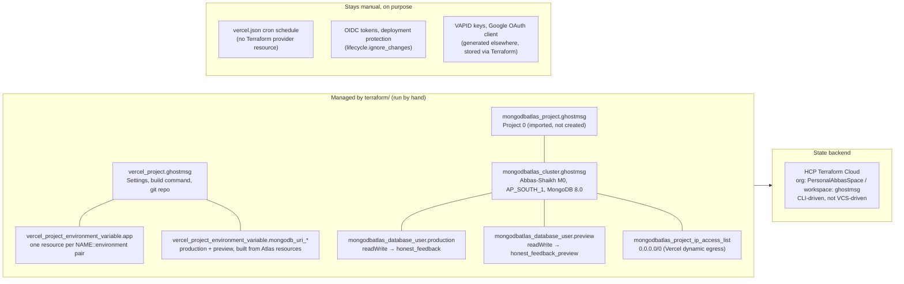
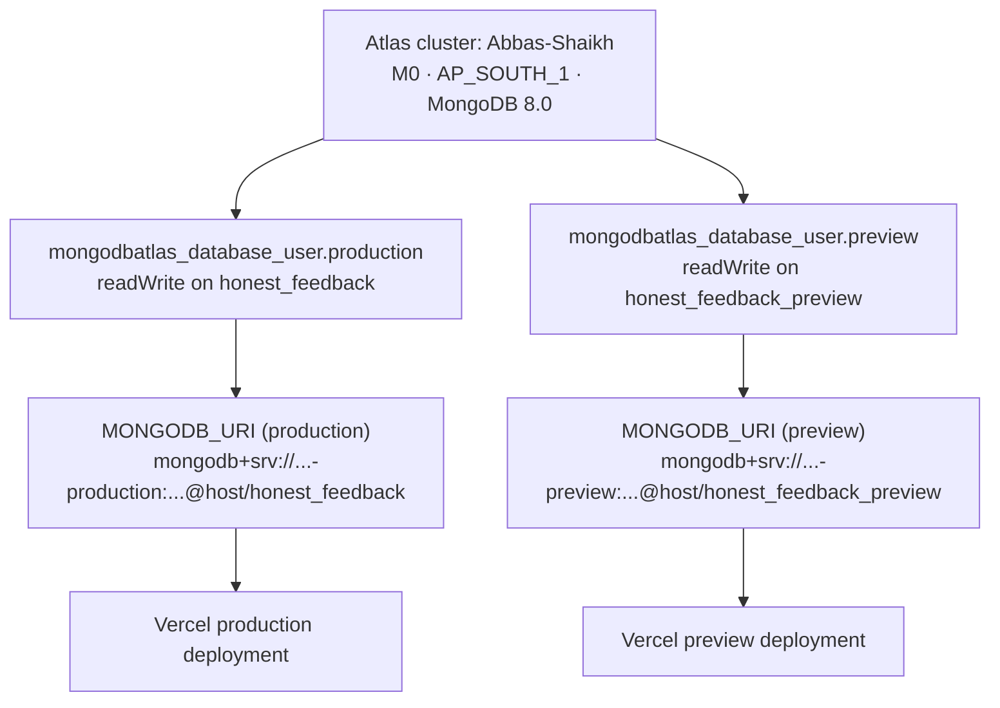

# Chapter 21: Infrastructure & Terraform

GhostMsg's cloud infrastructure is managed as code in [`terraform/`](../terraform/). This chapter explains what Terraform owns, what stays manual, and how the two environments (Production and Preview) are kept isolated. The operational runbook is [`terraform/README.md`](../terraform/README.md); this chapter adds the architectural rationale and the full picture of the deployment environment.

Decision: [ADR 0032](adr/0032-terraform-managed-vercel-and-mongodb-atlas-infrastructure.md).

---

## 1. What Terraform owns



### 1.1 Vercel project

`vercel_project.ghostmsg` was adopted via import (`terraform import vercel_project.ghostmsg prj_pvDTGpjbZpsZB94JdBnZA2EeMcOL`); Terraform never created it. Three fields are in `lifecycle.ignore_changes`: `oidc_token_config`, `vercel_authentication`, `protection_bypass_for_automation_secret`. Without this exclusion, the provider fills those with its schema defaults on the first plan and proposes to disable OIDC tokens and loosen deployment protection.

### 1.2 Environment variables

`app_env_vars` (defined in [`terraform/variables.tf`](../terraform/variables.tf)) is a `map(object)` where each entry has optional `production`, `preview`, `development` string values and a `sensitive` bool. [`locals.tf`](../terraform/locals.tf) flattens this into a set of `"NAME::environment"` keys — one per entry that has a value. [`vercel.tf`](../terraform/vercel.tf) creates one `vercel_project_environment_variable.app` resource per key. This lets Production and Preview hold different values without any coupling.

`MONGODB_URI` is excluded from `app_env_vars` and built directly from the Atlas resources in `vercel.tf`, so the connection string is always correct and nobody ever copies it from the Atlas UI.

`NEXTAUTH_URL` has no `preview` field by design: each Preview deployment has a unique URL, so a single static value would always redirect to the wrong host.

### 1.3 MongoDB Atlas cluster

The real cluster already existed before Terraform was introduced:

| Property | Value |
| :--- | :--- |
| Atlas project | "Project 0" (`id: 670cc22371b1856baf945a9d`) |
| Cluster | "Abbas-Shaikh" |
| Tier | M0 free |
| Region | `AP_SOUTH_1` |
| MongoDB version | `8.0` |
| Adopted via | `terraform import` |

Two database users are **created** (not imported) by Terraform:

| Resource | Username | Database | Permission |
| :--- | :--- | :--- | :--- |
| `mongodbatlas_database_user.production` | `<prefix>-production` | `honest_feedback` | `readWrite` |
| `mongodbatlas_database_user.preview` | `<prefix>-preview` | `honest_feedback_preview` | `readWrite` |

The legacy user (`shaikhabbas54`) is left untouched and must be deleted manually from the Atlas UI once the new users are confirmed working.

---

## 2. File structure

| File | Purpose |
| :--- | :--- |
| [`versions.tf`](../terraform/versions.tf) | Provider pins (`vercel ~> 2.4`, `mongodbatlas ~> 1.18`), Terraform `>= 1.7.0`, HCP state backend config |
| [`variables.tf`](../terraform/variables.tf) | All inputs: API keys, passwords, the `app_env_vars` map, project/cluster names |
| [`locals.tf`](../terraform/locals.tf) | `env_var_keys` (flattened `NAME::env` set for `for_each`), `mongo_srv_host` |
| [`vercel.tf`](../terraform/vercel.tf) | Vercel project resource and all env var resources (generic + MongoDB URI) |
| [`mongodbatlas.tf`](../terraform/mongodbatlas.tf) | Atlas project, cluster, two DB users, IP access list |
| [`outputs.tf`](../terraform/outputs.tf) | After `apply`: resource IDs, usernames, cluster hostname |
| [`terraform.tfvars.example`](../terraform/terraform.tfvars.example) | Committed template (placeholder values only) |
| `terraform.tfvars` | Real secrets for local `plan`/`apply` runs (**gitignored**) |

---

## 3. Two-database isolation model

One free M0 cluster, two databases, two Terraform-managed users:



Preview deployments cannot read or write production data. The isolation is enforced by MongoDB RBAC (each user can only access its own database), not by convention.

---

## 4. State backend: HCP Terraform Cloud

| Setting | Value |
| :--- | :--- |
| Organisation | `PersonalAbbasSpace` |
| Workspace | `ghostmsg` |
| Workflow | **CLI-driven** (not VCS-driven) |
| `versions.tf` block | `cloud { organization = "PersonalAbbasSpace"; workspaces { name = "ghostmsg" } }` |

The workspace is CLI-driven because `terraform/` lives inside the main app repo. A VCS-driven workspace would plan on every unrelated app commit.

State and the run history are stored in Terraform Cloud. Variables for CI runs can be set as workspace variables in the Terraform Cloud dashboard (mark sensitive ones as sensitive there).

---

## 5. What stays manual

| Item | Why |
| :--- | :--- |
| `vercel.json` cron schedule | The Vercel Terraform provider has no cron resource; crons are part of the deployment, not infrastructure. |
| OIDC token config, deployment protection | Excluded via `lifecycle.ignore_changes`; manage these in the Vercel dashboard. |
| Google OAuth client (Google Cloud Console) | The OAuth client is not a Terraform-managed resource; credentials are stored via Terraform as env vars. |
| VAPID key pair generation | Generated once with `npx web-push generate-vapid-keys`; stored via Terraform. |
| Legacy Atlas user `shaikhabbas54` | Terraform never owned it; delete it manually after confirming the new users work. |

---

## 6. Sensitive variable behaviour

Vercel marks variables created with `sensitive = true` as write-only: the dashboard, the API, and `vercel env pull` return an empty value back. The variable still reaches the running deployment correctly; reading it back locally is blocked. To restore `.env.local` after a pull: copy values from `terraform.tfvars` for the keys that came back empty. Setting `sensitive = false` makes the value readable in the dashboard at the cost of visibility.

---

## 7. Day-to-day commands

```bash
cd terraform
terraform plan     # preview changes (safe to run any time)
terraform apply    # apply with confirmation prompt
terraform output   # print outputs.tf values (IDs, hostnames)
```

Full runbook (first-time setup, import commands, `ENV_CONFLICT` troubleshooting): [`terraform/README.md`](../terraform/README.md).

---

## 8. Adding or changing an environment variable

1. Add or edit the entry in `app_env_vars` in both `terraform/terraform.tfvars` (real values) and `terraform/terraform.tfvars.example` (placeholder).
2. Run `terraform plan` and read the diff carefully.
3. Run `terraform apply` to push the change to Vercel.
4. Update [`.env.example`](../.env.example), [Chapter 2 §2.1](02-getting-started.md#21-every-variable-the-code-reads) and [Chapter 9 §2](09-deployment-and-operations.md#2-production-environment-variables-checklist) in the same commit.

> Editing a variable value directly in the Vercel dashboard will be overwritten by the next `terraform apply`.

---

## 9. Importing pre-existing resources

If a Vercel env var or Atlas resource already exists and causes `ENV_CONFLICT` on first `apply`:

```bash
# Vercel env var (quote the address: brackets confuse the shell)
terraform import 'vercel_project_environment_variable.app["KEY::production"]' \
  team_id/project_id/env_id

# Atlas project (already done)
terraform import mongodbatlas_project.ghostmsg 670cc22371b1856baf945a9d

# Atlas cluster (already done)
terraform import mongodbatlas_cluster.ghostmsg 670cc22371b1856baf945a9d-Abbas-Shaikh
```

If the imported resource's `sensitive` flag doesn't match this config's default (`true`), Terraform shows `must be replaced` instead of a clean no-op. That's a delete-then-recreate of just that one env var — not an outage. Apply it.

See [`terraform/README.md §6–7`](../terraform/README.md#6-importing-what-already-exists) and [ADR 0032 D8](adr/0032-terraform-managed-vercel-and-mongodb-atlas-infrastructure.md).

---

## 10. Known limitations

| Limitation | Notes |
| :--- | :--- |
| `NEXTAUTH_URL` unset for Preview | Google sign-in on Preview deployments redirects to the production domain. Accept this limitation or test via localhost. |
| M0 free tier: one cluster per Atlas project | Preview isolation is per-database, not per-cluster. Upgrade to a paid tier for full cluster isolation. |
| Atlas DB user passwords not importable | The `mongodbatlas_database_user` resources are always newly created; old users must be removed manually. |
| `vercel env pull` returns empty for sensitive vars | Copy values from `terraform.tfvars` when refreshing `.env.local`. |
| No auto-apply on push | Plans and applies are deliberate, by design (CLI-driven workspace). |

---

## 11. Next chapter
Return to [Chapter 9: Deployment & Operations](09-deployment-and-operations.md) for the app-level production picture, or read [ADR 0032](adr/0032-terraform-managed-vercel-and-mongodb-atlas-infrastructure.md) for the full decision history.
