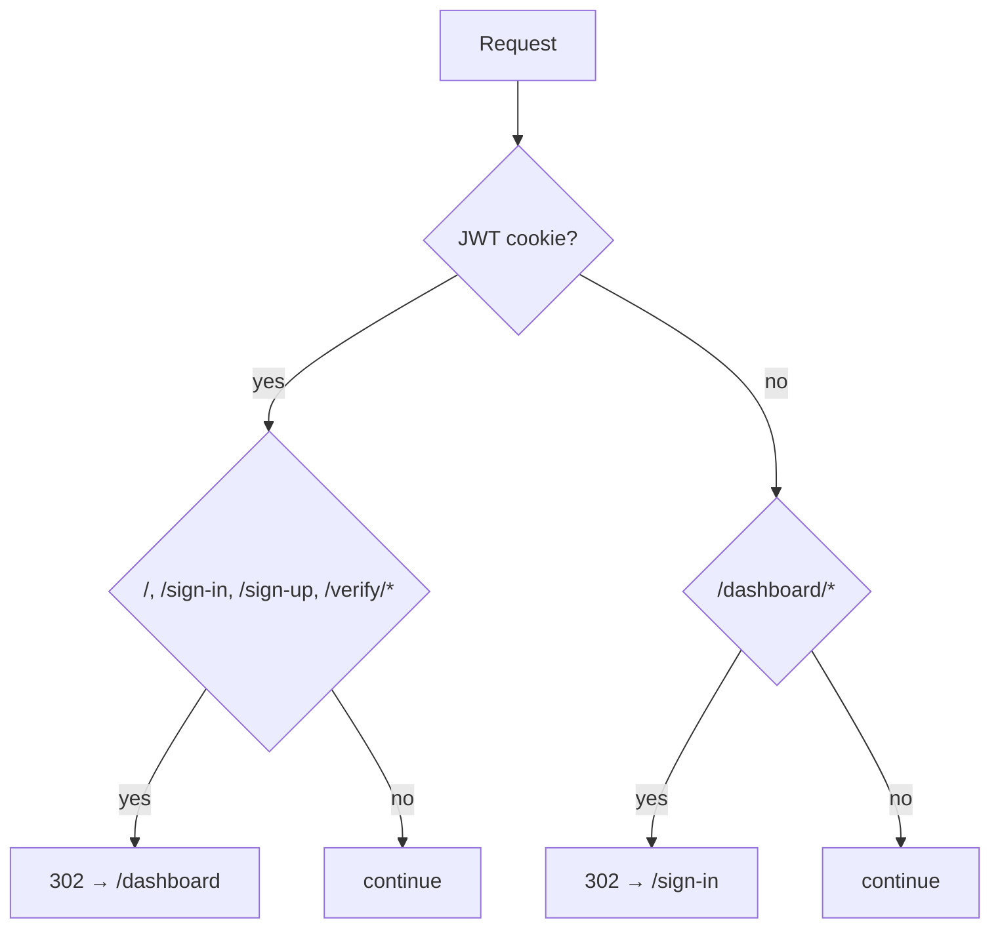
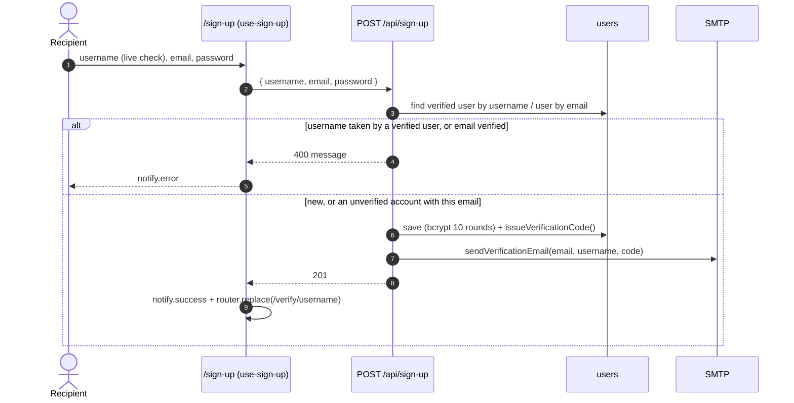
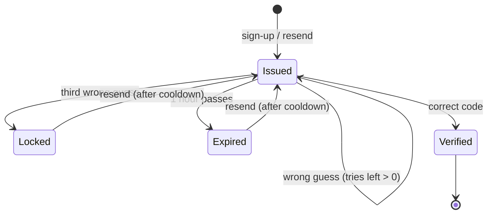
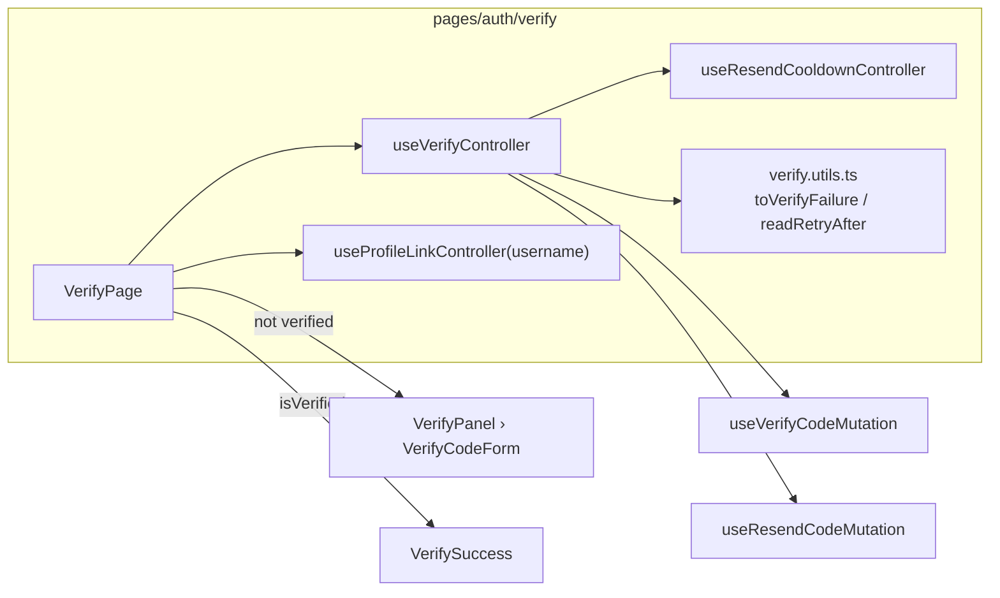

# Chapter 22: Authentication & Verification

How a Recipient gets an account, proves their email with a **Verification Code**, and signs in, plus the rules the code enforces at each step. Read this before touching `/sign-up`, `/verify/[username]`, `/sign-in`, NextAuth or the `verify-code` routes.

Decisions: [ADR 0002](adr/0002-dual-authentication-and-email-verification.md) (credentials + Google, email verification), [ADR 0033](adr/0033-standardized-form-architecture-with-react-hook-form-and-shadcn-primitives.md) (form architecture). Screens: [Chapter 14 §2](14-ui-screens-and-user-flows.md#2-authentication-sign-up-verifyusername-sign-in). Endpoints: [Chapter 16 §3](16-api-reference.md#3-auth--verification).

---

## 1. Routes and guards

| Route | Who | Page | Controller(s) |
| :--- | :--- | :--- | :--- |
| `/sign-up` (`?username=` pre-fills) | Guests | `pages/auth/sign-up` | `use-sign-up`, `use-username-availability`, `use-google-sign-in` |
| `/verify/[username]` | Guests | `pages/auth/verify` | `use-verify`, `use-resend-cooldown`, `useProfileLinkController(username)` |
| `/sign-in` (`?callbackUrl=`) | Guests | `pages/auth/sign-in` | `use-sign-in`, `use-google-sign-in` |
| `/dashboard/*` | Signed in | `pages/dashboard` | (see [Chapter 23](23-inbox-triage.md)) |

`src/middleware.ts` reads the NextAuth JWT and redirects before any page renders:



The matcher is `["/", "/sign-in", "/sign-up", "/dashboard/:path*", "/verify/:path*"]`; `/u/[username]` and the API are never redirected.

## 2. Sign-up



- **Username availability** is debounced (`USERNAME_DEBOUNCE_MS`, 400 ms) through `authQueries.checkUsername`; the logic lives in `src/lib/users/username-availability.ts` and is shared with Change username.
- An **unverified** account with the same email is refreshed in place (new password hash, new code), so a person who lost the first email can just sign up again.
- `issueVerificationCode()` (`src/server/users/verification-code.ts`) is the only place codes are made:

```ts
// src/server/users/verification-code.ts
export function issueVerificationCode(now: Date = new Date()): IssuedVerificationCode {
  return {
    verifyAttempts: 0,
    verifyCode: String(randomInt(100_000, 1_000_000)), // node:crypto, not Math.random
    verifyCodeExpiry: new Date(now.getTime() + VERIFY_CODE_TTL_MS),
    verifyCodeSentAt: now,
  };
}
```

## 3. The Verification Code lifecycle

The rules are constants in `src/lib/users/verification.ts`, read by both the API and the verify screen:

```ts
export const MAX_VERIFY_ATTEMPTS = 3;        // wrong guesses per code
export const RESEND_COOLDOWN_SECONDS = 60;   // between "Resend code" requests
export const VERIFY_CODE_TTL_MS = 60 * 60 * 1000; // a code lives one hour
```



Stored on the user (never returned to the client): `verifyCode`, `verifyCodeExpiry`, `verifyAttempts`, `verifyCodeSentAt` ([Chapter 15 §2.1](15-data-model-and-database.md#21-identity-and-account)).

### 3.1 `POST /api/verify-code`

The route checks, in order: body valid → user exists → already verified → locked → expired → wrong → correct.

| Situation | Status | Body |
| :--- | :---: | :--- |
| Correct code | 200 | `{ "success": true, "message": "Account Verified Successfully!" }` |
| Already verified | 200 | `{ "success": true, "message": "Account already verified." }` |
| Wrong code, tries left | 200 | `{ "success": false, "reason": "wrong", "attemptsLeft": 2, "message": "That code isn't right." }` |
| Wrong code, last try used | 200 | `{ "success": false, "reason": "locked", "attemptsLeft": 0, … }` |
| Already locked | 429 | `{ "success": false, "reason": "locked", "attemptsLeft": 0, "message": "Too many tries. Get a new code." }` |
| Expired | 400 | `{ "success": false, "reason": "expired", "message": "That code has expired. Get a new one." }` |
| Bad body | 400 | `{ "success": false, "message": "Enter the 6-digit code from the email." }` |
| Unknown user | 404 | `{ "success": false, "message": "User not found!!" }` |

A wrong code is a **200 with `success: false`** on purpose: it isn't a transport error, and the screen needs `attemptsLeft`. A correct code resets `verifyAttempts` to 0.

### 3.2 `POST /api/verify-code/resend`

```http
POST /api/verify-code/resend
Content-Type: application/json

{ "username": "maya" }
```

| Situation | Status | Body |
| :--- | :---: | :--- |
| Sent | 200 | `{ "success": true, "message": "We sent you a new code.", "retryAfterSeconds": 60 }` |
| Within 60 s of the last code | 429 | `{ "success": false, "message": "You can get a new code in 42 seconds.", "retryAfterSeconds": 42 }` |
| More than 5 resends per username in 10 min | 429 | `{ "success": false, "message": "Too many new codes. Try again in a few minutes.", "retryAfterSeconds": … }` |
| Missing username / already verified | 400 | `{ "success": false, "message": … }` |
| Unknown user | 404 | `{ "success": false, "message": "User not found!!" }` |
| Email failed | 500 | `{ "success": false, "message": … }` |

A successful resend replaces the code, resets the tries and restarts the hour. The per-username limit uses `checkRateLimit` (in-memory per server instance, see [Chapter 17](17-trust-safety-and-privacy.md)).

## 4. The verify screen



- **Cooldown.** `useResendCooldownController` starts at 60 s on mount (sign-up has just sent a code), ticks once a second, and `restart(seconds)` takes the server's `retryAfterSeconds` after a resend or a refused one.
- **Errors are inline, not toasts.** `verify.utils.ts` turns a reply into `{ error: { title, detail }, needsNewCode }`:

```ts
toVerifyFailure({ reason: "wrong", attemptsLeft: 2 });
// → { error: { title: "That code isn't right.",
//              detail: "2 tries left. Check for the newest email." },
//     needsNewCode: false }

toVerifyFailureFromError(new ApiError("…", 400, { reason: "expired" }));
// → { error: { title: "That code has expired.", detail: "Get a new code to try again." },
//     needsNewCode: true }
```

- **One main action.** `VerifyCodeForm` shows a single primary button, chosen from the state:

| State | Main button | Under it |
| :--- | :--- | :--- |
| Typing, timer running | **Verify** (disabled until 6 digits) | "Didn't get it? Resend in 0:42" |
| Timer finished, code incomplete | **Resend code** (secondary) | "Wrong email? Change it" |
| 6 digits, timer finished | **Verify** | "Didn't get it? Resend code" (link) |
| Wrong code | **Resend code** (disabled with "Resend in 0:12" while cooling) | Alert: title + tries left |
| Locked or expired | **Resend code**; slots disabled | Alert: "Too many tries." / "That code has expired." |
| Verified | Screen becomes `VerifySuccess` | |

- A wrong code shakes the slots once (`shake` from `src/lib/motion.ts`) and turns them red until the next keystroke clears the error.
- **Verified** shows "You're in. Your link is live." with the new link (`ShareLinkCard layout="compact"`), Copy / Share… and **Sign in to open your inbox** (`/sign-in`). Verifying never signs the person in. Focus moves to the heading because the form disappears ([Chapter 25 §3](25-accessibility-and-feedback.md#3-focus-management)).

## 5. Sign-in

Credentials sign-in runs NextAuth's `authorize` in `src/app/api/auth/[...nextauth]/options.ts`. The identifier is matched against `email` **or** `username`.

| Check | Error shown (`notify.error`) |
| :--- | :--- |
| Missing identifier or password | "Identifier and password are required" |
| No user | "No User found with this email or username" |
| `isVerified` false | "Please verify your account first before login" |
| No password on the account | "Please sign in with Google for this account" |
| Wrong password | "Password is incorrect, Please try again" |

Google sign-in (`controller/google-signin.ts`) links to an existing user by email, or creates a verified one with `username = email local part`. Sessions are JWTs carrying `_id`, `username` and `isVerified`; `update({ username })` after Change username rewrites the token.

```ts
// what a client component can read
const { data: session } = useSession();
session?.user._id;        // string
session?.user.username;   // string
session?.user.isVerified; // boolean
```

## 6. Phone layout

Below 640 px the auth screens have no site header and no card ([Chapter 26](26-responsive-design.md)):

```tsx
// src/app/(app)/layout.tsx: wraps only the three auth routes
<SiteLayout hideHeaderOnPhones>{children}</SiteLayout>

// a page picks its top bar
<AuthPanel backHref="/" step={{ current: 1, total: 2 }} title="Make your link" description="…">
  <SignUpForm … />
</AuthPanel>
```

Forms use `max-sm:flex-1` and `AuthFormFooter` uses `max-sm:mt-auto`, so the primary button sits at the bottom of the screen. `PasswordField` uses a "Show" / "Hide" text toggle (`aria-label` "Show password" / "Hide password", `aria-pressed`).

## 7. Tests and mocks

| What | Where |
| :--- | :--- |
| Rules (tries, cooldown, `m:ss`) | `src/lib/users/verification.test.ts` |
| Reply → screen mapping | `pages/auth/verify/verify.utils.test.ts` |
| Cooldown ticking | `use-resend-cooldown.controller.test.ts` (fake timers) |
| Controller flows | `use-verify.controller.test.ts`, `use-sign-up…`, `use-sign-in…` |
| Stories | `Pages/Auth/Verify` (Default, Verifies, InvalidCode, Locked, Expired, Mobile), `Patterns/VerifyCodeForm`, `Blocks/VerifySuccess`, `Blocks/AuthPanel` |

MSW scenarios (`src/mock/handlers/auth.handlers.ts`): `scenarios.verify.success | invalid | locked | expired`, `scenarios.resendCode.success | cooldown`.

```ts
// a controller test for the lock
server.use(...scenarios.verify.locked);
const { result } = renderHookWithProviders(() => useVerifyController("newghost"));
await act(() => result.current.handleSubmit({ code: "123456" }));
expect(result.current.needsNewCode).toBe(true);
```

## 8. Known gaps

| Gap | Effect | Next step |
| :--- | :--- | :--- |
| Sign-in for an unverified account only says "Please verify your account first" | No link to `/verify/[username]`; the person must sign up again or type the URL | Add a "Get a new code" link that opens `/verify/<identifier>` when the identifier is a username |
| Google sign-up takes the email's local part as the username | Fails (unique index) when that username exists; `controlGoogleSignInFlow` returns false | Suffix on collision, or ask for a username |
| Forgot password | Not built; the board's "Forgot?" link is left out on purpose | Needs a reset-token flow |
| The verify screen names the handle, not the email | The page only knows the username; putting the email in the URL would leak it | Keep, or pass the email through a short-lived server session |
| Rate limits are per server instance | Resend limits reset on deploy and differ across instances | Shared store if the app runs on many instances |

## 9. Where to go next

[Chapter 17](17-trust-safety-and-privacy.md) for rate limits and privacy, [Chapter 25](25-accessibility-and-feedback.md) for focus and live regions, [Chapter 26](26-responsive-design.md) for the phone layout rules.
