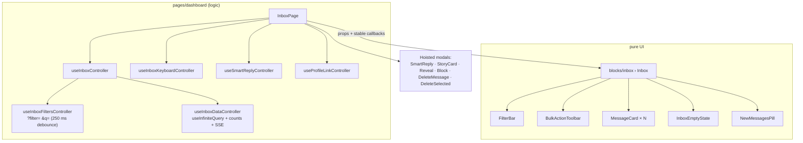
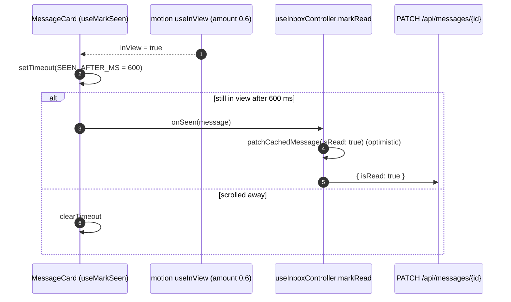
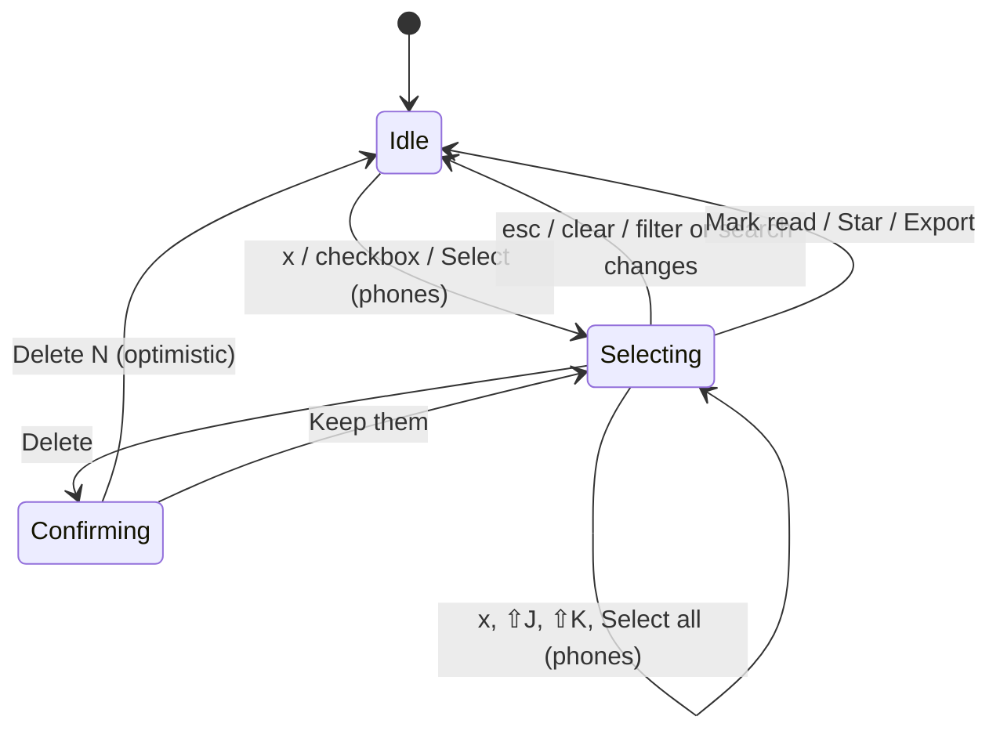
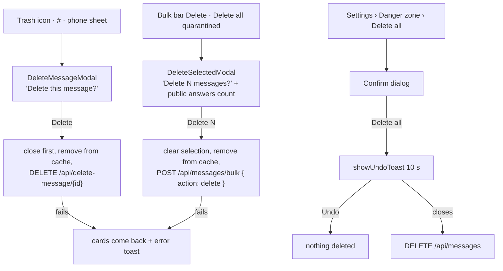
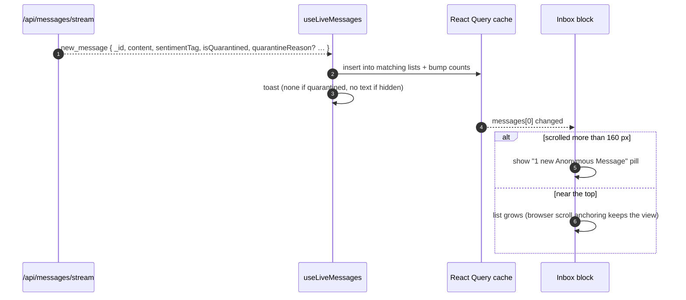
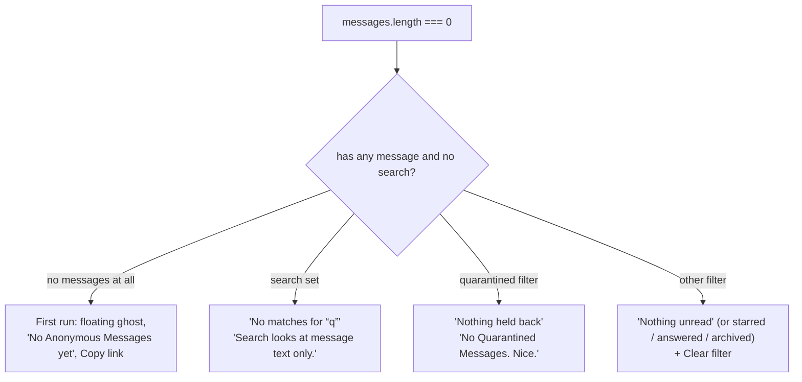

# Chapter 23: Inbox Triage

How the inbox at `/dashboard` loads, filters, marks read, archives, selects, deletes and updates live, and how each behaviour maps to code. Read this before touching `blocks/inbox`, `patterns/message-card`, `patterns/filter-bar` or any `use-inbox*.controller.ts`.

Decisions: [ADR 0021](adr/0021-optimistic-inbox-mutations-close-first-and-shared-cache-helpers.md) (optimistic mutations), [ADR 0030](adr/0030-server-side-inbox-filtering-paging-and-counts.md) (server-side filters, paging, counts), [ADR 0031](adr/0031-state-management-consistency-and-structure.md) (state structure), [ADR 0034](adr/0034-confirmed-message-deletes-undo-for-delete-all-and-phone-dashboard-chrome.md) (confirmed deletes, phone chrome). Product view: [Chapter 12 §5.4](12-product-guide-and-features.md#54-inbox-dashboard). State rules: [Chapter 20](20-state-management.md).

---

## 1. Anatomy



The block never fetches. Every callback it receives is a stable `useCallback` from the controller, so the memoized `MessageCard`s don't re-render when one message changes.

## 2. Filters

Every filter is a server query (`GET /api/get-messages?status=`), never a client-side slice. The same rules exist three times and a contract test keeps them equal (`src/server/messages/inbox-query.test.ts`):

| Status | Client rule (`lib/messages/inbox-filter.ts`) | MongoDB filter (`server/messages/inbox-query.ts`) |
| :--- | :--- | :--- |
| `all` | not quarantined, not archived | `{ isArchived: { $ne: true }, isQuarantined: false }` |
| `unread` | not read, not quarantined, not archived | `{ …NOT_ARCHIVED, isQuarantined: false, isRead: false }` |
| `starred` | pinned, not archived | `{ …NOT_ARCHIVED, isPinned: true }` |
| `answered` | reply text not blank, not archived | `{ …NOT_ARCHIVED, "reply.text": /\S/ }` |
| `quarantined` | quarantined, not archived | `{ …NOT_ARCHIVED, isQuarantined: true }` |
| `archived` | archived | `{ isArchived: true }` |
| `any` (API only, exports) | everything | `{}` |

```ts
// src/lib/messages/inbox-filter.ts: archived messages only show under "archived"
if (status === "archived") return Boolean(message.isArchived);
if (message.isArchived) return false;
```

`FilterBar` shows All, Unread, Starred, Answered, then **Archived** only when `counts.archived > 0` (or it is the active filter), then **Quarantined** only when there is something quarantined. Counts come from one aggregation, `GET /api/messages/counts`.

### 2.1 URL state, search and paging

- `?filter=unread&q=jacket` is the source of truth; `useInboxFiltersController` writes it with `history.replaceState` (no navigation) and debounces search by `INBOX_SEARCH_DEBOUNCE_MS` (250 ms).
- Search is a case-insensitive literal match on the message **or** its answer (regex characters escaped on the server).
- Pages are 12 messages (`INBOX_PAGE_SIZE`), newest first, with a keyset cursor `"<ISO createdAt>_<id>"`. **Load more** calls `fetchNextPage`.
- Changing the filter or the search clears the selection, so a bulk action never reaches a message that isn't on screen.

## 3. Read state

A card is marked read when it has been at least 60 % on screen for 600 ms. Quarantined and blurred cards are never auto-read.



Opening Reply or the Story Card, revealing and starring also mark an unread message read. `markRead` skips messages that are already read, so nothing is sent twice.

## 4. Archive

`e`, the card's Archive icon, or **Archive** in the phone sheet. In the Archived view the same action is **Move to Inbox**.

```http
PATCH /api/messages/66f1…c2
Content-Type: application/json

{ "isArchived": true }
```

`useArchiveMessageMutation` removes the card from every cached list at once, then confirms with a plain toast: "Message archived" or "Moved back to Inbox". There is no Undo (decision in [redesign-progress §4](agents/redesign-progress.md#4-decisions-the-user-made-dont-re-ask)); moving it back is the undo. Failure rolls back and shows "Couldn't update that message".

## 5. Selection and bulk actions



- Selection is `{ ids, scope }` where `scope` is the current filter + search. Ids that aren't loaded are ignored.
- Bulk Mark read and Star are optimistic with rollback (`POST /api/messages/bulk`). Export uses `fetchAllMessages(status)`, so it covers every page, not just the loaded one.
- Phones: **Select** in the top bar turns on checkboxes, a fixed "N selected · Select all" header and `BulkActionToolbar layout="bar"` over the tab bar ([Chapter 26](26-responsive-design.md)).

## 6. Deletes



Single and bulk deletes never offer Undo; only Delete all does ([ADR 0034](adr/0034-confirmed-message-deletes-undo-for-delete-all-and-phone-dashboard-chrome.md)). The dialog's message is resolved from the live cache by id, so it never shows a stale copy.

## 7. Keyboard

| Key | Action | On a quarantined message |
| :--- | :--- | :--- |
| `j` / `↓`, `k` / `↑` | Move the cursor (clamps at the ends) | moves |
| `⇧J` / `⇧K` | Select here, move, select there | selects |
| `x` | Toggle selection | selects |
| `s` | Star / unstar | skipped |
| `r` | Reply (Smart Reply) | skipped |
| `e` | Archive | skipped |
| `#` | Delete (opens the confirm) | works |
| `⇧B` | Block sender (opens the dialog; needs a Sender Hash) | works |
| `/` | Focus search | |
| `esc` | Clear the selection | |

The map is `SHORTCUT_KEYS` in `pages/dashboard/inbox.utils.ts`; `event.key` already includes Shift, so ⇧B arrives as `"B"` and `#` as `"#"`. Page-wide keys (`g i`, `g p`, `g s`, `⇧C`, `?`) are in `use-global-shortcuts.controller.ts`, which listens in the capture phase and stops a consumed chord key so `g s` never also stars a message. How to add a key: [Chapter 25 §2.3](25-accessibility-and-feedback.md#23-adding-a-shortcut).

## 8. Live updates and the new-messages pill



If the stream drops, the inbox polls every 30 s (`INBOX_POLL_MS`). The subtitle reads "N unread · last checked a moment ago" from the query's `dataUpdatedAt`, re-rendered once a minute. Details: [Chapter 18 §5](18-notifications-and-realtime.md#5-live-feed-server-sent-events).

## 9. Loading and empty states

Skeletons appear only after 150 ms (`useDelayedFlag`), so fast loads don't flash. Empty results pick one of four states (design Feedback board):



Only the first-run state animates ([Chapter 25 §6](25-accessibility-and-feedback.md#6-motion)).

## 10. The Quarantined view

`?filter=quarantined` is a view, not a route: title "Quarantined", "N held back · never in your main inbox", a reassurance notice, and "Delete all quarantined" (the bulk confirm for every loaded message there). Cards are dashed, tagged with their reason (Hurtful language, Spam, Threat) and concealed until **Reveal** ([Chapter 17 §4.3](17-trust-safety-and-privacy.md#43-how-held-content-is-shown)). On phones the chips hide and a back arrow returns to All.

## 11. Tests and stories

| Behaviour | Test |
| :--- | :--- |
| Filters, search, paging, counts, selection scope, archive, deletes, rollback | `use-inbox.controller.test.ts` |
| URL write-through, debounce | `use-inbox-filters.controller.test.ts` |
| Server query, polling flag | `use-inbox-data.controller.test.ts` |
| Every key | `use-inbox-keyboard.controller.test.ts`, `use-global-shortcuts.controller.test.ts` |
| Shared filter contract | `lib/messages/inbox-filter.test.ts`, `server/messages/inbox-query.test.ts` |
| UI states | `Blocks/Inbox` (Grid, Empty, NoMatches, SearchNoMatches, NothingQuarantined, QuarantinedOnly, MoreToLoad…), `Pages/Dashboard`, `Patterns/MessageCard`, `Patterns/FilterBar` |

Fixtures: `src/mock/fixtures/messages.fixtures.ts` (`messageScenarios.mixed`, `allQuarantined`, `longContent`). MSW: `scenarios.inbox.*`.
