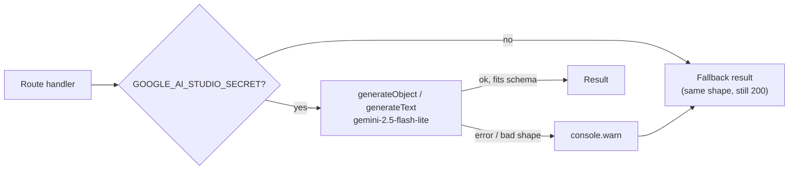
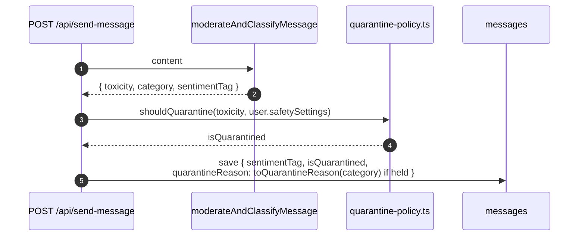

# Chapter 24: AI Features

Where GhostMsg calls a language model, what it sends, what it expects back, and what happens when the model is slow, wrong or missing. Read this before changing a prompt, a model, an AI route or the hooks that call them.

Decisions: [ADR 0003](adr/0003-edge-runtime-for-ai-suggestions.md) (Edge for suggestions), [ADR 0025](adr/0025-graded-toxicity-and-recipient-controlled-quarantine.md) (graded toxicity + quarantine policy). Safety rules: [Chapter 17](17-trust-safety-and-privacy.md). Endpoints: [Chapter 16 §8](16-api-reference.md#8-ai-assistant).

---

## 1. The four features

| Feature | Trigger | Module | Route / runtime | Output | Fallback |
| :--- | :--- | :--- | :--- | :--- | :--- |
| **Moderation** | Every `POST /api/send-message` | `server/ai/moderation.ts` | in the send route (Node) | `{ toxicity, category, sentimentTag }` (structured) | `none` / `none` / `neutral` (deliver) |
| **Smart Reply** | Opening Reply in the inbox | `server/ai/smart-reply.ts` | `POST /api/ai/smart-reply` (Node, signed in) | three drafts, one per tone (structured) | three stock drafts |
| **Suggested Messages** | Visitor on `/u/[username]` (when `offerSuggestions`) | `server/ai/suggested-messages.ts` | `GET /api/suggest-messages` (**Edge**) | `"a||b||c"` text | one of four fixed sets |
| **AMA Prompt ideas** | "Suggest with AI" on Profile | `server/ai/ama-suggestions.ts` | `POST /api/ai/ama-suggestions` (Node, signed in) | `"a||b||c"` text → 3 prompts | three fixed prompts |

All four use **Gemini 2.5 Flash Lite** through `@ai-sdk/google` and the `ai` package, keyed by `GOOGLE_AI_STUDIO_SECRET`.

## 2. Shared rules



1. **Server only.** Every module starts with `import "server-only"`; the key never reaches the browser.
2. **Fail open.** No key, a timeout, a quota error or an off-schema reply returns a fallback of the same shape. A visitor can always send; a Recipient always gets drafts. Moderation failing open means delivery to the inbox, never a block (S4 in [product-rules.md](agents/product-rules.md)).
3. **Structured output where the shape matters.** Moderation and Smart Reply use `generateObject` with a Zod schema, so there is no JSON to strip and no manual parsing. The two text features use a `||` separator and a tolerant parser.
4. **Only message text goes to the model.** No sender data, no Sender Hash, no IP, no recipient email. Content is quoted inside the prompt.
5. **The model never decides alone.** Moderation's toxicity feeds `shouldQuarantine(toxicity, safetySettings)`; the Recipient's setting makes the decision.

## 3. Moderation

```ts
// src/server/ai/moderation.ts
const moderationSchema = z.object({
  category: z.enum(["none", "hurtful", "spam", "threat"]),
  sentimentTag: sentimentTagEnum, // sweet | curious | spicy | advice | neutral
  toxicity: z.enum(TOXICITY_LEVELS), // none | borderline | hurtful | severe
});
```



- `toQuarantineReason("none")` is `"hurtful"`: a hold without a category reads as hurtful, which is what the Quarantine setting promises to catch.
- The reason only labels the message (Hurtful language, Spam, Threat); it never changes the hold.
- The thresholds per sensitivity are in [Chapter 17 §4.2](17-trust-safety-and-privacy.md#42-the-policy).

## 4. Smart Reply

```http
POST /api/ai/smart-reply
Content-Type: application/json

{ "content": "Do you ever regret saying yes to that job?" }
```

```json
{
  "success": true,
  "drafts": [
    { "tone": "thoughtful", "text": "Honestly, sometimes. But it taught me what I want." },
    { "tone": "witty", "text": "Never. The hard days were the point." },
    { "tone": "wholesome", "text": "Thank you for asking. It means a lot." }
  ]
}
```

- **One call, three tones.** `generateSmartReplies` asks for `{ thoughtful, witty, wholesome }` with `generateObject`, cleans quotes, caps each at 180 characters and returns them in `SMART_REPLY_TONES` order.
- **Loaded once per message.** The client uses a query, not a mutation, keyed outside `messages.all` so inbox invalidations never call the model again:

```ts
// src/data/messages/smart-reply.queries.ts
drafts: (messageId: string, content: string) =>
  queryOptions({
    queryKey: queryKeys.smartReplies.drafts(messageId),
    queryFn: ({ signal }) =>
      clientFetch(api.POST("/api/ai/smart-reply", { body: { content }, signal })),
    select: (data) => data.drafts,
    staleTime: Number.POSITIVE_INFINITY, // reopening the same message reuses them
    gcTime: 30 * 60 * 1000,
    refetchOnWindowFocus: false,
    retry: false,                         // each retry is another AI call
  }),
```

- `useSmartReplyController` enables the query only while the modal is open. Picking an idea **replaces** the draft; the Recipient edits before saving. Nothing is published unless the switch says so (S6).
- UI: three skeleton rows while loading, "Couldn't load ideas. Try again" on error (calls `refetch`), stacked on desktop, a sideways scroller on phones.

## 5. Suggested Messages

- `GET /api/suggest-messages` runs on the **Edge** runtime with no input, so `createSuggestedMessagesSource` caches one result for 15 minutes per instance; most visitors in that window share one model call.
- The reply is `"q1||q2||q3"`; `parseSuggestions` in `pages/public-profile/send-message.utils.ts` splits and trims it.
- The page only fetches when the Recipient's `offerSuggestions` is on and the profile has loaded (`publicQueries.suggestions()`, `enabled` from the controller). "New ideas" refetches.

## 6. AMA Prompt ideas

```http
POST /api/ai/ama-suggestions
{ "currentPrompt": "Ask me anything about moving countries for work" }
```

```json
{ "success": true, "suggestions": ["…", "…", "…"] }
```

`parseAmaSuggestions` splits on `||`, strips quotes and dashes, drops anything over 120 characters (the AMA Prompt limit) and keeps three. An empty parse falls back to `FALLBACK_AMA_SUGGESTIONS`.

## 7. Testing AI code

Mock the SDK at the module boundary; never call the network:

```ts
const { generateObject } = vi.hoisted(() => ({ generateObject: vi.fn() }));
vi.mock("ai", () => ({ generateObject }));
vi.mock("@ai-sdk/google", () => ({
  createGoogleGenerativeAI: () => ({ chat: () => ({}) }),
}));

it("falls back when the AI call fails", async () => {
  process.env.GOOGLE_AI_STUDIO_SECRET = "test-key";
  generateObject.mockRejectedValueOnce(new Error("quota exceeded"));
  await expect(generateSmartReplies("Hi")).resolves.toEqual(FALLBACK);
});
```

Cover: no key, a good reply, an off-shape or failing reply, and any cleanup (quotes, length caps). Existing suites: `moderation.test.ts`, `smart-reply.test.ts`, `suggested-messages.test.ts`, `ama-suggestions.test.ts`. In Storybook and controller tests the routes are MSW handlers (`scenarios.ai.default | error | loading | none | smartReplyError`).

## 8. Adding or changing an AI feature

1. Put the call in `src/server/ai/<feature>.ts` with `import "server-only"`, a fallback of the same shape, and `console.warn` on failure.
2. Prefer `generateObject` + a Zod schema when the output has structure.
3. Add the route under `src/app/api/ai/`, register request/response schemas in `src/server/openapi/openapi.ts`, run `pnpm typegen`.
4. Client: a query when the result is a function of its input and safe to cache; a mutation when the user asks for a fresh result each time. Set `retry: false`.
5. Add the MSW handler and fixture, the unit test (section 7) and a story for the loading and error states.
6. Document it here and in [Chapter 16](16-api-reference.md). Done when: no key → the UI still works; the network tab shows one call per user action.

## 9. Known limits

| Limit | Effect |
| :--- | :--- |
| Prompt injection | Message text is quoted in the prompt; a crafted message can still steer tone or category. Moderation fails open, so the worst case is delivery to the inbox. |
| No per-user rate limit on Smart Reply or AMA ideas | Only signed-in Recipients can call them; caching and `retry: false` keep calls to one per action. Add `checkRateLimit` if costs grow. |
| Suggestions cache is per Edge instance | Different regions may show different questions for 15 minutes. |
