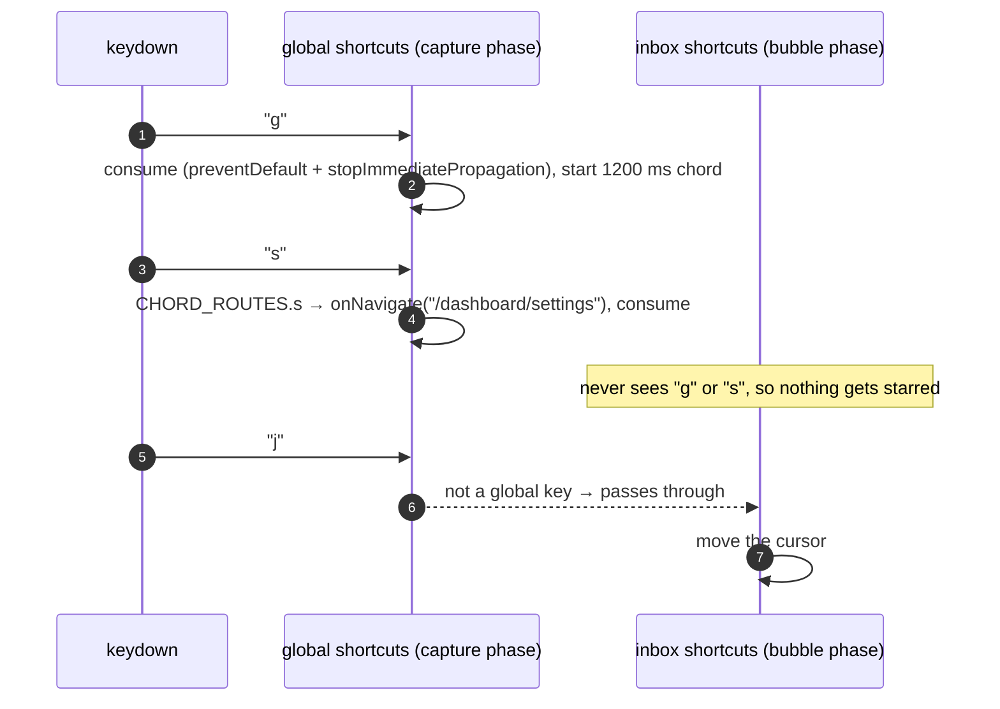
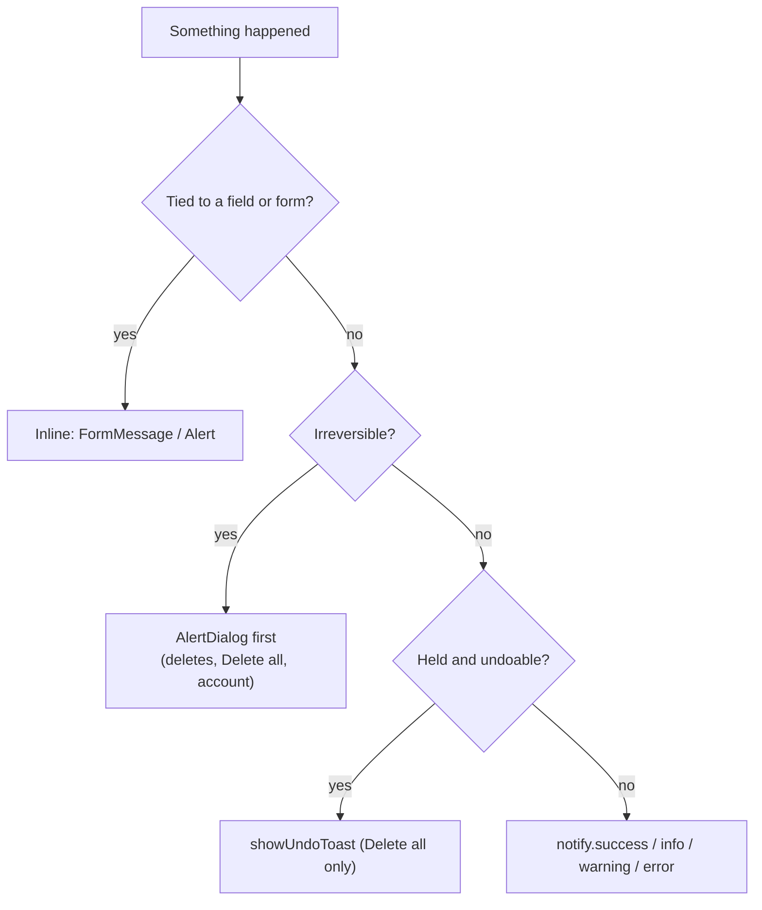
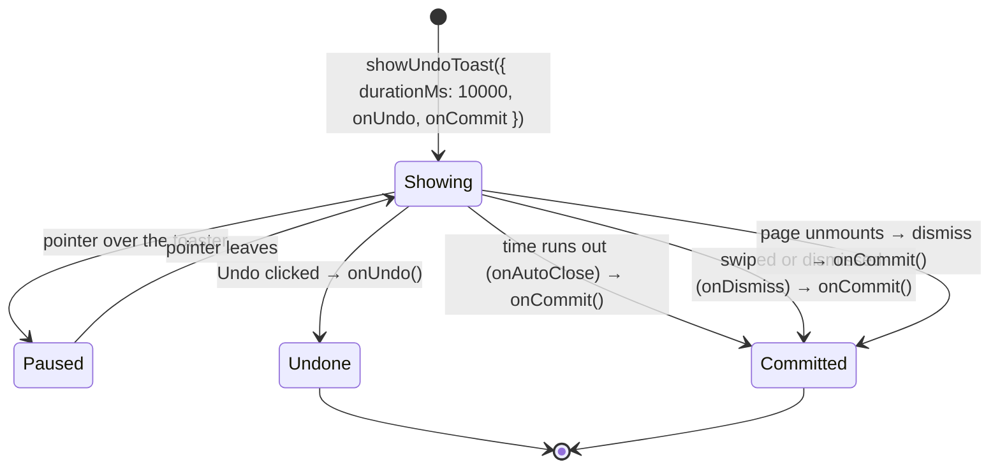

# Chapter 25: Accessibility & Feedback

How GhostMsg stays usable by keyboard, screen reader, touch and reduced-motion users, and how it tells people what just happened (toasts, inline errors, live regions). Read this before adding a shortcut, a toast, a dialog, an animation or a form field.

Related: [Chapter 13](13-design-system-and-theming.md) (contrast gate, motion tokens, `notify` in the variant catalog), [Chapter 23 §7](23-inbox-triage.md#7-keyboard) (inbox keys), [ADR 0034](adr/0034-confirmed-message-deletes-undo-for-delete-all-and-phone-dashboard-chrome.md) (toasts and deletes).

---

## 1. Baseline rules

| Rule | How it's enforced |
| :--- | :--- |
| Text and UI contrast meet WCAG AA in all 6 themes | `pnpm theme:contrast` (`scripts/check-theme-contrast.ts`) |
| Every story passes axe | Storybook a11y addon runs in `pnpm test:stories` |
| Touch targets ≥ 44px below `md` | Phone variants (`max-md:h-11`, `size-11`, `h-13` buttons); `MobileHeaderAction` is 44px |
| Every control has a name | Visible `Label` / `FieldLabel`, or `aria-label` on icon buttons (`IconAction`, `MobileHeaderAction`) |
| Inputs never zoom on iOS | Inputs and messages use `text-body` (16px) |
| Dialogs trap focus and close on Escape | Radix `Dialog` / `AlertDialog`, vaul `Drawer` via `ResponsiveDialog` |
| Motion respects the OS setting | `<MotionConfig reducedMotion="user">` in `src/app/layout.tsx`; CSS animations are `motion-safe:` |

## 2. Keyboard

### 2.1 The map

| Scope | Keys | Code |
| :--- | :--- | :--- |
| Inbox | `j k ↑ ↓` move · `⇧J ⇧K` extend · `x` select · `s` star · `r` reply · `e` archive · `#` delete · `⇧B` block · `/` search · `esc` clear | `use-inbox-keyboard.controller.ts`, `SHORTCUT_KEYS` in `inbox.utils.ts` |
| Dashboard | `g i` `g p` `g s` go to · `⇧C` copy my link · `?` shortcut sheet · `⌘K` / `Ctrl+K` palette | `use-global-shortcuts.controller.ts`, `use-dashboard-shell.controller.ts` |

The shortcut sheet (`patterns/shortcut-sheet`, `SHORTCUT_GROUPS`) and the command palette's hints (`"⇧C"`, `"g i"`, `"g p"`, `"g s"`) show the same keys. Card action tooltips show their key with `Kbd` (`ActionTooltip` in `MessageCard`).

### 2.2 When shortcuts are ignored

`shouldIgnoreShortcut(event)` in `src/lib/browser/shortcuts.ts` is the one guard:

```ts
export function shouldIgnoreShortcut(event: KeyboardEvent): boolean {
  if (event.defaultPrevented || event.metaKey || event.ctrlKey || event.altKey) {
    return true; // ⌘/Ctrl/Alt belong to the browser and ⌘K
  }
  const target = event.target as HTMLElement | null;
  if (target && (TYPING_TAGS.has(target.tagName) || target.isContentEditable)) {
    return true; // typing in INPUT, TEXTAREA, SELECT or contenteditable
  }
  return Boolean(document.querySelector('[role="dialog"], [role="alertdialog"]'));
}
```

Shift is allowed: it is part of `⇧B`, `⇧C`, `#` and `?`.



### 2.3 Adding a shortcut

1. Inbox key: add it to `InboxShortcut` and `SHORTCUT_KEYS` (`inbox.utils.ts`), handle it in `runShortcut` / `runMessageShortcut` (`use-inbox-keyboard.controller.ts`), and pass any new callback from `InboxPage`.
2. Dashboard-wide key: handle it in `use-global-shortcuts.controller.ts` and call `consume(event)` so the inbox never sees it.
3. Add it to `SHORTCUT_GROUPS` (the `?` sheet) and, if it has a command, to the palette's `shortcut` hint.
4. If a visible button does the same thing, give it `shortcut="…"` so the tooltip shows the key.
5. Tests: a `press("key")` case in the controller test, including "ignored while a dialog is open".
6. Done when: the key works, is listed in the sheet, and does nothing while typing in a field.

## 3. Focus management

| Situation | Behaviour | Where |
| :--- | :--- | :--- |
| A dialog opens | Radix moves focus into it; Escape closes; focus returns to the trigger | `elements/dialog`, `elements/alert-dialog` |
| Reveal a Quarantined Message | **Keep hidden** has initial focus | `reveal-message-modal.tsx` |
| Leaving unsaved Profile edits | **Keep editing** has initial focus | `discard-changes-modal.tsx` |
| Content replaces a form (verified screen) | The new heading gets focus (`tabIndex={-1}`) | `VerifySuccess` via `AuthPanel titleRef` |
| Inbox cursor (`j`/`k`) | The focused card gets a visible ring and scrolls into view | `MessageCard isFocused` |
| Mode / palette cards | The radio stays in the DOM (`sr-only`); the card shows the focus ring | `appearance-settings.tsx` |

```tsx
// moving focus when a screen replaces the one the user was on
const titleRef = useRef<HTMLHeadingElement>(null);
useEffect(() => {
  titleRef.current?.focus();
}, []);
return <AuthPanel title="You're in. Your link is live." titleRef={titleRef} … />;
```

## 4. Live regions

| Region | Politeness | Content |
| :--- | :--- | :--- |
| Sonner's toaster | polite | success, info, warning toasts |
| `Toaster`'s hidden region | **assertive** (`aria-live`, no `role="alert"`) | the text of every `notify.error` |
| `Alert` (inline errors) | `role="alert"` | e.g. "That code isn't right." on /verify |
| New-messages pill | polite | "1 new Anonymous Message" |
| Selection header (phones) | polite | "N selected" |
| Sent screen | `role="status"` | "Sent. Name will never know it was you." |

The hidden region has no `role="alert"` on purpose: with one, `getByRole("alert")` in tests and screen readers' alert lists would always find an extra, usually empty, alert.

## 5. Feedback: toasts, inline errors, dialogs

### 5.1 Which to use



### 5.2 `notify`

App code never imports `toast` from `sonner` for feedback; it uses `notify` from `@/components/elements/sonner`:

```ts
import { notify } from "@/components/elements/sonner";

notify.success("Link copied");                   // 3 s
notify.info("Messages refreshed");               // 5 s
notify.error("Couldn't save. Try again.");       // 6 s, announced assertively
notify.error("Couldn't send", {
  action: { label: "Retry", onClick: retry },    // stays until dismissed or clicked
});
```

| Type | Duration (`TOAST_DURATION_MS`) | Announced |
| :--- | :--- | :--- |
| success | 3 s | polite |
| info, warning | 5 s | polite |
| error | 6 s, or until dismissed when it has an `action` | assertive |

Copy rules (design Feedback board): one line, verb first ("Deleted 2 messages"), at most one action, an Undo is always labelled "Undo", and a toast **never contains Anonymous Message text** (privacy on shared screens).

In tests, mock both layers so assertions stay on Sonner's spies:

```ts
vi.mock("sonner", () => ({ toast: { error: vi.fn(), success: vi.fn() } }));
vi.mock("@/components/elements/sonner", async () => {
  const sonner = await import("sonner");
  return { notify: sonner.toast };
});
```

### 5.3 The Undo toast lifecycle



Exactly one of `onUndo` / `onCommit` runs (`settleOnce`). The 3px bar drains with `animate-countdown` and pauses with Sonner's timer, so what the bar shows is what happens.

## 6. Motion

| Rule | Detail |
| :--- | :--- |
| UI feedback ≤ 300 ms | Presses, dialogs, toolbars (`src/lib/motion.ts` presets) |
| Idle loops only on the landing hero, the first-run empty inbox and the not-found mark | `animate-float`; everything else is still |
| One-shot celebration | `animate-pulse-ring` runs twice (verified mark, success checks) |
| Wrong code | `shake` once, 160 ms; with reduced motion, colour change only |
| Information is never motion-only | The Undo bar is **not** `motion-safe` because it shows time left |

## 7. Forms

- Labels are visible (`FieldLabel` / `FormLabel`, weight 600) except where the design hides them; then `sr-only` (the Verification Code input).
- Errors: `aria-invalid` on the control plus `FormMessage`; a server error that isn't about one field goes in an `Alert`.
- `InputOTP` uses `autoComplete="one-time-code"` and `REGEXP_ONLY_DIGITS`; pasting fills all six slots.
- Password visibility: a text button "Show" / "Hide" with `aria-label` "Show password" / "Hide password" and `aria-pressed`.

## 8. Pull-request checklist

- [ ] New icon-only buttons have `aria-label` (and a tooltip if there is room).
- [ ] New keys follow §2.3 and appear in the `?` sheet.
- [ ] Feedback uses `notify` or an inline `Alert`; no message text in toasts.
- [ ] New animations are `motion-safe:` and ≤ 300 ms unless they carry information.
- [ ] Phone targets are ≥ 44px.
- [ ] The story passes axe in light and dark.
