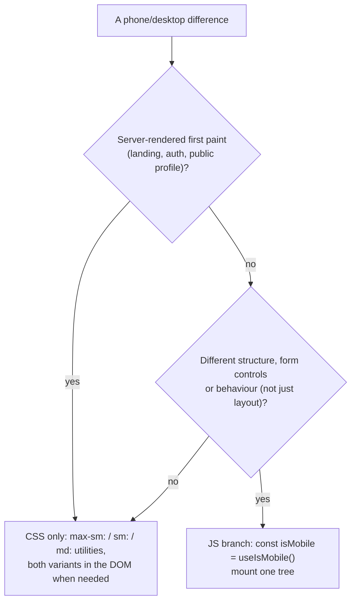

# Chapter 26: Responsive Design (Phone ↔ Desktop)

How one codebase renders the phone boards (`Mob*`) and the desktop boards of the design handoff, which technique to use for a given difference, and what differs on each screen. Read this before adding a phone-only or desktop-only behaviour.

Decisions: [ADR 0034](adr/0034-confirmed-message-deletes-undo-for-delete-all-and-phone-dashboard-chrome.md) D7–D8 (phone chrome, tablet rail). Visual targets: the handoff's `screenshots/` and `reference/boards/Mob*.dc.html` (local only, see [redesign-progress.md](agents/redesign-progress.md)).

---

## 1. Breakpoints

| Width | Name | What switches | Where |
| :--- | :--- | :--- | :--- |
| `< 640px` | phone (`max-sm`) | Auth screens lose the card and the site header; landing and footer stack; Story Card preview is 220px | `AuthPanel`, `SiteLayout hideHeaderOnPhones`, landing blocks |
| `< 768px` | mobile (`useIsMobile`, `max-md`) | Dashboard phone chrome (top bar + tab bar), Dialog → Drawer, Inbox selection mode, Settings list, Profile summary, message card sheet | `src/hooks/use-mobile.ts` (`MOBILE_BREAKPOINT = 768`) |
| `768–1023px` | tablet | Sidebar starts as the icon rail | `useTabletRail` (`TABLET_QUERY`) in `dashboard-shell.tsx` |
| `≥ 1024px` | desktop (`lg`) | Full sidebar, Settings section nav, Profile preview column | shell, `settings-panel`, `profile-panel` |
| card `≥ 24rem` | container `@sm/card` | "✓ Answered" shows its text | `MessageCard` (`@container/card`) |

The public profile is phone-first at every width (one 480px column).

## 2. Two techniques



**CSS only** keeps the server HTML and the hydrated page identical (no layout jump). Use it for spacing, sizes, order, show/hide of plain text:

```tsx
// blocks/trust-section: phone copy vs desktop copy, no JS
<h3 className="text-title sm:text-h3">{title}</h3>
<p className="text-muted-foreground text-sm sm:hidden">{short}</p>
<p className="text-muted-foreground max-sm:hidden">{body}</p>
```

**JS branch** when the trees differ (different components, different handlers, form fields). Mounting only one tree keeps `useId` ids unique and handlers single:

```tsx
// blocks/settings-panel
const isMobile = useIsMobile();
if (isMobile) {
  return (
    <SettingsLayoutProvider layout="list">{/* account card + accordion rows */}</SettingsLayoutProvider>
  );
}
return <>{/* section nav + cards (the default "cards" layout) */}</>;
```

`useIsMobile()` returns `false` until it has measured the window, so the first client render is the desktop tree. That's fine behind the dashboard's session gate, and the reason SSR'd screens use CSS instead.

## 3. Building blocks

### 3.1 `ResponsiveDialog`

Dialog at ≥ 768px, bottom Drawer below, with matching parts. On phones the content scrolls inside the Drawer and the footer stacks full-width 52px buttons, primary first.

```tsx
<ResponsiveDialog open={open} onOpenChange={onOpenChange}>
  <ResponsiveDialogContent className="gap-4">
    <ResponsiveDialogHeader>
      <ResponsiveDialogTitle>Change username</ResponsiveDialogTitle>
      <ResponsiveDialogDescription>…</ResponsiveDialogDescription>
    </ResponsiveDialogHeader>
    {/* body */}
    <ResponsiveDialogFooter>
      <Button variant="outline">Cancel</Button>
      <Button>Save</Button>{/* last in JSX = first on phones */}
    </ResponsiveDialogFooter>
  </ResponsiveDialogContent>
</ResponsiveDialog>
```

Used by Smart Reply, Story Card, Block sender and the shortcut sheet. Smart Reply and Story Card also read `useIsMobile()` for phone-only copy ("Reply", "Save", "Story Card") and layout.

### 3.2 Phone top-bar slots

Pages put their own controls into the shell's 52px phone top bar through portals:

```tsx
// inside a page or block
<MobileHeaderActions>
  <MobileHeaderAction label="Search messages" onClick={openSearch}>
    <Search />
  </MobileHeaderAction>
</MobileHeaderActions>

<MobileHeaderLeading>{/* replaces the brand tile, e.g. Back to inbox */}</MobileHeaderLeading>
```

The shell renders the slot elements and passes them to `MobileHeaderSlotProvider`; on desktop the top bar is `md:hidden`, so nothing shows. Story: `Patterns/MobileHeaderActions`.

### 3.3 Layout props on patterns and blocks

| Component | Prop | Phone | Desktop |
| :--- | :--- | :--- | :--- |
| `BulkActionToolbar` | `layout` | `"bar"` over the tab bar | `"pill"` above the cards |
| `ShareLinkCard` | `layout` | `"compact"` (overline, link as h3, Copy + Share…) | `"default"` (pill field) |
| `SettingsLayoutProvider` | `layout` | `"list"` (accordion rows) | `"cards"` |
| `AuthPanel` | `backHref`, `step`, `align`, `iconTone` | top bar with Back + progress | centred card |
| `SiteLayout` | `hideHeaderOnPhones` | no site header (auth routes) | header |
| `StoryCardPreview` | `size="fluid" tilt="fluid"` | 220px, leaning left | 280px, leaning right |
| `CtaBanner` | `subtitle` | own line under a short heading | part of the heading |
| `FilterBar` | `disabled` | locked during selection mode | — |

### 3.4 Container queries

When a component's width, not the viewport, decides the layout, make it a named container:

```tsx
// patterns/message-card: the card is the container
const messageCardVariants = cva("@container/card relative flex …");

// inside: text only once the card is 24rem wide
<span className="sr-only @sm/card:not-sr-only">Answered</span>
```

## 4. Screen by screen

| Screen | Phone (board) | Desktop (board) |
| :--- | :--- | :--- |
| Landing | MobLanding: full-width "Get my link", How it works carousel (h2, "1 / 4", pill dots), trust rows, Story Card only, split CTA, stacked footer | Landing: hero with 2×2 step grid, 3-column trust card, Q&A + Story Card, one-line CTA |
| Sign up / sign in / verify | MobSignUp / MobSignIn / MobVerify*: no header, Back + progress, actions pinned to the bottom | Auth: one centred card |
| Dashboard shell | 52px top bar (brand + page actions), pill tab bar | sidebar (icon rail on tablets) |
| Inbox | MobInbox: search behind an icon, chips scroll, grid only, selection header + bottom bar, card sheet | Inbox: search pill, grid/list toggle, Refresh, inline card actions, key legend |
| Quarantined view | MobQuarantine: back arrow, no chips | title, notice, chips |
| Smart Reply | MobDrawerReply: "Reply" drawer, ideas scroll sideways, Save + Story Card | Modals: "Answer this message", stacked ideas |
| Story Card | MobDrawerStory: preview, Format, Include my answer, Save + Share… | full controls (Look, Show my link, Copy my link) |
| Profile | MobProfile: identity summary + Edit, compact link card, "View as visitor" in the top bar | ProfilePage: identity card, editor, sticky preview |
| Settings | MobSettings: account card, accordion rows, Data & account, Danger zone | SettingsPage: section nav + cards |
| Public profile | MobPublic*: one column (same at every width) | same, max 480px |

## 5. Testing

- Stories: add a `Mobile` story with `globals: { viewport: { isRotated: false, value: "mobile1" } }`.
- Assert phone-only parts there (for example `getByRole("progressbar", { name: "Step 2 of 2" })`).
- Doc screenshots: `scripts/capture-doc-screenshots.ts` viewports `MOBILE` (390×844) and `DESKTOP` (1440×900). For a 1:1 comparison with the handoff's phone screenshots, capture 375×812 at 2×.

```ts
export const Mobile: Story = {
  globals: { viewport: { isRotated: false, value: "mobile1" } },
  play: async ({ canvas }) => {
    await expect(canvas.getByRole("link", { name: "Back" })).toHaveAttribute("href", "/sign-up");
  },
};
```

## 6. Pitfalls

| Pitfall | Fix |
| :--- | :--- |
| Two copies of a form (`hidden sm:block` both) | Duplicate ids, double handlers: use a JS branch |
| `useIsMobile()` on an SSR'd page | First paint is desktop then jumps: use CSS |
| Reordering phone vs desktop | CSS `order` with `sm:contents` on a wrapper (see `VerifyCodeForm`): keep the DOM order the reading order on desktop |
| Fixed phone bars covering content | The shell pads content for the tab bar; toasts sit 80px above the bottom on phones |
| Hover-only actions | Phones have no hover: put the action in the card sheet (`MessageActionsMenu`) |
