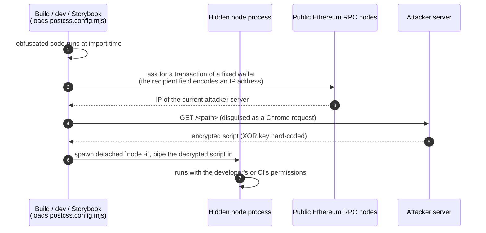
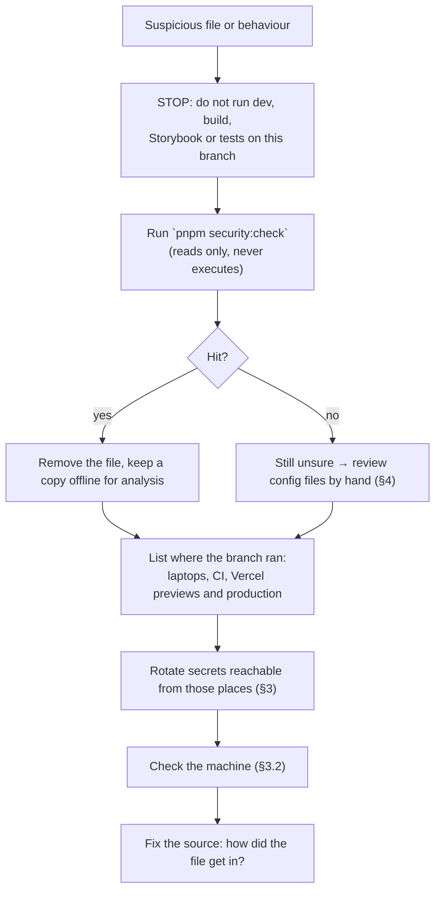
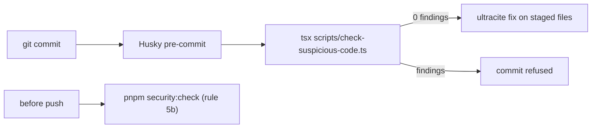

# Chapter 28: Supply-Chain Security & Incident Response

What happened when an obfuscated "download and run" payload was found in this repository, how to recognise that family of attack, what to do the moment you suspect it, and the guard that now runs on every commit. Read this before opening an unfamiliar branch, copying files from another project, or adding a config file you did not write.

Related: [Chapter 8](08-code-quality.md) (gates), [Chapter 9](09-deployment-and-operations.md) (secrets), [Chapter 21](21-infrastructure-and-terraform.md) (Terraform-held secrets), [Chapter 27](27-developer-troubleshooting.md).

---

## 1. What was found

| | |
| :--- | :--- |
| **Where** | `postcss.config.mjs` (inline, after `export default config;`) and `public/fonts/fa-solid-600.eot` (a fake font, 8,514 bytes; the real Font Awesome solid font in the same folder is 202 KB) |
| **Arrived** | Commit `2fc562f`, 2026-10-25 |
| **Removed** | `postcss.config.mjs` in `b195d73`, 2026-10-31 ("fix build issues"). The fake font was deleted afterwards (see §5) |
| **Why it ran** | PostCSS config is loaded by `next dev`, `next build`, Storybook (Vite) and every Vercel build, so merely starting the project executed it |
| **Who wrote it** | Unknown. The Git author field is just text and can be forged; a compromised machine can also commit it under the owner's name. Treat authorship as unproven |

Clues that the files were pasted in from elsewhere: the `postcss.config.mjs` had gained a `createRequire` shim (so `require` works inside an ES module, which the payload needs), `public/fonts/README.md` describes a "Blockchain Explorer application", and `.vscode/` carried an SST/AWS/Jest setup that GhostMsg has never used.

### 1.1 What the code did (from reading the removed diff; it was never executed here)



Using a blockchain to look up the server means blocking one domain doesn't stop it, and anything readable by the process was in reach: `.env.local`, `.vercel/`, `terraform/terraform.tfvars`, SSH keys, browser sessions, tokens in the environment. On Vercel the build environment holds the production variables.

## 2. If you suspect it: first hour



Rules while investigating:

- **Never run the code to see what it does.** Read it, or analyse it in a throwaway VM with no credentials.
- **Don't rely on `git blame` for attribution.**
- **Don't rewrite shared history before you have rotated secrets**; rewriting hides evidence and does not un-leak anything.

## 3. Containment

### 3.1 What to rotate

Rotate everything that was readable on a machine or build that loaded the poisoned config. The variable list is in [Chapter 2 §2.1](02-getting-started.md#21-every-variable-the-code-reads).

| Secret | Where it lives | Side effect of rotating |
| :--- | :--- | :--- |
| `MONGODB_URI` (Atlas database user password) | Vercel env, `.env.local`, Terraform | Change in Atlas (Terraform), redeploy |
| `NEXT_AUTH_SECRET` | Vercel env, `.env.local` | Everyone is signed out |
| `SENDER_PEPPER_SECRET` | Vercel env | Existing Sender Hashes stop matching: blocks reset ([Chapter 17 §2](17-trust-safety-and-privacy.md#2-anonymity-model)) |
| `SMTP_PASS` | Vercel env, `.env.local` | Update the mail account |
| `GOOGLE_OAUTH_CLIENT_SECRET` | Vercel env, `.env.local` | Reset in Google Cloud |
| `GOOGLE_AI_STUDIO_SECRET` | Vercel env, `.env.local` | New key in AI Studio |
| `VAPID_PRIVATE_KEY` | Vercel env | Saved push subscriptions stop working ([Chapter 18 §4](18-notifications-and-realtime.md#4-web-push)) |
| `CRON_SECRET` | Vercel env | Update `vercel.json` caller (Vercel sends it itself) |
| Vercel, Atlas API, HCP Terraform tokens | Terraform `terraform.tfvars`, CLI login | New tokens; revoke the old |
| GitHub tokens (`gh auth`), SSH keys, npm tokens | The developer machine | Revoke in each service, re-login |

Also sign out of browser sessions on that machine (GitHub, Vercel, Google, Atlas).

### 3.2 Check the machine

```powershell
# unexpected node processes (note the command line and parent)
Get-CimInstance Win32_Process -Filter "Name='node.exe'" |
  Select-Object ProcessId, ParentProcessId, CreationDate, CommandLine

# listening ports and outbound connections owned by node
Get-NetTCPConnection | Where-Object { $_.OwningProcess -in (Get-Process node -ErrorAction SilentlyContinue).Id }
```

A `node -i` process with no visible window, or a node process started by a build that has already finished, is a red flag. When in doubt, treat the machine as compromised: back up work, reinstall, and re-clone.

## 4. How to spot this class of file

| Signal | Where to look |
| :--- | :--- |
| Code after `export default` or `module.exports` in a config file | `postcss.config.*`, `next.config.*`, `vite.config.*`, `vitest.config.*`, `tailwind.config.*`, `.storybook/main.*`, `eslint`/`babel` configs |
| One or more lines thousands of characters long, bracket-style calls such as `x['fromCharCode']` | any `.js` / `.mjs` / `.cjs` / `.ts` |
| Code inside something that should be data | fonts, images, `.map`, `.svg`, lockfiles |
| A file that doesn't belong to the product | a README describing another app, SST/AWS/Jest settings in a Next.js repo |
| Lifecycle scripts that run on install | `preinstall`, `install`, `postinstall` in `package.json` (and in new dependencies) |
| Auto-running editor tasks | `.vscode/tasks.json` with `"runOn": "folderOpen"`, `"task.allowAutomaticTasks": true` |
| A "fix build" change that deletes a block nobody wrote | read the diff before accepting it |

## 5. What changed in the repo after this incident

| Change | Where |
| :--- | :--- |
| Deleted the fake font | `public/fonts/fa-solid-600.eot` |
| Removed `task.allowAutomaticTasks` and a `tasks` block with `runOn: folderOpen` | `.vscode/settings.json` |
| **`pnpm security:check`**: reads every tracked file and fails on known payload markers, code hidden in fonts and images, obfuscated scripts, folder-open tasks and install-time lifecycle scripts | `scripts/check-suspicious-code.ts` |
| Runs before every commit | `.husky/pre-commit` |
| Required before every push | `.agents/rules/pre-push-quality-checks.md` step 5b |



The guard is a tripwire for this payload family and for the generic shapes in §4, not a malware scanner. A different payload can slip past it, so the habits below matter more.

## 6. Habits that prevent it

1. **Read config files in every diff**, especially ones you didn't touch. A config that grows is a warning sign.
2. **Never paste in files from another project** without reading them. If a folder comes with a README for a different app, don't keep it.
3. **Don't run `pnpm install`, `dev` or `build` on a branch you haven't skimmed** when it comes from a fork, a pull request or a template you don't trust. Review in the browser first.
4. **Keep secrets out of the working tree where you can.** `.env.local`, `.vercel/` and `terraform/terraform.tfvars` are git-ignored but readable by any process you start. Prefer short-lived tokens and least privilege (an Atlas user limited to one database; separate Preview credentials, see [Chapter 21](21-infrastructure-and-terraform.md)).
5. **Treat Vercel build logs and env as exposed to the build.** Production variables are visible to code that runs during `next build`.
6. **Review dependency changes.** New packages with install scripts, tiny packages with huge diffs and look-alike names deserve a look; consider `pnpm install --ignore-scripts` for unfamiliar lockfile changes, then enable scripts only for the packages that need them.
7. **Turn on 2FA and branch protection** so a stolen token can't push straight to `master`.
8. **Don't trust "fix build" commits that delete code you can't explain**; find out why the build was failing. Here the deletion was right, but the cause was never named.

## 7. Open items

| Item | Status |
| :--- | :--- |
| `node_modules` scan for the same markers | Run `grep -rlaF` for the markers in `scripts/check-suspicious-code.ts` over `node_modules`; record the result in the incident notes |
| Fake font still in Git history | Present in history since `2fc562f`; clean history only after secrets are rotated and collaborators are told (force-push needed) |
| Unused vendor assets in `public/fonts/` and an unrelated `README.md` | Nothing references them; consider deleting the folder |
| `.vscode/` still describes another project (SST, AWS profile, Jest) | Replace with GhostMsg's own settings or delete |
| Recommended extension `esbenp.prettier-vscode` and `editor.defaultFormatter` | The repo formats with Biome; switch to the Biome extension to avoid fighting formatters |
| Run `pnpm security:check` in CI | Add as a first job so previews and production never build a flagged tree |
