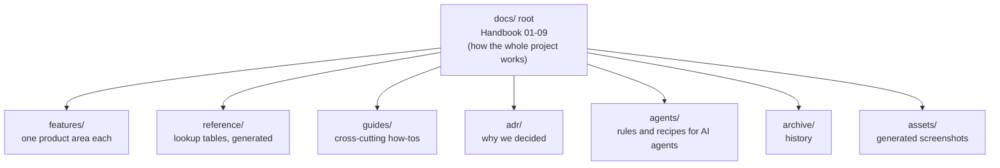

# GhostMsg Engineering Documentation 📖

The engineering documentation for GhostMsg, grouped by what kind of document it is. **The root of `docs/` holds only the project-wide handbook (01 to 09).** Anything about one feature, one lookup table or one cross-cutting topic lives in a folder.

**New here?** Read [Project Overview](01-overview.md), then [Getting Started](02-getting-started.md) and [System Architecture](03-system-architecture.md). Then the [Product Guide](features/product-guide.md) for what the product does and [Screens & User Flows](features/screens-and-user-flows.md) for how it looks. **AI agents** start at [agents/README.md](agents/README.md).

**Where does a new document go?**

| It answers… | Put it in |
| :--- | :--- |
| "How does the whole project work or get built?" | the root (next free number) |
| "How does one product area work, end to end?" | `features/` |
| "What are the exact fields, endpoints, tokens or modules?" | `reference/` |
| "How do I do X across the codebase (or fix Y)?" | `guides/` |
| "Why did we choose this?" | `adr/` (next number) |
| "What must an AI agent follow or do?" | `agents/` |
| "What used to be true?" | `archive/` |

---

## 📚 Handbook (this folder)

| # | Document | Key topics |
| :---: | :--- | :--- |
| 01 | [**Project Overview**](01-overview.md) | Vision, philosophy, domain language, feature map. |
| 02 | [**Getting Started**](02-getting-started.md) | Prerequisites, every environment variable, install, first run. |
| 03 | [**System Architecture**](03-system-architecture.md) | Topology, source layers and runtime boundaries, NextAuth, MongoDB, Edge AI. |
| 04 | [**API & Type Safety**](04-api-and-type-safety.md) | OpenAPI 3.1 contracts, Scalar UI, typegen, the `openapi-fetch` SDK. |
| 05 | [**Component Architecture**](05-component-architecture.md) | The four tiers, the dependency rule, controllers, tokens, motion. |
| 06 | [**Developer Workflow**](06-dev-workflow.md) | Daily commands, git hooks, the pre-push gate, Changesets. |
| 07 | [**Testing Strategy**](07-testing-strategy.md) | Unit and story projects, MSW isolation, the controller harness, test inventory. |
| 08 | [**Code Quality**](08-code-quality.md) | Ultracite (Biome), strict TypeScript, banned patterns, tier import rules. |
| 09 | [**Deployment & Operations**](09-deployment-and-operations.md) | Vercel, MongoDB Atlas, SMTP, the production environment checklist, cron. |

## ✨ Features (`features/`)

| Document | Key topics |
| :--- | :--- |
| [**Product Guide**](features/product-guide.md) | Personas, promises, route map, journeys, every feature with its rules and code owners, known gaps. |
| [**Screens & User Flows**](features/screens-and-user-flows.md) | Every screen with a generated screenshot, its tiers, controllers and states. |
| [**Authentication & Verification**](features/authentication-and-verification.md) | Guards, sign-up, the Verification Code lifecycle, sign-in. |
| [**Inbox Triage**](features/inbox-triage.md) | Filters, auto-read, archive, selection, confirmed deletes, keyboard, live updates, empty states. |
| [**AI Features**](features/ai-features.md) | Moderation, Smart Reply, Suggested Messages, AMA ideas. |
| [**Notifications & Real-Time**](features/notifications-and-realtime.md) | SSE live feed, email and the daily digest, Web Push, quiet hours. |
| [**Trust, Safety & Privacy**](features/trust-safety-and-privacy.md) | Invariants, anonymity model, moderation and quarantine, blocking, data rights. |

## 📖 Reference (`reference/`)

| Document | Key topics |
| :--- | :--- |
| [**Data Model**](reference/data-model.md) | ER diagram, every User and Message field, indexes, lifecycle. |
| [**API Reference**](reference/api-reference.md) | Every endpoint with request, response, errors and the client data-layer map. |
| [**Design System**](reference/design-system.md) | Palettes, tokens, contrast gate, the CVA variant catalog. |
| [**Component Registry**](reference/component-registry.md) | Generated inventory of modules, stories, mocks and scenarios (`pnpm docs:registry`). |

## 🧭 Guides (`guides/`)

| Document | Key topics |
| :--- | :--- |
| [**State Management**](guides/state-management.md) | Where each kind of state lives, the rules, the inbox data flow. |
| [**Accessibility & Feedback**](guides/accessibility-and-feedback.md) | Keyboard, focus, live regions, `notify` toasts, motion. |
| [**Responsive Design**](guides/responsive-design.md) | Breakpoints, CSS-only versus JS branches, phone versus desktop. |
| [**Storybook & UI Catalog**](guides/storybook-and-ui-catalog.md) | Story standard, MSW page stories, fixtures, reliability rules. |
| [**Infrastructure & Terraform**](guides/infrastructure-and-terraform.md) | Terraform-managed Vercel and MongoDB Atlas, env var flow. |
| [**Troubleshooting**](guides/troubleshooting.md) | Symptom, cause and fix for styling, types, tests, lint, tooling. |
| [**Supply-Chain Security**](guides/supply-chain-security.md) | The removed payload, incident response, `pnpm security:check`. |

---

## 🏛️ Architectural Decision Records (ADRs)

- [**ADR 0001: Embedded Messages Schema**](adr/0001-embedded-messages-schema.md)
- [**ADR 0002: Dual Authentication & Verification**](adr/0002-dual-authentication-and-email-verification.md)
- [**ADR 0003: Edge Runtime for AI Suggestions**](adr/0003-edge-runtime-for-ai-suggestions.md)
- [**ADR 0004: Ultracite and Biome Tooling**](adr/0004-ultracite-and-biome-tooling.md)
- [**ADR 0005: Type-Safe API Layer & Scalar Docs**](adr/0005-type-safe-api-and-scalar-documentation.md)
- [**ADR 0006: Standardized API Client & React Query Architecture**](adr/0006-standardized-api-calling-and-react-query-architecture.md)
- [**ADR 0007: Dependency Reclassification & Bundle Optimization**](adr/0007-dependency-reclassification-and-bundle-optimization.md)
- [**ADR 0008: React Optimization & Dynamic Bundle Analysis**](adr/0008-react-optimization-and-bundle-analysis.md)
- [**ADR 0009: Biome Suppression Elimination & Code Quality Remediation**](adr/0009-biome-suppression-elimination-and-lint-remediation.md)
- [**ADR 0010: Standalone Message Collection, Abuse Prevention & Public Q&A Architecture**](adr/0010-standalone-messages-schema-and-feature-architecture.md)
- [**ADR 0011: Mandatory Type-Safe OpenAPI SDK, Nodemailer SMTP Mailer & Reversible Abuse Prevention**](adr/0011-openapi-sdk-smtp-mailer-and-sender-unblocking.md)
- [**ADR 0012: Vitest Unit & Integration Testing Strategy for GhostMsg**](adr/0012-vitest-unit-and-integration-testing-strategy.md)
- [**ADR 0013: Elements-Patterns-Blocks Composable Component Architecture & Colocated Tooling**](adr/0013-elements-patterns-blocks-composable-architecture.md)
- [**ADR 0014: Architectural Deepening: Pure Patterns, Hoisted Overlays, Web Push Adapter & Elements Consolidation**](adr/0014-architectural-deepening-pure-patterns-hoisted-overlays-and-push-adapter.md)
- [**ADR 0015: Four-Tier Components: Pages Layer, Logic Isolation & Vendor Consolidation**](adr/0015-four-tier-components-pages-layer-and-vendor-consolidation.md)
- [**ADR 0016: Storybook 10, MSW Mocking & Story-Driven Component Testing**](adr/0016-storybook-msw-and-story-driven-component-testing.md)
- [**ADR 0017: Generated Component Registry & Documentation Freshness Gate**](adr/0017-generated-component-registry-and-docs-freshness-gate.md)
- [**ADR 0018: Source Structure: Server, Data, Lib, Utilities, Controllers & Tests**](adr/0018-source-structure-server-data-lib-utils-controllers-tests.md)
- [**ADR 0019: Controller Test Harness: renderHookWithProviders, Request Recording & Edge-Only Mocking**](adr/0019-controller-test-harness-renderhook-msw-and-edge-mocking.md)
- [**ADR 0020: Web Push Delivery: VAPID Keys, Server Push Capability & Subscription Lifecycle**](adr/0020-web-push-delivery-vapid-and-subscription-lifecycle.md)
- [**ADR 0021: Optimistic Inbox Mutations: Close-First Dialogs & Shared Cache Helpers**](adr/0021-optimistic-inbox-mutations-close-first-and-shared-cache-helpers.md)
- [**ADR 0022: Palette Theming (3 × light/dark) and the Claude Design Redesign**](adr/0022-palette-theming-and-claude-design-redesign.md)
- [**ADR 0023: shadcn-First Elements and the Profile & Settings Backend**](adr/0023-shadcn-first-elements-and-profile-settings-backend.md)
- [**ADR 0024: Profile & Preferences Data Model and the Settings API**](adr/0024-profile-preferences-data-model-and-settings-api.md)
- [**ADR 0025: Graded Toxicity and Recipient-Controlled Quarantine**](adr/0025-graded-toxicity-and-recipient-controlled-quarantine.md)
- [**ADR 0026: Notification Delivery Policy: Quiet Hours and Hidden Previews**](adr/0026-notification-delivery-policy-quiet-hours-and-hidden-previews.md)
- [**ADR 0027: Destructive Account Actions: Undo Window, Typed Confirmation and Username Changes**](adr/0027-destructive-account-actions-undo-window-and-typed-confirmation.md)
- [**ADR 0028: Agent-First Documentation System and Generated Screenshots**](adr/0028-agent-first-documentation-system-and-generated-screenshots.md)
- [**ADR 0029: Daily Digest Scheduling and Alert Privacy Fixes**](adr/0029-daily-digest-scheduling-and-alert-privacy-fixes.md)
- [**ADR 0030: Server-Side Inbox Filtering, Keyset Paging and Counts**](adr/0030-server-side-inbox-filtering-paging-and-counts.md)
- [**ADR 0031: State Management Consistency and Structure**](adr/0031-state-management-consistency-and-structure.md)
- [**ADR 0032: Terraform-Managed Vercel and MongoDB Atlas Infrastructure**](adr/0032-terraform-managed-vercel-and-mongodb-atlas-infrastructure.md)
- [**ADR 0033: Standardized Form Architecture with React Hook Form and Shadcn Primitives**](adr/0033-standardized-form-architecture-with-react-hook-form-and-shadcn-primitives.md)
- [**ADR 0034: Confirmed Message Deletes, Undo Only for Delete All, Toast Lifecycle Commits and Phone Dashboard Chrome**](adr/0034-confirmed-message-deletes-undo-for-delete-all-and-phone-dashboard-chrome.md)

---

## 🗄️ Archive (history)

Original plans and the redesign write-up, kept for history. Where they differ from the code, the live docs above win. See [archive/README.md](archive/README.md).

## 🤖 Agent Guidelines

- [**Agent Guide Index (start here)**](agents/README.md)
- [**Product Rules (invariants, recipient control, copy)**](agents/product-rules.md)
- [**Feature Recipes (end-to-end changes)**](agents/feature-recipes.md)
- [**Documentation Maintenance (change → docs map, screenshots)**](agents/documentation-maintenance.md)
- [**API & Client-Server Patterns**](agents/api-patterns.md)
- [**Component Architecture (4 tiers, logic in pages)**](agents/component-architecture.md)
- [**Source Structure (server / data / lib / utils / controllers / tests)**](agents/source-structure.md)
- [**Domain Modeling Guidelines**](agents/domain.md)
- [**Issue Tracker Integration**](agents/issue-tracker.md)
- [**Triage Labels System**](agents/triage-labels.md)
