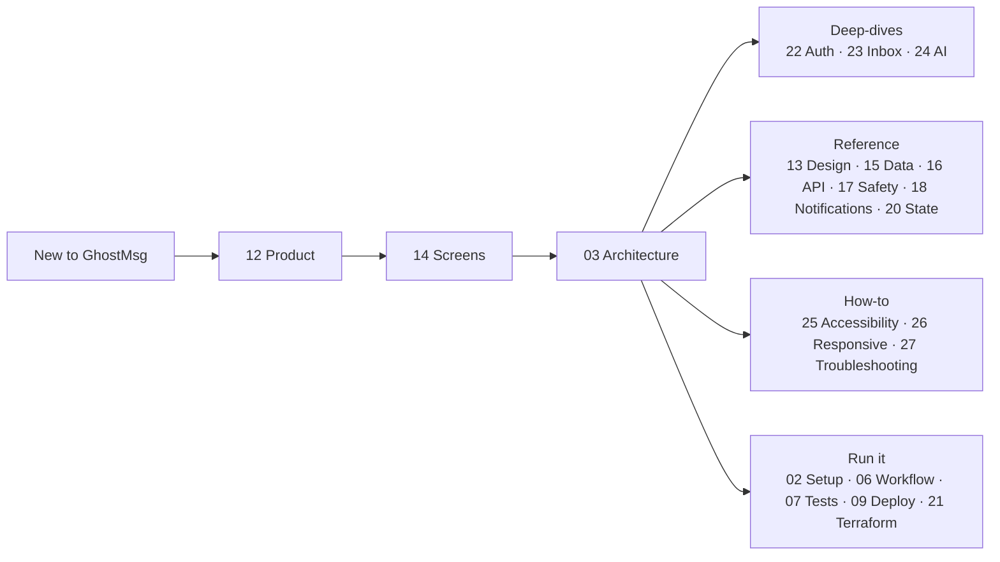

# GhostMsg Engineering Documentation 📖

Welcome to the comprehensive engineering documentation for GhostMsg. This documentation is organized into numbered chapters for sequential onboarding and reference.

**New here?** Read [12 Product Guide](12-product-guide-and-features.md) for what the product does, [14 UI Screens](14-ui-screens-and-user-flows.md) for how it looks, then [03 System Architecture](03-system-architecture.md). Feature deep-dives: [22 Auth](22-authentication-and-verification.md), [23 Inbox](23-inbox-triage.md), [24 AI](24-ai-features.md). Cross-cutting guides: [25 Accessibility & Feedback](25-accessibility-and-feedback.md), [26 Responsive Design](26-responsive-design.md), [27 Troubleshooting](27-developer-troubleshooting.md). **AI agents** start at [agents/README.md](agents/README.md).

---

## 📚 Table of Contents

| Chapter | Title | Key Topics |
| :---: | :--- | :--- |
| **01** | [**Project Overview**](01-overview.md) | Vision, philosophy, ubiquitous domain language, and feature mindmap. |
| **02** | [**Getting Started & Setup**](02-getting-started.md) | Prerequisites, `.env.local` configuration, local installation, and running with Turbopack. |
| **03** | [**System Architecture**](03-system-architecture.md) | High-level system diagram, source layers & runtime boundaries (server / data / lib), NextAuth lifecycle, MongoDB schema, and Edge AI pipeline. |
| **04** | [**API & Type Safety**](04-api-and-type-safety.md) | OpenAPI 3.1 contracts, Scalar UI (`/docs`), automated typegen, and `openapi-fetch` SDK. |
| **05** | [**Component Architecture**](05-component-architecture.md) | Next.js App Router tree, Tailwind CSS v4 design tokens, Radix/Shadcn primitives, and Motion. |
| **06** | [**Developer Workflow**](06-dev-workflow.md) | Daily commands, Husky pre-commit hooks, API typegen automation, and Changesets. |
| **07** | [**Testing Strategy**](07-testing-strategy.md) | Unit + story Vitest projects, MSW-isolated tests, colocated utils/controller tests, `renderHookWithProviders` harness, test inventory (no E2E suite yet). |
| **08** | [**Code Quality & Standards**](08-code-quality.md) | Ultracite (Biome) rules, TypeScript strict mode configuration, and anti-pattern bans. |
| **09** | [**Deployment & Operations**](09-deployment-and-operations.md) | Vercel production deployment, MongoDB Atlas connection pooling, and SMTP email provider configuration. |
| **10** | [**Storybook & UI Catalog**](10-storybook-and-ui-catalog.md) | Storybook 10 (nextjs-vite), story standard, MSW page isolation, fixtures, and story tests in Chromium. |
| **11** | [**Component Registry**](11-component-registry.md) | Generated inventory: every module, public API, stories, play() tests, mocks, controllers, fixtures and MSW scenarios (`pnpm docs:registry`). |
| **12** | [**Product Guide & Feature Catalog**](12-product-guide-and-features.md) | Personas, promises, route map, journeys, every feature with its rules and code owners, known gaps. |
| **13** | [**Design System & Theming**](13-design-system-and-theming.md) | Brand direction, 3 palettes × light/dark, tokens, contrast gate, motion, shadcn-first elements and the CVA variant catalog. |
| **14** | [**UI Screens & User Flows**](14-ui-screens-and-user-flows.md) | Every screen with a generated screenshot, its tier composition, controllers, states and stories; key flows. |
| **15** | [**Data Model & Database**](15-data-model-and-database.md) | ER diagram, every User/Message field with defaults, indexes, write patterns, compatibility defaults, data lifecycle. |
| **16** | [**API Reference**](16-api-reference.md) | Conventions, every endpoint with request/response/errors/side effects, client data-layer map, MSW scenarios. |
| **17** | [**Trust, Safety & Privacy**](17-trust-safety-and-privacy.md) | Invariants, anonymity model, send pipeline, graded moderation + quarantine policy, blocking, limits, data rights, known issues. |
| **18** | [**Notifications & Real-Time Delivery**](18-notifications-and-realtime.md) | SSE live feed, instant email and the daily digest, Web Push, quiet hours, hidden previews, scaling limits. |
| **19** | [**Redesign Change Summary**](19-redesign-change-summary.md) | What the October 2026 redesign changed: features, UI, API, database, code, quality gates. |
| **20** | [**State Management**](20-state-management.md) | Where each kind of state lives, the rules for new state, inbox data flow, and the completed state-management review. |
| **21** | [**Infrastructure & Terraform**](21-infrastructure-and-terraform.md) | Terraform-managed Vercel project and MongoDB Atlas cluster, two-database isolation, HCP state backend, env var management, and known limitations. |
| **22** | [**Authentication & Verification**](22-authentication-and-verification.md) | Middleware guards, sign-up, the Verification Code lifecycle (3 tries, 60 s resend, 1 h expiry), verify screen states, sign-in checks, Google, known gaps. |
| **23** | [**Inbox Triage**](23-inbox-triage.md) | Filters and the shared filter contract, URL state, auto-read, archive, selection, confirmed deletes, keyboard, live pill, empty states. |
| **24** | [**AI Features**](24-ai-features.md) | Moderation, Smart Reply (three drafts, one call), Suggested Messages (Edge, cached), AMA ideas: schemas, fallbacks, testing, adding a feature. |
| **25** | [**Accessibility & Feedback**](25-accessibility-and-feedback.md) | Keyboard map and guard, adding a shortcut, focus rules, live regions, `notify` and toast rules, Undo toast lifecycle, motion, forms, PR checklist. |
| **26** | [**Responsive Design**](26-responsive-design.md) | Breakpoints, CSS-only vs `useIsMobile` branch, ResponsiveDialog, top-bar portals, layout props, container queries, screen-by-screen phone vs desktop. |
| **27** | [**Developer Troubleshooting**](27-developer-troubleshooting.md) | Symptom → cause → fix for styling, types, tests, lint, merges and local tooling. |

---

## 🏛️ Architectural Decision Records (ADRs)

- [**ADR 0001: Embedded Messages Schema**](adr/0001-embedded-messages-schema.md)
- [**ADR 0002: Dual Authentication & Verification**](adr/0002-dual-authentication-and-email-verification.md)
- [**ADR 0003: Edge Runtime for AI Suggestions**](adr/0003-edge-runtime-for-ai-suggestions.md)
- [**ADR 0004: Ultracite and Biome Tooling**](adr/0004-ultracite-and-biome-tooling.md)
- [**ADR 0005: Type-Safe API Layer & Scalar Docs**](adr/0005-type-safe-api-and-scalar-documentation.md)
- [**ADR 0006: Standardized API Client & React Query Architecture**](adr/0006-standardized-api-calling-and-react-query-architecture.md)
- [**ADR 0007: Dependency Reclassification & Bundle Optimization**](adr/0007-dependency-reclassification-and-bundle-optimization.md)
- [**ADR 0008: React Optimization & Dynamic Bundle Analysis**](adr/0008-react-optimization-and-bundle-analysis.md)
- [**ADR 0009: Biome Suppression Elimination & Code Quality Remediation**](adr/0009-biome-suppression-elimination-and-lint-remediation.md)
- [**ADR 0010: Standalone Message Collection, Abuse Prevention & Public Q&A Architecture**](adr/0010-standalone-messages-schema-and-feature-architecture.md)
- [**ADR 0011: Mandatory Type-Safe OpenAPI SDK, Nodemailer SMTP Mailer & Reversible Abuse Prevention**](adr/0011-openapi-sdk-smtp-mailer-and-sender-unblocking.md)
- [**ADR 0012: Vitest Unit & Integration Testing Strategy for GhostMsg**](adr/0012-vitest-unit-and-integration-testing-strategy.md)
- [**ADR 0013: Elements-Patterns-Blocks Composable Component Architecture & Colocated Tooling**](adr/0013-elements-patterns-blocks-composable-architecture.md)
- [**ADR 0014: Architectural Deepening: Pure Patterns, Hoisted Overlays, Web Push Adapter & Elements Consolidation**](adr/0014-architectural-deepening-pure-patterns-hoisted-overlays-and-push-adapter.md)
- [**ADR 0015: Four-Tier Components: Pages Layer, Logic Isolation & Vendor Consolidation**](adr/0015-four-tier-components-pages-layer-and-vendor-consolidation.md)
- [**ADR 0016: Storybook 10, MSW Mocking & Story-Driven Component Testing**](adr/0016-storybook-msw-and-story-driven-component-testing.md)
- [**ADR 0017: Generated Component Registry & Documentation Freshness Gate**](adr/0017-generated-component-registry-and-docs-freshness-gate.md)
- [**ADR 0018: Source Structure: Server, Data, Lib, Utilities, Controllers & Tests**](adr/0018-source-structure-server-data-lib-utils-controllers-tests.md)
- [**ADR 0019: Controller Test Harness: renderHookWithProviders, Request Recording & Edge-Only Mocking**](adr/0019-controller-test-harness-renderhook-msw-and-edge-mocking.md)
- [**ADR 0020: Web Push Delivery: VAPID Keys, Server Push Capability & Subscription Lifecycle**](adr/0020-web-push-delivery-vapid-and-subscription-lifecycle.md)
- [**ADR 0021: Optimistic Inbox Mutations: Close-First Dialogs & Shared Cache Helpers**](adr/0021-optimistic-inbox-mutations-close-first-and-shared-cache-helpers.md)
- [**ADR 0022: Palette Theming (3 × light/dark) and the Claude Design Redesign**](adr/0022-palette-theming-and-claude-design-redesign.md)
- [**ADR 0023: shadcn-First Elements and the Profile & Settings Backend**](adr/0023-shadcn-first-elements-and-profile-settings-backend.md)
- [**ADR 0024: Profile & Preferences Data Model and the Settings API**](adr/0024-profile-preferences-data-model-and-settings-api.md)
- [**ADR 0025: Graded Toxicity and Recipient-Controlled Quarantine**](adr/0025-graded-toxicity-and-recipient-controlled-quarantine.md)
- [**ADR 0026: Notification Delivery Policy: Quiet Hours and Hidden Previews**](adr/0026-notification-delivery-policy-quiet-hours-and-hidden-previews.md)
- [**ADR 0027: Destructive Account Actions: Undo Window, Typed Confirmation and Username Changes**](adr/0027-destructive-account-actions-undo-window-and-typed-confirmation.md)
- [**ADR 0028: Agent-First Documentation System and Generated Screenshots**](adr/0028-agent-first-documentation-system-and-generated-screenshots.md)
- [**ADR 0029: Daily Digest Scheduling and Alert Privacy Fixes**](adr/0029-daily-digest-scheduling-and-alert-privacy-fixes.md)
- [**ADR 0030: Server-Side Inbox Filtering, Keyset Paging and Counts**](adr/0030-server-side-inbox-filtering-paging-and-counts.md)
- [**ADR 0031: State Management Consistency and Structure**](adr/0031-state-management-consistency-and-structure.md)
- [**ADR 0032: Terraform-Managed Vercel and MongoDB Atlas Infrastructure**](adr/0032-terraform-managed-vercel-and-mongodb-atlas-infrastructure.md)
- [**ADR 0033: Standardized Form Architecture with React Hook Form and Shadcn Primitives**](adr/0033-standardized-form-architecture-with-react-hook-form-and-shadcn-primitives.md)
- [**ADR 0034: Confirmed Message Deletes, Undo Only for Delete All, Toast Lifecycle Commits and Phone Dashboard Chrome**](adr/0034-confirmed-message-deletes-undo-for-delete-all-and-phone-dashboard-chrome.md)

---

## 📐 Architecture Blueprints (historical)

Original plans, kept for history. Where they differ from the code, the numbered chapters win.

- [**Feature & Implementation Master Blueprint**](feature-and-implementation-blueprint.md)
- [**API & React Query Architecture Blueprint**](api-and-react-query-architecture.md)

## 🤖 Agent Guidelines

- [**Agent Guide Index (start here)**](agents/README.md)
- [**Product Rules (invariants, recipient control, copy)**](agents/product-rules.md)
- [**Feature Recipes (end-to-end changes)**](agents/feature-recipes.md)
- [**Documentation Maintenance (change → docs map, screenshots)**](agents/documentation-maintenance.md)
- [**API & Client-Server Patterns**](agents/api-patterns.md)
- [**Component Architecture (4 tiers, logic in pages)**](agents/component-architecture.md)
- [**Source Structure (server / data / lib / utils / controllers / tests)**](agents/source-structure.md)
- [**Domain Modeling Guidelines**](agents/domain.md)
- [**Issue Tracker Integration**](agents/issue-tracker.md)
- [**Triage Labels System**](agents/triage-labels.md)
