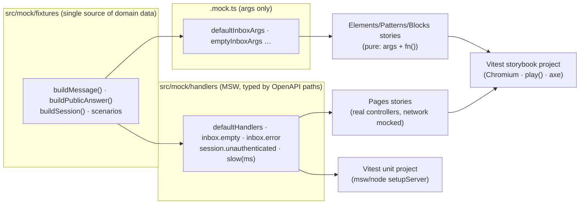

# ADR 0016: Storybook 10, MSW Mocking & Story-Driven Component Testing

## Status
**Accepted**. Resolved in a grilling session on 2026-10-11 (decisions Q1–Q16 below). This builds on [ADR 0012](0012-vitest-unit-and-integration-testing-strategy.md) (Vitest) and [ADR 0015](0015-four-tier-components-pages-layer-and-vendor-consolidation.md) (four tiers). It supersedes ADR 0012's rule that component tests live in `*.test.tsx`.

---

## Context & Problem Statement

1. **No real Storybook setup.** Stories existed as plain function exports, with no `Meta`, args, controls, states or interaction tests. Storybook wasn't in `package.json` or either lockfile, though orphaned Storybook 8 and 10 packages sat in `node_modules`.
2. **Two lockfiles.** `pnpm-lock.yaml` and `package-lock.json` both existed, while `node_modules` was pnpm-shaped.
3. **Noisy, network-dependent tests.** Vitest was configured with happy-dom. Page and controller tests hit the real network and failed silently (`ECONNRESET`, Gemini 400 in every run), and motion components needed a happy-dom WAAPI workaround.
4. **Scattered mock data.** Each `*.mock.ts` held its own literals, and component mocks imported each other (for example, `inbox.mock` imported from `message-card.mock`).
5. **Stories at risk from page dependencies.** Pages depend on next-auth, React Query and `openapi-fetch`. Any story that touches them needs isolation that survives upgrades of those packages.

---

## Decisions

| # | Topic | Decision |
| :-- | :--- | :--- |
| Q1 | Package manager | **pnpm only.** Pin `vite@^8` directly so Storybook, Vitest and `@vitejs/plugin-react` 6 share one Vite. Delete `package-lock.json`, pin `"packageManager": "pnpm@10.29.1"`, and do a clean reinstall to purge orphaned Storybook packages. |
| Q2 | Framework | **`@storybook/nextjs-vite` 10.6.x.** It mocks `next/link`, `next/navigation` and `next/image`, shares the Vite toolchain with Vitest, and loads Tailwind v4 through the existing PostCSS config. |
| Q3 | Story testing | **`@storybook/addon-vitest` in browser mode** (`@vitest/browser-playwright`, headless Chromium). Every story is a smoke test, and `play()` functions are interaction tests. It runs as a second Vitest project. |
| Q4 | Page stories | **Pages get stories, isolated with MSW at the network layer** (`msw` ^2.15 + `msw-storybook-addon` 3; MSW 2 because Vitest 5's browser mocker `@vitest/mocker` peers `msw@^2.4.9`, and the addon accepts `>=2`). next-auth, React Query and openapi-fetch run unmodified. |
| Q5 | Mock data | **Two layers.** `src/mock/fixtures/` holds typed domain builders and named scenarios. Per-component `<name>.mock.ts` holds only args built from fixtures. A component mock never imports another component's mock. |
| Q6 | Story standard | CSF3 with `satisfies Meta` + `autodocs`, tier titles, full `argTypes`, `fn()` callbacks, one story per state, `play()` on interactive stories, light/dark + viewports (details below). |
| Q7 | Accessibility | **`@storybook/addon-a11y` with `test: "error"`.** Axe violations fail the story test. Known vendor exceptions use a per-story `"todo"` with a comment. |
| Q8 | Visual regression | **Out of scope.** Chromatic/TurboSnap can be added later without touching stories. |
| Q9 | Test ownership | **Stories are the component tests** for elements, patterns and blocks. Their `*.test.tsx` assertions move into `play()`, and the duplicate test files are deleted. `*.test.tsx` remains for logic only: controllers, `src/lib`, schemas, and page/controller integration. |
| Q10 | MSW layout | `src/mock/handlers/<domain>.handlers.ts` (auth/session, messages, user, public, ai) are typed against `src/generated/api-schema.d.ts` paths. `index.ts` exports `defaultHandlers` plus named scenario sets. Per-story overrides go in `parameters.msw.handlers`. |
| Q11 | MSW in Vitest | Unit setup runs `msw/node` `setupServer(...defaultHandlers)` with `onUnhandledRequest: "error"`. No test may reach the real network. |
| Q12 | Scripts & gate | Scripts: `storybook`, `build-storybook`, `test` (unit), `test:stories` (browser), `test:all` (both). The pre-push gate runs `pnpm test:all`. `build-storybook` stays a manual/CI step. |
| Q13 | Providers | `.storybook/preview.tsx` provides a `next-themes` `ThemeProvider` with `forcedTheme` driven by a toolbar global (light/dark), plus a global `<Toaster />`. `Pages/*` stories also get `SessionProvider` and a **fresh `QueryClient` per story**. Tooltips need no extra provider. |
| Q14 | Font | Poppins loads via `<link>` in `.storybook/preview-head.html`, which sets `--font-poppins`. There is no build-time network dependency. |
| Q15 | Naming | Kebab-case, colocated: `<name>/<name>.stories.tsx` and `<name>/<name>.mock.ts`. |
| Q16 | Delivery | One pass, left uncommitted for review. |
| Q17 | Contrast vs. visual parity | **Fix to WCAG AA.** Failing light-mode text colors shift one shade darker with the same hue: sentiment badges `pink/orange/emerald-600 → -700`; red status text and actions `red-500 → red-700` (dark mode keeps a light shade, `dark:text-red-400`). This is an **approved exception** to the ADR 0015 visual-parity rule. |
| Q18 | `--muted-foreground` token | **Darken the light-mode token** from `oklch(0.553 0.013 58.071)` to `oklch(0.5 0.013 58.071)` so muted text on muted surfaces reaches 4.5:1. Dark mode is unchanged. |

---

### Accessibility fixes found by the a11y gate (non-visual)
- **Auth form footer:** the alternate-mode `Link` was nested inside a `Button` (`nested-interactive`). It now uses `Button asChild`.
- **Carousel:** previous/next buttons got screen-reader labels (`button-name`).
- **Tabs highlight:** removed the invalid `aria-selected` from the motion highlight wrapper `div`s; the tab buttons keep it (`aria-allowed-attr`).

---

## Architecture



### Vitest projects

```ts
// vitest.config.ts (shape)
export default defineConfig({
  test: {
    projects: [
      { extends: true, test: { name: "unit", environment: "happy-dom", include: ["src/**/*.test.{ts,tsx}"], setupFiles: ["src/test/setup.ts"] } },
      { extends: true, plugins: [storybookTest({ configDir: ".storybook" })],
        test: { name: "storybook", testTimeout: 30_000, browser: { enabled: true, headless: true, provider: playwright({}), instances: [{ browser: "chromium" }] } } },
    ],
  },
});
```

No `setupFiles` are needed for the storybook project, because Storybook 10 applies the preview annotations itself. The unit project's `src/test/setup.ts` starts `msw/node` at module load (`server.listen()` before any app module captures `fetch`) and runs happy-dom at `http://localhost:3000`, so relative `/api/*` URLs resolve.

### Story standard (Q6), required for every story file

1. **Types.** `const meta = { … } satisfies Meta<typeof X>; type Story = StoryObj<typeof meta>`, with `tags: ["autodocs"]`. Titles: `Elements/…`, `Patterns/…`, `Blocks/…`, `Pages/…`.
2. **Controls.** `argTypes` with a `description` for every prop, `control: "select"` / `"radio"` for variants and sizes, and every callback arg set to `fn()`.
3. **States.** One story per meaningful state: Default, each Variant/Size, Disabled, Loading/Pending, Empty, Error, Edge (long text or overflow), as applicable.
4. **Interactions.** Every interactive story has a `play()` that drives the UI with `userEvent` and asserts both the callback (`expect(args.onX).toHaveBeenCalled…`) and the visible result.
5. **Themes and viewports.** Light/dark come from the toolbar. Responsive blocks add a `mobile1` viewport story.

```tsx
const meta = {
  title: "Patterns/AmaPromptEditor",
  component: AmaPromptEditor,
  tags: ["autodocs"],
  args: { ...defaultAmaPromptEditorArgs, onChange: fn(), onSave: fn() },
  argTypes: { isSaving: { control: "boolean", description: "Shows the saving spinner and disables Save" } },
} satisfies Meta<typeof AmaPromptEditor>;

export const Saves: Story = {
  play: async ({ args, canvas, userEvent }) => {
    await userEvent.click(canvas.getByRole("button", { name: /save topic banner/i }));
    await expect(args.onSave).toHaveBeenCalledOnce();
  },
};
```

---

## Outcome (implementation, 2026-10-12)

- **Coverage:** 64 story files with 292 stories and 181 `play()` interaction tests, plus 51 `*.mock.ts` files, across all four tiers.
- **Test files:** all element, pattern and block `*.test.tsx` files were migrated and deleted. `*.test.tsx` remains only for logic, controllers and page integration.
- **Results:** `pnpm test:all` gives 71 files / 319 tests passing, with no network access and no unhandled errors. `pnpm build-storybook` succeeds.
- **Accessibility fixes found by the gate:**
  - Destructive badge text used an undefined token, so it now uses `text-white`.
  - `SendMessageForm` used a plain `Label`; it's now a `FormLabel` linked to the textarea.
  - The public Q&A heading was an `h3` directly after the `h1`; it's now an `h2` element with `h3` styling.
- **Contract mismatch caught by typed handlers:** `POST /api/sign-up` is specified as `201`, which led to the `created()` helper.

## Consequences

### Positive
- **Upgrade-safe stories.** Package upgrades (next-auth, React Query, openapi-fetch) can't break page stories, because those packages are never mocked; only HTTP is.
- **Real-browser component tests.** Motion, layout and focus behave as in production, and the happy-dom workarounds are confined to the unit project.
- **Deterministic unit tests.** No real network access, so the run output is clean.
- **Single fixture source.** A model change breaks one builder, not 20 mocks.
- **Living documentation.** Autodocs prop tables, controls and actions for every component.

### Negative & Mitigations
- **Playwright Chromium download (~150 MB)** for story tests. Mitigation: a one-time `pnpm exec playwright install chromium`, documented in getting-started.
- **Slower `test:all`** than unit tests alone. Mitigation: `pnpm test` stays fast for the inner loop, and `test:all` gates pushes.
- **MSW handler maintenance.** Mitigation: handlers are typed against generated OpenAPI paths, so contract drift fails compilation.
