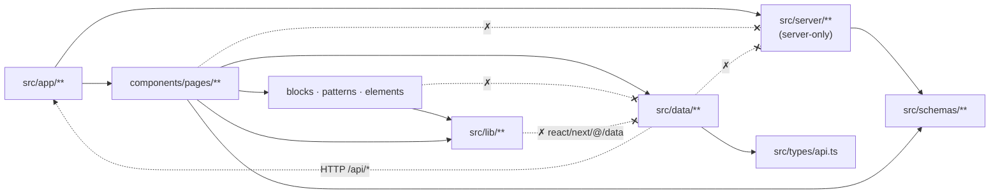
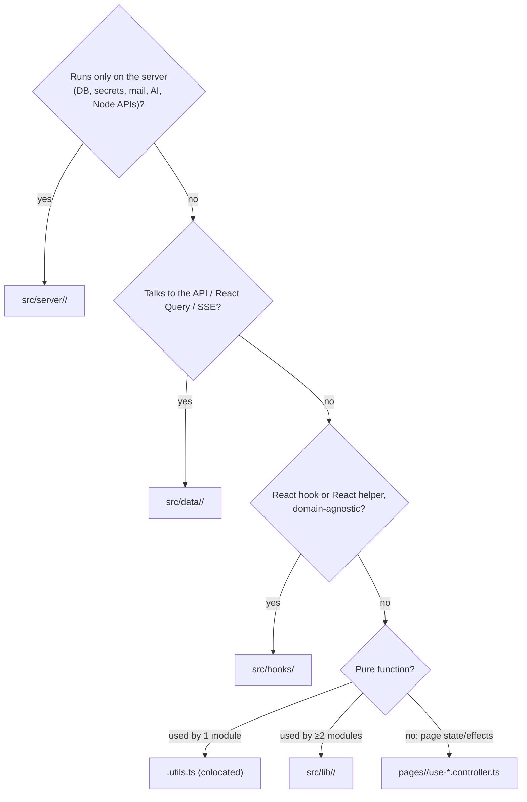

# ADR 0018: Source Structure: Server, Data, Lib, Utilities, Controllers & Tests

## Status
**Accepted** (2026-10-12). Resolved in a grilling session (Q1–Q16). Complements [ADR 0015](0015-four-tier-components-pages-layer-and-vendor-consolidation.md) (component tiers) and [ADR 0016](0016-storybook-msw-and-story-driven-component-testing.md) (testing). The controller test harness required by Q7 is specified in [ADR 0019](0019-controller-test-harness-renderhook-msw-and-edge-mocking.md). Agent guide: [docs/agents/source-structure.md](../agents/source-structure.md).

---

## Context & Problem Statement

ADR 0015 structured `src/components`, but everything outside it had grown by accretion:

1. **`src/lib` mixed three runtimes with no boundary.**
   - Server-only: `db-connect`, `mailer`, `ai-*`, `security`, `event-bus`, the 919-line `openapi`.
   - Client-only: `api-client`, a `"use client"` push hook, DOM-touching `export-messages`, a React context helper.
   - Universal: `cn`.

   Nothing prevented a server module from reaching a client bundle.
2. **`src/helpers`** was a vague second `lib`: two server email senders next to `lib/mailer.ts`.
3. **The data layer was split.** Queries were in `src/queries/`, mutations in `src/hooks/mutations/`, and the SSE data hook in `src/hooks/` next to generic UI hooks.
4. **Pure logic hid inside controllers.** `matchesStatus`, `matchesSearch` and `countByStatus` lived in `use-inbox.controller.ts`, and one auth file held four hooks. None of the 8 controllers had its own test.
5. **Two test conventions.** `__tests__/` folders coexisted with colocated `*.test.tsx`.
6. **Client UI imported domain types from Mongoose model files**, whose `Date | string` didn't match the ISO strings the API returns.
7. **Real landing-page content lived in `src/mock/`.**

---

## Decisions

| # | Topic | Decision |
| :-- | :--- | :--- |
| Q1 | Runtime split | **`src/server/`** holds server-only code, each file guarded by `import "server-only"`. **`src/lib/`** holds pure, framework-agnostic utilities only. Client infrastructure moves to the data layer. |
| Q2 | Data layer | **`src/data/`** contains `api-client.ts`, `query-keys.ts`, and per domain `src/data/<domain>/{<domain>.queries.ts, use-*-mutation.ts, use-live-*.ts}`. `src/queries/` and `src/hooks/mutations/` are removed. |
| Q3 | Hooks | **`src/hooks/`** holds generic, domain-agnostic React hooks only. Data and session hooks live in `src/data/` or page controllers. |
| Q4 | Component utilities | Non-trivial pure logic goes in a **colocated `<module>.utils.ts`**. One-line helpers may stay inline. **Promotion rule:** a util moves to `src/lib/<domain>/` once 2 or more modules use it. Browser side effects (e.g. triggering a download) are separated from pure builders. |
| Q5 | Controllers | **One hook per file**, `use-<concern>.controller.ts`, in its route folder. Hooks shared by sibling routes live in `pages/<group>/shared/`. Pure parts go into `*.utils.ts`. |
| Q6 | Test placement | **Always colocated** (`x.ts` + `x.test.ts`). No `__tests__/` folders. |
| Q7 | Test obligations | Every `*.utils.ts` and every `src/lib` / `src/server` module with logic has a `*.test.ts`. Every page controller has a `*.controller.test.ts` (`renderHook` + MSW scenarios). Data hooks are covered through controller tests. UI is covered by stories (ADR 0016). |
| Q8 | Client types | Client-facing types come from the generated OpenAPI schema via **`src/types/api.ts`** aliases (e.g. `MessageDto`). Mongoose model types are server-only. |
| Q9 | App content | Real app content moves to **`src/content/`** (`landing-messages.json`). `src/mock/` is for tests and stories only. |
| Q10 | Enforcement | The **`server-only`** package plus Biome `noRestrictedImports`:<br>• `@/server/**` is banned from components, data, hooks, lib and `.storybook`.<br>• `@/data/**` is banned below pages, replacing the old queries/mutations patterns.<br>• `src/lib` may not import `react`, `next/*`, `@/data/**` or `@/server/**`. |
| Q11 | Data file naming | One mutation hook per file (`use-delete-message-mutation.ts`) and one `<domain>.queries.ts` of `queryOptions` factories. `api-client.ts` and `query-keys.ts` sit at the `src/data/` root. |
| Q12 | Schemas & models | `src/schemas/` stays universal. The extended Zod moves to `src/schemas/zod.ts`. Mongoose models move to `src/server/models/`. |
| Q13 | Server layout | Grouped by capability: `db/`, `models/`, `email/` (absorbs `src/helpers`), `ai/`, `security/`, `realtime/`, `openapi/`. React Email templates stay in root `emails/`. |
| Q14 | API route logic | **Out of scope.** Routes keep their logic but import from `src/server/**`. A service layer gets its own future ADR. |
| Q15 | Providers & React helpers | `src/context/` is renamed to **`src/providers/`**. `get-strict-context.tsx` moves to `src/hooks/`. |
| Q16 | Delivery | New branch `feat/as/source-structure-and-utilities`, stacked on #15. |

---

## Target structure

```
src/
├── app/                     # routes (thin pages) + API route handlers
├── components/              # elements → patterns → blocks → pages (ADR 0015)
├── content/                 # real app content (landing-messages.json)
├── data/                    # CLIENT data layer — imported only by page controllers
│   ├── api-client.ts        # openapi-fetch `api`, `clientFetch`, `ApiError`
│   ├── query-keys.ts
│   ├── auth/                # auth.queries.ts, use-sign-up-mutation.ts, use-verify-code-mutation.ts
│   ├── messages/            # messages.queries.ts, use-*-mutation.ts, use-live-messages.ts
│   ├── public/              # use-send-message-mutation.ts, use-suggest-messages-mutation.ts
│   └── user/                # user.queries.ts, use-*-mutation.ts, use-push-notification.ts (+ .utils.ts)
├── generated/               # api-schema.d.ts (typegen output)
├── hooks/                   # generic React hooks + get-strict-context (no data, no domain)
├── lib/                     # pure, framework-agnostic utilities: utils.ts (cn), messages/export.ts, browser/download.ts
├── mock/                    # fixtures/, handlers/, noop.ts — tests & stories only
├── providers/               # Auth, Query, Theme providers
├── schemas/                 # universal Zod contracts (+ zod.ts OpenAPI extension)
├── server/                  # SERVER ONLY (`import "server-only"`)
│   ├── ai/  db/  email/  models/  openapi/  push/  realtime/  security/
├── test/                    # unit setup, msw-server, server-only-stub, render + renderHook utils
└── types/                   # api.ts (OpenAPI-derived DTOs), next-auth.d.ts
```

### Import boundaries (enforced)



### Placement decision procedure



### Implementation notes (as migrated)

| Concern | Files |
| :--- | :--- |
| Server boundary | Every non-test `src/server/**/*.ts` starts with `import "server-only"`. `vitest.config.ts` aliases `server-only` to `src/test/server-only-stub.ts`; `pnpm typegen` runs `tsx --conditions=react-server` so the real package resolves to its no-op export. |
| Email result type | `src/types/api-response.ts` became `src/server/email/email-result.ts` (`EmailResult`): it was only ever a server email return type. |
| Client DTOs | `src/types/api.ts`: `MessageDto`, `MessageReplyDto`, `PublicAnswerDto`, `NotificationSettingsDto`, `SentimentTag`. Fixtures alias them (`MessageFixture = MessageDto`). |
| Extracted utils | `pages/dashboard/inbox.utils.ts` (`matchesStatus`, `matchesSearch`, `countByStatus`, `hasReplyText`), `pages/dashboard/profile.utils.ts` (`buildProfileUrl`), `pages/public-profile/send-message.utils.ts` (`parseSuggestions`), `pages/auth/sign-up/username-availability.utils.ts` (`deriveUsernameAvailability`, `isCheckableUsername`), `data/user/use-push-notification.utils.ts` (`urlBase64ToUint8Array`), `elements/theme-toggler/theme-toggler.utils.ts` (`getNextTheme`). |
| Promoted to lib | `lib/messages/export.ts` (`buildMessagesCsv`, `buildMessagesJson`, `buildMessagesExport`) and the side effect `lib/browser/download.ts` (`downloadTextFile`); used by the inbox controller, the inbox block and the bulk-action toolbar (format type). |
| Auth controller split | `pages/auth/use-auth-form.controller.ts` became `shared/use-google-sign-in.controller.ts`, `sign-in/use-sign-in.controller.ts`, `sign-up/use-sign-up.controller.ts` and `sign-up/use-username-availability.controller.ts`. |
| Controller tests | One `*.controller.test.ts` per controller (11), using `renderHookWithProviders` + `recordRequests` from `src/test/test-utils.tsx`. `settings-tab.test.tsx` and `public-profile-page.test.tsx` were replaced (render coverage is in stories). |
| Lint | `biome.jsonc` overrides: `@/server/**` + `server-only` banned in components, data, hooks, providers, content, mock, types and `.storybook`; `@/data/**` banned in elements, patterns and blocks; `src/lib/**` may not import React, Next, NextAuth, TanStack, `@/data` or `@/components`. |

---

## Consequences

### Positive
- **Build-enforced server boundary.** `server-only` plus lint bans mean secrets and Mongoose can't be bundled into the client.
- **One data layer** that only page controllers can import (ADR 0015 stays enforced).
- **Pure logic is unit-tested without React.** Every controller has a test.
- **One test convention**, and file names match their hook or module names.

### Negative & Mitigations
- **Large path churn.** It's mechanical, verified by `tsc`, lint, `test:all`, build and `docs:registry:check`.
- **API routes still hold business logic** (Q14). This is tracked as a follow-up ADR.
