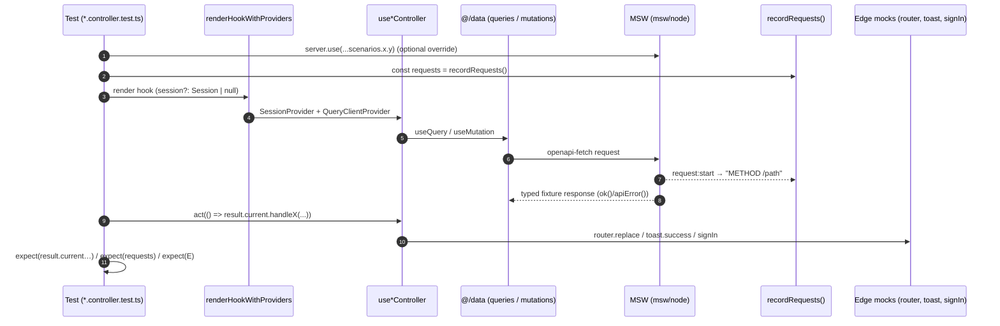

# ADR 0019: Controller Test Harness: `renderHookWithProviders`, Request Recording & Edge-Only Mocking

## Status
**Accepted** (2026-10-12). Implements [ADR 0018](0018-source-structure-server-data-lib-utils-controllers-tests.md) Q7 ("every page controller has a `*.controller.test.ts`"). Refines [ADR 0016](0016-storybook-msw-and-story-driven-component-testing.md), which made stories the component tests and left `*.test.ts(x)` for controllers without defining how.

---

## Context & Problem Statement

ADR 0018 required one test per controller (11 controllers), but there was no shared way to write them:

1. **Only two ad-hoc tests existed.** `settings-tab.test.tsx` rendered the whole tab to check copy, which the stories already cover. `public-profile-page.test.tsx` built its own `QueryClientProvider` wrapper inline.
2. **Controllers need two providers.** They need React Query for data and NextAuth's `SessionProvider` for `useSession`. With no session prop, `SessionProvider` fetches `/api/auth/session`, and a signed-in session starts the inbox SSE stream (`EventSource`, which happy-dom doesn't implement).
3. **Asserting side effects was unclear.** Mutations show their own toasts. Several handlers (bulk, delete, accept, unblock) return only `{ success, message }`. Nothing showed whether a controller called the API or skipped it (blank AMA prompt, blank reply, short username).
4. **Some edges are invisible to MSW:**
   - `useRouter` from `next/navigation`, which needs the App Router context.
   - `signIn` from `next-auth/react`, whose Google flow assigns `window.location`.
   - `sonner` toasts.
   - DOM downloads.

---

## Decisions

| # | Topic | Decision |
| :-- | :--- | :--- |
| D1 | Harness | `renderHookWithProviders(hook, { session?, queryClient? })` in `src/test/test-utils.tsx` wraps the hook in `SessionProvider` (the session is passed in directly, `refetchOnWindowFocus={false}`) and a fresh `createTestQueryClient()` (no retries, infinite `staleTime`). |
| D2 | Default session | **`null` (signed out).** No `/api/auth/session` fetch and no SSE. Tests that need a user pass `sessionScenarios.authenticated` explicitly (e.g. the profile URL). |
| D3 | Network | **MSW only**, using the same `defaultHandlers` and `scenarios` as Storybook. Override per test with `server.use(...scenarios.<area>.<name>)`; `afterEach` resets. Unhandled requests fail the test (ADR 0016, Q11). |
| D4 | Asserting calls | `recordRequests()` returns a live `string[]` of `"METHOD /path"` for every request MSW sees during the current test. It listens on `server.events` `request:start` and removes its listener in `onTestFinished`. Use it for "called" and "not called" assertions instead of stubbing mutation hooks. |
| D5 | What may be mocked | **Edges only:**<br>• `vi.mock("next/navigation")` → `{ useRouter: () => ({ replace }) }`, with `replace` from `vi.hoisted`.<br>• `vi.mock("sonner")` for toasts.<br>• `vi.mock("next-auth/react")` for `signIn` (the sign-in and Google controllers).<br>• Browser side-effect modules such as `@/lib/browser/download`.<br>**Never mock `@/data/**`**: the real queries and mutations run against MSW. |
| D6 | Scope | One `use-<concern>.controller.test.ts` per controller, colocated. Cover:<br>• the happy path and each server-error scenario;<br>• each guard clause (blank input → no request);<br>• the controlled-prop overrides (`onToggle`, `onDelete`, `onRefresh`);<br>• the state machine the page renders (filters, selection, modal open/close). |
| D7 | Composed controllers | A controller that composes another (`useSignUpController` → `useUsernameAvailabilityController`) gets one integration assertion. The inner controller has its own test, driven through a small `useHarness` hook that owns the `useForm`. |
| D8 | Render-only tests | Page or tab render tests that only check copy are **removed**; stories cover rendering. `settings-tab.test.tsx` and `public-profile-page.test.tsx` are deleted, and their behaviour assertions live in the controller tests. |
| D9 | Pure logic | Branching that can be tested without React (filters, parsers, status mapping) is extracted to `<module>.utils.ts` and tested there (ADR 0018, Q4). Controller tests then focus on wiring. |

---

## Test anatomy



```ts
// Shape every controller test follows
const { replace } = vi.hoisted(() => ({ replace: vi.fn() }));
vi.mock("next/navigation", () => ({ useRouter: () => ({ replace }) }));
vi.mock("sonner", () => ({ toast: { success: vi.fn(), error: vi.fn() } }));

it("toasts the server error for an incorrect code", async () => {
  server.use(...scenarios.verify.invalid);
  const { result } = renderHookWithProviders(() => useVerifyController("newghost"));

  await act(() => result.current.handleSubmit({ code: "123456" }));

  expect(toast.error).toHaveBeenCalledWith("Incorrect verification code");
  expect(replace).not.toHaveBeenCalled();
});
```

---

## Consequences

### Positive
- **All 11 controllers are tested** with one recipe, against the same MSW contract the stories use. An OpenAPI change breaks typed handlers, then the tests.
- **Fast and deterministic:** happy-dom, no session fetch, no SSE, no real network.
- **"Not called" is testable**, so guard clauses can't silently start sending requests.

### Negative & Mitigations
- **Edge mocks can drift from the libraries.** They are limited to four modules, and the `Pages/*` stories still exercise the real `SessionProvider`, router stub and toasts in Chromium.
- **Real-timer debounce in the username tests** (400 ms) costs about 1 s. That's acceptable; fake timers interfere with React Query and MSW timing.
- **`signIn` is mocked**, so NextAuth's credentials round-trip is covered only by the sign-in page stories (MSW `callback/credentials` handlers).
