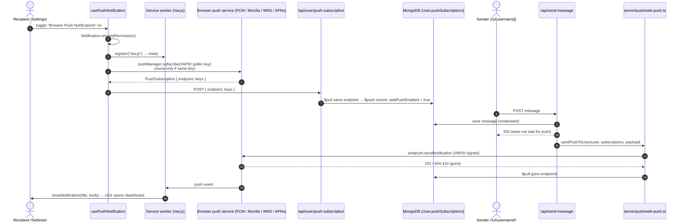

# ADR 0020: Web Push Delivery: VAPID Keys, Server Push Capability & Subscription Lifecycle

## Status
**Accepted** (2026-10-12).

> **Update (2026-10-14):** D3 changed. The client no longer sets `webPushEnabled: false` after unsubscribing. Push is **per device**: the Settings switch shows this browser's subscription, turning it off removes only this device, and the server clears `webPushEnabled` when the last subscription is removed or pruned (`disablePushWhenNoDevices`, [ADR 0030](0030-server-side-inbox-filtering-paging-and-counts.md) D9).

Completes the Web Push adapter from [ADR 0014](0014-architectural-deepening-pure-patterns-hoisted-overlays-and-push-adapter.md). Follows the placement rules of [ADR 0018](0018-source-structure-server-data-lib-utils-controllers-tests.md): a new `src/server/push/` capability.

---

## Context & Problem Statement

Users reported that "Browser push notifications" in Settings failed immediately, even with notifications allowed. Tracing the flow showed the feature was only half built:

1. **No VAPID keypair.** `NEXT_PUBLIC_VAPID_PUBLIC_KEY` wasn't set anywhere. The client fell back to a hardcoded public demo key whose private half the server never had, so even a successful subscription could never receive a push.
2. **Subscriptions were silently dropped.** `POST /api/user/push-subscription` ran `$addToSet: { pushSubscriptions }`, but the `User` schema had no `pushSubscriptions` field, so Mongoose strict mode discarded it. The body wasn't validated either.
3. **Nothing sent pushes.** No `web-push` dependency and no sender existed; new messages went out only over SSE and email.
4. **Fragile subscribe flow.** A browser subscription created with a different `applicationServerKey` makes `pushManager.subscribe` throw `InvalidStateError`. Failures surfaced as raw DOMException text ("Registration failed - push service error"). Turning push off never removed the server-side record.

---

## Decisions

| # | Topic | Decision |
| :-- | :--- | :--- |
| D1 | Keys | VAPID keys come **only from env**: `NEXT_PUBLIC_VAPID_PUBLIC_KEY` (client + server), `VAPID_PRIVATE_KEY` (server) and optional `VAPID_SUBJECT` (default `mailto:support@ghostmsg.app`). Generate them with `npx web-push generate-vapid-keys`. **No hardcoded fallback key.** Without keys, the client shows "Push notifications aren't configured on this server" and the server skips sending. |
| D2 | Storage | `User.pushSubscriptions: [{ endpoint, keys: { p256dh, auth }, createdAt }]`, one entry per device. `POST` validates with `pushSubscriptionRequestSchema` (keys required), **pulls any entry with the same endpoint, then pushes** the new one, so a resubscribed device never duplicates. |
| D3 | Unsubscribe | New typed `DELETE /api/user/push-subscription` (`pushUnsubscribeRequestSchema { endpoint }`, registered in OpenAPI). The client removes the server record (best effort), calls `subscription.unsubscribe()`, then sets `webPushEnabled: false`. |
| D4 | Sender | `src/server/push/web-push.ts` (`server-only`): `getVapidConfig()`, `isGoneError()` and `sendPushToUser(userId, subscriptions, payload)`. It sends to every device in parallel (`Promise.allSettled`, TTL 24 h), **prunes subscriptions the push service answers with 404/410**, logs other failures, and never throws. |
| D5 | Trigger | `POST /api/send-message` sends a push after the message is saved, only when `notificationSettings.webPushEnabled`, the recipient has subscriptions, and the message isn't quarantined. It's fire-and-forget like the email alert: the HTTP response never waits on push. Payload: `{ title, body (first 80 chars), url: "/dashboard" }`, which `public/sw.js` renders. |
| D6 | Client flow | `src/data/user/use-push-notification.ts`: request permission → register `/sw.js` → wait for `serviceWorker.ready` → reuse the existing subscription **only if its `applicationServerKey` matches** (otherwise unsubscribe and resubscribe) → `POST` the subscription → invalidate the notifications query. Exposes `isConfigured` alongside `isSupported`. |
| D7 | Errors | `describePushError()` maps DOMExceptions to actionable messages: • `NotAllowedError` → notifications are blocked in site settings. • `AbortError` → the push service refused (e.g. Brave's "Use Google services for push messaging", private windows). • `InvalidStateError` → a stale subscription. • `InvalidAccessError` → a bad key. • `NotSupportedError` / `SecurityError` → needs HTTPS. API failures are toasted once, by the mutation. |
| D8 | Tests | `web-push.test.ts`: config, gone detection, fan-out, pruning, unconfigured skip. `use-push-notification.utils.test.ts`: key comparison, error messages. `use-settings.controller.test.ts`: not configured → no request; configured → `POST /api/user/push-subscription`; off → `PATCH /api/user/notifications`. MSW has the `DELETE` handler. |

---

## Delivery pipeline

---

## Consequences

### Positive
- **Push works end to end**, configured through env like every other secret, and each device is tracked separately.
- **Self-healing:** expired or revoked subscriptions are removed on the first failed send.
- **Clear failures:** users see why subscribing failed, and a missing configuration is obvious.

### Negative & Mitigations
- **A new runtime dependency (`web-push`).** It's the reference implementation of VAPID and RFC 8291 encryption, and is only imported by `src/server/push/` (lint keeps it out of client bundles).
- **Production needs the keys.** Add `NEXT_PUBLIC_VAPID_PUBLIC_KEY` and `VAPID_PRIVATE_KEY` to Vercel ([Chapter 9](../09-deployment-and-operations.md)). Rotating keys invalidates existing subscriptions; clients resubscribe automatically (D6) the next time push is toggled on.
- **Browsers without a push service** (Brave with Google push services off, some private modes) still can't subscribe. They now get a specific message instead of a generic failure.
