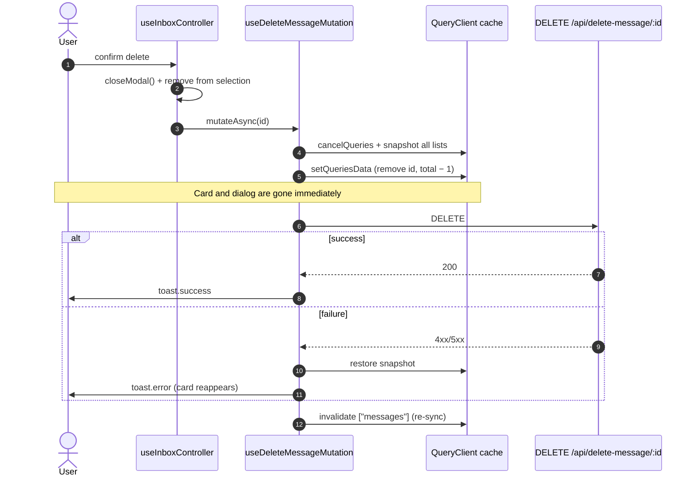

# ADR 0021: Optimistic Inbox Mutations: Close-First Dialogs & Shared Cache Helpers

## Status
**Accepted** (2026-10-12). Refines the optimistic-update rule of [ADR 0006](0006-standardized-api-calling-and-react-query-architecture.md) for the inbox, and the hoisted-modal pattern of [ADR 0014](0014-architectural-deepening-pure-patterns-hoisted-overlays-and-push-adapter.md).

---

## Context & Problem Statement

Users reported that deleting a message "is not optimistic":

1. **The dialog waited for the server.** `useDeleteMessageMutation` already removed the message from the cache in `onMutate`. But `handleDeleteConfirm` awaited `mutateAsync` **before** `closeModal()`, so the confirm dialog stayed open with a spinner for the whole round trip. The card vanished behind a dialog the user was still staring at.
2. **Only one cache key was patched.** The optimistic update targeted `queryKeys.messages.list()` (no filters) exactly. Any list cached under another filter key was left stale until refetch.
3. **Bulk actions weren't optimistic.** Bulk delete, read and star waited for the server and then invalidated, so the toolbar cleared but the cards lingered.

---

## Decisions

| # | Topic | Decision |
| :-- | :--- | :--- |
| D1 | Close first | Inbox confirm handlers **close the dialog and update local state before awaiting** the mutation: `closeModal()`, drop the id from `selectedIds`, then `await mutateAsync(...)`. Bulk actions clear the selection before the request. Failures are reported by the mutation (rollback + toast). |
| D2 | Shared cache helpers | `src/data/messages/messages-cache.ts`: • `updateCachedMessages(queryClient, update)` cancels in-flight list queries, snapshots **every** cached inbox list (`["messages", "list", *]`) via `getQueriesData`, and applies `update` to each through `setQueriesData`, adjusting `total` by the number removed. • `restoreCachedMessages(queryClient, snapshot)` rolls back. • `invalidateCachedMessages(queryClient)` re-syncs in `onSettled`. |
| D3 | Delete | `useDeleteMessageMutation`: `onMutate` → `updateCachedMessages(filter out id)`. `onError` → restore + toast. `onSettled` → invalidate. |
| D4 | Bulk | `useBulkActionMutation`: `onMutate` applies the server's semantics to the cache (`delete` removes, `read` sets `isRead: true`, `star` sets `isPinned: true`), then restores on error and invalidates on settle. |
| D5 | Tests | `use-inbox.controller.test.ts` holds the request open with MSW `delay("infinite")` to prove the card leaves **before** the response and the dialog is already closed. It uses `apiError(500)` to prove rollback plus the error toast, for both single and bulk delete. |

---

## Consequences

### Positive
- **Instant feedback** for delete and every bulk action, with a safe rollback.
- **One implementation** of snapshot, patch and restore, shared by every inbox mutation and covering all filter keys.

### Negative & Mitigations
- **A failed delete makes the card reappear** after the dialog has closed. The error toast explains why, and this is the standard optimistic-UI tradeoff.
- **The star toggle and mark-as-read on a single card** still wait for the server before the UI updates. They should adopt `updateCachedMessages` in a follow-up.
