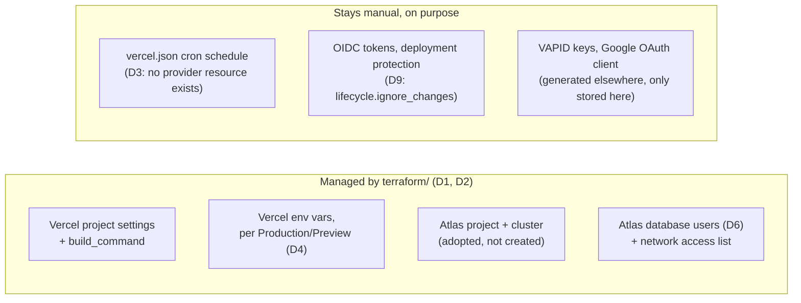

# ADR 0032: Terraform-Managed Vercel Project and MongoDB Atlas Infrastructure

## Status

**Accepted** (2026-10-16).

---

## Context

Every piece of GhostMsg's cloud infrastructure (the Vercel project's settings and environment variables, and the MongoDB Atlas project, cluster, database users and network access) was managed by hand through each provider's dashboard. There was no diff before a change, no history of who changed what, and syncing the same set of environment variables across Production and Preview meant repeating the work twice with no record that they'd been kept in sync.

## Decisions

| # | Decision |
| :-- | :--- |
| D1 | **Terraform, with state in HCP Terraform (Terraform Cloud)**, now manages the Vercel project and its environment variables, plus the Atlas project/cluster/database users/network access list. Config lives in [`terraform/`](../../terraform/), a CLI-driven workspace (`ghostmsg`, org `PersonalAbbasSpace`) rather than VCS-driven, since the directory lives inside this app repo and a VCS-driven workspace would plan on every unrelated commit. |
| D2 | **The existing Vercel project and Atlas cluster are adopted via `terraform import`, never recreated.** `terraform/README.md` §6 has the exact import commands and IDs. |
| D3 | **Vercel Cron stays in [`vercel.json`](../../vercel.json), out of Terraform's scope.** Confirmed by inspecting the Vercel provider's resource schema directly (`terraform providers schema -json`): there is no cron resource. Crons are part of the deployment itself, not separate infrastructure, so Terraform has no handle on them. |
| D4 | **Environment variables can differ per Vercel environment.** The `app_env_vars` input (`terraform/variables.tf`) is a map where each entry sets independent `production` / `preview` / `development` values (or omits any of them); `terraform/locals.tf` flattens that into one `vercel_project_environment_variable` resource per (name, environment) pair that actually has a value, so Production and Preview never have to share a value by accident. |
| D5 | **`MONGODB_URI` is excluded from `app_env_vars` and built directly from the Atlas resources instead** (`terraform/vercel.tf`), one computed value per environment, so nobody ever copies a connection string out of the Atlas UI by hand. |
| D6 | **One free M0 Atlas cluster hosts two database users**, `<prefix>-production` and `<prefix>-preview`, each scoped `readWrite` to only its own database (`honest_feedback`, the real existing production database, and `honest_feedback_preview`, new and empty). Preview deployments can't read or write production data and vice versa, without paying for a second cluster. |
| D7 | **Every secret value stays out of the repo.** Real values live in a gitignored `terraform/terraform.tfvars` for local runs, or as sensitive HCP Terraform workspace variables; `terraform/terraform.tfvars.example` ships with placeholders only. |
| D8 | **Pre-existing Vercel env vars get imported, never deleted-and-recreated by hand.** The project already had several variables set before Terraform existed (`NEXT_AUTH_SECRET`, `GOOGLE_AI_STUDIO_SECRET`, `GOOGLE_OAUTH_CLIENT_ID`/`_SECRET`, `MONGODB_URI`), each as one object spanning multiple environments. `terraform import` adopts the real object into one resource address (usually the `production` one); `apply` then shrinks its `target` to just that environment, freeing the others to be created cleanly. `terraform/README.md` §7 documents the pattern and the `must be replaced` quirk when an imported object's `sensitive` flag doesn't match this config's default (`true`). |
| D9 | **`oidc_token_config`, `vercel_authentication`, and `protection_bypass_for_automation_secret` are explicitly excluded** (`lifecycle.ignore_changes` on `vercel_project`, `terraform/vercel.tf`). These are security/deployment-protection settings this config never sets a value for; without the exclusion, Terraform fills them with the provider's schema defaults on the first `plan` and silently proposes disabling OIDC tokens and loosening deployment protection. Out of scope on purpose: manage them in the Vercel dashboard. |

## Considered options

- **Keep managing both dashboards by hand.** Rejected: the original motivation was no review, no diff, no record that Production and Preview env vars actually match what was intended.
- **A separate Atlas cluster per environment.** Rejected for now: the free tier allows one M0 cluster per Atlas project; a second cluster means a second Atlas project or a paid tier. Revisit if Preview load ever needs real isolation beyond a separate database.
- **VCS-driven HCP Terraform workspace** (auto-plan on every push to this repo). Rejected: `terraform/` isn't the only thing that changes in this repo, so every unrelated app commit would trigger an infrastructure plan. CLI-driven keeps applies deliberate.

## Consequences

- New directory [`terraform/`](../../terraform/) with its own [README](../../terraform/README.md) (setup, import commands, day-to-day commands): read that first for anything infra-related, per [`docs/agents/README.md`](../agents/README.md).
- `MONGODB_URI` in the Vercel dashboard is now Terraform-owned for Production and Preview: editing it by hand in the dashboard will be overwritten on the next `terraform apply`.
- First-time setup still has one manual gap: there's no clean `terraform import` for an Atlas database user whose password isn't already known (Atlas never returns it), documented as a trade-off in `terraform/README.md` §6.
- `pnpm dev` works exactly as before ([Chapter 2](../02-getting-started.md)); Terraform only reaches Vercel's Production/Preview environments and Atlas directly. `.env.local` is a different story if `vercel env pull` is ever run against it: see the next two bullets.
- **`vercel env pull` can't retrieve any `app_env_vars` entry left at the default `sensitive = true`**: Vercel's sensitive variables are write-only once created; the dashboard, the API, and `vercel env pull` all get an empty value back, never the Production/Preview deployments that actually run with them. `terraform/README.md` §7 covers restoring a local `.env.local` from `terraform.tfvars` after a pull.
- **Setting `app_env_vars.NEXTAUTH_URL`'s `preview` field to the same URL as `production` briefly broke Google sign-in everywhere it mattered**: a `vercel env pull` on this repo overwrote a working local `NEXTAUTH_URL=http://localhost:3000` with the production domain, redirecting local sign-ins to `https://ghost-msg.vercel.app/...&error=OAuthCallback`; the same static value would do the same thing on every real Preview deployment, whose actual URL is never the production domain. Fixed by removing the `preview` field entirely (D4 already allows omitting any environment; there was never a correct static value to put there). `terraform/README.md` §7 and [Chapter 2](../02-getting-started.md#2-environment-variables-configuration) both cover it now.
- [Chapter 9](../09-deployment-and-operations.md) §1–2 now point to `terraform/` as the source of truth for environment variables and the Atlas cluster, instead of describing them as dashboard-only settings.
- **First real adoption surfaced two things this config's original defaults got wrong**, both now fixed and documented in `terraform/variables.tf`: the real production cluster is named "Abbas-Shaikh" in a project called "Project 0" (not the placeholder names "GhostMsg"/"ghostmsg" the config shipped with), and it runs in `AP_SOUTH_1` on MongoDB `8.0`, not the `US_EAST_1`/`7.0` defaults. There's also an unrelated, empty Atlas project genuinely named "GhostMsg" (id `6ad215632c5f48216a492c03`) in the same org: a coincidence with this config's old defaults, not the target. Lesson: before importing anything, confirm real names/regions/versions against the provider's API (or UI) rather than trusting a config's placeholder defaults, since a region or major-version mismatch on an M0 cluster can force a destroy/recreate.
- Rolling this out against the already-deployed, already-configured project meant `terraform apply` initially failed with `ENV_CONFLICT` for every env var the project already had set by hand. Resolved by importing those specific objects (D8) rather than deleting and recreating them: deleting a live secret-store entry is exactly the kind of blind, unattended write this ADR's CLI-driven (not auto-apply) workflow is meant to avoid.
