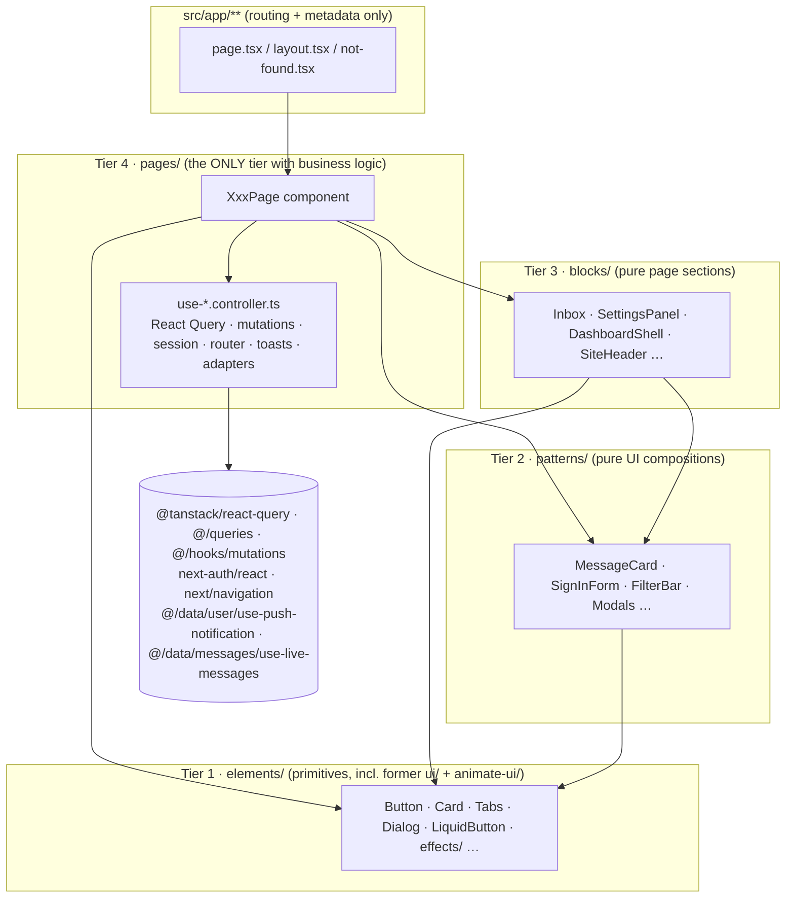
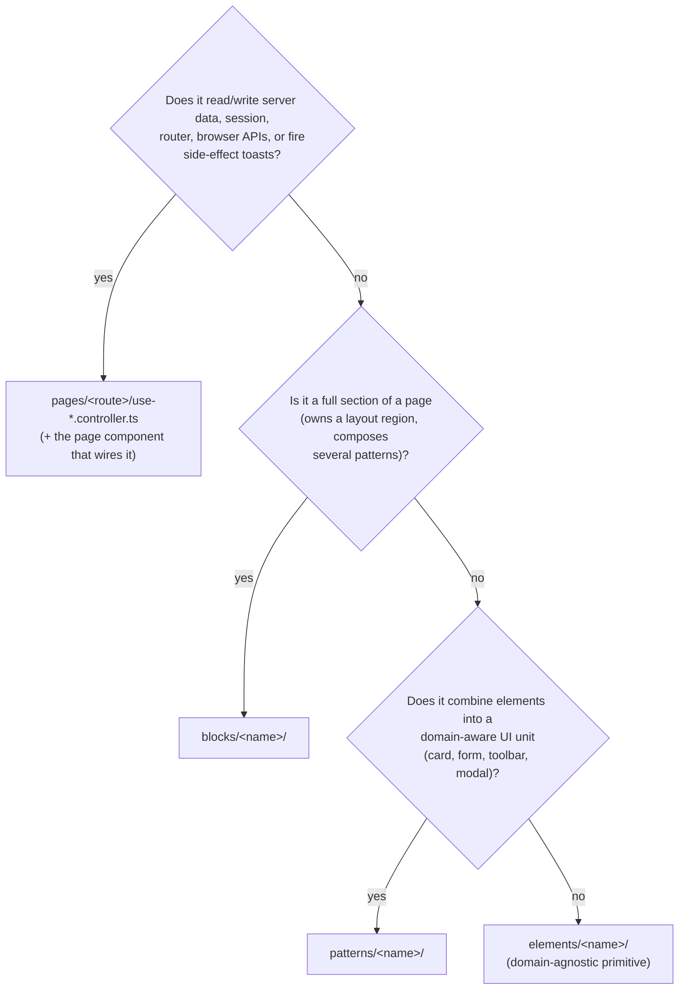
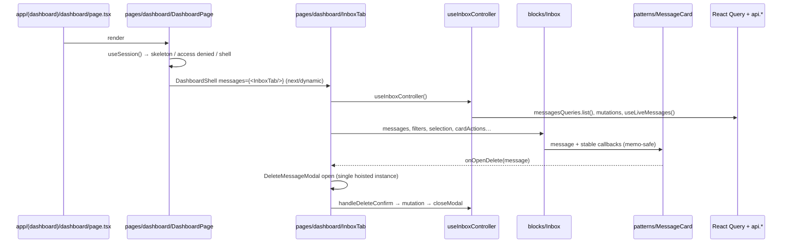

# Component Architecture for Agents

The mandatory rulebook for any change under `src/components/` or `src/app/**/page.tsx|layout.tsx|not-found.tsx`. Follow it without being asked. The rationale lives in [ADR 0013](../adr/0013-elements-patterns-blocks-composable-architecture.md), [ADR 0014](../adr/0014-architectural-deepening-pure-patterns-hoisted-overlays-and-push-adapter.md) and [ADR 0015](../adr/0015-four-tier-components-pages-layer-and-vendor-consolidation.md). This file is the operational version: where code goes, what it may import, and how to prove it's done.

---

## 1. The model in one picture



Arrows mean "may import". There are no upward arrows and nothing below `pages/` touches `DATA`. Biome enforces both (section 6).

**Leading word: _pure_.** A pure component renders only from its props, and reports intent only through callbacks. Elements, patterns and blocks are pure. Local, purely visual state is still allowed: password visibility, a carousel index, the story-card theme. Pages are _impure_ by design, because that's where side effects live.

---

## 2. Where does this code go? (decision procedure)

Answer the questions in order. The first "yes" decides the tier.



Quick reference:

| You are adding… | Tier | Example in repo |
| :--- | :--- | :--- |
| A `useQuery`, `useMutation`, `signIn`, `router.replace`, `toast.success` after a mutation | **pages** controller | `pages/dashboard/use-inbox.controller.ts` |
| A route-level component that wires controllers into blocks | **pages** | `pages/dashboard/dashboard-page.tsx` |
| A dashboard tab that owns data | **pages** (`*-tab.tsx`) | `pages/dashboard/settings-tab.tsx` |
| A page section with title/controls/list | **blocks** | `blocks/inbox/inbox.tsx` |
| A form, card, modal, toolbar, badge with domain meaning | **patterns** | `patterns/auth-form/sign-in-form.tsx` |
| A button, input, dialog, tabs, motion effect | **elements** | `elements/liquid-button/` |
| A pure helper (formatting, export) | `src/lib/` | `src/lib/messages/export.ts` |

---

## 3. Tier contracts

### 3.1 Elements: `src/components/elements/<name>/`

- **Domain-agnostic.** No messages, users or sentiments.
- **Imports:** other elements, Radix, Motion, `class-variance-authority`, `@/lib/utils`, and generic hooks in `@/hooks/use-{controlled-state,auto-height,is-in-view}`.
- **Visual parity rule.** The `default` variant and size must render class-for-class like the original shadcn/animate-ui component. New looks are opt-in variants (`glass`, `ghost`, `bordered`, `filled`, …). Changing a default restyles the whole app, so treat it as a breaking change. **The only approved exception is WCAG AA contrast** (ADR 0016, Q17/Q18). If the a11y story test reports `color-contrast`, darken the text one shade within the same hue rather than disabling the rule.
- **Vendor code** (formerly `components/ui` and `components/animate-ui`) lives here. Styled component: `<name>.tsx`. Motion primitive: `<name>.primitive.tsx` in the same folder. Shared effects (`slot`, `auto-height`, `highlight`, `particles`, `gravity-stars`) go in `elements/effects/`.
- **There is exactly one Button** (`elements/button`), with variants `default | primary | accent | secondary | destructive | outline | ghost | glass | link`.

```tsx
// elements/<name>/<name>.tsx
const fooVariants = cva("base classes identical to the original", {
  variants: {
    variant: { default: "original look", glass: "opt-in look" },
    size: { default: "", sm: "…", lg: "…" },
  },
  defaultVariants: { variant: "default", size: "default" },
});

export function Foo({ className, variant, size, ...props }: FooProps) {
  return <div className={cn(fooVariants({ variant, size }), className)} data-slot="foo" {...props} />;
}
```

### 3.2 Patterns: `src/components/patterns/<name>/`

- **Pure, domain-aware compositions of elements.**
- **Data in, intent out.** `message`, `value`, `suggestions`… come in. `onOpenReply`, `onSubmit`, `onSelect`… go out.
- **Forms receive the RHF instance** (`form: UseFormReturn<Values>`) from a page controller. The pattern renders fields and calls `form.handleSubmit(onSubmit)`. It never calls `useForm` with a resolver, and never submits to an API.
- **Dialogs are patterns, but they are never mounted inside list items.** The page mounts a single hoisted instance (section 5.2).
- **Value types** come from schemas via type-only imports (`import type { signInSchema } from "@/schemas/sign-in-schema"`), or as a small local interface (`PublicQaItem`).

```tsx
// patterns/share-link-card/share-link-card.tsx
export interface ShareLinkCardProps {
  onCopy?: () => void;
  profileUrl: string;
}

export function ShareLinkCard({ profileUrl, onCopy }: ShareLinkCardProps) {
  return (
    <Card data-slot="share-link-card">
      …
      <CopyButton content={profileUrl} onClick={onCopy} />
    </Card>
  );
}
```

### 3.3 Blocks: `src/components/blocks/<name>/`

- **Pure page sections** composing patterns and elements, with slots (`children`, `messages`, `profile`, …) for page-provided content.
- **Group large prop surfaces** into objects instead of 20 flat props:

```tsx
// blocks/inbox/inbox.tsx
export interface InboxProps {
  messages: Message[];          // already filtered by the page
  totalMessages: number;
  filters: InboxFilters;        // { activeStatus, counts, searchQuery, onStatusChange, onSearchChange }
  selection: InboxSelection;    // { selectedIds, onToggle, onClear }
  bulkActions: InboxBulkActions;// { isPending, onAction, onExport }
  cardActions: InboxCardActions;// { onOpenBlock, onOpenDelete, onOpenReply, onOpenStoryCard, onStarToggle }
  viewMode: InboxViewMode;
  onViewModeChange: (mode: InboxViewMode) => void;
  isRefreshing?: boolean;
  onRefresh: () => void;
  isSenderBlocked?: (senderHash?: string) => boolean;
}
```

- **Loading, empty and denied states** are block exports too (`DashboardSkeleton`, `DashboardAccessDenied`, the inbox empty state). The page picks which one to render.

### 3.4 Pages: `src/components/pages/<route>/`

- **Mirror the app route groups exactly:**

```
pages/
├── layouts/site-layout/        ← app/(app)/layout.tsx, also used by home
├── home/                       ← app/page.tsx
├── auth/
│   ├── shared/                 (logic used by sibling pages)
│   │   ├── use-google-sign-in.controller.ts (+ .test.ts)
│   │   └── auth-pages.mock.ts
│   ├── sign-in/                ← app/(app)/(auth)/sign-in/page.tsx
│   │   └── use-sign-in.controller.ts (+ .test.ts)
│   ├── sign-up/                ← app/(app)/(auth)/sign-up/page.tsx
│   │   ├── use-sign-up.controller.ts (+ .test.ts)
│   │   ├── use-username-availability.controller.ts (+ .test.ts)
│   │   └── username-availability.utils.ts (+ .test.ts)
│   └── verify/                 ← app/(app)/(auth)/verify/[username]/page.tsx
│       └── use-verify.controller.ts (+ .test.ts)
├── dashboard/                  ← app/(app)/(dashboard)/dashboard/page.tsx
│   ├── dashboard-page.tsx      (session gate + DashboardShell + lazy tabs)
│   ├── inbox-tab.tsx  profile-tab.tsx  settings-tab.tsx
│   ├── use-{inbox,smart-reply,profile,settings}.controller.ts (+ .test.ts each)
│   └── {inbox,profile}.utils.ts (+ .test.ts each)
├── public-profile/             ← app/u/[username]/page.tsx
└── not-found/                  ← app/not-found.tsx
```

- **One controller hook per file**, named `use<Concern>Controller` in `use-<concern>.controller.ts`, with a colocated `use-<concern>.controller.test.ts` ([ADR 0018](file:///d:/Projects/GhostMsg/docs/adr/0018-source-structure-server-data-lib-utils-controllers-tests.md), Q5/Q7). It returns plain values plus `handle*` callbacks wrapped in `useCallback`, and `is*Pending` flags.
- **Logic shared by sibling pages** lives in `pages/<group>/shared/` (e.g. `pages/auth/shared/use-google-sign-in.controller.ts`). It never moves down into a block.
- **Pure logic inside a controller** (filters, parsers, status mapping) moves to a colocated `<module>.utils.ts` with a `.utils.test.ts`. Once two or more modules use it, it's promoted to `src/lib/<domain>/`.
- **Toasts after a side effect belong in controllers.** Purely UI feedback inside a pattern (the story card's "downloaded" toast) is fine.

```tsx
// pages/dashboard/settings-tab.tsx: the page-level wiring shape
export function SettingsTab(props: SettingsTabProps = {}) {
  const settings = useSettingsController(props);
  return (
    <SettingsPanel
      isAccepting={settings.isAccepting}
      onToggleAcceptance={settings.handleToggleAcceptance}
      …
    />
  );
}
```

### 3.5 App routes: `src/app/**`

Keep only routing concerns: `metadata` / `generateMetadata`, awaiting `params`, rendering exactly one page component.

```tsx
// app/(app)/(auth)/verify/[username]/page.tsx
export const metadata: Metadata = { title: "Verify Account", … };

const VerifyUserPage = async ({ params }: { params: Promise<{ username: string }> }) => {
  const { username } = await params;
  return <VerifyPage username={username} />;
};
export default VerifyUserPage;
```

---

## 4. Import rules (the DAG)

| From ↓ may import → | elements | patterns | blocks | pages | data/logic modules¹ |
| :--- | :---: | :---: | :---: | :---: | :---: |
| **elements** | ✅ | ❌ | ❌ | ❌ | ❌ |
| **patterns** | ✅ | ✅ | ❌ | ❌ | ❌ |
| **blocks** | ✅ | ✅ | ✅ (sub-blocks) | ❌ | ❌ |
| **pages** | ✅ | ✅ | ✅ | ✅ | ✅ |
| **app/** | — | — | — | ✅ | metadata only |

¹ `@tanstack/react-query`, `@/queries/**`, `@/hooks/mutations/**`, `@/data/messages/use-live-messages`, `next-auth/react`, `next/navigation`, `@/data/user/use-push-notification`.

Also:
- **Use the module's folder** (`@/components/patterns/message-card`), which resolves to its `index.ts`. Inside a folder, sibling files use relative imports (`./button.primitive`).
- **Stories and tests import mocks directly** (`./x.mock`), because `index.ts` exports only the public API, never mocks.
- **There are no tier-level barrels.** `elements/index.ts`, `patterns/index.ts` and `blocks/index.ts` intentionally don't exist.

---

## 5. Canonical flows (copy these shapes)

### 5.1 Data flow through the tiers (Inbox)



### 5.2 Hoisted overlays

- **Mount each modal once**, as a sibling of the list in the page component, never inside `map()`.
- The controller holds `activeModal: "block" | "delete" | "reply" | "story" | null` and `activeMessage`.
- `closeModal` resets only `activeModal`. `activeMessage` is kept so the dialog animates out with its content.
- **Openers are stable `useCallback`s** (`openDeleteModal`, …) so memoized cards don't re-render.

### 5.3 Forms owned by pages

```tsx
// controller (pages/…)
const form = useForm<SignInValues>({ resolver: zodResolver(signInSchema), defaultValues, mode: "onChange" });
const handleSubmit = useCallback(async (values: SignInValues) => { /* signIn / mutate / toast / router */ }, [...]);
return { form, handleSubmit, isSubmitting: form.formState.isSubmitting, onGoogleSignIn };

// page
<SignInForm form={c.form} isSubmitting={c.isSubmitting} onSubmit={c.handleSubmit} onGoogleSignIn={c.onGoogleSignIn} />
```

Cross-field side effects stay in the controller and write back into form state:
- **Suggestion → textarea:** `form.setValue("content", text, { shouldValidate: true })`.
- **Username availability:** debounce, then query, then `form.setError` / `clearErrors`. The status goes to the pattern as `usernameAvailability: "idle" | "checking" | "available" | "taken"`.

### 5.4 Browser APIs

Browser APIs that talk to the API go behind a hook in `src/data/<domain>/` (e.g. `src/data/user/use-push-notification.ts`), consumed only by a page controller. Pure browser side effects without React live in `src/lib/browser/` (e.g. `downloadTextFile`) and stay separate from the pure builders that feed them ([ADR 0018](file:///d:/Projects/GhostMsg/docs/adr/0018-source-structure-server-data-lib-utils-controllers-tests.md), Q4).

---

## 6. Enforcement: what fails and why

`biome.jsonc` has `style/noRestrictedImports` overrides per tier and per source folder. Each diagnostic message names the rule and its ADR (0015 or 0018):

| Diagnostic message starts with | Cause | Fix |
| :--- | :--- | :--- |
| "Business logic (queries, mutations, … in @/data) belongs in @/components/pages" | `@/data/**`, `@tanstack/react-query`, `next-auth/react` or `next/navigation` imported below pages | Move the hook into a page controller. Pass data and callbacks down. |
| "Server-only code (@/server/**) is imported only by src/app/**" | A component, data, hook, provider, mock, type or Storybook file imports `@/server/**` or `server-only` | Call the API through `@/data`. For a type, use the OpenAPI DTO from `@/types/api`. |
| "src/lib is framework-free" | `src/lib/**` imports React, Next, NextAuth, TanStack, `@/data` or `@/components` | Move a hook to `@/hooks` (generic) or `@/data/<domain>` (API). Keep only the pure part in `src/lib`. |
| "Elements are Tier 1…" / "Patterns are Tier 2…" / "Blocks are Tier 3…" | Upward import | Invert it: pass the higher-tier piece in as a prop or slot, or move the component up a tier. |
| "animate-ui and shadcn ui live in @/components/elements now" | Import from a deleted vendor path | Import from `@/components/elements/<name>`. If a registry install just created the folder, see section 7.4. |

Other overrides: a11y relaxations apply only to `elements/effects/**`, `elements/**/*.primitive.tsx`, `elements/carousel/**` and `elements/input-otp/**`. Fix new a11y findings in our own code rather than widening these.

---

## 7. Recipes (follow the steps; each ends on its done-check)

### 7.1 New element
1. Create `elements/<name>/<name>.tsx`, with CVA variants whose `default` matches the source design exactly.
2. Add `index.ts` exporting the component, its props type and `<name>Variants`.
3. Add `<name>.mock.ts` (args built from `src/mock/fixtures`) and `<name>.stories.tsx` meeting the story standard ([chapter 10 §4](../10-storybook-and-ui-catalog.md)). Behaviour is asserted in `play()`, not in a `*.test.tsx`.

**Done when** nothing outside `elements/` reaches past `index.ts`, and the story renders every variant.

### 7.2 New pattern or block
1. Create the folder with `<name>.tsx`, `index.ts`, `<name>.mock.ts` and `<name>.stories.tsx`. Its interaction tests live in the stories' `play()` functions, with no separate `*.test.tsx`.
2. Props: data values plus `on*` callbacks plus optional `is*` flags. Group them into objects past about 8 props (blocks).
3. Stories render from args only. If a story needs a `QueryClientProvider`, a session or MSW, logic has leaked in, so go back to step 2.
4. In `*.mock.ts`, callbacks are `noop`. In stories, `args` override every callback with `fn()`.

**Done when** `pnpm test:stories` passes for the new stories (render + `play()` + axe) without `pageProviders` or MSW.

### 7.3 New route or page
1. Create `pages/<route>/<route>-page.tsx`, `index.ts` and any `use-*.controller.ts`.
2. Compose it from existing blocks. Create a new block only if no existing block fits (section 2).
3. Create a thin `app/**/page.tsx` (section 3.5).
4. Add `<route>-page.stories.tsx` (title `Pages/…`, `parameters.pageProviders: true`, one story per MSW scenario: default, empty, error, signed-out, slow). Add one `use-*.controller.test.ts` per controller via `renderHookWithProviders` (`src/test/test-utils.tsx`); the unit project's `msw/node` server answers their requests. Move pure helpers into `<route>.utils.ts` with a `.utils.test.ts`.

**Done when** `app/**/page.tsx` contains only metadata, params and one JSX element.

### 7.4 Adding a shadcn or Animate UI registry component
1. Run `npx shadcn add <name>`. `components.json` maps `ui` to `@/components/elements`. For Animate UI, run `npx shadcn add @animate-ui/<name>`; it writes to `src/components/animate-ui/...`.
2. Move the styled file to `elements/<name>/<name>.tsx` and the motion primitive to `elements/<name>/<name>.primitive.tsx`. Merge new effects into `elements/effects/`. If the item ships its own Button, keep `elements/button` and merge only the new variants.
3. Rewrite imports to `@/components/elements/...`. Generic hooks it brings (`@/hooks/use-*`) and `@/hooks/get-strict-context` stay where they are.
4. Delete the leftover `src/components/animate-ui/` (or `ui/`) folder. Add `index.ts`, `<name>.mock.ts` and `<name>.stories.tsx` (interactions in `play()`), then run `pnpm docs:registry`.

**Done when** `rg "components/(animate-ui|ui)/" src` returns nothing and lint passes.

### 7.5 Moving logic out of a component (refactor)
1. Identify every hook call that touches data/logic modules.
2. Move them into a controller under the page that renders the component. Return values and `handle*` callbacks.
3. Replace them in the component with props. If the component lives in a block or pattern, add the props to its interface.
4. Move or split tests: a pure component test with mocks, plus a page/controller test with providers.

**Done when** the component's file has no imports from the data/logic list in section 4.

---

## 8. File and naming conventions

| Thing | Convention |
| :--- | :--- |
| Folder | `kebab-case`, one component module per folder |
| Component | `PascalCase` named export, plus `export default` for the main component |
| Props | `export interface <Name>Props`, members sorted alphabetically (Biome assist) |
| Variants | `<name>Variants` via `cva`, exported |
| Controller | `use-<concern>.controller.ts` → `use<Concern>Controller` |
| Page component | `<route>-page.tsx` → `<Route>Page`. Tabs: `<tab>-tab.tsx` |
| Mocks | `<name>.mock.ts` → `default<Name>MockProps`, `mock<Thing>`. Never exported from `index.ts`. |
| DOM hook for tests/styling | `data-slot="<name>"` on the root element |
| Regex in tests | Top-level constants (`const SAVE_REGEX = /save/i;`), per Biome `useTopLevelRegex` |
| Directive | `"use client"` only where hooks, events or motion are used. Server-safe blocks (e.g. `hero`, `auth-panel`) omit it. |

---

## 9. Testing rules specific to components

Owner of each kind of test ([ADR 0016](../adr/0016-storybook-msw-and-story-driven-component-testing.md)):

| What | Where | Runner |
| :--- | :--- | :--- |
| Element / pattern / block behaviour + a11y | `*.stories.tsx` (`play()`) | Vitest `storybook` project (Chromium) |
| Page wiring under API scenarios | `Pages/*` stories with MSW handlers | Vitest `storybook` project |
| Controllers, `*.utils.ts`, `src/lib`, `src/server`, schemas | colocated `*.controller.test.ts` / `*.test.ts` | Vitest `unit` project (happy-dom + `msw/node`) |

Rules:
- **Mock data** comes from `src/mock/fixtures` builders and scenarios. A `*.mock.ts` only shapes args, and never imports another component's mock.
- **Network.** Only MSW answers requests. In stories, use `parameters.msw.handlers`. In unit tests, use `server.use(...)` from `src/test/msw-server.ts`. An unhandled request fails the test.
- **Pages** need `parameters.pageProviders: true`, which provides `SessionProvider` and a fresh `QueryClient` per story. Never share a client across stories.
- **Queries.** Query by role and label. If a label doesn't resolve, fix the markup: `FormControl` must wrap the `<input>`.
- **Story-test reliability** (animations off in test mode, local-state wrappers instead of `useArgs`, form harnesses, `PAGE_LOAD` waits, preloading lazy chunks, scenario ordering, `screen` for portals): follow [chapter 10 §7](../10-storybook-and-ui-catalog.md). The happy-dom WAAPI shim in `src/test/setup.ts` is for the unit project only; don't import `motion/react` there.

## 10. Completion gate for any component change

Run all five. Every one must be green:

```bash
pnpm check                 # Biome, including the tier import rules
pnpm exec tsc --noEmit
pnpm test:all              # unit + story tests, exit code 0, no "Unhandled Errors" section
pnpm build                 # production build
pnpm docs:registry:check   # Chapter 11 registry is current (run `pnpm docs:registry` to fix)
```

Then confirm by reading the diff:
- [ ] No data/logic import outside `pages/**`.
- [ ] No default variant of an element changed. If one had to change, say so explicitly in the summary.
- [ ] Every new module folder has `index.ts`, `*.mock.ts` (fixture-built args) and stories meeting the five-point standard.
- [ ] `pnpm docs:registry` re-run after adding or renaming modules, stories, mock exports or scenarios.
- [ ] Docs updated if a rule or the structure changed: chapter 5/10, this guide, and an ADR for any new decision.
