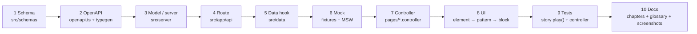

# Feature Recipes for Agents

Step-by-step recipes for the changes this codebase sees most often. Each recipe touches every layer in order and ends on a **done-check**. They compose the rules in [component-architecture.md](component-architecture.md), [source-structure.md](source-structure.md) and [api-patterns.md](api-patterns.md); follow those for details.



---

## Recipe A: Add a Recipient setting (end-to-end)

Example: a "Show my Sentiment Tags publicly" switch in Settings → Messages.

1. **Model:** add `messagePreferences.showSentimentPublicly: { type: Boolean, default: false }` in `src/server/models/user.model.ts` and the interface.
2. **Schema:** add the field to `messagePreferencesSchema` in `src/schemas/user-settings-schema.ts` (the PATCH body is `.partial()` automatically). Extend `user-settings-schema.test.ts`.
3. **DTO default:** add `showSentimentPublicly: user.messagePreferences?.showSentimentPublicly ?? false` in `toUserPreferences` (`src/server/users/user-dto.ts`) + test.
4. **Route:** nothing to do. `PATCH /api/user/preferences` already writes any validated key with a dot path.
5. **Typegen:** `pnpm typegen`.
6. **Fixtures/MSW:** extend `buildUserPreferences` in `src/mock/fixtures/user.fixtures.ts`; the preferences handler merges bodies automatically.
7. **Controller:** expose `showSentimentPublicly` + `handleShowSentimentPubliclyChange` from `use-settings.controller.ts` via `updatePreferences({ messages: { … } })`. That mutation is built on `useOptimisticResourceMutation`, so the switch is already optimistic, queued, silent on success and rolled back with a toast on error; a setting on a **new** resource gets its own mutation file on the same factory with a new `scopeId`. Test it in `use-settings.controller.test.ts` with `recordRequests()`.
8. **UI:** add a `SwitchSetting` row to `blocks/settings-panel/messages-settings.tsx` (+ the prop in `MessagesSettingsProps`), wire it in `settings-page.tsx`, and update `settings-panel.mock.ts` + a story `play()`.
9. **Consumer:** read the flag where it matters (a server route, or another controller).
10. **Docs:** [Chapter 12 §5.7](../12-product-guide-and-features.md#57-settings-dashboardsettings), [Chapter 15 §2.3](../15-data-model-and-database.md#23-embedded-settings), [Chapter 16 §9](../16-api-reference.md#9-profile--settings-new-in-this-release-unless-noted), [product-rules.md §6](product-rules.md#6-feature-switches-and-where-they-are-read); re-capture `dashboard-settings`.

**Done when** `pnpm check && pnpm exec tsc --noEmit && pnpm test:all && pnpm docs:registry:check` pass and the switch round-trips in the Settings story.

## Recipe B: Add an endpoint

Follow [Chapter 16 §13](../16-api-reference.md#13-adding-an-endpoint-checklist). Key points: session check first; `safeParse`; ownership filter on message routes; logic worth testing goes in a `src/server/<capability>/` module with a colocated test; every status code registered in OpenAPI; an MSW handler before any test calls it.

## Recipe C: Add or change a screen section

1. Decide the tier with the decision procedure in [component-architecture.md §2](component-architecture.md).
2. Build the pure pattern from shadcn elements (Field, Item, ToggleGroup, Empty, …), with props + `on*` callbacks only.
3. Add `index.ts`, `<name>.mock.ts` (from fixtures), `<name>.stories.tsx` with `play()` tests (query by role and accessible name; ToggleGroup items are `radio`).
4. Compose it in the block, then wire data and handlers in the page from a controller.
5. `pnpm docs:registry`; update [Chapter 14](../14-ui-screens-and-user-flows.md) composition tables; re-capture screenshots.

**Done when** the new stories pass axe and `play()`, and the screen's page story still passes.

## Recipe D: Add a design variant to an element

1. Add the variant to the element's `cva()` config with a one-line comment; never change the `default`.
2. Use semantic tokens; if you need a new token, add it to all six theme blocks and the contrast script.
3. Add it to the element story's `argTypes` options and the `AllVariants` story.
4. Update the variant catalog in [Chapter 13 §6.1](../13-design-system-and-theming.md#61-variant-catalog-ghostmsg-additions-in-bold).

**Done when** `pnpm theme:contrast` and the element story pass.

## Recipe E: Install a new shadcn component

Follow [component-architecture.md §7.4](component-architecture.md): `pnpm dlx shadcn@latest add <name> --path <scratch>` → move to `elements/<name>/<name>.tsx` + `index.ts` → rewrite imports (`@/lib/utils`, `@/components/elements/*`, `@/hooks/*`) → **`pnpm remove cn`** → mock + story → `pnpm docs:registry`. If Biome flags upstream ARIA patterns, add the element to the existing override in `biome.jsonc` rather than editing upstream markup.

## Recipe F: Change moderation or alert behaviour

1. Change the pure policy (`quarantine-policy.ts` or `delivery-policy.ts`) and its unit test first. Keep the safety invariants in [product-rules.md §1](product-rules.md#1-safety-and-privacy-invariants).
2. If the AI prompt changes, keep the JSON shape and the fail-open fallback.
3. Update UI copy that describes the behaviour (Settings hints) in the same change.
4. Update [Chapter 17](../17-trust-safety-and-privacy.md) / [Chapter 18](../18-notifications-and-realtime.md) and the relevant ADR (or write a new one if the decision changes).

## Recipe G: Add a palette

See [Chapter 13 §7](../13-design-system-and-theming.md#7-adding-to-the-design-system). Also add the palette to the list that builds `PALETTE_MATRIX` in `scripts/capture-doc-screenshots.ts`, then capture its two screenshots.

## Recipe H: Write a controller test

```ts
import { act, waitFor } from "@testing-library/react";
import { scenarios } from "@/mock/handlers";
import { server } from "@/test/msw-server";
import { recordRequests, renderHookWithProviders } from "@/test/test-utils";

it("saves the sensitivity", async () => {
  const requests = recordRequests();
  const { result } = renderHookWithProviders(() => useSettingsController());
  act(() => result.current.handleSensitivityChange("strict"));
  await waitFor(() => expect(requests).toContain("PATCH /api/user/preferences"));
});
```

Mock only edges (`next/navigation`, `sonner`, `next-auth/react` `signOut`/`useSession().update`, browser APIs) with `vi.mock`; use `vi.hoisted` for spies; switch server behaviour with `server.use(...scenarios.x.y)`. See [ADR 0019](../adr/0019-controller-test-harness-renderhook-msw-and-edge-mocking.md).

## Recipe I: Add an inbox filter

Example: a "Published" chip that lists answers visible on the Public Profile Link. The filter rules are one contract executed in three places: the server (MongoDB), the MSW mock and the live cache ([ADR 0030](../adr/0030-server-side-inbox-filtering-paging-and-counts.md)).

1. **Contract:** add `"published"` to `INBOX_STATUSES` and a case in `matchesInboxStatus` / `countInboxStatuses`, plus the field in `InboxCounts` and `EMPTY_INBOX_COUNTS` (`src/lib/messages/inbox-filter.ts`) + test.
2. **Server:** add the MongoDB equivalent in `statusFilter`, the `$cond` in `inboxCountsPipeline` and `toInboxCounts` (`src/server/messages/inbox-query.ts`). The contract test in `inbox-query.test.ts` must agree with step 1.
3. **Schemas:** the `status` enum of `GET /api/get-messages` (`src/server/openapi/openapi.ts`) and `inboxCountsSchema`; `pnpm typegen`.
4. **Mocks:** the MSW handler already filters and counts with the lib helpers; update `mixedMessageCounts` in the fixtures.
5. **UI:** add the value to `MessageFilterStatus` and a chip in `patterns/filter-bar` (+ story), and the command in the ⌘K groups. `isFilterStatus` follows `isInboxStatus`, so `?filter=published` works at once.
6. **Live updates:** nothing to do; `insertLiveMessage` and `addToInboxCounts` use the same contract.
7. **Docs:** Chapter 12 inbox table, Chapter 16 `get-messages`/counts, GLOSSARY if the name is new.

**Done when** `inbox-filter.test.ts`, `inbox-query.test.ts`, `use-inbox-data.controller.test.ts` and the `Blocks/Inbox` + `Pages/Dashboard` stories pass.

## Recipe J: Add or change a Production/Preview environment variable

Example: adding `SOME_NEW_SECRET` used by a new server module.

1. **Code:** add `process.env.SOME_NEW_SECRET` in `src/server/<capability>/<name>.ts` with a sensible default for when it is absent (fail open if possible, or log a warning).
2. **Env example:** add a commented entry to [`.env.example`](../../.env.example) with purpose, default and what breaks without it. Optional values stay commented; required values are uncommented.
3. **Getting started:** add a row to the variable table in [Chapter 2 §2.1](../02-getting-started.md#21-every-variable-the-code-reads).
4. **Terraform (Production/Preview):** add the key to `app_env_vars` in `terraform/terraform.tfvars` with separate `production` and `preview` values as needed. Update `terraform/terraform.tfvars.example` with placeholder values.
5. **Plan and apply:** `cd terraform && terraform plan` (read carefully) → `terraform apply`.
6. **Production checklist:** add a row to [Chapter 9 §2](../09-deployment-and-operations.md#2-production-environment-variables-checklist).
7. **Tests:** use `vi.stubEnv("SOME_NEW_SECRET", value)` in tests that exercise the key; `vi.unstubAllEnvs()` in `afterEach`.

**Done when** the Vercel dashboard shows the variable in Production and Preview, `terraform plan` is clean (no changes), and all tests pass without a real `.env.local`.


## Recipe K: Add an inbox keyboard shortcut

Example: `p` pins a message to the top. Full rules: [Chapter 25 §2.3](../25-accessibility-and-feedback.md#23-adding-a-shortcut).

1. **Map:** add `"pin"` to `InboxShortcut` and `p: "pin"` to `SHORTCUT_KEYS` (`pages/dashboard/inbox.utils.ts`) + a case in `inbox.utils.test.ts`.
2. **Controller:** add `onPin` to `UseInboxKeyboardControllerOptions` and a `case "pin"` in `runMessageShortcut` (skip quarantined messages unless the action is safe for them).
3. **Page:** pass `onPin: inbox.handlePin` from `InboxPage`.
4. **Sheet and tooltip:** add `{ keys: ["p"], label: "Pin" }` to `SHORTCUT_GROUPS` (`patterns/shortcut-sheet`); give the matching card button `shortcut="p"`.
5. **Test:** `press("p")` in `use-inbox-keyboard.controller.test.ts`, plus "ignored while typing / dialog open" is already covered by `shouldIgnoreShortcut`.
6. **Docs:** Chapter 23 §7 table and Chapter 12 keyboard row.

**Done when** the key works on the focused card, appears in the `?` sheet, and does nothing inside a field.

## Recipe L: Add or change an AI feature

Follow [Chapter 24 §8](../24-ai-features.md#8-adding-or-changing-an-ai-feature): module in `src/server/ai/` (`server-only`, same-shape fallback), route + OpenAPI schemas + `pnpm typegen`, a query (cacheable, `retry: false`) or mutation, MSW handler + fixture, a mocked-SDK unit test, and a story for loading and error states.

**Done when** the feature works with no `GOOGLE_AI_STUDIO_SECRET` and makes one model call per user action.

## Recipe M: Add a phone-specific variation

Pick the technique with the flowchart in [Chapter 26 §2](../26-responsive-design.md#2-two-techniques): CSS-only for server-rendered screens and plain layout, a `useIsMobile()` branch when the trees differ. Then:

1. Add the phone layout (prop on the pattern or block, or a utility class), keeping one tree mounted.
2. Put top-bar controls through `MobileHeaderActions` / `MobileHeaderLeading`, not a second header.
3. Add a `Mobile` story (`mobile1` viewport) asserting the phone-only parts.
4. Compare against the `Mob*` board; touch targets ≥ 44px.
5. Docs: Chapter 26 §3.3 and §4, and Chapter 14 for the screen.

**Done when** the story passes axe on both viewports and no `id` is duplicated.

## Recipe N: Show feedback to the user

Use the decision flowchart in [Chapter 25 §5.1](../25-accessibility-and-feedback.md#51-which-to-use): inline `Alert` / `FormMessage` for field or form errors, a confirm `AlertDialog` for irreversible actions, `showUndoToast` only for Delete all, otherwise `notify.success | info | warning | error`. One line, verb first, never message text. In tests mock `sonner` and `@/components/elements/sonner` together.

**Done when** the controller test asserts the `toast.*` spy and no component imports `toast` from `sonner` directly.
