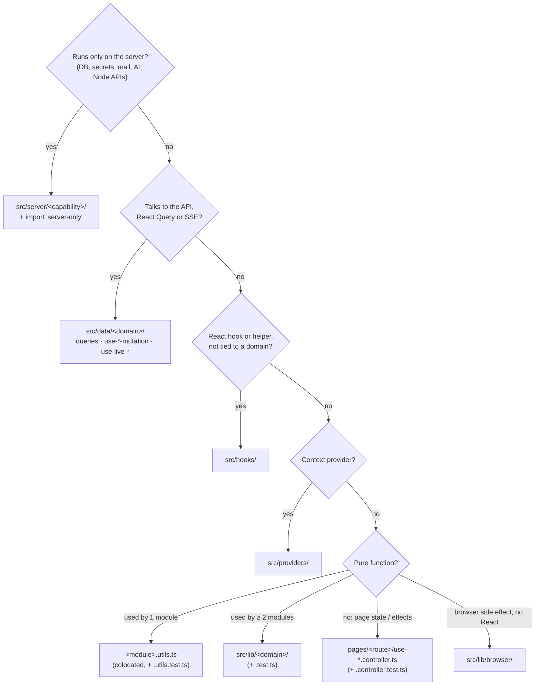
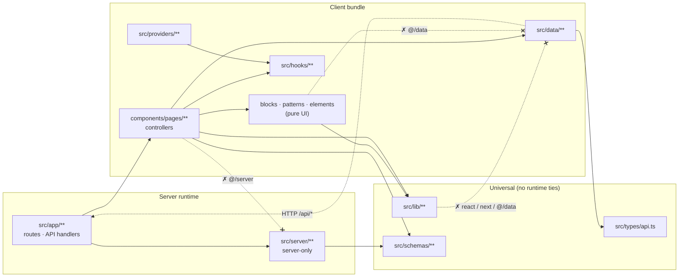
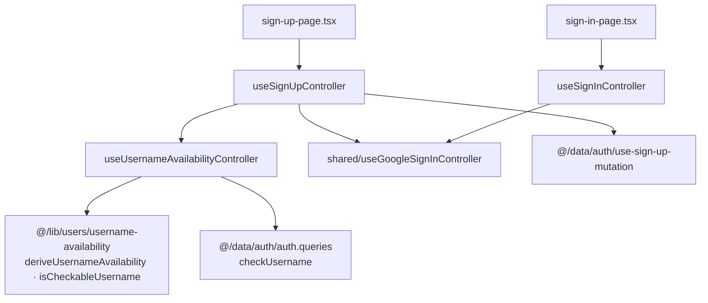

# Source Structure Guide for Agents (ADR 0018 / ADR 0019)

Read this before you create, move or rename anything under `src/` outside `src/components/` (for components, read [component-architecture.md](component-architecture.md)). It answers three questions: **where does this file go**, **what may it import**, and **what test must it have**.

Decisions and rationale: [ADR 0018](../adr/0018-source-structure-server-data-lib-utils-controllers-tests.md) (structure) and [ADR 0019](../adr/0019-controller-test-harness-renderhook-msw-and-edge-mocking.md) (controller tests). Rule summary: [`.agents/rules/source-structure.md`](../../.agents/rules/source-structure.md).

---

## 1. The map

```
src/
├── app/                     # routes (thin pages) + API route handlers → may import @/server
├── components/              # elements → patterns → blocks → pages (ADR 0015)
│   └── pages/<route>/       # use-*.controller.ts (+ .test.ts), <route>.utils.ts (+ .test.ts)
├── content/                 # static app content (landing.ts: landing example copy)
├── data/                    # CLIENT data layer, imported only by page controllers
│   ├── api-client.ts        # openapi-fetch `api`, `clientFetch`, `ApiError`
│   ├── query-keys.ts        # every React Query key
│   ├── auth/                # auth.queries.ts, use-sign-up-mutation.ts, use-verify-code-mutation.ts
│   ├── optimistic-resource-mutation.ts  # useOptimisticResourceMutation: the factory for settings-like edits (ADR 0031)
│   ├── messages/            # messages.queries.ts (inbox · counts · publicAnswers), messages-cache.ts (optimistic helpers),
│   │                        #   fetch-all-messages.ts (export), use-{bulk-action,delete-message,delete-all-messages,
│   │                        #   reply-message,update-message,smart-reply}-mutation.ts,
│   │                        #   use-live-messages.ts (+ .utils.ts + .utils.test.ts)
│   ├── public/              # public.queries.ts (suggestions), use-send-message-mutation.ts
│   └── user/                # user.queries.ts, use-{accept-message,ama-suggestions,block-sender,change-username,
│                            #   delete-account,notification-settings,push-subscription,remove-push-subscription,
│                            #   update-preferences,update-profile}-mutation.ts,
│                            #   use-push-notification.ts (+ .utils.ts + .utils.test.ts)
├── generated/               # api-schema.d.ts (pnpm typegen, never edit)
├── hooks/                   # generic React hooks only: use-leave-guard (+ test), use-active-section, use-mobile,
│                            #   get-strict-context, use-auto-height, use-controlled-state, use-is-in-view
├── lib/                     # pure, framework-free helpers by domain (each + .test.ts)
│   ├── utils.ts             # cn()
│   ├── messages/            # inbox-filter.ts + inbox-cursor.ts (shared inbox contract: server, mocks, live cache),
│   │                        #   export.ts (buildMessagesCsv / Json / Export)
│   ├── users/               # username-availability.ts (sign-up + change username)
│   ├── theme/               # palette.ts (palette ids, storage key, parsing)
│   ├── format/              # relative-time.ts
│   └── browser/             # download.ts, resize-image.ts (browser side effects)
├── mock/                    # fixtures/, handlers/, noop.ts (tests & stories only)
├── providers/               # auth-provider (takes the server session), query-provider, theme-provider,
│                            #   palette-provider (+ test)
├── schemas/                 # universal Zod contracts (+ zod.ts OpenAPI-extended z, + tests)
├── server/                  # SERVER ONLY: every file starts with `import "server-only"`
│   ├── ai/                  # moderation.ts, quarantine-policy.ts, smart-reply.ts, ama-suggestions.ts (+ tests)
│   ├── db/                  # db-connect.ts
│   ├── email/               # mailer.ts, send-{verification,message-alert,daily-digest}-email.ts, email-result.ts
│   ├── messages/            # inbox-query.ts: MongoDB filter, page size, counts pipeline (+ test)
│   ├── models/              # user.model.ts, message.model.ts
│   ├── notifications/       # delivery-policy.ts, daily-digest.ts (+ tests), daily-digest-store.ts
│   ├── openapi/             # openapi.ts (registry → /api/openapi.json, typegen)
│   ├── push/                # web-push.ts: VAPID config, sendPushToUser, gone-pruning (+ test)
│   ├── realtime/            # event-bus.ts (SSE fan-out)
│   ├── security/            # security.ts (+ test)
│   └── users/               # user-dto.ts (+ test), public-profile.ts (getPublicProfile, React cache)
├── test/                    # setup.ts, msw-server.ts, server-only-stub.ts, test-utils.tsx
└── types/                   # api.ts (OpenAPI DTOs), next-auth.d.ts (identity-only session)
```

---

## 2. Where does it go?



| You're adding… | It goes in | Test |
| :--- | :--- | :--- |
| A Mongoose model or DB query helper | `src/server/models/` or `src/server/db/` | if it has logic |
| An email sender | `src/server/email/send-<what>-email.ts` returning `EmailResult` | if it has logic |
| A new API call (GET) | `src/data/<domain>/<domain>.queries.ts` (+ key in `query-keys.ts`) | via the controller test |
| A new API call (POST/PATCH/DELETE) | `src/data/<domain>/use-<action>-mutation.ts` (one per file) | via the controller test |
| A client response type | alias in `src/types/api.ts` (`XDto = Schemas["X"]`) | n/a (`tsc`) |
| Page state, handlers, toasts, redirects | `pages/<route>/use-<concern>.controller.ts` | `use-<concern>.controller.test.ts` |
| A hook shared by sibling pages | `pages/<group>/shared/use-<concern>.controller.ts` | `.controller.test.ts` |
| Filtering, parsing or mapping used by one module | `<module>.utils.ts` next to it | `<module>.utils.test.ts` |
| The same pure helper needed by a second module | move to `src/lib/<domain>/<name>.ts` | `<name>.test.ts` |
| A Zod schema (request, form, OpenAPI) | `src/schemas/<name>-schema.ts` | `<name>-schema.test.ts` |
| Landing or marketing copy and data | `src/content/` | n/a |
| Test or story data | `src/mock/fixtures/` + `src/mock/handlers/` | n/a |

---

## 3. What may it import? (lint-enforced)



| From | ✗ May not import | Biome message starts with |
| :--- | :--- | :--- |
| components (all tiers), `src/data`, `src/hooks`, `src/providers`, `src/content`, `src/mock`, `src/types`, `.storybook` | `@/server/**`, `server-only` | "Server-only code (@/server/**) is imported only by src/app/**" |
| elements, patterns, blocks | `@/data/**`, `@tanstack/react-query`, `next-auth/react`, `next/navigation` | "Business logic (queries, mutations, … in @/data) belongs in @/components/pages" |
| `src/lib/**` (non-test) | `react`, `react-dom`, `next/**`, `next-auth/**`, `@tanstack/**`, `@/data/**`, `@/components/**`, `@/server/**` | "src/lib is framework-free" |

Two more guards back this up:
- **Next.js build:** importing a `server-only` module into a client component fails `pnpm build`.
- **`tsc`:** Vitest aliases `server-only` to `src/test/server-only-stub.ts`, and `pnpm typegen` runs with `--conditions=react-server`, so neither breaks under plain Node.

---

## 4. Recipes

### 4.1 Extract pure logic from a controller
1. Move the pure function(s) to `pages/<route>/<route>.utils.ts`, with named exports and no React imports.
2. Add `<route>.utils.test.ts`, built from `src/mock/fixtures` where data is needed (e.g. `profile.utils.test.ts` asserts `buildProfilePatch` sends only the dirty fields, trimmed; `inbox.utils.test.ts` asserts `resolveModalMessage` falls back to the snapshot once a message is gone).
3. Import the utils into the controller and keep only wiring there (`handleSave` calls `buildProfilePatch(getValues(), dirtyFields)` and sends the result).

**Done when** the controller has no branching that could be tested without React.

### 4.2 Promote a util to `src/lib`
1. A second module needs it. Move it to `src/lib/<domain>/<name>.ts` and its test next to it.
2. If it mixes a pure builder with a browser effect, split them: the builder goes in `lib/<domain>/`, the effect in `lib/browser/` (`buildMessagesExport` + `downloadTextFile`).
3. Update both consumers and delete the old `.utils.ts`.

**Done when** `pnpm check` passes, meaning the lib file imports no framework.

### 4.3 Add an API call end-to-end
1. Schema → OpenAPI registry (`src/server/openapi/openapi.ts`) → `pnpm typegen` ([api-patterns.md](api-patterns.md)).
2. Add a DTO alias to `src/types/api.ts` if the UI needs the shape.
3. Add a query in `src/data/<domain>/<domain>.queries.ts`, or a mutation in a new `src/data/<domain>/use-<action>-mutation.ts`.
4. Add a typed MSW handler and scenario in `src/mock/handlers/<domain>.handlers.ts`.
5. Use it from a page controller and extend that controller's test (happy path + error scenario).

### 4.4 Add a server capability
1. Create `src/server/<capability>/<name>.ts`, starting with `import "server-only";`.
2. Import it only from `src/app/api/**` or other server modules.
3. Add `<name>.test.ts` if it has logic. It runs in the unit project through the stub alias.

### 4.5 Add or split a controller (and its test)
1. One hook per file: `use-<concern>.controller.ts`. If a hook is shared by sibling routes, put it in `pages/<group>/shared/`.
2. A controller may compose another (`useSignUpController` calls `useUsernameAvailabilityController(form)` and `useGoogleSignInController()`).
3. Write `use-<concern>.controller.test.ts` using the harness (section 5).



---

## 5. Controller test harness (ADR 0019)

```ts
import { act, waitFor } from "@testing-library/react";
import { toast } from "sonner";
import { scenarios } from "@/mock/handlers";
import { server } from "@/test/msw-server";
import { recordRequests, renderHookWithProviders } from "@/test/test-utils";

vi.mock("sonner", () => ({ toast: { success: vi.fn(), error: vi.fn() } }));

it("sends nothing when the only change is a blank AMA prompt", async () => {
  const requests = recordRequests();
  const { result } = renderHookWithProviders(() => useProfileController());

  act(() => result.current.setAmaPrompt("   "));
  await act(() => result.current.handleSave());

  expect(requests).not.toContain("PATCH /api/user/profile");
  expect(result.current.isDirty).toBe(false);
});
```

| Need | Use |
| :--- | :--- |
| Providers | `renderHookWithProviders(hook, { session?, queryClient? })`. The session defaults to `null`: no session fetch, no SSE. |
| A signed-in user | `{ session: sessionScenarios.authenticated }` |
| A server state | `server.use(...scenarios.<area>.<name>)`, e.g. `scenarios.inbox.error`, `scenarios.username.taken` |
| "Was the API called?" | `const requests = recordRequests()` → `expect(requests).toContain("POST /api/messages/bulk")` |
| "What did it send?" | A named listener `const capture = async ({ request }) => bodies.push(await request.clone().json())`, `server.events.on("request:start", capture)`, then `server.events.removeListener(...)` at the end. Assert the body when MSW is stateless and a refetch would return the old value. |
| URL view state | Assert `window.location.pathname + search` after the setter; reset with `window.history.replaceState(null, "", "/dashboard")` in `afterEach` (`use-inbox-filters.controller.test.ts`). A controller that needs no providers can use plain `renderHook`. |
| Debounces | Assert the immediate value, then `await waitFor(...)` on the debounced one (real timers; the repo uses no fake timers) |
| Router | `const { replace } = vi.hoisted(() => ({ replace: vi.fn() }))` + `vi.mock("next/navigation", () => ({ useRouter: () => ({ replace }) }))` |
| Toasts | `vi.mock("sonner", …)` |
| `signIn` | `vi.mock("next-auth/react", () => ({ signIn: vi.fn() }))` (no `renderHookWithProviders`, use plain `renderHook`) |
| Downloads | `vi.mock("@/lib/browser/download", () => ({ downloadTextFile: vi.fn() }))` |
| Never | mocking `@/data/**`, or hitting the real network |

---

## 6. Checklist before you finish

- [ ] The file is where the flowchart (section 2) puts it, and it is named `use-*.controller.ts`, `use-*-mutation.ts`, `<domain>.queries.ts` or `<module>.utils.ts`.
- [ ] New server files start with `import "server-only"`.
- [ ] Every new `*.utils.ts`, lib/server module with logic and controller has a colocated test; there are no `__tests__/` folders.
- [ ] Client code uses `@/types/api` DTOs, never `@/server/models`.
- [ ] `pnpm check && pnpm exec tsc --noEmit && pnpm test:all && pnpm build && pnpm docs:registry:check` all pass.
