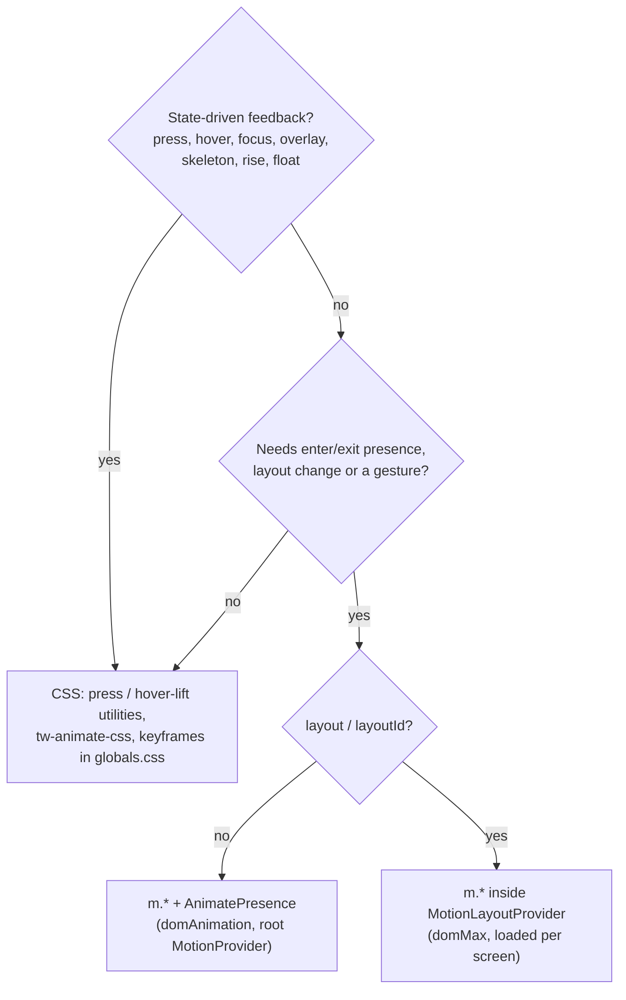

# Motion Guide

How GhostMsg animates, and the budget it must stay inside. Decisions: [ADR 0035](../adr/0035-css-first-motion-lazymotion-and-lazy-overlays.md). Tokens and keyframes: [Design System §5](../reference/design-system.md). Read this before adding any animation.

## 1. Pick the engine

## 2. Rules

- **Interaction feedback is CSS.** Use `press` (scale 0.97 on `:active`) on buttons, toggles and chips; add `press-deep` (0.92) on icon-only controls; `hover-lift` on desktop cards. They animate colour, `scale` and `translate` only and are skipped under `prefers-reduced-motion`. Never `transition-all`.
- **`m.*`, never `motion.*`.** Import minimal components from `motion/react-m` (`import { div as MotionDiv } from "motion/react-m"`). `MotionProvider` is `strict`, so a full `motion.*` component throws in dev. Hooks and `AnimatePresence` still come from `motion/react`.
- **Layout animation needs `MotionLayoutProvider`.** `layout` and `layoutId` only work below it (it loads `domMax`). Mount it in the screen that uses them (the dashboard shell), never at the root.
- **List presence** uses `PresenceList` / `PresenceItem` (`elements/effects/presence-list.tsx`): fade-rise in with a capped stagger, fade-shrink out, siblings re-flow (needs `MotionLayoutProvider`).
- **Presets** live in `src/lib/motion.ts` (`pillDrop`, `shake`, `layoutIds`, plus the duration/ease/spring/transition tokens). Add one only when two call sites need it.
- **Dashboard motion is restrained**: 120–200 ms, ease-out, no bounce, hard cap 300 ms. Springs and bursts only at a *Delight moment* (landing hero, sent screen, verified mark, first-run empty inbox).
- **Animate `transform` and `opacity` only.** No `width`/`height`/`top`/`left` animation (the Undo countdown bar is the one existing exception). No `will-change` unless a trace shows it helps.
- **Cap staggers at 8 items**; the rest appear instantly.
- **Scroll reveal is CSS**: add `reveal` to a below-the-fold section. It uses `animation-timeline: view()`, so there is no JS and nothing is hidden before hydration. Never put it on the LCP element.
- **Success marks are CSS**: `animate-pop` (overshoot) for the sent and verified marks.
- **Route enter** is `RouteTransition` (`animate-rise`) from a `template.tsx`; it plays once per navigation.
- **Entry animations and tests**: an `m.*` item sits at its `initial` state for one frame after mount, so story assertions on animated content should use `waitFor(() => expect(el).toBeVisible())`.
- **Lazy chunks** (`next/dynamic`) wrap hoisted modals, the command palette, the carousel and heavy effects, in the pages tier, prefetched on hover, focus or idle.

## 3. Motion budget

Measured with `pnpm analyze` (First Load JS per route). Rules: landing must not grow; dashboard may grow by about 5 KB gzipped.

| Route | Baseline (2.4.1) | After Phase 0 |
| :--- | ---: | ---: |
| `/` | 145 kB | 145 kB |
| `/dashboard` | 290 kB | 300 kB (over the 5 kB budget, see ADR 0035) |
| `/sign-in` | 202 kB | 203 kB |
| `/sign-up` | 274 kB | 274 kB |
| `/u/[username]` | 264 kB | 264 kB |
| `/verify/[username]` | 320 kB | 301 kB |

Rule of thumb from the probe: the minimal `m` core is about 7 kB gzipped, `AnimatePresence` about 2 kB, `LazyMotion` about 1 kB, the full `motion` API about 40 kB. A route that has none of these pays ~10 kB the first time it needs presence, so prefer CSS (`animate-pop`, `animate-rise`, `reveal`, `press`) on routes that don't already carry `m`.

## 4. Testing

Story tests set `MotionGlobalConfig.skipAnimations` and zero CSS durations (`.storybook/preview.tsx`), so assert end states, not frames. Every animated element gets a "Motion" story for review in interactive Storybook.

[Back to the guides index](README.md)
